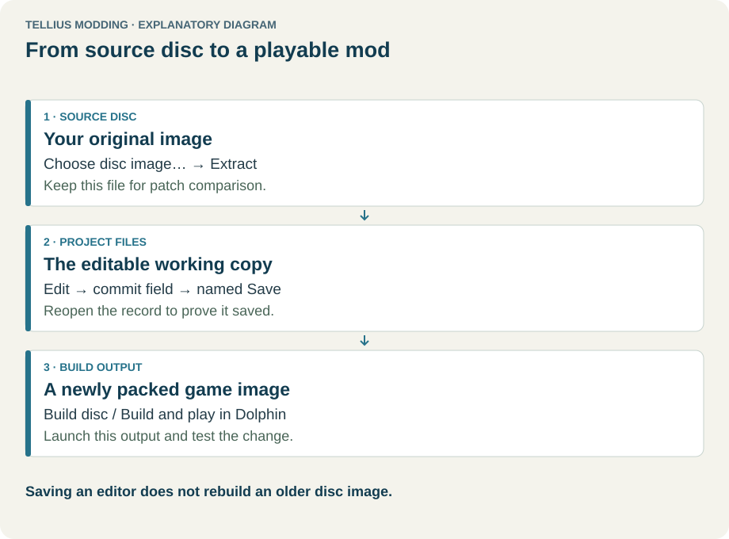
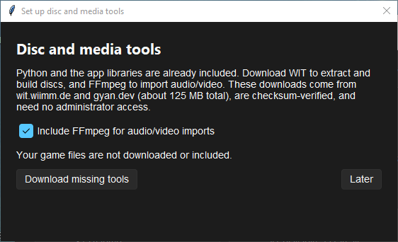
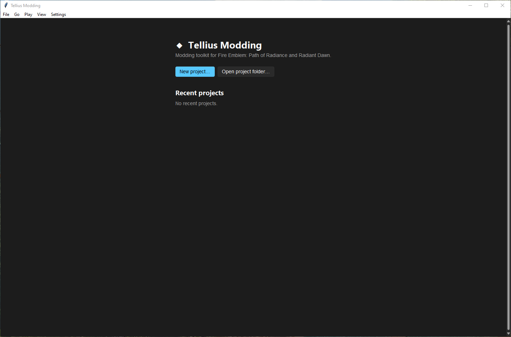
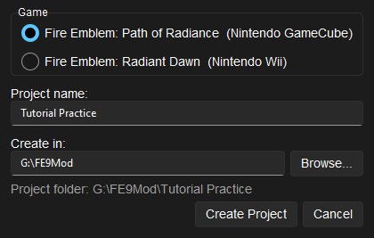
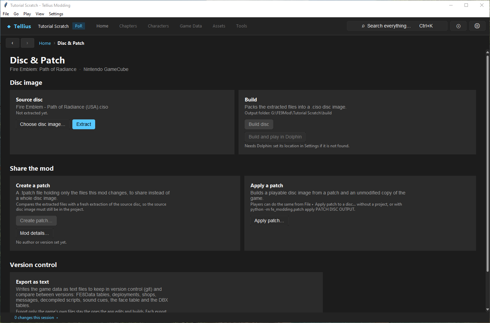
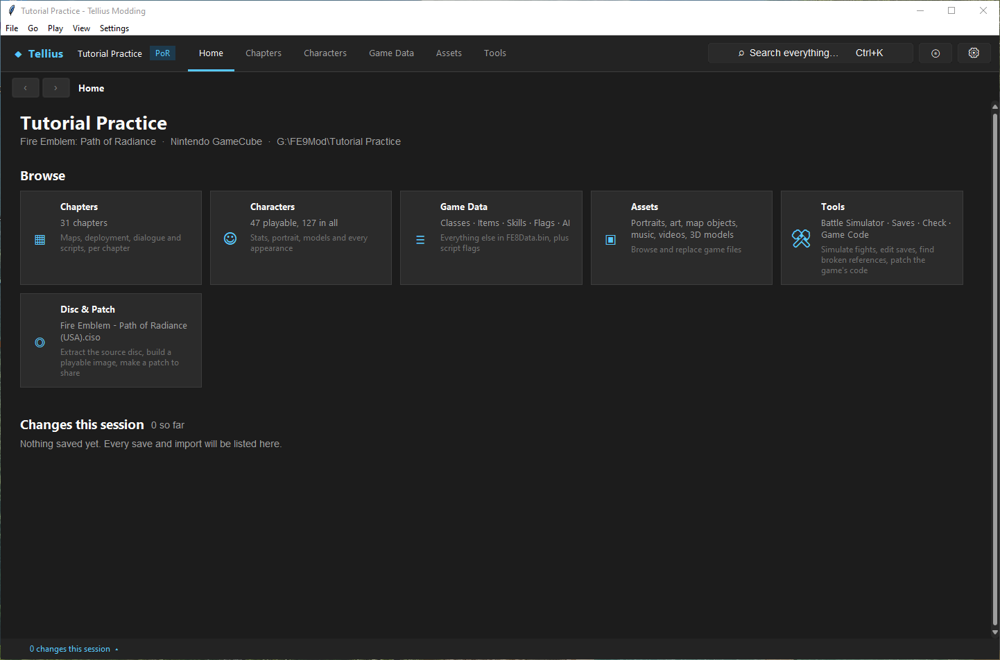

# Install the app and create a project

**Route:** Launcher → **New project…** → Disc & Patch → **Choose disc image…** → **Extract**

## What you will make

You will install the app, create a practice project called *Tutorial Practice*, give it your copy of *Path of Radiance*, and extract the game into it. At the end the workspace shows all six sections (Chapters, Characters, Game Data, Assets, Tools, Disc & Patch), and you know which folder holds what, so you can always go back to a clean state.

## Before you begin

- A disc image of *Path of Radiance* you own, as `.iso`, `.gcm`, `.ciso`, `.wdf`, `.wia` or `.rvz` (an `.rvz` is converted with DolphinTool first). Any region works: US, PAL or Japanese.
- About 3 GB free per project: a copy of the disc (about 1.5 GB) plus the extracted files (about 1.5 GB), and room for builds later.
- A parent folder for your projects, outside the app's folder and outside the folder of your disc images, for example `G:\FE9Mod`.

Download the Windows archive from the [release page](https://github.com/klg-tellius/TelliusModding/releases/latest) and extract the whole ZIP. `TelliusModding.exe` needs the `_internal` folder next to it; moving only the `.exe` breaks the installation.

## How the editor fits together

<!-- diagram project -->
<figure class="tutorial-figure" markdown="1">

<figcaption>Concept diagram, not an app screenshot. Source disc, project files and build output: extract once, save edits in the project, build a new image to test. Select the image to open it at full size.</figcaption>
</figure>

A project is one folder:

| Folder | What it holds |
| --- | --- |
| `project.json` | The project's name, game, mod details and the name of its source disc |
| `source/` | A copy of your disc image, made by **Choose disc image…**. Your original image is never touched |
| `extracted/` | The game's files, unpacked by **Extract**. Every editor reads and writes here |
| `originals/` | The first copy of every extracted file an editor replaced, for **Restore original** |
| `build/` | The disc images and patches you make |

Two external tools do the disc work: **WIT** extracts and packs disc images, and **FFmpeg** (optional) converts audio and video for imports. The app downloads them on request; they are not part of the game.

Until a project is extracted, only Home and Disc & Patch open: every other page is built from the extracted files.

## Guided walkthrough

### 1. Install the tools

<!-- screenshot 01-d-tools.png -->
<figure class="tutorial-figure" markdown="1">

<figcaption markdown="span">**Settings › Disc and media tools…** (offered at first start when WIT is missing): **Download missing tools** fetches WIT, which extracts and builds discs, and, with **Include FFmpeg for audio/video imports**, FFmpeg. Your game files are not downloaded or included.</figcaption>
</figure>

Start `TelliusModding.exe`. On the first start without WIT, the **Disc and media tools** window opens (later: **Settings › Disc and media tools…**). Keep **Include FFmpeg for audio/video imports** ticked if you will replace music or videos, and press **Download missing tools** (about 125 MB, from wit.wiimm.de and gyan.dev, checksum-verified, no administrator rights needed). Wait for *Tools are ready* and press **Close**.

### 2. Create the project

<!-- screenshot 01-launcher.png -->
<figure class="tutorial-figure" markdown="1">

<figcaption markdown="span">The launcher when no project is open: **New project…** creates one, **Open project folder…** opens an existing one, and **Recent projects** lists the last ones opened.</figcaption>
</figure>

The launcher shows **New project…**, **Open project folder…** and **Recent projects**. Press **New project…**.

<!-- screenshot 01-a-setup.png -->
<figure class="tutorial-figure" markdown="1">

<figcaption markdown="span">**New Project** with Path of Radiance selected, the name *Tutorial Practice* and the parent folder. The preview line shows the folder the app will create.</figcaption>
</figure>

1. Keep **Fire Emblem: Path of Radiance (Nintendo GameCube)** selected.
2. **Project name**: `Tutorial Practice`.
3. **Create in**: your projects folder (**Browse…** to pick it), here `G:\FE9Mod`.
4. Read the line under it, *Project folder: G:\FE9Mod\Tutorial Practice*: the folder the app will create. Characters a folder name cannot hold are removed from the name.
5. Press **Create Project**. The workspace opens on Home, with only **Disc & Patch** available.

### 3. Give it the disc

<!-- screenshot 01-c-extract.png -->
<figure class="tutorial-figure" markdown="1">

<figcaption markdown="span">**Disc & Patch** after **Choose disc image…**: the image is copied into the project's `source` folder and named on the **Source disc** card, *Not extracted yet*. **Extract** unpacks it; until then only Home and Disc & Patch open.</figcaption>
</figure>

1. Open **Disc & Patch** (the Home card, or the disc button at the top right).
2. Press **Choose disc image…** and pick your image. The app copies it into the project's `source` folder; the **Source disc** card names it and says *Not extracted yet*. If the image's disc ID is not *Path of Radiance*, a *Wrong game?* warning says so.
3. Press **Extract**. The status bar shows *Extracting …* for a minute or two; do not close the app.

### 4. Check the result

<!-- screenshot 01-b-result.png -->
<figure class="tutorial-figure" markdown="1">

<figcaption markdown="span">Home of the extracted project: its name, game, platform and folder, the six section cards (Chapters lists 31 chapters, Characters 47 playable of 127) and **Changes this session**.</figcaption>
</figure>

Home now shows the project's name, game, platform and folder, and the six section cards: **Chapters** (31 chapters on a US disc), **Characters** (47 playable, 127 in all), **Game Data**, **Assets**, **Tools** and **Disc & Patch**. Every section is also in the top bar.

Before editing anything, run **Tools → Check → Run check** and note the result: an unmodified disc gives *0 errors, 4 warnings* ([Check a project and fix problems](05-check-project.md)). Then copy the whole project folder somewhere safe: it is your clean baseline.

## Understand every choice

| Control | Where | Meaning | How to choose |
| --- | --- | --- | --- |
| **Download missing tools** | Disc and media tools | Downloads WIT, and FFmpeg if ticked | Once per installation |
| **Include FFmpeg for audio/video imports** | Disc and media tools | Also downloads FFmpeg | Tick if you will import music, sound or video |
| **Later** / **Close** | Disc and media tools | Closes without (more) downloads | Without WIT you cannot extract or build |
| **New project…** | Launcher (also **File › New Project...**) | Opens **New Project** | |
| **Open project folder…** | Launcher (also **File › Open Project...**) | Opens an existing project's folder | Pick the folder that holds `project.json` |
| **Recent projects** | Launcher | Projects opened before; click one to open it | |
| Game | New Project | Path of Radiance or Radiant Dawn: decides how every file is read | The game of your disc; it cannot be changed later |
| **Project name** | New Project | The project's name, also used for the folder and the built image's file name | Unique and descriptive |
| **Create in** / **Browse…** | New Project | The parent folder; the project gets its own folder inside | A writable local folder that is backed up |
| *Project folder:* | New Project | The folder that will be created | Must not exist yet, or be empty |
| **Choose disc image…** | Disc & Patch › Source disc | Copies an image into `source/` and records it | Your clean disc. Keep it: patches are made by comparing with it |
| **Extract** | Disc & Patch › Source disc | Unpacks the source disc into `extracted/` | Once, at the start |
| **Re-extract** | Disc & Patch › Source disc (after extraction) | Unpacks the disc again over `extracted/`, after a warning | Only to throw away every edit and start over |

## Things to try next

1. **A second practice project.** Create *Tutorial Scratch* next to it for experiments you expect to throw away, so *Tutorial Practice* stays usable.
2. **Recent projects.** Close the project with **File › Close Project** and reopen it from **Recent projects**.
3. **Another region.** Create a project from a PAL or Japanese disc and compare the chapter titles on Home.

## Interactions and precedence

- The project uses its own copy in `source/`. Moving or deleting your original image afterwards does not matter; deleting `source/` does (patches need it).
- **Re-extract** overwrites `extracted/` with the disc's files. Edits made since are lost, and `originals/` still holds the copies of the first versions.
- The game chosen in **New Project** decides every editor's file formats. A Radiant Dawn disc in a Path of Radiance project gives a *Wrong game?* warning at **Choose disc image…** and after **Extract**.
- Pages are built from the extracted files once they exist; until then the top bar sections are disabled.

## Test matrix

| Case | Setup | Expected result |
| --- | --- | --- |
| Baseline | New project, nothing chosen | Home shows only **Disc & Patch**; the message asks you to choose and extract the disc |
| Intended change | Choose the disc, **Extract** | All six sections open; Check gives *0 errors, 4 warnings* |
| Boundary | **Create in** a folder that already holds a non-empty *Tutorial Practice* | Refused: *already exists and is not empty* |
| Likely failure | Image of another game | *Wrong game?* warning; create the project again with the right game |

## Troubleshooting

| Symptom | Likely cause | What to do |
| --- | --- | --- |
| The app does not start after being moved | `_internal` was left behind | Put `TelliusModding.exe` back next to `_internal` |
| **Extract** fails at once | WIT is missing | **Settings › Disc and media tools…**, then **Download missing tools** |
| *'.xyz' is not a format the bundled tool can read* | An unsupported image type | Convert it to `.iso` with Dolphin |
| Extraction stops part way | Not enough space, or the image is damaged | Free space on the project's drive; check the image in Dolphin |
| Only Home and Disc & Patch after extraction | Extraction did not finish | Read the status bar message; press **Extract** again |

Never press **Re-extract** to fix one broken file: it overwrites every edit and the evidence of what went wrong. Use the editor's **Restore original** instead ([Save changes and restore originals](03-saving-and-restoring.md)).

## Save, build, and revert

Nothing here needs saving: **Create Project** writes `project.json` and the folders, **Choose disc image…** copies the image, **Extract** writes `extracted/`. To revert to the start, copy your baseline folder back, or press **Re-extract**.

## Limits and confidence

- Project creation, folder naming, the source copy, extraction and the wrong-game check are source-reviewed, and this walkthrough was run in the app on a US disc (app-tested).
- The app reads and builds the disc's files; it does not give you the right to share them. Share patches, not disc images ([Package and share a mod](61-share-a-patch.md)).

## Related tutorials and references

- Next: [Tour the workspace](02-workspace-tour.md), [Save changes and restore originals](03-saving-and-restoring.md), [Set up Dolphin and build the game](04-dolphin-setup.md)
- Reference: [Disc Layout](../meta/disc-layout.md), [GameCube Disc & FST](../formats/iso-fst.md)

---

[All tutorials](index.md) · [Next: Tour the workspace →](02-workspace-tour.md)
