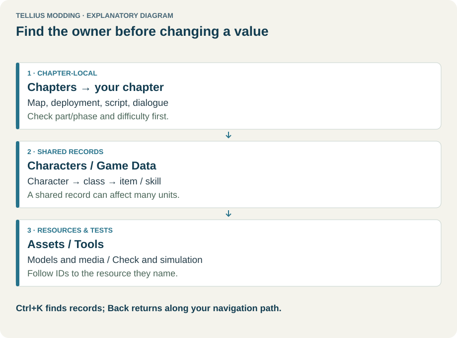
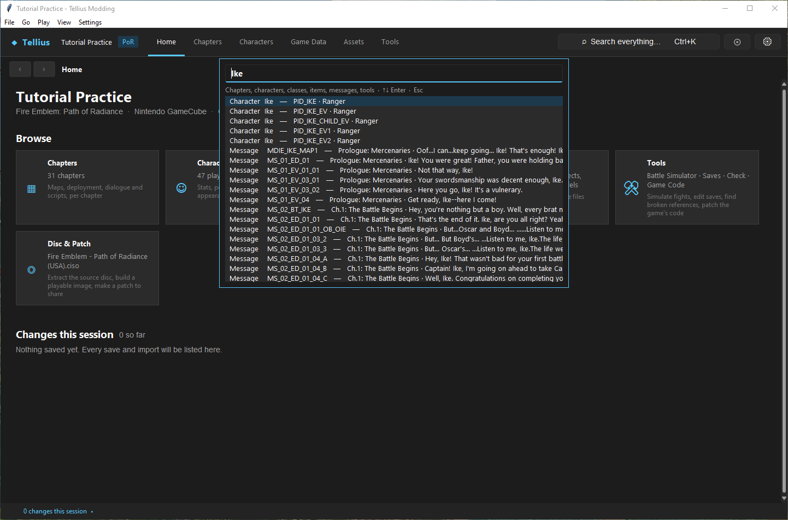
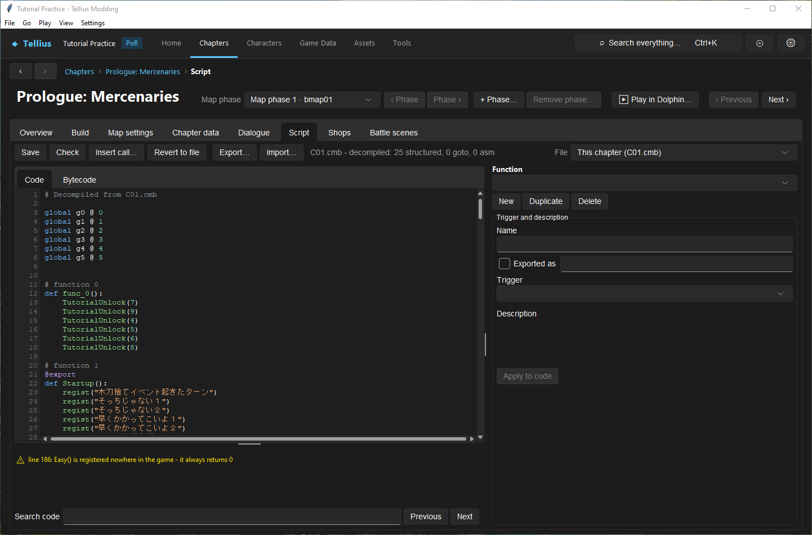
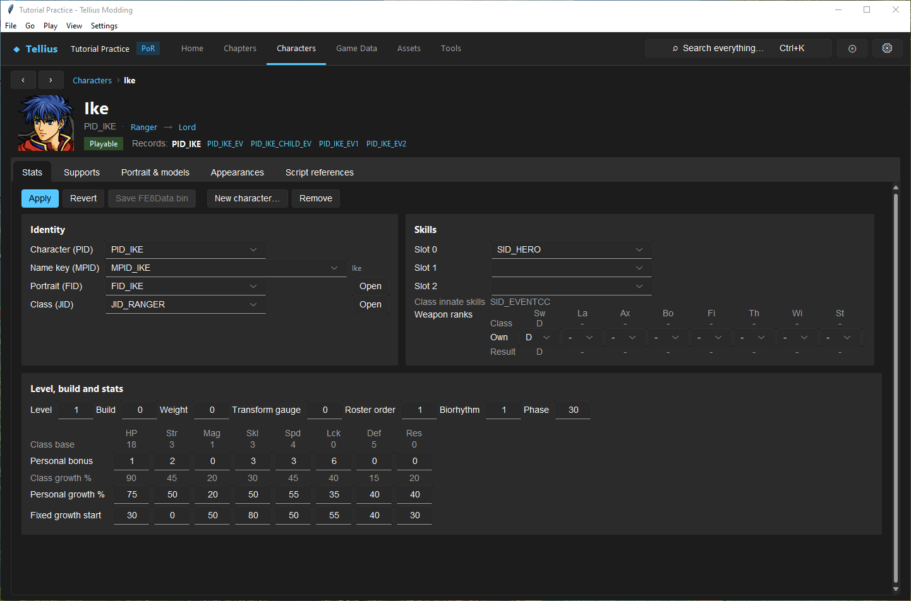

# Tour the workspace

**Route:** any page of an extracted project

## What you will make

You will learn the parts of the workspace by using them: find Ike with the search box, open his record, jump to a chapter's script, come back with the history, and read what the status bar says about unsaved work. At the end you can reach any record in a few keystrokes and you know where the app tells you what is unsaved and what was changed.

## Before you begin

Open the practice project from [Install the app and create a project](01-install-create-project.md). Change nothing in this lesson.

## How the editor fits together

<!-- diagram workspace -->
<figure class="tutorial-figure" markdown="1">

<figcaption>Concept diagram, not an app screenshot. Chapter-local resources, shared records, and assets and tools: find the owner before changing a value. Select the image to open it at full size.</figcaption>
</figure>

The window has five bands, from top to bottom:

1. **The menu bar**: **File**, **Go**, **Play**, **View**, **Settings**.
2. **The top bar**: the project's name and game (*Tutorial Practice · PoR*), the six sections (**Home**, **Chapters**, **Characters**, **Game Data**, **Assets**, **Tools**), **Search everything… Ctrl+K**, the disc button (Disc & Patch) and the settings button.
3. **The breadcrumb bar**: **‹** back, **›** forward, and where you are (*Chapters › Prologue: Mercenaries › Script*).
4. **The page**.
5. **The status bar**: on the left the unsaved editors (*● 1 unsaved: FE8Data.bin*), then *N changes this session ▴*; on the right the last status message (*Built …*, *Extracting …*).

Each kind of page exists once and keeps its state while you go elsewhere: a half-edited form is still there when you come back, and its edits count as unsaved until you save them. Only a page that loads other data asks first: opening another chapter while the current one has unsaved edits asks whether to discard them.

Records point to each other by ID: a character names its class (`JID_`), its portrait (`FID_`), its name text (`MPID_`); deployments and scripts name characters (`PID_`) and items (`IID_`). The app shows those IDs next to names and turns them into links, so you can follow a reference to the page that owns it.

## Guided walkthrough

### 1. Read the window

<!-- screenshot 02-a-setup.png -->
<figure class="tutorial-figure" markdown="1">

<figcaption markdown="span">The workspace: section bar along the top, breadcrumbs with Back/Forward under it, the page, and the status bar with the unsaved count and **Changes this session**.</figcaption>
</figure>

On Home, read the five bands. The section tab of the page you are on is underlined in the top bar.

### 2. Find a record

<!-- screenshot 02-b-result.png -->
<figure class="tutorial-figure" markdown="1">

<figcaption markdown="span">**Ctrl+K** search for *Ike*: one list finds characters, classes, items, chapters and messages. Enter opens the selected result.</figcaption>
</figure>

1. Press **Ctrl+K** (or click **Search everything…**) and type `Ike`.
2. The list shows matches of every kind: *Character* (`PID_IKE · Ranger`, and his event copies `PID_IKE_EV`…), then *Message* rows from the chapters' dialogue. Other kinds appear for other words: *Go to* (a section), *Tool*, *Chapter*, *Class*, *Item*, *Skill*.
3. Use ↑/↓ and press Enter on *Character Ike — PID_IKE · Ranger*. The character page opens on **Stats**. Esc closes the search without going anywhere.

### 3. Follow the history

<!-- screenshot 02-c-crumbs.png -->
<figure class="tutorial-figure" markdown="1">

<figcaption markdown="span">The breadcrumb bar after Characters → Ike → Prologue: **‹** goes back to Ike (Alt+Left), **›** forward again (Alt+Right), and each crumb (*Chapters › Prologue: Mercenaries › Script*) is a link. The section tab in the top bar shows where you are.</figcaption>
</figure>

1. Open **Chapters**, click **Prologue: Mercenaries**, then its **Script** tab. The breadcrumbs read *Chapters › Prologue: Mercenaries › Script*; each crumb but the last is a link.
2. Press **‹** (or Alt+Left).

<!-- screenshot 02-d-back.png -->
<figure class="tutorial-figure" markdown="1">

<figcaption markdown="span">**‹** returned to Ike's Stats tab, as it was: pages keep their state while you move around, and unsaved edits stay in their editor.</figcaption>
</figure>

You are back on Ike's **Stats**, as you left it. **›** (Alt+Right) goes forward again. Home lists the last places you visited under **Jump back in**.

### 4. Read the status bar

Click *0 changes this session ▴* at the bottom left: the **Changes this session** drawer opens above the status bar, empty for now ([Save changes and restore originals](03-saving-and-restoring.md) fills it). **Hide** closes it. When an editor holds unsaved edits, the left of the status bar names it.

## Understand every control

### Menus

| Menu | Items |
| --- | --- |
| **File** | **New Project...**, **Open Project...**, **Close Project** (offers to save unsaved editors), **Apply patch to a disc...**, **Exit** |
| **Go** | **Home**, **Chapters**, **Characters**, **Game Data**, **Assets**, **Tools**, **Search...** (Ctrl+K), **Back** (Alt+Left), **Forward** (Alt+Right) |
| **Play** | **Play chapter in Dolphin...** (F5: the open chapter, or a chapter you pick), **Build and play disc in Dolphin** (Ctrl+F5) |
| **View** | **Changes this session** |
| **Settings** | **Preferences...** (theme, Dolphin and Blender locations), **Disc and media tools...** (WIT and FFmpeg) |

### Top bar and breadcrumbs

| Control | What it does |
| --- | --- |
| Project and game | The open project's name and game (PoR or RD). |
| **Home**, **Chapters**, **Characters**, **Game Data**, **Assets**, **Tools** | The six sections. Disabled until the project is extracted (except Home). |
| **Search everything… Ctrl+K** | The search palette: sections, tools, chapters, characters, classes, items, skills and every chapter message, matched on every word you type. ↑/↓ move, Enter opens, Esc closes. In a text box, Ctrl+K belongs to the text box. |
| Disc button | Opens **Disc & Patch**. |
| Settings button | Opens **Preferences** (see [Set up Dolphin and build the game](04-dolphin-setup.md)). |
| **‹** / **›** | Back and forward through the pages you visited (Alt+Left, Alt+Right), up to 50 steps. |
| Crumbs | Where you are; each crumb but the last opens its page. |

### Home

| Part | What it shows |
| --- | --- |
| Title line | Project name, game, platform and folder |
| **Browse** | One card per section, with counts (chapters, playable characters) |
| **Jump back in** | Up to eight pages you visited, latest first |
| **Changes this session** | The last ten changes; **Show all changes** opens the drawer |

### Status bar

| Part | What it shows |
| --- | --- |
| *● N unsaved: …* | Editors with edits not yet saved, by name |
| *N changes this session ▴* | Click to open or close the **Changes this session** drawer |
| Right side | The last status message, and *…* while a task (extract, build, patch) runs |

## Things to try next

1. **Search by ID.** Type `IID_IRONAXE`: the item opens in **Game Data › Items**.
2. **Search a line of dialogue.** Type three words of a line you remember: its *Message* row opens the chapter's **Dialogue** tab on that message.
3. **Follow a link.** On Ike's **Stats**, press **Open** next to his class: **Game Data › Classes** opens on `JID_RANGER`.
4. **Find where something is used.** Open Ike's **Appearances** and **Script references** tabs.

## Interactions and precedence

- The search lists what the project index knows. It is built when the project opens and after big changes; right after you add a record, the index may not have it yet.
- A page keeps its edits while you are away; closing the project or the app asks about every unsaved editor at once.
- Ctrl+K inside a text editor (Script, Dialogue) works on the text; click outside it first.

## Test matrix

| Case | Setup | Expected result |
| --- | --- | --- |
| Baseline | Home of the practice project | Six sections enabled; *0 changes this session* |
| Intended change | Ctrl+K, `Ike`, Enter | Ike's page, **Stats** tab |
| Boundary | **‹** from the Prologue's Script tab | Back on Ike's Stats, as left |
| Likely failure | Ctrl+K while typing in the Script editor | Nothing opens: the key is the editor's |

## Troubleshooting

| Symptom | Likely cause | What to do |
| --- | --- | --- |
| The sections are disabled | The project is not extracted | **Disc & Patch › Extract** |
| The search shows nothing for a new record | The index has not been rebuilt | Wait a moment, or reopen the project |
| **‹** is disabled | No earlier page in this session | Use the sections or the search |
| *Indexing…* on Chapters or Characters | The index is still being built | Wait a few seconds |

## Save, build, and revert

Navigation saves nothing and changes nothing. The status bar tells you what is unsaved; the next lesson explains which button saves what.

## Limits and confidence

The window layout, menus, shortcuts, search kinds and history are source-reviewed, and the walkthrough was run in the app on the practice project (app-tested).

## Related tutorials and references

- Before: [Install the app and create a project](01-install-create-project.md)
- Next: [Save changes and restore originals](03-saving-and-restoring.md), [Remove records without corrupting saves](15-remove-records.md)

---

[← Previous: Install the app and create a project](01-install-create-project.md) · [All tutorials](index.md) · [Next: Save changes and restore originals →](03-saving-and-restoring.md)
