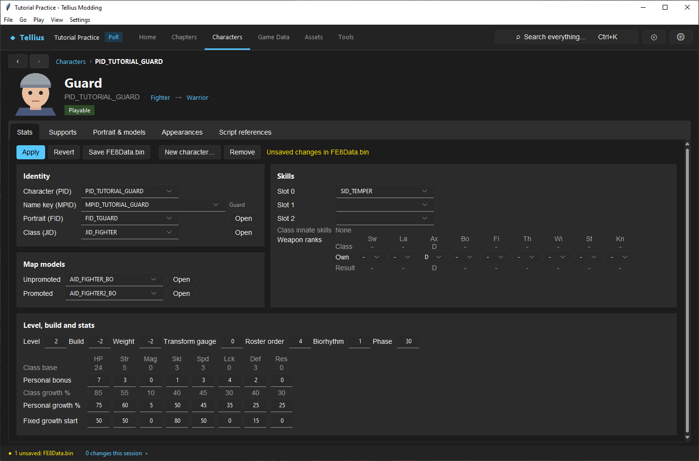
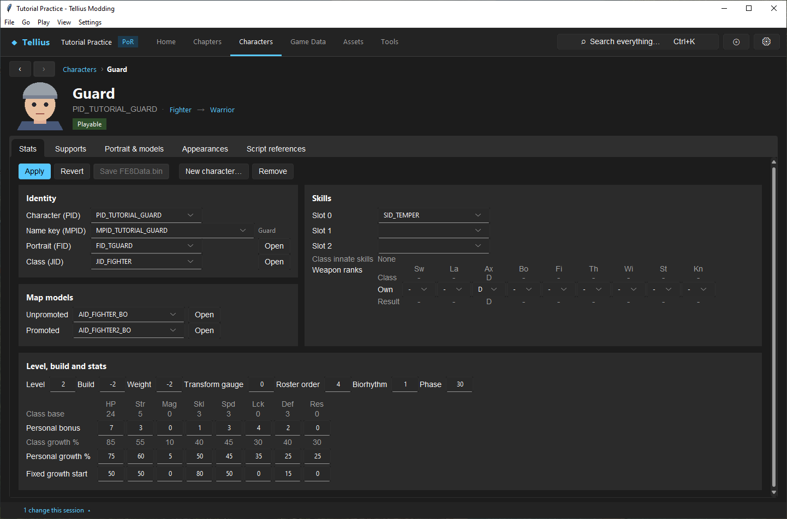
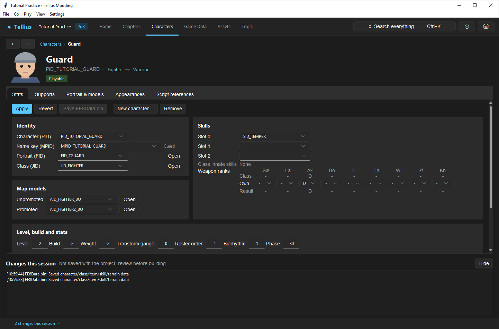

# Save changes and restore originals

**Route:** any editor's **Apply** / **Save** buttons; **Restore original** where an editor offers it

## What you will make

You will change one value of a character, watch it go through the three steps every edit takes (typed, applied, saved), prove it is in the file by leaving and reopening the record, read the change in **Changes this session**, and put the value back. At the end you know which button saves which file, and how to get back to the extracted original of any file.

## Before you begin

- Make the practice character `PID_TUTORIAL_GUARD` first ([Create a character](10-create-character.md)), or use any character you can change and change back.
- Copy the project folder before you start experimenting with saves. A copy is the only backup of everything at once.

## How the editor fits together

An edit goes through up to four steps:

1. **Typed**: the value is in a field.
2. **Applied**: **Apply** (in forms that have one) moves the form's values into the editor's copy of the file, in memory. Every page that shows the same file sees it at once. The status bar now names the file as unsaved.
3. **Saved**: the editor's save button writes the file into the project's `output/` folder. The game's own file in the shared vanilla files is never written, so it stays the version from the disc however many times you save.
4. **Built**: **Build disc** packs the vanilla files with `output/` laid over them into a new image. A saved change is not in an image built before it.

Many pages share one file. The character, class, item, skill, terrain, general, support and chapter-data editors all edit one in-memory copy of `FE8Data.bin`: an applied edit on one of them is visible on the others, and one **Save FE8Data.bin** writes all of them.

## Guided walkthrough

### 1. Apply a change

<!-- screenshot 03-a-setup.png -->
<figure class="tutorial-figure" markdown="1">

<figcaption markdown="span">An applied but unsaved edit: the form says **Unsaved changes in FE8Data.bin**, **Save FE8Data.bin** is enabled, and the status bar names the unsaved file.</figcaption>
</figure>

1. Open `PID_TUTORIAL_GUARD` (Ctrl+K, `TUTORIAL_GUARD`) on its **Stats** tab.
2. Raise the **Str** value of **Personal bonus** by 1 (2 → 3).
3. Press **Apply**. The bar beside the buttons says *Unsaved changes in FE8Data.bin*, **Save FE8Data.bin** is enabled, and the status bar reads *● 1 unsaved: FE8Data.bin*.

Go to Home and come back: the value is still 3, because the page kept the in-memory copy. It is not in the file yet.

### 2. Save it and prove it

<!-- screenshot 03-b-result.png -->
<figure class="tutorial-figure" markdown="1">

<figcaption markdown="span">After saving, leaving and reopening the record, the Strength bonus is still raised and **Save FE8Data.bin** is disabled again: the file holds the value.</figcaption>
</figure>

1. Press **Save FE8Data.bin**. The warning disappears and the button is disabled again.
2. Close the project (**File › Close Project**), reopen it from **Recent projects**, and open the character again. **Str** is still 3: the file holds it.

### 3. Read the change log

<!-- screenshot 03-c-changes.png -->
<figure class="tutorial-figure" markdown="1">

<figcaption markdown="span">**Changes this session** (the counter at the bottom left, or **View › Changes this session**): every save, import and restore of the session with its time and owner. It is not saved with the project.</figcaption>
</figure>

Click *N changes this session ▴* at the bottom left. Each save, import and restore of the session is listed with its time and owner (*FE8Data.bin: Saved character/class/item/skill/terrain data*). The list is not saved with the project: it is a reminder of what to test before you build.

### 4. Put it back

Set **Str** back to 2, **Apply**, **Save FE8Data.bin**. For files that have a **Restore original** button (graphics, fonts, models, battle tables, cameras, DBX files), that button puts back the extracted original from `originals/` in one step; [Edit battle presentation](55-battle-presentation.md) does it on a battle model.

## Understand every control

| Control | Where | What it does |
| --- | --- | --- |
| **Apply** | Character Stats, and other forms with one | Moves the form's values into the editor's copy in memory |
| **Revert** | Character Stats | Reloads the form from the in-memory copy (drops what you typed, not what you applied) |
| **Discard unsaved edits** | Game Data | Drops every applied edit of `FE8Data.bin` since the last save |
| **Save …** | Each editor | Writes the editor's file (see the table below) |
| **Restore original** / **Restore original file** / **Restore original…** | Editors of files with a kept original | Copies the extracted original back over the file and drops the copy |
| *● N unsaved: …* | Status bar | Editors whose edits are not saved |
| *N changes this session ▴* / **View › Changes this session** | Status bar / menu | Opens the change log of the session |
| Save prompt | Closing the project, building, making a patch | Lists the unsaved editors; **Yes** saves them all and goes on, **No** goes on without them, **Cancel** goes back |

### Which save belongs to this change

| You changed… | It is in | Saved by |
| --- | --- | --- |
| A character, class, item, skill, terrain type, general constant, support, chapter record, battle scene, flag name | `FE8Data.bin` | **Save FE8Data.bin** (any page that shows it) |
| A map, a unit placement, a deployment section, a script zone | the chapter's map and deployment files | **Save Chapter** on the Build or Map settings tab |
| A chapter script | `Scripts/<name>.cmb` | **Save** on the Script tab |
| A message | `Mess/<name>.m` | **Save Chapter** on the Dialogue tab |
| A shop | `shop/` | **Save Shops** |
| An AI script | `cp_data.bin` | **Save AI data** |
| A portrait picture / face record | `Face/` | **Save pictures** / **Save face record** |
| An icon, a font, a texture archive | the graphic file | **Save** (and **Discard changes**) |
| A background | `s/` and `s/rect.bin` | **Save** / **Save Resource** |
| Sound Room, credits, in-game tutorials | their files | **Save Sound Room**, **Save credits**, **Save tutorials**, **Save tracks** |
| A DBX file | `zdbx.cmp` | **Save** on DBX Files |
| A battle weapon, scenery, unit parameter, camera | `zdbx.cmp` | written at once by **Apply** / **Apply script** / **Apply rig** |
| A model, an animation | the model's files | written at once by **Write files** in the import review |
| Music, sound effects, videos | their files | written at once by the import |
| A Game Code value | `sys/main.dol` | written at once by the field or checkbox |
| Story order, a new chapter or campaign | `sys/main.dol` and the chapter files | written at once by the dialog |

When one task touches several owners (a new character placed in a chapter with a line of dialogue), save each: **Save FE8Data.bin**, **Save Chapter** on Build, **Save Chapter** on Dialogue.

## Things to try next

1. **Two pages, one file.** Apply a change on a class in **Game Data › Classes**, then open a character of that class: its **Class base** row already shows it.
2. **Discard.** Apply a change, then **Discard unsaved edits** in Game Data, and check it is gone everywhere.
3. **Restore a graphic.** Replace one icon in **Assets › Icons**, **Save**, then **Restore original file**.
4. **Close with unsaved work.** Apply a change and close the project: the prompt lists `FE8Data.bin`; answer **Cancel**.

## Interactions and precedence

- On the character form, typed values are not applied until **Apply**; a value you typed but did not apply is lost when the form reloads. In Game Data there is no **Apply**: a field is applied when it loses focus (Tab, a click elsewhere, or a save).
- An applied, unsaved edit is used by the Battle Simulator and Play, but not by a build: building asks to save first.
- **Restore original** goes back to the file as extracted, not to your previous save: it deletes the mod's copy in `output/`, dropping every save of that file. **Re-extract** only remakes the vanilla files; `output/` stays.
- The build copies `FE8Data.bin` and a few other loose files into `system.cmp`, the archive the game really reads. Edit the loose file; the build does the rest.

## Test matrix

| State | Reopen the record | An old build | A new build |
| --- | --- | --- | --- |
| Typed, not applied | old value | old | old |
| Applied, not saved | new value until the project closes | old | asks to save first |
| Saved | new value | old | new value |
| Restored original | the disc's value | unchanged | the disc's value |

## Troubleshooting

| Symptom | Likely cause | What to do |
| --- | --- | --- |
| A value goes back when you leave the page | It was typed but not applied | **Apply**, then save |
| A value is gone after reopening the project | The file was not saved | Save the owner; watch the status bar |
| The game still shows the old value | The image was built before the save, or an old image was launched | Build again and open the new image |
| No **Restore original** button | That editor has no restore, or the file was never replaced | Copy the file back from your project copy |

## Save, build, and revert

This whole lesson is about it: apply, save the owner, build to test, **Restore original** or copy back your project copy to revert.

## Limits and confidence

- The apply/save/originals behaviour and the save prompts are source-reviewed; the walkthrough was run in the app on the practice project (app-tested).
- The vanilla file is the only earlier version the app keeps. It is not a history: keep project copies or version control for that (`output/` holds only the changed files, so it is small to copy; **Disc & Patch › Export as text…** writes the data as text for git).

## Related tutorials and references

- Before: [Tour the workspace](02-workspace-tour.md)
- Next: [Set up Dolphin and build the game](04-dolphin-setup.md)
- Reference: [Disc Layout](../meta/disc-layout.md)

---

[← Previous: Tour the workspace](02-workspace-tour.md) · [All tutorials](index.md) · [Next: Set up Dolphin and build the game →](04-dolphin-setup.md)
