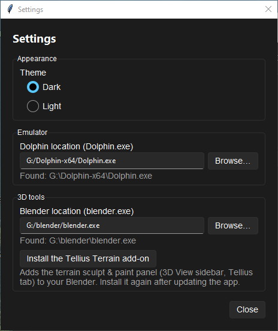
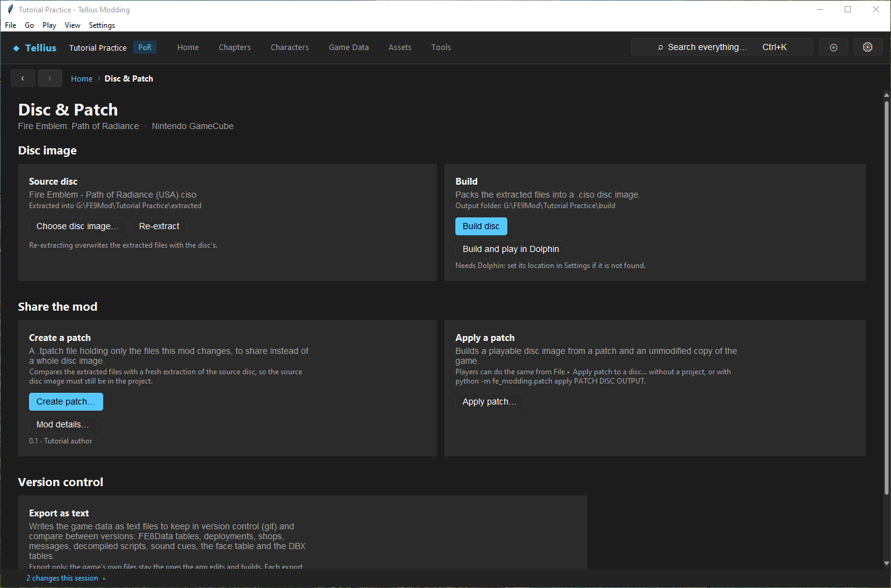
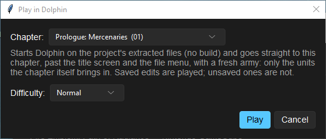

# Set up Dolphin and build the game

**Route:** Settings → **Preferences**; Disc & Patch → **Build disc** / **Build and play in Dolphin**; **Play › Play chapter in Dolphin…**

## What you will make

You will tell the app where Dolphin is, build the unmodified practice project into a disc image, and boot it, so you have a clean baseline before your first edit. You will also see the three ways to start the game from the app (the built image, a chapter jump, a save) and when to use each.

## Before you begin

- Install [Dolphin](https://dolphin-emu.org/download/) (the portable ZIP or the installer). Start it once on its own with your original disc to check that it runs the game.
- An extracted practice project ([Install the app and create a project](01-install-create-project.md)), unmodified, and about 1.5 GB free in its `build` folder.

## How the editor fits together

**Build disc** packs the project's `extracted/` folder into one image, `build/<project name>.ciso`. For Path of Radiance the app packs it itself (WIT is used for extraction and for Radiant Dawn). Before packing, it copies the loose files that the game reads from its `system.cmp` archive into that archive (`FE8Data.bin`, `FE8Anim.bin`, `FE8Effect.bin`, `cp_data.bin`, `s/rect.bin`, `window/rectdesc.bin`, `Scripts/startup.cmb`, `Face/facedata.bin`, three window textures, `Mess/common.m` and four fonts), and makes any missing chapter name images. Every build overwrites the same file.

A GameCube disc holds 1,459,978,240 bytes. A bigger image still runs in Dolphin, and the build warns you, but it would not run on a console or in loaders that check the size.

There are three ways to start the game from the app, all through the Dolphin set in **Preferences** (started with `--exec <image> --batch`, so Dolphin closes with the game):

| Start | What runs | Use it for |
| --- | --- | --- |
| **Build and play in Dolphin** | A new build of the whole disc | The real test of a release |
| **Play chapter in Dolphin…** (F5, or **▶ Play in Dolphin…** on a chapter) | The extracted files, without a build, booted straight into one chapter on one difficulty, with a fresh army | Testing one chapter quickly |
| **Play in Dolphin…** on **Tools › Saves** | The extracted files with a copy of one save on memory card A | Testing a chapter with a real army ([Edit and test a save](59-save-editor.md)) |

All three ask about unsaved editors first: unsaved edits are not played.

## Guided walkthrough

### 1. Tell the app where Dolphin is

<!-- screenshot 04-a-setup.png -->
<figure class="tutorial-figure" markdown="1">

<figcaption markdown="span">**Settings › Preferences…**: **Dolphin location (Dolphin.exe)** is the emulator the app launches; Blender is optional and only used by the .blend model tools.</figcaption>
</figure>

Open **Settings › Preferences…** (or the settings button at the top right). Under **Emulator**, **Dolphin location (Dolphin.exe)** shows where the app found Dolphin (*Found: …*): your setting if you made one, else the usual install folders (`Program Files`, your local app data and user folders, in `Dolphin-x64`, `Dolphin` or `Dolphin Emulator`), else the system PATH. If it says nothing was found, press **Browse…** and choose `Dolphin.exe` itself.

### 2. Build the unmodified project

<!-- screenshot 04-c-build.png -->
<figure class="tutorial-figure" markdown="1">

<figcaption markdown="span">The **Build** card on Disc & Patch: **Build disc** packs the saved project files into a new image; **Build and play in Dolphin** also starts it.</figcaption>
</figure>

On **Disc & Patch**, the **Build** card shows the output folder (*Output folder: G:\FE9Mod\Tutorial Practice\build*). Press **Build disc**.

<!-- screenshot 04-b-result.png -->
<figure class="tutorial-figure" markdown="1">

<figcaption markdown="span">After **Build disc**: the status bar reads *Built* and the image path, the project's `build/Tutorial Practice.ciso`. Every build overwrites that file; open it in Dolphin, or use **Build and play in Dolphin**.</figcaption>
</figure>

The status bar shows *Building disc image …* for a minute or two, then *Built G:\FE9Mod\Tutorial Practice\build\Tutorial Practice.ciso*. No warning: the unmodified image fits a disc.

### 3. Boot it

1. Press **Build and play in Dolphin**. It builds again (with no edits, the same image) and starts Dolphin on it.
2. Reach the title screen, start a new game on Normal and play until you control Ike in the Prologue. This is your clean baseline: any problem you see from now on comes from an edit.
3. Close Dolphin.

### 4. Jump to a chapter

<!-- screenshot 04-d-play-chapter.png -->
<figure class="tutorial-figure" markdown="1">

<figcaption markdown="span">**Play › Play chapter in Dolphin…** (F5): pick a chapter and a **Difficulty**; Dolphin starts on the extracted files, without a build, straight in that chapter.</figcaption>
</figure>

Press **F5** (**Play › Play chapter in Dolphin…**) away from a chapter page. Pick **Chapter:** `Ch.1: The Battle Begins (02)` and **Difficulty:** `Normal`, then **Play**. Dolphin starts past the title screen and the file menu, straight in that chapter, with only the units the chapter brings in. No disc is built: this is the fastest check after an edit to one chapter.

## Understand every control

### Preferences

| Control | What it does | How to choose |
| --- | --- | --- |
| **Theme** **Dark** / **Light** | The app's colours | Either |
| **Dolphin location (Dolphin.exe)** / **Browse…** | The emulator the app starts; *Found:* shows the one it will use | `Dolphin.exe` itself, not a shortcut or folder |
| **Blender location (blender.exe)** / **Browse…** | Blender, for the `.blend` model tools ([Round-trip a model through Blender safely](51-blender-round-trip.md)) | Optional |
| **Install the Tellius Terrain add-on** | Installs the app's terrain sculpt and paint panel (3D View sidebar, *Tellius* tab) into that Blender; runs Blender in the background | After setting Blender, and again after updating the app |
| **Close** | Saves and closes | |

### Disc & Patch › Build

| Control | What it does |
| --- | --- |
| **Build disc** | Packs `extracted/` into `build/<project name>.ciso`, after offering to save unsaved editors. Overwrites the previous image. |
| **Build and play in Dolphin** (Ctrl+F5) | Builds, then starts Dolphin on the new image. Needs Dolphin to be found. |
| *Output folder* | Where the image goes (the project's `build` folder). |
| Size warning | Shown after a build when the image is bigger than a GameCube disc. |

### Play in Dolphin (chapter jump)

| Control | What it does |
| --- | --- |
| **Chapter:** | The chapter to boot into (only when opened away from a chapter page). |
| **Difficulty:** | Normal, Hard or Maniac; remembered for next time. |
| **Play** | Prepares the extracted files in `build/dolphin_run` and starts Dolphin. Saved edits are played; unsaved ones are not. |

## Things to try next

1. **A visible edit.** Change Ike's name text in a later lesson, build, and compare with the baseline in Dolphin.
2. **Chapter jump with an edit.** Move one enemy on Ch.1's Build tab, **Save Chapter**, then F5 on the chapter page: the enemy starts on its new tile, without a build.
3. **A size test.** Replace a video with a bigger file and build: the warning gives how many MiB too large the image is.

## Interactions and precedence

- A build includes only saved edits. The prompt before it offers to save everything first.
- The chapter jump and the save test run the extracted files directly, with a temporary boot patch; the built image does not include that patch.
- Dolphin's own settings (memory cards, save states, graphics) are Dolphin's. A save state taken on an older build can bring back old data: test from a fresh boot or a real save.
- `system.cmp` is rebuilt by each build from the loose files; edit the loose files, not the archive.

## Test matrix

| Case | Setup | Expected result |
| --- | --- | --- |
| Baseline | Unmodified project, **Build disc** | *Built …\\Tutorial Practice.ciso*, no warning; boots to the title screen |
| Intended change | **Build and play in Dolphin** | Dolphin starts the new image |
| Boundary | F5 on Ch.1, Normal | Dolphin boots straight into Ch.1 |
| Likely failure | Dolphin not found | *Dolphin not found: set Dolphin's location first* |

## Troubleshooting

| Symptom | Likely cause | What to do |
| --- | --- | --- |
| *Dolphin not found* | No setting, and not in the usual folders | **Preferences › Browse…** to `Dolphin.exe` |
| The game shows an old version | An old image was opened in Dolphin, or a save state was loaded | Build again; boot the image named in the status bar; avoid old save states |
| *The game data is N MiB larger than a GameCube disc can hold* | Replaced media too large | Shrink videos or music ([Replace a video and manage disc size](49-videos.md)) |
| Build fails at once | Nothing extracted, or a file in use | Extract first; close programs that hold files of the project |
| The chapter jump starts with no units | The chapter brings in no player units by itself | Use **Play in Dolphin…** from a save with an army |

## Save, build, and revert

Save every editor before building (the prompt helps). The build writes only `build/`; deleting the image changes nothing in the project. Keep one baseline image of the unmodified project if you want to compare later, under another name: the next build overwrites the default one.

## Limits and confidence

- Packing, the size check, Dolphin discovery and the three launch modes are source-reviewed; the build in this lesson was run in the app (app-tested).
- Booting the build and the chapter jump in Dolphin are the reader's check here (the screenshots stop at the app).

## Related tutorials and references

- Before: [Save changes and restore originals](03-saving-and-restoring.md)
- Next: [Check a project and fix problems](05-check-project.md), [Play and rewind a chapter in the app](58-play-chapter.md)
- Reference: [GameCube Disc & FST](../formats/iso-fst.md)

---

[← Previous: Save changes and restore originals](03-saving-and-restoring.md) · [All tutorials](index.md) · [Next: Check a project and fix problems →](05-check-project.md)
