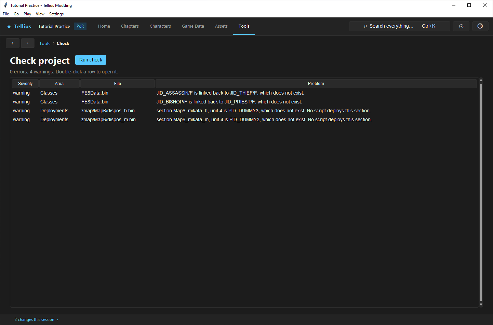
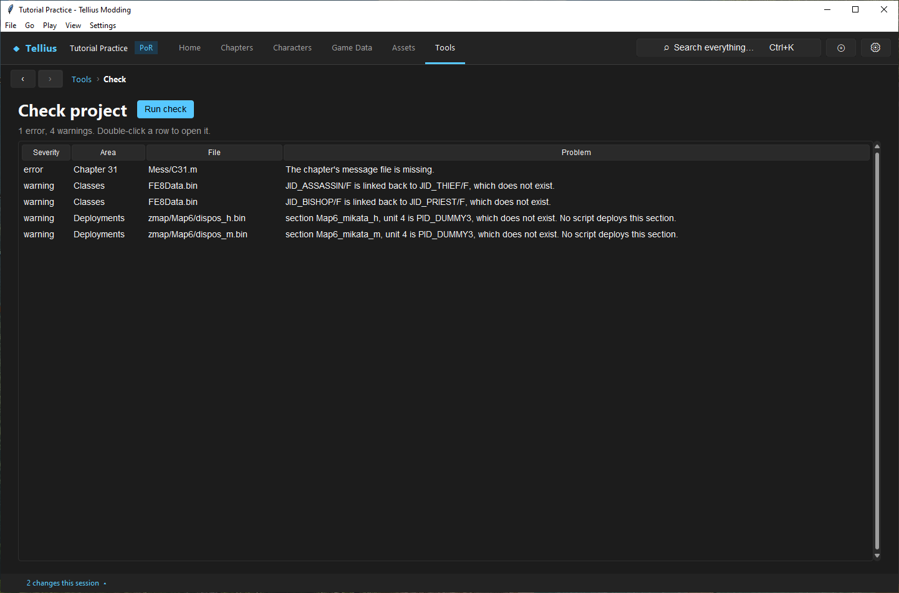

# Check a project and fix problems

**Route:** Tools → Check → **Run check**

## What you will make

You will record the check result of the unmodified project, break one thing on purpose, read the error the check reports, put it right and see the result go back to the baseline. At the end you can read any row of the report, tell an error from a warning, and know which problems the check cannot see.

## Before you begin

- The practice project, unmodified or with edits you have saved. The check reads the files on disk: unsaved edits are not checked.
- Know where the project folder is: step 2 moves one file by hand.

## How the editor fits together

A record names another by its ID (`PID_`, `JID_`, `IID_`, `SID_`), and a chapter is a set of files named by its chapter record. A typo, a removed record or a missing file shows only in the game, usually as a crash. **Run check** reads the whole project without running it and lists every problem it can find:

- **error**: something the game cannot load or will misread;
- **warning**: suspicious but possibly intended (a script string that only looks like an ID, a chapter nothing leads to).

On an unmodified disc the check reports no errors. The retail data breaks some rules in places the game never reaches; those are four warnings on a US disc, and they are your baseline.

## Guided walkthrough

### 1. Record the baseline

<!-- screenshot 05-a-setup.png -->
<figure class="tutorial-figure" markdown="1">

<figcaption markdown="span">**Tools › Check › Run check** on the unmodified project gives the baseline list. Note these rows: after an edit, only new rows are yours to fix.</figcaption>
</figure>

Open **Tools → Check** and press **Run check**. After a few seconds the summary reads *0 errors, 4 warnings*:

| Area | File | Problem |
| --- | --- | --- |
| Classes | `FE8Data.bin` | `JID_ASSASSIN/F` is linked back to `JID_THIEF/F`, which does not exist. |
| Classes | `FE8Data.bin` | `JID_BISHOP/F` is linked back to `JID_PRIEST/F`, which does not exist. |
| Deployments | `zmap/Map6/dispos_h.bin` | section `Map6_mikata_h`, unit 4 is `PID_DUMMY3`, which does not exist. No script deploys this section. |
| Deployments | `zmap/Map6/dispos_m.bin` | the same on Maniac |

These are retail leftovers. Keep this list: after an edit, every new row is yours.

### 2. Break one thing

<!-- screenshot 05-c-error.png -->
<figure class="tutorial-figure" markdown="1">

<figcaption markdown="span">An induced failure: with `Mess/C31.m` moved away, **Run check** reports *1 error*: **Severity** error, **Area** Chapter 31, **File** `Mess/C31.m`, *The chapter's message file is missing.* Double-click the row to open the chapter it belongs to.</figcaption>
</figure>

1. Close nothing. In the file explorer, open the project's `extracted\files\Mess` folder and rename `c31.m` to `c31.m.hidden` (the message file of the last chapter).
2. Press **Run check** again. The summary reads *1 error, 4 warnings*; the first row is **error**, **Chapter 31**, `Mess/C31.m`, *The chapter's message file is missing.*
3. Double-click the row: the chapter it belongs to opens.

### 3. Fix it and prove it

<!-- screenshot 05-b-result.png -->
<figure class="tutorial-figure" markdown="1">

<figcaption markdown="span">The file put back and **Run check** again: *0 errors, 4 warnings*, the baseline. The four warnings are in the retail data, in places the game never reaches.</figcaption>
</figure>

Rename the file back to `c31.m` and press **Run check**: *0 errors, 4 warnings*, the baseline. A repair is proven when the report is back to the baseline, not just when the error row is gone.

## Understand every control

| Control | What it does |
| --- | --- |
| **Run check** | Checks the saved project files (a few seconds). Disabled while it runs. |
| Summary | *N errors, N warnings*, or *No problems found.*, or why the check failed. |
| **Severity** | error or warning, errors first. |
| **Area** | What the problem belongs to: Characters, Classes, Items, Skills, Supports, Chapters, *Chapter NN*, Deployments, Scripts, Shops, FE8Data.bin, Project. |
| **File** | The file that holds it (`FE8Data.bin`, `Scripts/C02.cmb`, `zmap/bmap02/dispos_n.bin`…). |
| **Problem** | What is wrong, in a sentence. |
| Double-click / Enter | Opens the page that owns the row, when there is one (the character, the class, the chapter). |

### What the check looks at

| Area | Errors | Warnings |
| --- | --- | --- |
| `FE8Data.bin` | Two records with the same `PID_`/`JID_`/`IID_`/`SID_` | The file cannot be read |
| Characters | No class; a class, skill that does not exist; a weapon rank string that is not 9 characters | |
| Classes | A promotion link, innate weapon or skill that does not exist; a bad weapon rank string | A promoted class linked back to a missing class |
| Skills | | A restriction list or scroll that does not exist |
| Supports | A pair naming a missing character, and broken support tables | A bond naming a missing character |
| Chapters | Two records with one chapter id; a chapter's script, message or map file missing; a record with no map | No title (the chapter shows blank); a chapter nothing leads to in the story; more cleared chapters than the 40-entry clear history holds |
| Deployments | A unit whose character or class does not exist, in a section a script deploys | The same in a section no script deploys |
| Scripts | More global slots than the game's 32 (chapter script plus `startup.cmb`) | A string that looks like an ID that does not exist; a global slot shared with `startup.cmb` |
| Shops | An item that does not exist | |

A check that cannot read its input says so as a warning, and the other checks still run.

## Things to try next

1. **A missing ID in a script.** On a chapter's **Script** tab, change one `PID_` in a call to `PID_TUTORIAL_MISSING` and **Save**: the check gives a Scripts warning, *The script names PID_TUTORIAL_MISSING, which does not exist.* Put the ID back.
2. **An unlinked chapter.** After **Add chapter…** ([Work with chapter IDs and story order](07-chapter-ids-and-story-flow.md)), the check warns that no chapter leads to it until you place it in the story order.
3. **Before every build.** Run the check before **Build disc** and compare with your baseline.

## Interactions and precedence

- The check reads saved files. Save first, or it checks the previous version.
- It knows references, files and a few engine limits. It does not run scripts, AI, battles or the game's loading, so a clean report does not prove a chapter plays: test in [Play](58-play-chapter.md) and Dolphin.
- A warning can be your intent (a chapter you have not linked yet). Read it and decide; do not let warnings pile up unread.
- Retail warnings stay; they come from data the game never reaches.

## Test matrix

| Case | Setup | Expected result |
| --- | --- | --- |
| Baseline | Unmodified US project | *0 errors, 4 warnings* |
| Intended change | `Mess/c31.m` renamed away | *1 error, 4 warnings*, the missing message file |
| Boundary | The file put back | *0 errors, 4 warnings* |
| Likely failure | An edit applied but not saved | Not in the report: save first |

## Troubleshooting

| Symptom | Likely cause | What to do |
| --- | --- | --- |
| An error you just fixed is still there | The fix is not saved | Save its owner, run the check again |
| *The project has no extracted FE8Data.bin* | The project is not extracted | Extract the disc |
| Hundreds of errors after an edit | A shared record removed or renamed (a class, an item) | Restore it, then rename its users first |
| A row opens no page | The problem has no single owner page (a story-flow warning) | Read **File** and **Problem** |
| The game crashes but the check is clean | Something the check does not look at | Narrow it down in Play, then in Dolphin ([Troubleshoot crashes, missing data, and bad builds](64-troubleshooting.md)) |

## Save, build, and revert

The check writes nothing. Keep the baseline result with your project notes; compare with it before each build and each patch.

## Limits and confidence

- The list of checks is source-reviewed against the validator; the baseline, the induced error and the repair in this lesson were run in the app on a US disc (app-tested).
- The baseline warnings are those of the US disc; another region may differ.

## Related tutorials and references

- Before: [Set up Dolphin and build the game](04-dolphin-setup.md)
- Next: [Understand a chapter's parts](06-chapter-anatomy.md), [Remove records without corrupting saves](15-remove-records.md)
- Reference: [Troubleshoot crashes, missing data, and bad builds](64-troubleshooting.md)

---

[← Previous: Set up Dolphin and build the game](04-dolphin-setup.md) · [All tutorials](index.md) · [Next: Understand a chapter's parts →](06-chapter-anatomy.md)
