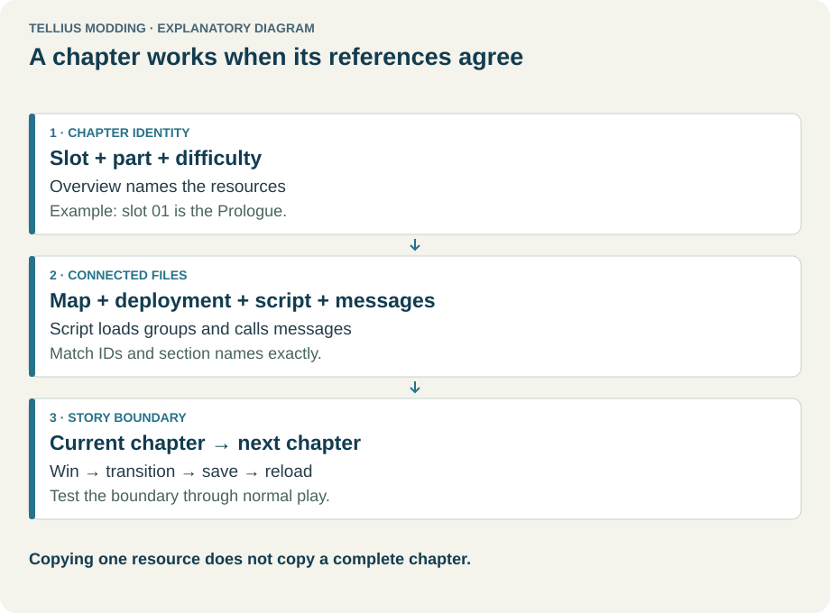
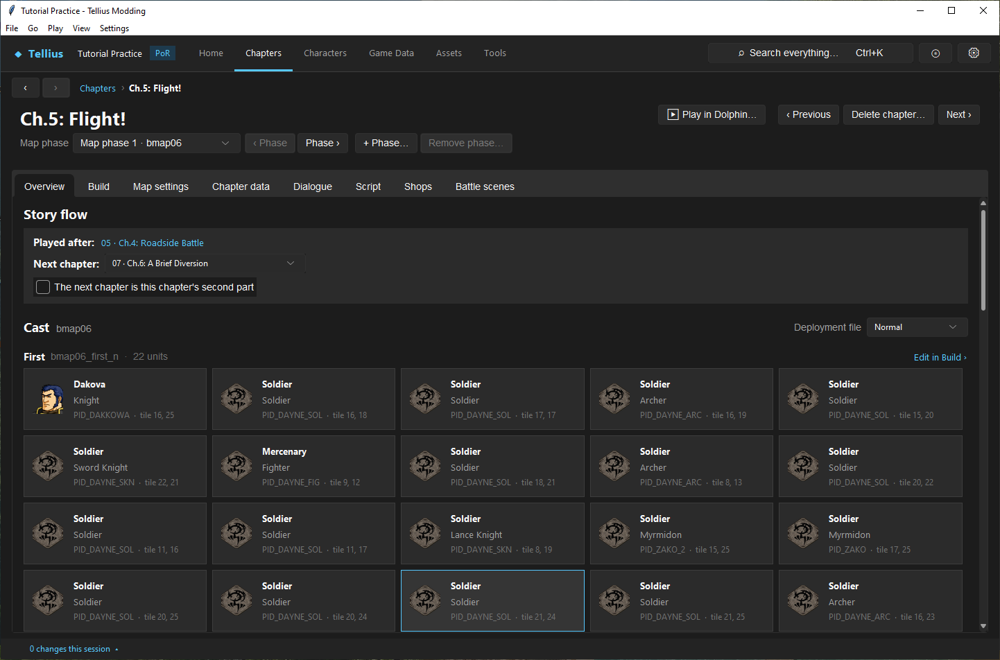
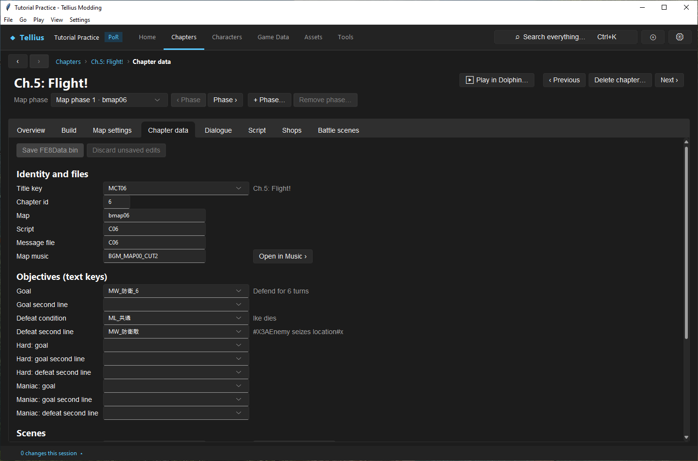
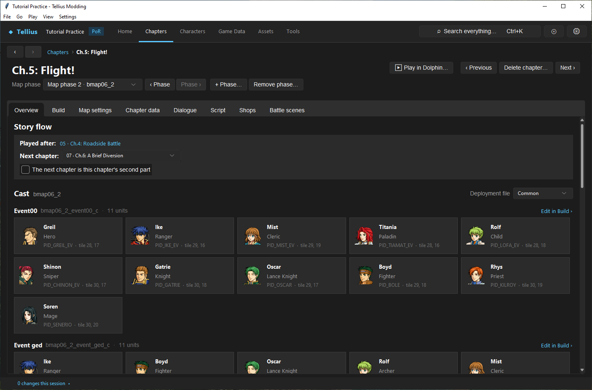
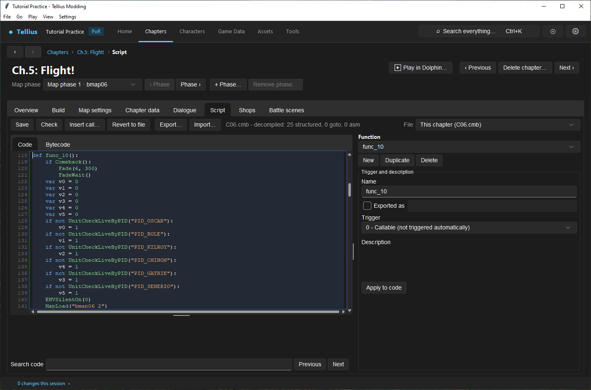
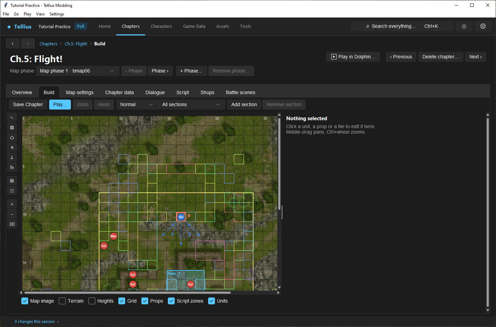

# Understand a chapter's parts

**Route:** Chapters → a chapter → **Overview**, **Chapter data**, **Script**, **Build**

## What you will make

You will trace one retail chapter, Ch.5: Flight!, from its number to every file the game loads for it: its record, its two map folders, its four deployment files, its script and its messages. You will write the trace down as a small table. At the end you can open any chapter and say which file holds what you want to change, and why copying one file alone never makes a chapter.

## Before you begin

- The practice project, extracted ([Install the app and create a project](01-install-create-project.md)). Change nothing in this lesson.
- A text file or a sheet of paper for the trace table.

## How the editor fits together

<!-- diagram chapter -->
<figure class="tutorial-figure" markdown="1">

[](../assets/images/tutorials/chapter.svg)

<figcaption>Concept diagram, not an app screenshot. A chapter is a slot, part and difficulty, connected files, and a story boundary that must agree. Select the image to open it at full size.</figcaption>
</figure>

A chapter is a **number** (its slot, `06` here) and a set of files named after it:

| Piece | Where it is | Named by |
| --- | --- | --- |
| The chapter record | one row of `FE8Data.bin` (**Chapter data** tab) | its **Chapter id**, 6 |
| The title | `Mess/common.m`, key `MCT06` | the record's **Title key** |
| The script | `Scripts/C06.cmb` | the record's **Script** |
| The messages | `Mess/c06.m` | the record's **Message file** |
| The map phases | `zmap/bmap06/`, `zmap/bmap06_2/`… each with `map.cmp` and `dispos.cmp` | the record's **Map**, then the script's `MapLoad("…")` calls |
| The deployment files | inside each `dispos.cmp`: `dispos_n.bin`, `dispos_h.bin`, `dispos_m.bin` (Normal, Hard, Maniac) and `dispos_c.bin` (Common) | the script's `Dispos…("section")` calls |
| Shops, battle scenes | `shop/shopitem_*.bin`, a row of `FE8Data.bin` | the chapter number, the map folder name |

The number shown to the player (*Ch.5*) is only text: slot 06 is the sixth chapter because the Prologue is 01. The internal number is the one every file uses.

A **map phase** is one map folder. Most chapters have one; some load a second map for a cutscene or a change of scene (Ch.5 has `bmap06_2`, Ch.8 has five). When the script loads that folder from a numbered part opening, the app calls the folders **Parts** instead (see [Manage chapter parts and phases](65-chapter-parts-and-phases.md)).

The chapter page shows each piece on its own tab:

| Tab | Shows and edits | Lesson |
| --- | --- | --- |
| **Overview** | Story flow, the cast of the chosen phase and deployment file, the messages, the script's functions | this one, [Work with chapter IDs and story order](07-chapter-ids-and-story-flow.md) |
| **Build** | The map and its units, props, terrain, heights and script zones | [Use the map Build tab](21-map-build-basics.md) |
| **Map settings** | The map's size, camera and environment | [Configure map settings and chapter objectives](27-map-settings.md) |
| **Chapter data** | The chapter record: names, objectives, scenes, music | [Configure map settings and chapter objectives](27-map-settings.md) |
| **Dialogue** | `Mess/c06.m` | [Author and connect a dialogue scene](37-dialogue-editor.md) |
| **Script** | `Scripts/C06.cmb` | [Edit, compile, and test event scripts](33-script-editor.md) |
| **Shops** | The chapter's armory and vendor | [Edit armory, vendor, forge, and gold](46-shops.md) |
| **Battle scenes** | The battle background of each terrain on this map | [Assign battle scenery by map and terrain](28-battle-backgrounds.md) |

## Guided walkthrough

### 1. Open the chapter and read the header

<!-- screenshot 06-a-setup.png -->
<figure class="tutorial-figure" markdown="1">

[](../assets/images/tutorials/screenshots/06-a-setup.png)

<figcaption markdown="span">The **Overview** of Ch.5: Flight! (slot 06). Under the title, the **Map phase** list (*Map phase 1 · bmap06*) with **‹ Phase** / **Phase ›**, **+ Phase…** and **Remove phase…**; on the right **▶ Play in Dolphin…**, **‹ Previous**, **Delete chapter…** and **Next ›**. The page lists the story flow, then the cast of each section of the Normal deployment file, here the 22 enemies of `bmap06_first_n` first.</figcaption>
</figure>

1. Open **Chapters** and click **Ch.5: Flight!** (card *#6*). The page opens on **Overview**.
2. Read the header. Under the title, **Map phase** lists *Map phase 1 · bmap06* and *Map phase 2 · bmap06_2*. On the right, **‹ Previous** and **Next ›** open chapters 05 and 07 on the same tab.
3. Read **Story flow**: **Played after:** *05 · Ch.4: Roadside Battle*, **Next chapter:** *07 · Ch.6: A Brief Diversion*.
4. Under **Cast**, **Deployment file** is *Normal*. Each section is a heading with its name and unit count: *First*, `bmap06_first_n`, 22 units. **Edit in Build ›** opens that section on the Build tab; a unit card opens its character.

Start your trace table with the slot (`06`), the title (*Ch.5: Flight!*) and the two map folders.

### 2. Read the record

<!-- screenshot 06-e-record.png -->
<figure class="tutorial-figure" markdown="1">

[](../assets/images/tutorials/screenshots/06-e-record.png)

<figcaption markdown="span">The **Chapter data** tab: chapter 06's record in `FE8Data.bin`. **Map** `bmap06`, **Script** `C06`, **Message file** `C06` and the **Title key** `MCT06` are the names the other tabs follow.</figcaption>
</figure>

Open **Chapter data**. Under **Identity and files**, copy the names exactly:

| Field | Value |
| --- | --- |
| **Title key** | `MCT06` (shown: *Ch.5: Flight!*) |
| **Chapter id** | 6 |
| **Map** | `bmap06` |
| **Script** | `C06` |
| **Message file** | `C06` |
| **Map music** | `BGM_MAP00_CUT2` |

The record names only the first map folder. The others are loaded by the script.

### 3. Switch to the second map phase

<!-- screenshot 06-c-phase.png -->
<figure class="tutorial-figure" markdown="1">

[](../assets/images/tutorials/screenshots/06-c-phase.png)

<figcaption markdown="span">**Map phase 2 · bmap06_2** with **Deployment file** *Common*: the map of the opening cutscene. Its sections `bmap06_2_event00_c` and `bmap06_2_event_ged_c` are only placed by the script; its Normal, Hard and Maniac files are empty.</figcaption>
</figure>

1. Go back to **Overview** and press **Phase ›** (or pick *Map phase 2 · bmap06_2* in the list). The **Cast** heading now reads `bmap06_2`.
2. With **Deployment file** *Normal*, the page says *No units in this deployment file.* Pick *Common*: two sections appear, `bmap06_2_event00_c` and `bmap06_2_event_ged_c`, 11 units each (Greil, Ike, Mist, Titania…).

This folder is the map of the opening cutscene. Its Normal, Hard and Maniac files are empty; its units are placed by name from the Common file.

### 4. Find the calls in the script

<!-- screenshot 06-d-script.png -->
<figure class="tutorial-figure" markdown="1">

[](../assets/images/tutorials/screenshots/06-d-script.png)

<figcaption markdown="span">The **Script** tab on `func_10`, the opening scene: `MapLoad("bmap06_2")` loads the cutscene map, `InstantDispos("bmap06_2_event00_c")` places its section, and `TalkEvent` plays the messages `MS_06_OP_01` and `MS_06_OP_02` of `c06.m`.</figcaption>
</figure>

Open **Script** and pick `func_10` in **Function** (or click it in the Overview's **Script** list). Lines 141 and 148 read:

```python
MapLoad("bmap06_2")
InstantDispos("bmap06_2_event00_c")
```

The first loads the cutscene map; the second places its section. Further down, `TalkEvent("MS_06_OP_01")` plays a message of `c06.m`. In `Opening0`, the chapter's opening, find `MapLoad("bmap06")` and `InstantDisposSetMode("bmap06_mikata_n", "bmap06_mikata_h", "bmap06_mikata_m")`: one section name per difficulty, and the game takes the one of the difficulty being played. `FinalDisposition` calls `InstantDisposRank("bmap06_first")`, which adds the difficulty letter itself (`_n`, `_h`, `_m`).

Add to your table: which function loads which folder, and which sections it places.

### 5. See the units on the map

<!-- screenshot 06-b-result.png -->
<figure class="tutorial-figure" markdown="1">

[](../assets/images/tutorials/screenshots/06-b-result.png)

<figcaption markdown="span">Back on **Map phase 1 · bmap06**, the **Build** tab with the *Normal* file: the battle map with the 8 player slots, the 22 enemies of `bmap06_first_n` and the 5 reinforcements of `bmap06_zoen_n` on their tiles.</figcaption>
</figure>

1. Press **‹ Phase** to return to *Map phase 1 · bmap06*, then open **Build**.
2. Pick *Normal* in the toolbar's deployment-file list (beside **Redo**; the next list, *All sections*, filters the sections shown). The map shows the 8 player slots of `bmap06_mikata_n`, the 22 enemies of `bmap06_first_n` and the 5 reinforcements of `bmap06_zoen_n`.
3. Pick *Hard*: `bmap06_first_h` has 26 enemies. The same script deploys a different section on each difficulty.

Your finished trace:

| Slot | Record | Script | Messages | Map phases | Deployment sections (Normal) |
| --- | --- | --- | --- | --- | --- |
| 06 | `MCT06`, map `bmap06` | `C06.cmb` | `c06.m` | `bmap06` (battle), `bmap06_2` (opening) | `bmap06_mikata_n` 8, `bmap06_first_n` 22, `bmap06_zoen_n` 5; Common: `bmap06_event01_c`, `bmap06_event_greil_c`, `bmap06_2_event00_c`, `bmap06_2_event_ged_c` |

## Understand every control

### Chapter header

| Control | What it does |
| --- | --- |
| Title | The chapter's title from `Mess/common.m`, or *Chapter NN* when it has none. |
| **Map phase** list | The chapter's map folders in play order (*Map phase 1 · bmap06*). Called **Parts** (*Part 2 · bmap18_2*) when the script loads a folder from a part opening. Changing it changes what **Overview**, **Build**, **Map settings** and **Battle scenes** show; it asks first when the map or deployment has unsaved edits. |
| **‹ Phase** / **Phase ›** (**‹ Part** / **Part ›**) | The previous or next folder of the list. |
| **+ Phase…** | Copies the shown folder into a new one (*Map phase only* or *Next playable chapter part*). See [Manage chapter parts and phases](65-chapter-parts-and-phases.md). |
| **Remove phase…** | Deletes the shown folder, refused while a script names it. Disabled on the first folder. |
| Part status | Under the phase row, for a playable part: *Part 2: script links found*, or what it still needs (*needs deployment and previous victory*). |
| **▶ Play in Dolphin…** | Starts the extracted files straight in this chapter ([Set up Dolphin and build the game](04-dolphin-setup.md)). |
| **‹ Previous** / **Next ›** | The chapter before or after by number, on the same tab. |
| **Delete chapter…** | Deletes the chapter and all its files; not shown on the Prologue. See [Work with chapter IDs and story order](07-chapter-ids-and-story-flow.md). |

### Overview

| Part | What it shows |
| --- | --- |
| **Story flow** | **Played after:**, **Next chapter:** and **The next chapter is this chapter's second part** ([Work with chapter IDs and story order](07-chapter-ids-and-story-flow.md)). |
| **Cast** | The units of the shown map phase, by section, for the chosen **Deployment file** (*Normal*, *Hard*, *Maniac*, *Common*). *No units in this deployment file.* when the file is empty; *This chapter has no map folder.* when there is none. |
| **Edit in Build ›** | Opens the section's first unit on **Build**. |
| Unit card | Name, class, PID and tile; opens the character. |
| **Dialogue** | The chapter's messages grouped by kind (*OP* opening, *BT* boss talk, *ED* ending, *DIE* deaths); **Open Dialogue ›**, or a message ID to open it. |
| **Script** | The named and triggered functions with their trigger; **Open Script ›**. *No script for this chapter.* when it has none. |

## Things to try next

1. **A five-phase chapter.** Open Ch.8: Despair and Hope (slot 09) and step through its five map phases with **Phase ›**. Find each folder's `MapLoad` in the script.
2. **Common versus difficulty files.** On Ch.1, compare the Overview's cast for *Normal* and *Common*.
3. **From the message to the script.** Click an *OP* message on the Overview, then search its ID with **Search code** on the Script tab.

## Interactions and precedence

- The record names the script, the messages and the first map. Everything after that is named in the script: other map folders, sections, messages.
- A section is found by its exact name. A script that names `bmap06_first` with `InstantDisposRank` finds `bmap06_first_n` on Normal; one that names a section missing from the file places nothing, without an error in the game.
- Units in `dispos_c.bin` are the same on every difficulty; the `_n`, `_h`, `_m` files can differ.
- Changing the map phase list only changes what the app shows. The game loads folders only when the script tells it to.
- Messages and story order can be shared: `Mess/common.m` holds every title and character name.

## Test matrix

| Trace | Expected agreement |
| --- | --- |
| Record → script | `Scripts/C06.cmb` exists |
| Record → messages | `Mess/c06.m` exists |
| Record → map | `zmap/bmap06/` holds `map.cmp` and `dispos.cmp` |
| Script → map phase | every `MapLoad("…")` names an existing folder |
| Script → section | every section a script places exists in the file the game will read |
| Section → records | every PID and JID exists (**Tools › Check**) |

## Troubleshooting

| Symptom | Likely cause | What to do |
| --- | --- | --- |
| The cast is empty | The phase's file for this difficulty is empty | Pick *Common* or another phase |
| A tab shows another map than expected | Another map phase is selected | Check the **Map phase** list |
| Units missing on one difficulty only | That difficulty's section differs or is missing | Compare *Normal*, *Hard*, *Maniac* on **Build** |
| **Check** reports a missing file | The record names a file that does not exist | Fix the name on **Chapter data**, or restore the file |
| A section exists but its units never appear | No script call names it, or the name is misspelled | Search the section name on the Script tab |

## Save, build, and revert

This lesson changes nothing. When you later edit several pieces of a chapter, each tab saves its own file: **Save FE8Data.bin** for the record, **Save Chapter** for the map and deployments, **Save** on Script, **Save Chapter** on Dialogue ([Save changes and restore originals](03-saving-and-restoring.md)).

## Limits and confidence

- The file layout, the names and the tabs are source-reviewed; the trace in this lesson was made in the app on a US disc (app-tested).
- That `dispos_c.bin` sections are placed on every difficulty comes from how the retail scripts use them; the game code that reads it is not traced.

## Related tutorials and references

- Before: [Check a project and fix problems](05-check-project.md)
- Next: [Work with chapter IDs and story order](07-chapter-ids-and-story-flow.md)
- Also: [Place and tune units by difficulty](30-deployment-by-difficulty.md), [Edit, compile, and test event scripts](33-script-editor.md)
- Reference: [Disc Layout](../meta/disc-layout.md)

---

[← Previous: Check a project and fix problems](05-check-project.md) · [All tutorials](index.md) · [Next: Work with chapter IDs and story order →](07-chapter-ids-and-story-flow.md)
