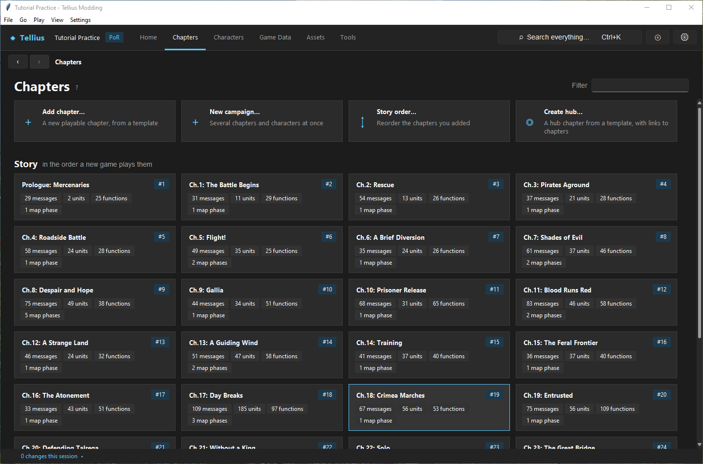
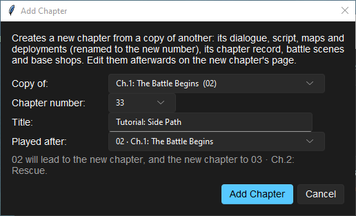
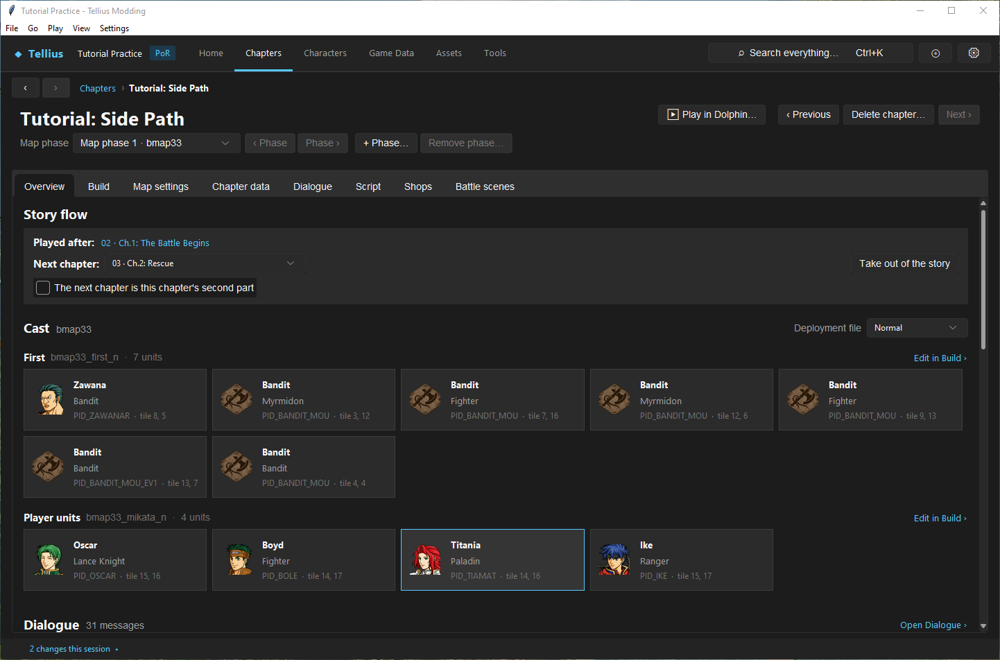
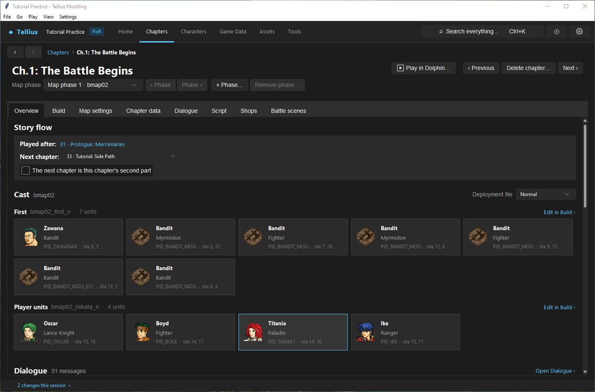
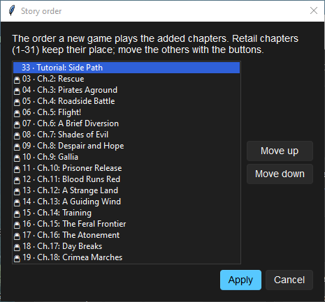
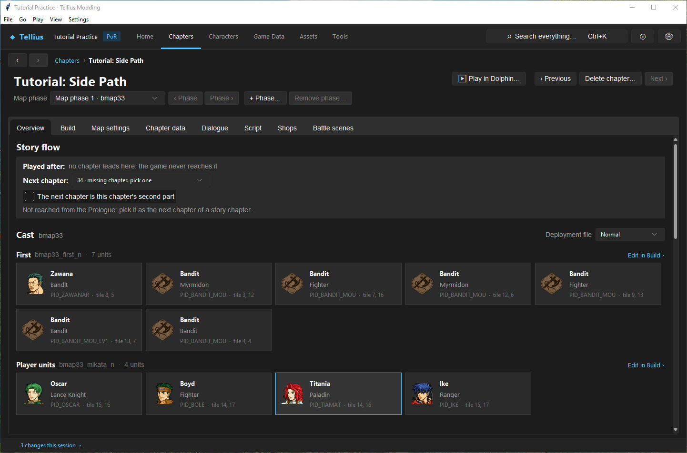

# Work with chapter IDs and story order

**Route:** Chapters → **Add chapter…** / **Story order…**; a chapter's **Overview** → **Story flow**; the chapter header → **Delete chapter…**

## What you will make

You will add chapter 33, *Tutorial: Side Path*, as a copy of Ch.1, place it between Ch.1 and Ch.2, read the change on both chapters, look at it in **Story order…**, take it out of the story again and delete it. At the end you know where the game's chapter order is stored, what each control writes, and how to undo each step.

## Before you begin

- The practice project, saved, with **Tools › Check** at its baseline ([Check a project and fix problems](05-check-project.md)).
- A copy of the project folder. Adding and deleting chapters writes several files at once (`FE8Data.bin`, `main.dol`, `Mess/common.m`, the shop files, new chapter files); the copy is the simplest way back.

## How the editor fits together

The game does not read a list of chapters. When a chapter is won, it asks `main.dol` for the next chapter number. Retail Path of Radiance simply adds 1 (01 → 02 → … → 31 → 32, the ending). The app adds a **next-chapter table** to `main.dol` the first time you change the flow; every chapter with a row goes where its row says, every other one still goes to its number + 1.

| Range | Meaning |
| --- | --- |
| 01 | The Prologue: every new game starts here. Cannot be deleted. |
| 02–31 | Retail story chapters. They keep their place in **Story order…**; another chapter can be put after one of them. 28 and 29 are the two halves of Ch.27. |
| 32 | The ending. The last chapter of the story leads here. |
| 33–89 | Free numbers for added chapters, except those a retail record already uses. |
| 90 and up | Trial maps, played from the trial menu, never in the story. |

The number is the chapter's identity: its files are named after it (`C33.cmb`, `c33.m`, `zmap/bmap33/`), its record holds it, saves store it. The title (*Tutorial: Side Path*) is only text in `Mess/common.m` under the key `MCT33`.

The game's save keeps a clear history of 40 chapters for the ending's war record. A story with more than 40 chapters still plays, but the later clears are not recorded; **Check** warns about it.

## Guided walkthrough

### 1. Add a chapter

<!-- screenshot 07-chapters.png -->
<figure class="tutorial-figure" markdown="1">

<figcaption markdown="span">**Chapters**: the action cards (**Add chapter…**, **New campaign…**, **Story order…**, **Create hub…**), then the story in play order with each chapter's place (*#1* to *#31*).</figcaption>
</figure>

<!-- screenshot 07-a-setup.png -->
<figure class="tutorial-figure" markdown="1">

<figcaption markdown="span">**Add chapter…**: **Copy of** Ch.1 (02), **Chapter number** 33, **Title** *Tutorial: Side Path*, **Played after** 02. The line under it says what changes: 02 will lead to 33, and 33 to 03.</figcaption>
</figure>

1. Open **Chapters** and click **Add chapter…**.
2. **Copy of:** *Ch.1: The Battle Begins (02)*. The new chapter gets a copy of its dialogue, script, map, deployments, record, battle scenes and base shops, renamed to the new number (`bmap02_mikata_n` becomes `bmap33_mikata_n`, `MapLoad("bmap02")` becomes `MapLoad("bmap33")`).
3. **Chapter number:** *33*, the first free number.
4. **Title:** `Tutorial: Side Path`. Plain ASCII only.
5. **Played after:** *02 · Ch.1: The Battle Begins*. The line below reads *02 will lead to the new chapter, and the new chapter to 03 · Ch.2: Rescue.*
6. Press **Add Chapter**. The app saves `FE8Data.bin` (it asks first if other edits are unsaved), writes the chapter's war-record labels into `Mess/ending.m` (`MED_CHAP33_TAG` *Tutorial*, `MED_CHAP33_TITLE` *Side Path*, `MED_DIED_CHAP33` *Fell in Tutorial*; see [Edit the ending and the war record](79-ending-and-war-record.md)) and opens the new chapter.

### 2. Read the new flow

<!-- screenshot 07-c-flow.png -->
<figure class="tutorial-figure" markdown="1">

<figcaption markdown="span">The new chapter 33's **Overview**: **Played after:** *02 · Ch.1: The Battle Begins*, **Next chapter:** *03 · Ch.2: Rescue*, and **Take out of the story**, which only added chapters have. The header shows **Delete chapter…** for every chapter but the Prologue.</figcaption>
</figure>

Chapter 33's **Overview** shows **Played after:** *02 · Ch.1: The Battle Begins* and **Next chapter:** *03 · Ch.2: Rescue*. Its cast is Ch.1's. **Take out of the story** appears: only added chapters have it. The header shows **Delete chapter…**; **Next ›** is disabled, 33 being the highest number.

<!-- screenshot 07-b-result.png -->
<figure class="tutorial-figure" markdown="1">

<figcaption markdown="span">Ch.1's **Story flow** after the add: its **Next chapter** is now *33 · Tutorial: Side Path*. The change is in `main.dol`'s next-chapter table; only playing Ch.1 to its end in Dolphin proves the transition.</figcaption>
</figure>

Click **Previous** until Ch.1 (or open it from **Chapters**). Its **Next chapter:** is now *33 · Tutorial: Side Path*. The change log reads *Chapter 33: Added chapter 33 from 02 (after 02)*. On **Chapters**, the new card has the badge *#3* and every later chapter moved one place down.

### 3. Look at the story order

<!-- screenshot 07-d-order.png -->
<figure class="tutorial-figure" markdown="1">

<figcaption markdown="span">**Story order…**: retail chapters carry a lock and keep their place; the added chapter 33 sits between 02 and 03. **Move up** / **Move down** swap it only with another added chapter, so here they do nothing.</figcaption>
</figure>

Back on **Chapters**, click **Story order…**. Retail chapters have a lock; *33 · Tutorial: Side Path* has none and sits between 02 and 03. Select it: **Move up** and **Move down** do nothing, because they only swap two added chapters that are next to each other. To move 33 elsewhere, change the **Next chapter** of the chapters around it, or take it out and add it again. Press **Cancel**.

### 4. Take it out of the story

<!-- screenshot 07-e-out.png -->
<figure class="tutorial-figure" markdown="1">

<figcaption markdown="span">After **Take out of the story**: *no chapter leads here: the game never reaches it*. Ch.1 leads to 03 again; chapter 33 and its files are still there, listed under **Other chapters**.</figcaption>
</figure>

On chapter 33's **Overview**, press **Take out of the story**. Ch.1 leads to 03 again. Chapter 33 now reads **Played after:** *no chapter leads here: the game never reaches it*, with the note *Not reached from the Prologue: pick it as the next chapter of a story chapter.* Its files are kept, and its card moves under **Other chapters** on the Chapters page.

Its **Next chapter:** reads *34 · missing chapter: pick one*: a chapter with no row in the table goes to its number + 1, and there is no chapter 34. If you put 33 back in the story through Ch.1's **Next chapter**, also set 33's own **Next chapter**; **Check** reports *Chapter 33 leads to chapter 34, which does not exist* until you do.

### 5. Delete it

Press **Delete chapter…** in the header. The confirmation lists what goes: *its ChapterData and battle-scene records*, *its dialogue and script*, *its 1 map phase*, *its shops, title text and chapter-name pictures*. **Yes** deletes them, saves `FE8Data.bin` and opens **Chapters**. Chapters that led to the deleted one now lead to its successor. Run **Tools › Check**: back to the baseline.

## Understand every control

### Add Chapter

| Control | What it does | How to choose |
| --- | --- | --- |
| **Copy of:** | The chapter whose files and records are copied | A chapter close to what you want: same kind of map, same objective |
| **Chapter number:** | Free numbers from 33 to 89 | The first one, unless you plan a range |
| **Title:** | The `MCTnn` text in `Mess/common.m`; *Chapter 33* by default | Plain ASCII |
| **Played after:** | The chapter that will lead to the new one; it then leads where that chapter used to go. *Not in the story (reach it later)* creates it unreachable | The chapter it follows in your story |
| Hint line | What the routing will become | Read it before **Add Chapter** |
| **Add Chapter** | Copies the files, writes the record, title, shops and flow, saves `FE8Data.bin` | |

### Story flow (a chapter's Overview)

| Control | What it does |
| --- | --- |
| **Played after:** | The chapters that lead here, as links. *the start of a new game* on the Prologue; *no chapter leads here: the game never reaches it* when none does. |
| **Next chapter:** | Where this chapter's victory leads: any chapter, or *32 · Ending*. Writes `main.dol` at once. |
| **Take out of the story** | Added chapters only: whatever led here leads to this chapter's successor instead. The files stay. |
| **The next chapter is this chapter's second part** | Plays the next chapter like the second half of Ch.27: no save menu between them, the army is not sorted out, support points are not counted again. Writes `main.dol` at once. |
| Notes | Chapters 28 and 29 always behave as two halves; a hub chapter's flow is set in its hub setup ([Create a hub and plan chapter unlocks](hub-chapters.md)); trial maps have no flow. |

### Story order…

| Control | What it does |
| --- | --- |
| List | The story in play order, from the Prologue to the last chapter before the ending. A lock marks retail chapters. |
| **Move up** / **Move down** | Swap the selected added chapter with the one above or below, if that one is added too. |
| **Apply** | Rewrites the links that differ (nothing when the order is unchanged). |
| **Cancel** | Closes without writing. |

### Delete chapter…

Shown on every chapter but the Prologue. Removes the record, the battle-scene rows, the shops, the title, the script, the messages, every map phase and the chapter-name pictures, and routes the chapters before it to the one after. A hub chapter also loses its hub setup. It saves `FE8Data.bin` with any other unsaved edit (it asks first).

## Things to try next

1. **Not in the story.** Add a chapter with **Played after:** *Not in the story (reach it later)*, then set Ch.2's (03) **Next chapter:** to it, and its own **Next chapter:** to *05 · Ch.4: Roadside Battle*. Ch.3 (04) is now skipped, and **Check** does not warn: only added chapters are reported unreachable. Put the flow back.
2. **A branch that rejoins.** Add 33 after 02 and 34 after 33: the Story order dialog now lets you swap them.
3. **Free numbers.** Open **Add chapter…** again after adding 33: **Chapter number:** now starts at 34.

## Interactions and precedence

- The flow changes `main.dol` at once; there is no separate save. Copy the project before experimenting.
- **Add Chapter** and **Delete chapter…** save `FE8Data.bin`, including other unsaved edits to it.
- Deleting a retail chapter (02–31) is allowed and routes around it, but other chapters' scripts may still name its flags, characters or map; **Check** finds only missing files and records.
- An added chapter's script is a renamed copy: its events, recruitments and flags are the template's until you change them.
- A save made in an old version of the story still holds the old chapter number; test a new flow from a new game.

## Test matrix

| Case | Setup | Expected result |
| --- | --- | --- |
| Baseline | Unmodified project | Ch.1 **Next chapter:** *03 · Ch.2: Rescue*; Check at baseline |
| Intended change | Add 33 after 02 | Ch.1 → 33 → 03; 33 has the badge *#3* |
| Boundary | Take 33 out | Ch.1 → 03; 33 under **Other chapters**, next *34 · missing chapter: pick one* |
| Likely failure | Ch.1 → 33 set by hand with 33 still going to 34 | **Check** error: chapter 33 leads to chapter 34, which does not exist |
| Revert | **Delete chapter…** on 33 | Check back at baseline |
| In game | Ch.1 played to its end with 33 after it | Chapter 33 loads after Ch.1's save menu (Dolphin) |

## Troubleshooting

| Symptom | Likely cause | What to do |
| --- | --- | --- |
| *The story flow can't be edited: …* | `main.dol` is not a supported US, PAL or JP version | Extract from a retail disc |
| *No template chapter or no free chapter number.* | Numbers 33–89 all used | Delete unused added chapters |
| *Invalid title* | Non-ASCII characters | Use plain ASCII; edit the text later in `Mess/common.m` |
| The game crashes after a chapter's victory | Its next chapter does not exist | **Check**; set **Next chapter:** |
| An added chapter loads but plays Ch.1's events | Its script is a copy of Ch.1's | Edit its Script tab ([Edit, compile, and test event scripts](33-script-editor.md)) |
| A chapter jump works but the story never reaches the chapter | No chapter leads to it | Set a **Next chapter:** that points to it |

## Save, build, and revert

- The flow, **Add Chapter** and **Delete chapter…** write their files at once. Build to test.
- To undo an added chapter: **Delete chapter…**. To undo a flow change: set the **Next chapter:** back, or take the chapter out.
- To undo everything at once: restore the project copy. The vanilla files hold only the disc's version of each file, not your previous state.

## Limits and confidence

- The numbers, the table, the dialogs and what they write are source-reviewed; adding, routing, taking out and deleting chapter 33 were done in the app on a US disc (app-tested).
- Whether the game loads the added chapter after Ch.1's victory and saves it correctly is the Dolphin test of [Build a three-chapter mini-campaign](62-mini-campaign.md) (unknown here).

## Related tutorials and references

- Before: [Understand a chapter's parts](06-chapter-anatomy.md)
- Next: [Create a campaign skeleton](08-new-campaign-wizard.md), [Plan around campaign limits](09-campaign-limits.md)
- Also: [Manage chapter parts and phases](65-chapter-parts-and-phases.md), [Build a three-chapter mini-campaign](62-mini-campaign.md)

---

[← Previous: Understand a chapter's parts](06-chapter-anatomy.md) · [All tutorials](index.md) · [Next: Create a campaign skeleton →](08-new-campaign-wizard.md)
