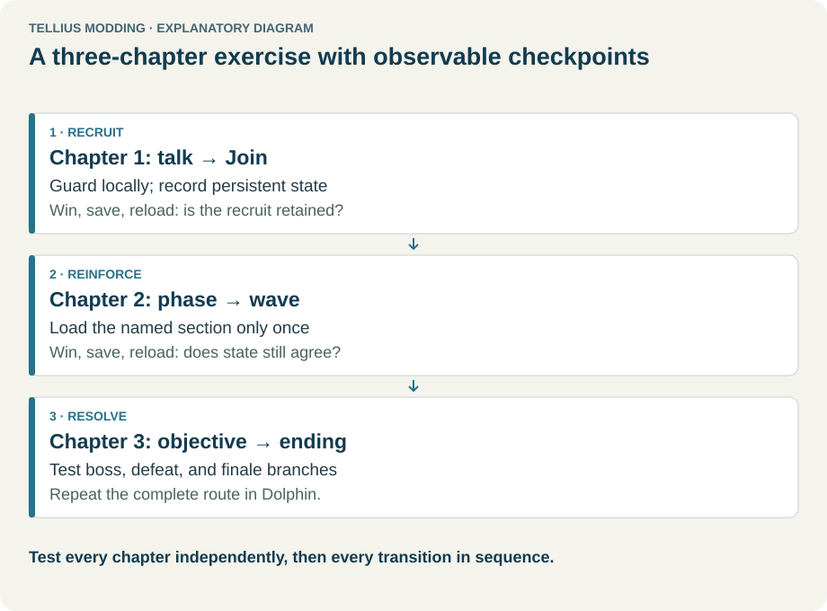
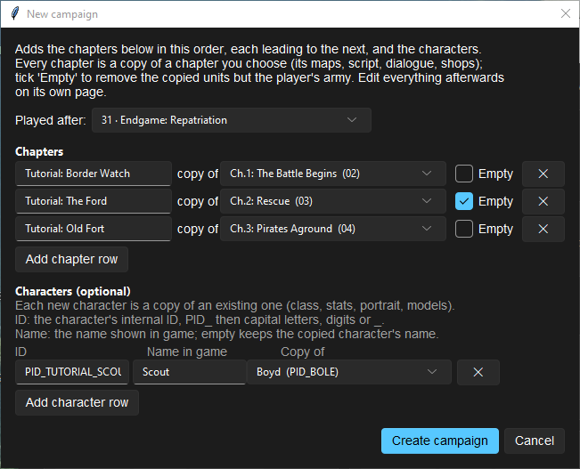
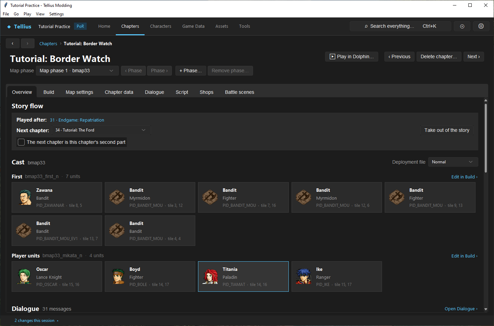
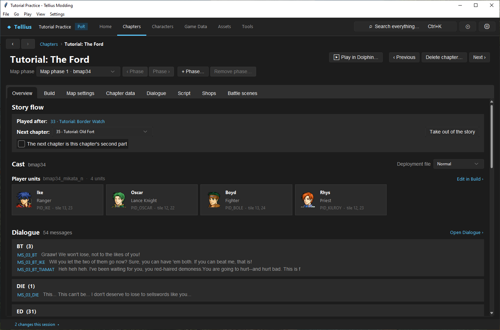
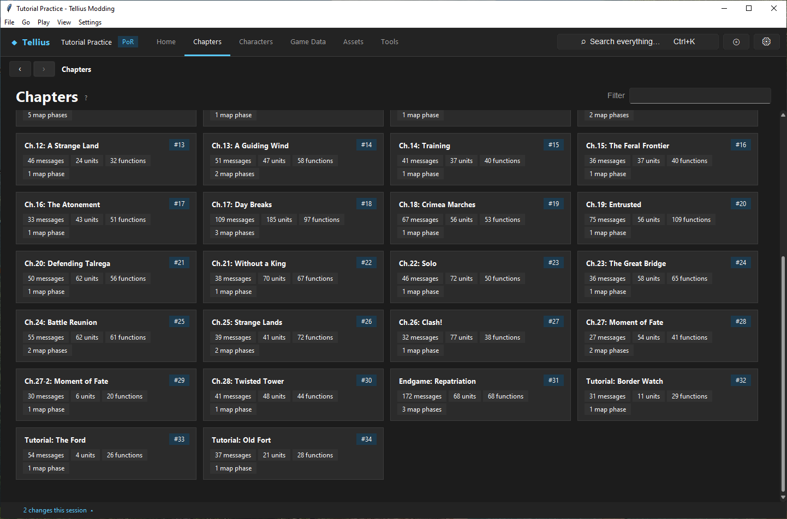
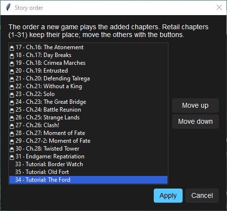
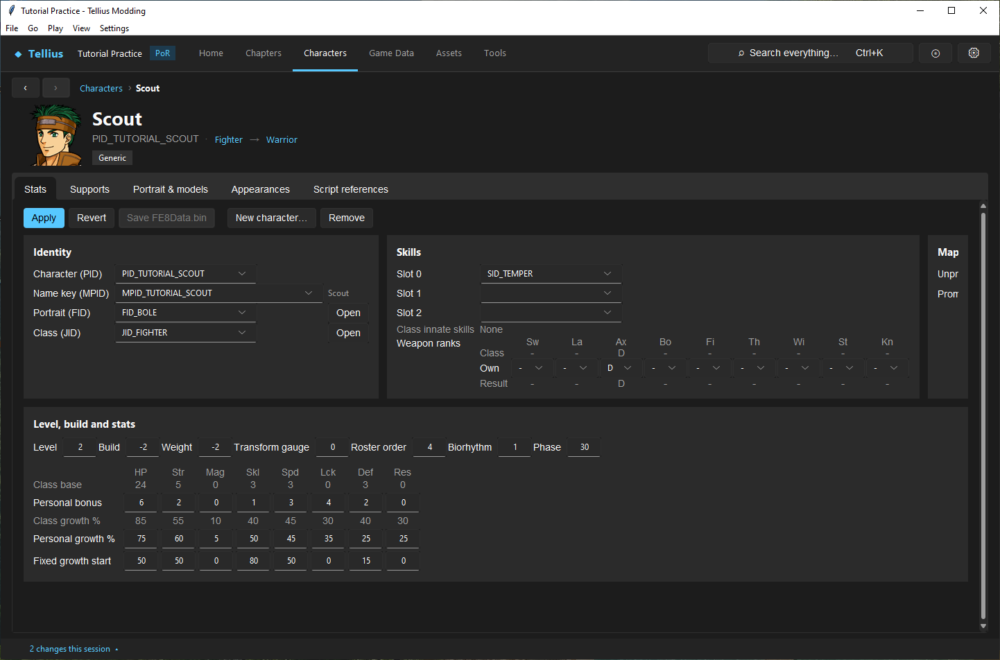

# Create a campaign skeleton

**Route:** Chapters → **New campaign…**

## What you will make

You will add a three-chapter campaign after Endgame (chapters 33, 34 and 35) and one new character, `PID_TUTORIAL_SCOUT`, in one step. You will check what the wizard made: the story links, a chapter emptied of its enemies, the new character's name, and the order of the new chapters. At the end you have a skeleton to fill chapter by chapter, and you know what each copied chapter still borrows from its template.

## Before you begin

- [Work with chapter IDs and story order](07-chapter-ids-and-story-flow.md): the wizard does several **Add chapter…** at once.
- A copy of the project folder. The wizard writes `FE8Data.bin`, `main.dol`, `Mess/common.m`, the shop files and every new chapter's files.
- A plan: how many chapters, which retail chapter each one starts from, which characters you need.

## How the editor fits together

<!-- diagram campaign -->
<figure class="tutorial-figure" markdown="1">

<figcaption>Concept diagram, not an app screenshot. A three-chapter campaign exercise with a checkpoint after each chapter and each transition. Select the image to open it at full size.</figcaption>
</figure>

**New campaign…** checks every row first and writes nothing if one is wrong. Then, in order:

1. Each chapter row becomes a chapter with the next free number (33, 34, 35…), copied from its template exactly like **Add chapter…**: script, messages, map phases, deployments, record, battle scenes, base shops, all renamed to the new number.
2. **Played after** leads to the first new chapter, each new chapter leads to the next, and the last one leads where **Played after** used to go.
3. A row with **Empty** ticked has every deployment section emptied except the player's (`…_mikata_…`). The sections stay, so the copied script still finds them.
4. Each character row adds a copy of an existing character with a new PID. A **Name in game** gets its own name key, `MPID_` + the end of the PID, in `Mess/common.m`.
5. `FE8Data.bin` is saved and the first new chapter opens.

What is **not** changed: the copied scripts still play the template's events, talk to its characters and recruit them; the copied messages are the template's; nothing deploys the new characters. That is the work of the next lessons.

## Guided walkthrough

### 1. Fill the wizard

<!-- screenshot 08-a-setup.png -->
<figure class="tutorial-figure" markdown="1">

<figcaption markdown="span">**New campaign…**: **Played after** the last story chapter (31, Endgame), three chapter rows (copies of 02, 03 with **Empty** ticked, and 04) and one row under **Characters (optional)**: `PID_TUTORIAL_SCOUT`, *Scout*, a copy of Boyd.</figcaption>
</figure>

1. On **Chapters**, click **New campaign…**.
2. **Played after:** leave *31 · Endgame: Repatriation*, the last chapter of the story. The campaign is played after the retail story, before the ending.
3. The dialog starts with one chapter row. Press **Add chapter row** twice. Fill the three rows:

    | Title | copy of | Empty |
    | --- | --- | --- |
    | `Tutorial: Border Watch` | *Ch.1: The Battle Begins (02)* | off |
    | `Tutorial: The Ford` | *Ch.2: Rescue (03)* | on |
    | `Tutorial: Old Fort` | *Ch.3: Pirates Aground (04)* | off |

4. Under **Characters (optional)**, press **Add character row**: **ID** `PID_TUTORIAL_SCOUT`, **Name in game** `Scout`, **Copy of** *Boyd (PID_BOLE)*.
5. Press **Create campaign**. After a few seconds, chapter 33 opens.

### 2. Check the links

<!-- screenshot 08-c-first.png -->
<figure class="tutorial-figure" markdown="1">

<figcaption markdown="span">The campaign's first chapter, 33 *Tutorial: Border Watch*, opens: **Played after** *31 · Endgame: Repatriation*, **Next chapter** *34 · Tutorial: The Ford*. Endgame no longer leads to the ending but to 33; 35 leads to the ending.</figcaption>
</figure>

Chapter 33, *Tutorial: Border Watch*: **Played after:** *31 · Endgame: Repatriation*, **Next chapter:** *34 · Tutorial: The Ford*. Open chapter 35: its **Next chapter:** is *32 · Ending*. Endgame no longer leads to the ending; it leads to 33.

### 3. Check the empty chapter

<!-- screenshot 08-d-empty.png -->
<figure class="tutorial-figure" markdown="1">

<figcaption markdown="span">Chapter 34, made with **Empty**: the cast keeps only the player sections (*Player units*); the enemies of Ch.2 are gone, their sections kept empty so the copied script still finds them.</figcaption>
</figure>

Open chapter 34, *Tutorial: The Ford*. Its **Cast** has only **Player units** (`bmap34_mikata_n`, Ike, Oscar, Boyd and Rhys). The Ch.2 bandits are gone. Its **Dialogue** still holds Ch.2's 54 messages, and its script still runs Ch.2's events.

### 4. Check the story and the order

<!-- screenshot 08-b-result.png -->
<figure class="tutorial-figure" markdown="1">

<figcaption markdown="span">**Chapters** after **Create campaign**: the three new chapters close the story as *#32*, *#33* and *#34*, after Endgame.</figcaption>
</figure>

Open **Chapters** and scroll to the end of **Story**: the three cards follow Endgame with the badges *#32*, *#33* and *#34*.

<!-- screenshot 08-e-order.png -->
<figure class="tutorial-figure" markdown="1">

<figcaption markdown="span">**Story order…** after selecting 34 and **Move down**: the three added chapters can be reordered among themselves (here 33, 35, 34). **Apply** would rewrite the links; this run closes with **Cancel**.</figcaption>
</figure>

Click **Story order…**. The three added chapters close the list, without a lock. Select *34 · Tutorial: The Ford* and press **Move down**: it swaps with 35, because both are added chapters. **Apply** would make the story 31 → 33 → 35 → 34 → ending; press **Cancel** to keep the planned order.

### 5. Check the character

<!-- screenshot 08-f-cast.png -->
<figure class="tutorial-figure" markdown="1">

<figcaption markdown="span">The campaign's character `PID_TUTORIAL_SCOUT`: a copy of Boyd with its own name key `MPID_TUTORIAL_SCOUT` (*Scout*). No chapter deploys it yet.</figcaption>
</figure>

Search `TUTORIAL_SCOUT` (Ctrl+K) and open it. The page is titled *Scout*; **Name key (MPID)** reads `MPID_TUTORIAL_SCOUT`, and class, portrait, skills and stats are Boyd's. No chapter deploys it yet: [Create a character](10-create-character.md) and [Place and tune units by difficulty](30-deployment-by-difficulty.md) place it.

### 6. Undo (optional)

To remove the skeleton: **Delete chapter…** on 35, 34 and 33 (in any order; each routes around itself), then **Remove** on the character's **Stats** tab and **Save FE8Data.bin**. Or restore your project copy.

## Understand every control

| Control | What it does | How to choose |
| --- | --- | --- |
| **Played after:** | The chapter that leads to the first new chapter. The last new one then leads where it used to go. | The last story chapter to append a campaign; the Prologue (*01*) to replace the story after it (the retail chapters become unreachable) |
| **Chapters** rows: title | The chapter's title (`MCTnn` in `Mess/common.m`); plain ASCII | The title the player will see |
| **copy of** | The template chapter | A chapter with a similar map and objective; it must have a script |
| **Empty** | Empties every section but the player's after copying | On for a chapter you will populate yourself |
| **✕** | Removes the row | |
| **Add chapter row** | A new chapter row, *New chapter N* | |
| **Characters (optional)**: **ID** | The new PID: `PID_` then capital letters, digits or `_` | One that no character uses |
| **Name in game** | The displayed name; empty keeps the template's name key | Plain ASCII |
| **Copy of** | The character copied: class, stats, growths, portrait, models | The closest existing unit |
| **Add character row** | A new character row | |
| **Create campaign** | Checks every row, then writes everything and saves `FE8Data.bin` | |
| **Cancel** | Closes without writing | |

The check refuses, with one line per problem: more chapters than free numbers, a template without a record or a script, a non-ASCII title or name, a PID that is malformed, taken twice or already used, a template character that does not exist.

## Things to try next

1. **Replace the story.** Choose **Played after:** *01 · Prologue: Mercenaries*: the campaign follows the Prologue and chapters 02–31 are no longer reached. Undo with your project copy.
2. **One chapter, no characters.** A wizard with a single row and no character row is an **Add chapter…** placed after the chosen chapter.
3. **Fill a skeleton.** On chapter 34, add enemies on **Build** ([Use the map Build tab](21-map-build-basics.md)) and new opening lines on **Dialogue**.

## Interactions and precedence

- The wizard is all-or-nothing for the checks, but not for the writes: if the disk fails half-way, the error lists the chapters already added.
- Copied chapters keep the template's flags, character calls and recruitment events. A campaign of three copies of Ch.1 recruits Oscar and Boyd three times over until you edit the scripts.
- A new character copies the template's portrait and models; changing them is [Create and assign a portrait](11-portraits.md) and [Give a character unique models](12-character-model-slot.md).
- The story clear history holds 40 chapters: a long campaign after the retail story passes it quickly; **Check** warns.

## Test matrix

| Case | Setup | Expected result |
| --- | --- | --- |
| Baseline | Unmodified project | Endgame → ending |
| Intended change | Three rows, one character, after 31 | 31 → 33 → 34 → 35 → ending; *Scout* exists |
| Boundary | Row 2 with **Empty** | Chapter 34 has only player units |
| Likely failure | ID `PID_bole` | *a character ID is PID_ followed by capital letters, digits or _.*; nothing written |
| In game | Endgame won on a save | Chapter 33 loads (Dolphin) |

## Troubleshooting

| Symptom | Likely cause | What to do |
| --- | --- | --- |
| *… chapter numbers are free.* | 33–89 mostly used | Delete unused added chapters |
| *the template chapter … has no script to copy.* | A template without `Scripts/Cnn.cmb` | Choose a story chapter |
| *PID_… already exists.* | The ID is used | Pick another ID |
| A new chapter plays the template's cutscenes | Scripts are copies | Edit each chapter's Script tab |
| The character shows the template's name | **Name in game** was empty | Set **Name key (MPID)** on its Stats tab, or add a text in `Mess/common.m` |
| **Check** warns about the clear history | More than 40 chapters in the story | Shorten the story, or accept the war-record limit |

## Save, build, and revert

The wizard saves what it writes. Build and test from a save made just before the **Played after** chapter's victory. To revert, delete the chapters and the character, or restore your project copy.

## Limits and confidence

- The checks, the copy and the routing are source-reviewed; the campaign of this lesson was created in the app on a US disc and then removed (app-tested).
- Playing through the new chapters in Dolphin is [Build a three-chapter mini-campaign](62-mini-campaign.md) (unknown here).

## Related tutorials and references

- Before: [Work with chapter IDs and story order](07-chapter-ids-and-story-flow.md)
- Next: [Plan around campaign limits](09-campaign-limits.md)
- Also: [Create a character](10-create-character.md), [Build a three-chapter mini-campaign](62-mini-campaign.md)

---

[← Previous: Work with chapter IDs and story order](07-chapter-ids-and-story-flow.md) · [All tutorials](index.md) · [Next: Plan around campaign limits →](09-campaign-limits.md)
