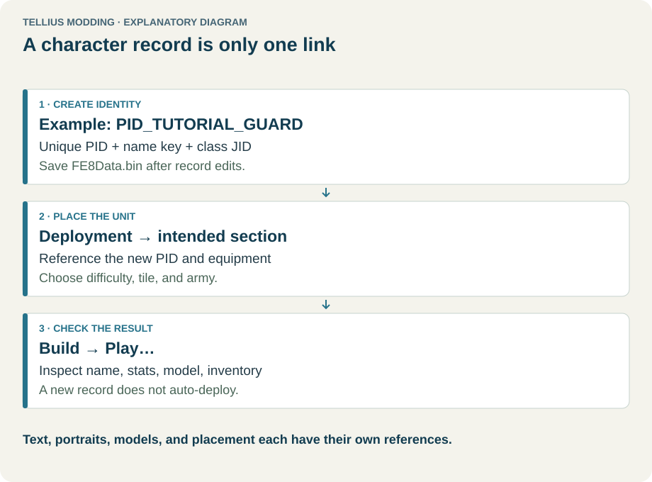
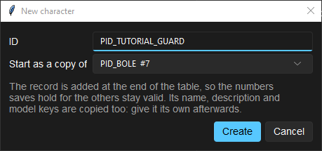
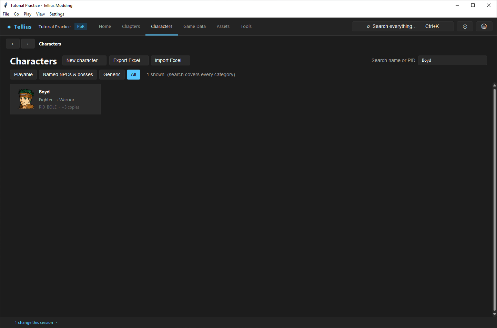
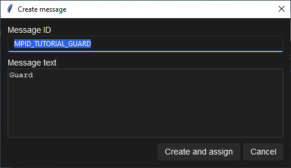
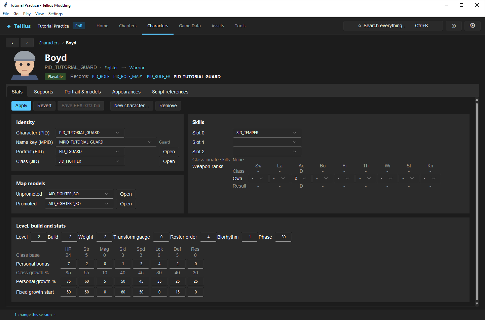
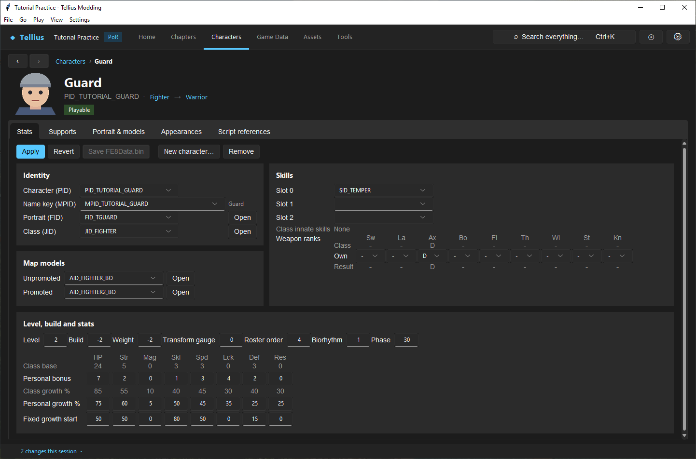
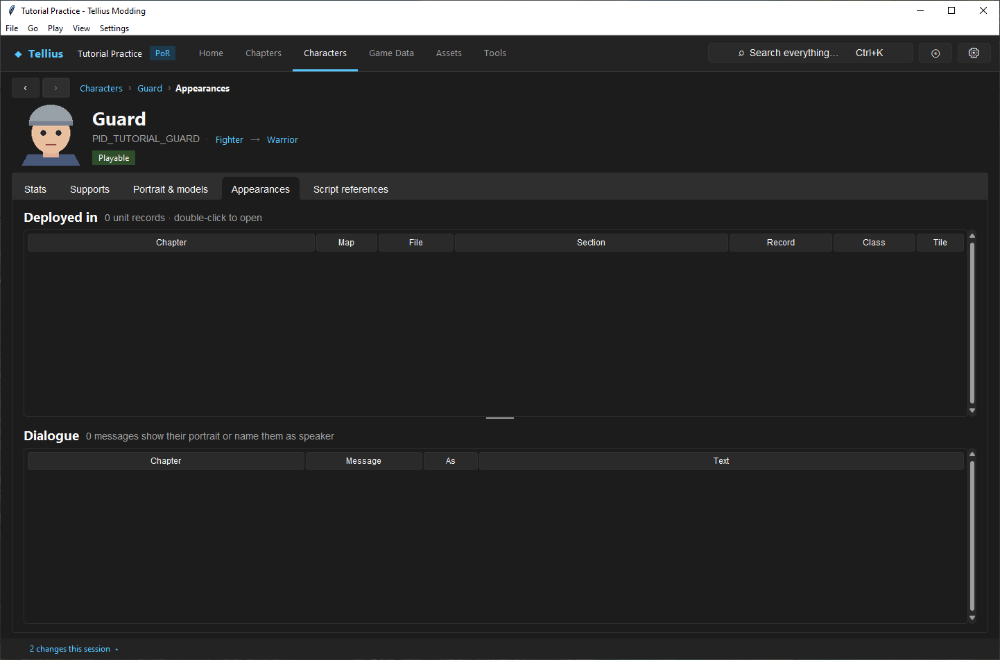
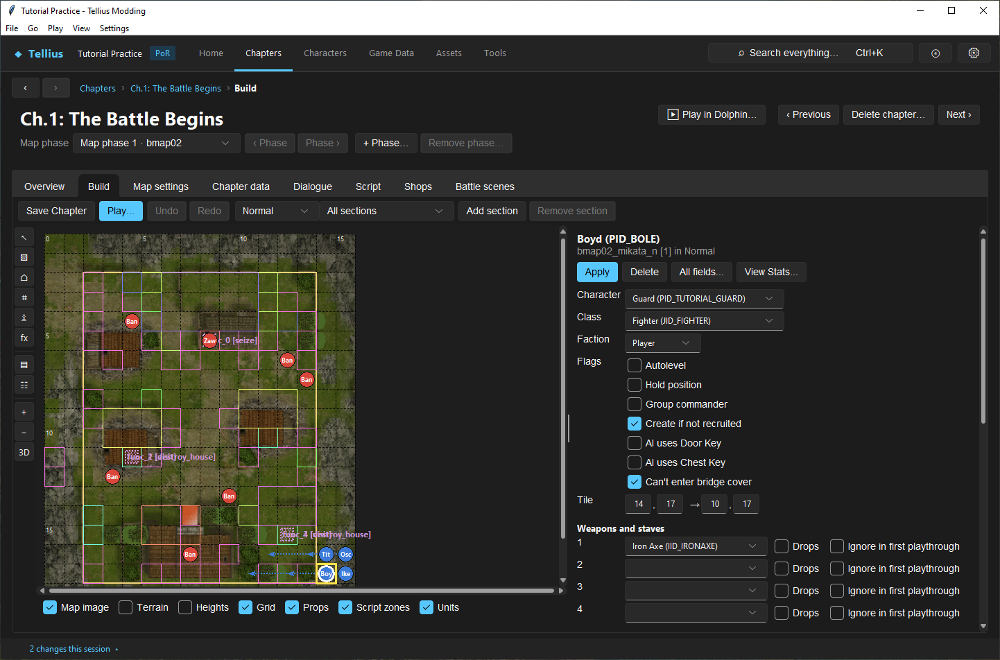

# Create a character

**Route:** Characters → **New character…** → the new character's **Stats** tab; then a chapter's **Build** tab

## What you will make

You will add `PID_TUTORIAL_GUARD` as a copy of Boyd, give it its own name, *Guard*, raise one stat, and put it in a player slot of Ch.1. At the end you can read every field of the **Stats** tab, you know which of them the copy still shares with Boyd, and you know where to look to check that nothing else uses the record.

## Before you begin

- The practice project, saved, with **Check** at its baseline ([Check a project and fix problems](05-check-project.md)).
- A template: the existing character closest to the one you want (class, weapon ranks, portrait, models). This lesson uses Boyd, `PID_BOLE`, an unpromoted Fighter.
- Make sure the new PID is free: Ctrl+K `TUTORIAL_GUARD` finds nothing.

## How the editor fits together

<!-- diagram character -->
<figure class="tutorial-figure" markdown="1">

<figcaption>Concept diagram, not an app screenshot. Creating a character record, placing the unit in a deployment, and checking it in Play. Select the image to open it at full size.</figcaption>
</figure>

A character is one record of `FE8Data.bin`. Other files find it by its **PID** (`PID_TUTORIAL_GUARD`):

| The record names… | By | Shared with other records? |
| --- | --- | --- |
| Its name | **Name key (MPID)**, a text in `Mess/common.m` | Yes, until you give it its own key |
| Its portrait | **Portrait (FID)** | Yes: changing the picture changes every character that uses it ([Create and assign a portrait](11-portraits.md)) |
| Its class | **Class (JID)**: bases, growths, weapon ranks, skills, map model | Yes: class edits affect every unit of the class |
| Its skills | three **Slot** SIDs, added to the class's innate skills | |
| Its map model | **Unpromoted** / **Promoted** AID; empty uses the class's | |

Everything about *where* and *how* the unit appears is not in the record but in a deployment file: tile, army, level, items, AI. A new record is in no deployment, no script and no message, so the game never shows it until you place it.

The Characters page sorts records into **Playable** (records with the player-side level-up values), **Named NPCs & bosses**, and **Generic** (soldiers that share a face, dummies, tutorial records).

## Guided walkthrough

### 1. Find the template

1. Open **Characters**. The chips choose a category (**Playable** by default); the count says how many cards are shown.
2. Type `Boyd` in **Search name or PID**: the search covers every category. Boyd's card shows his class, his PID and *+2 copies*: records that share his name key.
3. Open Boyd. The header shows his portrait, PID, class and promoted class as links, his category, and **Records:** `PID_BOLE`, `PID_BOLE_MAP1`, `PID_BOLE_EV`, his event copies, each a link.

### 2. Create the record

<!-- screenshot 10-a-setup.png -->
<figure class="tutorial-figure" markdown="1">

<figcaption markdown="span">**Characters › New character…**: the new PID is `PID_TUTORIAL_GUARD` and **Start as a copy of** is Boyd (`PID_BOLE`). The copy keeps Boyd's name key, portrait and class until you change them.</figcaption>
</figure>

1. Press **New character…** (on the Characters page, or in the bar of any character's **Stats** tab).
2. **ID**: `PID_TUTORIAL_GUARD`. **Start as a copy of**: *PID_BOLE*. Press **Create**.
3. The new record opens. Its status reads *Added PID_TUTORIAL_GUARD: save FE8Data.bin to list it on the Characters page*. It is appended at the end of the table, so no other record changes number.

### 3. Give it its own name

<!-- screenshot 10-e-hub.png -->
<figure class="tutorial-figure" markdown="1">

<figcaption markdown="span">**Characters**, **All**, *Boyd* in **Search name or PID**: one card, Boyd, *+3 copies*. Records that share a name key are shown as one: Boyd's two event records and the new `PID_TUTORIAL_GUARD`, which still uses `MPID_BOLE`.</figcaption>
</figure>

The copy is still called *Boyd*: its **Name key (MPID)** is Boyd's `MPID_BOLE`, and the text beside the field reads *Boyd*. Search `Boyd` on **Characters** again: the card now reads *+3 copies*, because records that share a name key are shown as one.

<!-- screenshot 10-f-name.png -->
<figure class="tutorial-figure" markdown="1">

<figcaption markdown="span">**Name key (MPID)** › **＋ Create new message…**: **Message ID** `MPID_TUTORIAL_GUARD`, **Message text** *Guard*. **Create and assign** writes the text into `Mess/common.m` and points the record at it; Boyd keeps `MPID_BOLE`.</figcaption>
</figure>

1. Open the **Name key (MPID)** list and pick **＋ Create new message…** at its end.
2. **Message ID**: `MPID_TUTORIAL_GUARD` (the app suggests one from the PID). **Message text**: `Guard`.
3. Press **Create and assign**. The text is written into `Mess/common.m` at once; the record now names it, and the text beside the field reads *Guard*. Boyd keeps `MPID_BOLE`.

### 4. Change one stat and save

<!-- screenshot 10-c-stats.png -->
<figure class="tutorial-figure" markdown="1">

<figcaption markdown="span">The new record after **＋ Create new message…** and before **Apply**: **Name key (MPID)** reads `MPID_TUTORIAL_GUARD` (*Guard*), the HP **Personal bonus** is raised from 6 to 7. The header still says *Boyd* and lists the records sharing his name until the file is saved.</figcaption>
</figure>

1. Under **Level, build and stats**, raise the HP **Personal bonus** by 1 (Boyd's 6 → 7). The header still says *Boyd* until the file is saved.
2. Press **Apply**: the bar reads *Unsaved changes in FE8Data.bin*.
3. Press **Save FE8Data.bin**.

<!-- screenshot 10-b-result.png -->
<figure class="tutorial-figure" markdown="1">

<figcaption markdown="span">After **Apply** and **Save FE8Data.bin**, reopening the record: the page is titled *Guard*, **Save FE8Data.bin** is disabled and the HP bonus is kept. The record exists, but nothing deploys it yet.</figcaption>
</figure>

Leave and reopen the record: the page is now titled *Guard*, the bonus is 7, **Save FE8Data.bin** is disabled.

### 5. Check that nothing uses it yet

<!-- screenshot 10-g-unused.png -->
<figure class="tutorial-figure" markdown="1">

<figcaption markdown="span">**Appearances** of the new character: *Not found in any deployment file or chapter message.* Creating a record neither deploys nor recruits it.</figcaption>
</figure>

Open the **Appearances** tab: *Not found in any deployment file or chapter message.* **Script references** is empty too.

### 6. Place it in a chapter

<!-- screenshot 10-d-deployment.png -->
<figure class="tutorial-figure" markdown="1">

<figcaption markdown="span">Placing it: on Ch.1's **Build** tab (*Normal*), Boyd's slot in `bmap02_mikata_n` selected and **Character** changed to `PID_TUTORIAL_GUARD`. **Apply**, then **Save Chapter**, writes the deployment file; this capture stops before **Apply**.</figcaption>
</figure>

1. Open Ch.1: The Battle Begins › **Build**, deployment file *Normal*.
2. Click Boyd's unit at the start position (`bmap02_mikata_n`, tile 14, 17).
3. In the selection panel, set **Character** to `PID_TUTORIAL_GUARD`. Keep **Class** empty (the character's own) and the items.
4. Press **Apply**, then **Save Chapter**.

The Guard now starts Ch.1 on Normal in Boyd's place. Boyd is no longer deployed there, but the script still recruits and talks to `PID_BOLE`; for a real character, add a new slot instead ([Place and tune units by difficulty](30-deployment-by-difficulty.md)). Put Boyd back after testing, or restore your project copy.

## Understand every control

### Characters page

| Control | What it does |
| --- | --- |
| **New character…** | The new-record dialog: **ID** and **Start as a copy of** (any record, or none for an empty one) |
| **Export Excel…** / **Import Excel…** | Every character in a workbook ([Edit data in bulk outside the app](67-bulk-edit.md)) |
| **Search name or PID** | Filters cards on every word typed, across all categories |
| **Playable**, **Named NPCs & bosses**, **Generic**, **All** | The category shown |
| Card | Name, class, PID; opens the character |

### Character header and tabs

| Part | What it shows |
| --- | --- |
| Portrait, name, PID | The record's face and name text |
| Class → promoted class | Links to **Game Data › Classes** |
| Category chip | Playable, Named NPCs & bosses or Generic |
| **Records:** | Other records with the same name key (event copies such as `PID_IKE_EV`), as links |
| **Stats** | The record's fields (below) |
| **Supports** | Its support partners ([Create supports and conversations](13-supports.md)) |
| **Portrait & models** | Its portrait, **Open in Portraits**, the four models it resolves to with **Open in 3D Models**, and **Simulate a battle…** ([Give a character unique models](12-character-model-slot.md)) |
| **Appearances** | **Deployed in** (every deployment row) and **Dialogue** (every message that shows or names it); double-click opens the row |
| **Script references** | Script functions that name its PID or name key |

### Stats tab

| Control | Meaning |
| --- | --- |
| **Apply** / **Revert** | Apply the form to `FE8Data.bin` in memory / reload the form from it |
| **Save FE8Data.bin** | Writes the file (every page sharing it) |
| **New character…** / **Remove** | Add a record / remove this one after checking that nothing names it ([Remove records without corrupting saves](15-remove-records.md)) |
| **Character (PID)** | The ID every caller uses |
| **Name key (MPID)** | The name text; **＋ Create new message…** makes a new one |
| **Portrait (FID)** / **Open** | The portrait; opens it in Portraits |
| **Class (JID)** / **Open** | The class; opens it in Game Data |
| **Slot 0**–**Slot 2** | Personal skills; **Class innate skills** lists the class's own |
| **Weapon ranks** | **Class**, **Own** and **Result** per weapon type (Sw, La, Ax, Bo, Fi, Th, Wi, St, Kn); **Own** sets a personal rank, empty keeps the class's |
| **Map models** **Unpromoted** / **Promoted** | A personal map model (AID); empty uses the class's |
| **Level** | The starting level |
| **Build** / **Weight** | Added to the class's; can be negative (Boyd −2) |
| **Transform gauge** | A laguz unit's starting gauge (0–20) |
| **Roster order** | Place in unit lists |
| **Biorhythm** / **Phase** | The biorhythm curve and its starting point |
| **Class base** | The class's base stats (read-only) |
| **Personal bonus** | Added to the class base for each stat |
| **Class growth %** / **Personal growth %** | The class's rates (read-only) / the character's |
| **Fixed growth start** | Starting values of the fixed level-up mode; only player-side records have them |

## Things to try next

1. **A different class.** Set **Class (JID)** to `JID_ARCHER`, **Apply**: **Weapon ranks** › **Result** follows the new class.
2. **A personal skill.** Put `SID_VANTAGE` in **Slot 1** and compare its first strike in the **Battle Simulator** ([Simulate and render a fight](56-battle-simulator.md)).
3. **Compare with the template.** **Simulate a battle…** from Boyd's and the Guard's **Portrait & models** tab against the same enemy.

## Interactions and precedence

- A unit's final stats combine the class base, the personal bonus, the level and the deployment's own values; a deployment can also give the unit another class.
- A copied name key, portrait or model is shared until you change it: renaming `MPID_BOLE`'s text would rename Boyd too.
- **Create and assign** writes `Mess/common.m` at once; the record change still needs **Save FE8Data.bin**.
- Saves store characters by their place in the table. Appending is safe for old saves; removing or reordering is not.

## Test matrix

| Case | Setup | Expected result |
| --- | --- | --- |
| Baseline | Before step 2 | Ctrl+K `TUTORIAL_GUARD` finds nothing |
| Intended change | Steps 2–4 | Record titled *Guard*, HP bonus 7, Boyd unchanged |
| Boundary | **Appearances** before step 6 | *Not found in any deployment file or chapter message.* |
| Placement | Step 6 saved | Ch.1's **Overview** cast lists *Guard* in *Player units* |
| In game | Ch.1 on Normal (Dolphin) | The Guard starts in Boyd's place |
| Likely failure | ID `PID_BOLE` | Refused: the ID exists |

## Troubleshooting

| Symptom | Likely cause | What to do |
| --- | --- | --- |
| The new character is called Boyd | It still uses `MPID_BOLE` | Step 3 |
| Renaming the copy renamed Boyd | The text of the shared key was edited | Give the copy its own key; put Boyd's text back |
| The card is missing from Characters | Not saved yet | **Save FE8Data.bin** |
| The unit does not appear in game | Not placed, placed on another difficulty, or the section is not deployed | **Appearances**; compare the deployment files |
| Stats differ from what you set | Deployment values or class change | Read the unit on **Build** |

## Save, build, and revert

**Save FE8Data.bin** for the record, **Save Chapter** for the placement; the name text is already written. To revert: put the deployment back, then **Remove** the record (refused while something names it), and remove the name text in `Mess/common.m` ([Remove records without corrupting saves](15-remove-records.md)). Or restore your project copy.

## Limits and confidence

- The fields and their effects are source-reviewed; steps 1–5 and the placement form of step 6 were done in the app on a US disc (app-tested).
- Exact in-game stats, growth and biorhythm behaviour are not checked in Dolphin here (unknown).

## Related tutorials and references

- Before: [Plan around campaign limits](09-campaign-limits.md)
- Next: [Create and assign a portrait](11-portraits.md), [Give a character unique models](12-character-model-slot.md)
- Reference: [Characters](../systems/characters.md), [Level Up Growth](../systems/level-up-growth.md)

---

[← Previous: Plan around campaign limits](09-campaign-limits.md) · [All tutorials](index.md) · [Next: Create and assign a portrait →](11-portraits.md)
