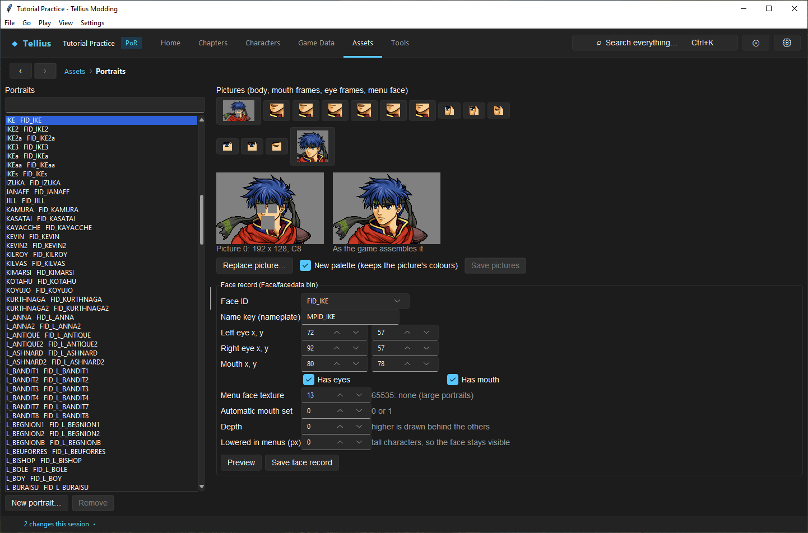
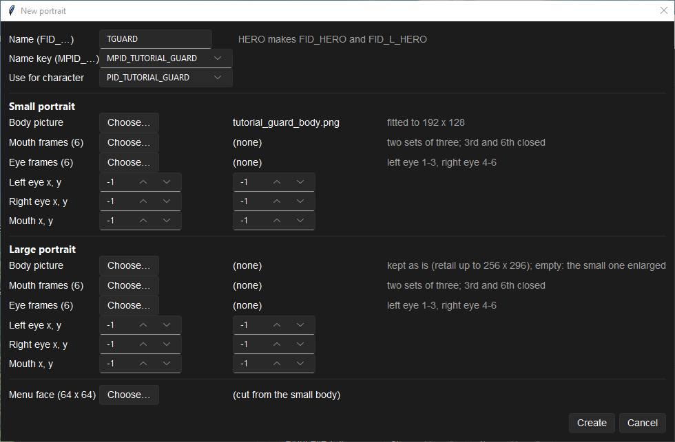
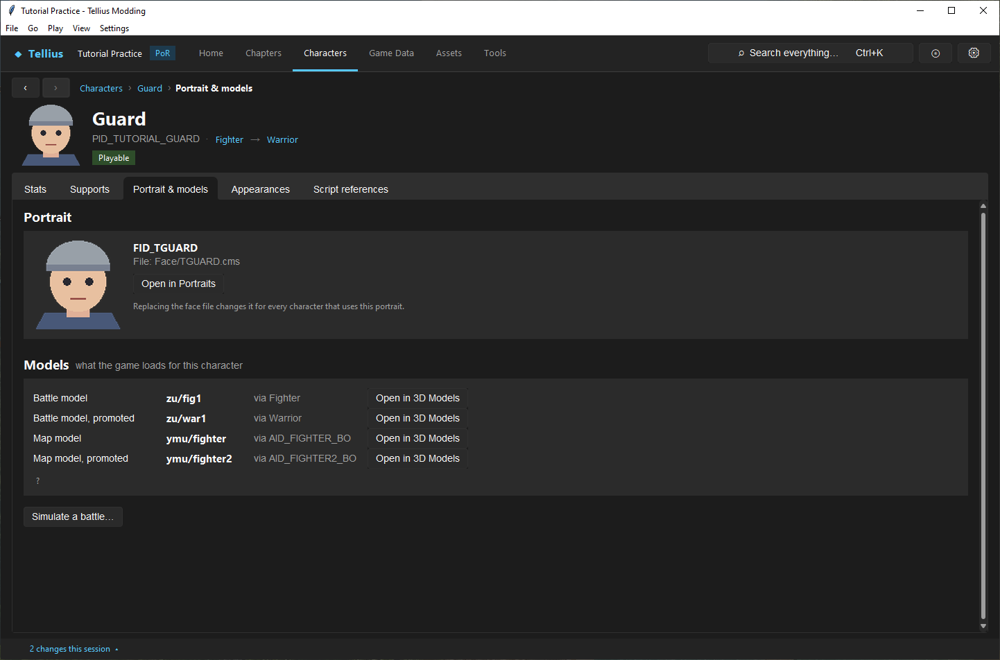

# Create and assign a portrait

**Route:** Assets → Portraits → New portrait…

## What you will make

You will make a new portrait pair, `FID_TGUARD` and `FID_L_TGUARD`, from one placeholder body picture, assign it to `PID_TUTORIAL_GUARD` ([Create a character](10-create-character.md)), and check it on the character page. At the end you know which file holds the pictures, which holds the face record, which holds the assignment, and what each field of the face record does.

## Before you begin

- `PID_TUTORIAL_GUARD` from lesson 10, saved.
- A body picture you made or may use: a PNG with transparency, about 192 × 128 for the small portrait. The capture for this lesson used a flat-colour placeholder bust drawn for the purpose.
- Optional: six mouth frames and six eye frames, cut from the same art, with the file names sorted in frame order (`mouth1.png` … `mouth6.png`).

## How the editor fits together

| Piece | Where it is | Saved by |
| --- | --- | --- |
| The pictures (body, mouth and eye frames, menu face) | `Face/<NAME>.cms`, one file per portrait, small and large in one pair | **Save pictures**, or **Create** for a new one |
| The face record: which file, the nameplate key, eye and mouth positions, flags | `Face/facedata.bin`, one row per FID | **Save face record**, or **Create** |
| The character's choice of portrait | the character record's **Portrait (FID)** in `FE8Data.bin` | **Save FE8Data.bin** |

The game pairs a small portrait `FID_NAME` (the map, menus, dialogue boxes) with a large one `FID_L_NAME` (full-screen conversations). A character names only the small one; the large one is found by the name.

A portrait is shared: every character and every dialogue line that names `FID_BOLE` shows the same picture. Replacing Boyd's pictures changes Boyd everywhere; to give a copy its own face, make a new portrait.

## Guided walkthrough

### 1. Look at a retail portrait

<!-- screenshot 11-viewer.png -->
<figure class="tutorial-figure" markdown="1">

<figcaption markdown="span">**Assets › Portraits** with `FID_IKE` selected: the pictures as the game assembles them, **Replace picture…**, and the **Face record (Face/facedata.bin)** with eye and mouth positions.</figcaption>
</figure>

Open **Assets › Portraits** and select `IKE` in **Portraits**. **Pictures (body, mouth frames, eye frames, menu face)** lists every picture of the file; selecting one shows its size under it (*Picture 0: 192 x 128, …*). **As the game assembles it** shows the body with the eyes and mouth placed by the face record. Under **Face record (Face/facedata.bin)**, read Ike's **Left eye x, y**, **Right eye x, y** and **Mouth x, y**: start your own positions from a face framed like yours.

### 2. Create the portrait

<!-- screenshot 11-a-setup.png -->
<figure class="tutorial-figure" markdown="1">

<figcaption markdown="span">**New portrait…**: name `TGUARD` (makes `FID_TGUARD` and `FID_L_TGUARD`), the nameplate key, **Use for character** `PID_TUTORIAL_GUARD`, and one body picture. Mouth and eye frames are optional; without them the face does not animate.</figcaption>
</figure>

1. Press **New portrait…** under the list.
2. **Name (FID_…)**: `TGUARD` (*HERO makes FID_HERO and FID_L_HERO*: type the name without the prefix).
3. **Name key (MPID_…)**: `MPID_TUTORIAL_GUARD`, the name shown on the portrait's nameplate.
4. **Use for character**: `PID_TUTORIAL_GUARD`.
5. Under **Small portrait**, **Body picture** › **Choose…**: your PNG (*fitted to 192 x 128*). Leave **Mouth frames (6)** and **Eye frames (6)** at *(none)* for a still face, or choose six pictures for each (*Choose six pictures (sorted by file name)*): mouths are *two sets of three; 3rd and 6th closed*, eyes are *left eye 1-3, right eye 4-6*. With frames, set **Left eye x, y**, **Right eye x, y** and **Mouth x, y** (−1 means not placed).
6. Under **Large portrait**, leave everything empty: the small body is enlarged (*empty: the small one enlarged*). A large body is kept at its size (retail goes up to 256 × 296).
7. **Menu face (64 x 64)**: leave *(cut from the small body)*.
8. Press **Create**. The app writes `Face/TGUARD.cms`, adds `FID_TGUARD` and `FID_L_TGUARD` to `Face/facedata.bin`, and sets the character's **Portrait (FID)** in memory.

### 3. Save the assignment and check it

<!-- screenshot 11-b-result.png -->
<figure class="tutorial-figure" markdown="1">

<figcaption markdown="span">`PID_TUTORIAL_GUARD`'s **Portrait & models** tab after **Create** and saving FE8Data.bin: the character resolves `FID_TGUARD`. This is the app's assembled preview, not the game.</figcaption>
</figure>

1. Press **Save FE8Data.bin** (status bar: *1 unsaved: FE8Data.bin*).
2. Open `PID_TUTORIAL_GUARD` › **Portrait & models**: *FID_TGUARD*, *File: Face/TGUARD.cms*, and the new picture. The header shows it too.
3. In a dialogue line of a test chapter, show the portrait with `$FCTGUARD|` ([Author and connect a dialogue scene](37-dialogue-editor.md)).

### 4. Adjust the face record

Back in **Assets › Portraits**, select `TGUARD`. Change a value of the face record (**Lowered in menus (px)**, say), press **Preview**: **As the game assembles it** redraws. **Save face record** writes it; until then, reopening the portrait shows the old value.

## Understand every control

### Portraits page

| Control | What it does |
| --- | --- |
| **Portraits** list | The `Face/*.cms` files |
| **New portrait…** / **Remove** | Create a pair (below) / remove a portrait the mod added |
| **Pictures (body, mouth frames, eye frames, menu face)** | The pictures of the file; the line under the preview gives the selected one's size and format |
| **As the game assembles it** | Body, eyes and mouth placed by the face record |
| **Replace picture…** | Replaces the selected picture; the new image is stretched to its size (*Choose a picture (…; it is stretched to fit)*) |
| **New palette (keeps the picture's colours)** | Rebuilds the picture's palette from the new image; off, the image is fitted to the existing colours. Only for indexed pictures |
| **Save pictures** | Writes the `.cms` file |

### Face record (Face/facedata.bin)

| Field | What it does |
| --- | --- |
| **Face ID** | The FID of the record (`FID_TGUARD`) |
| **Name key (nameplate)** | The MPID shown on the portrait's nameplate |
| **Left eye x, y** / **Right eye x, y** / **Mouth x, y** | Where the eye and mouth frames go on the body |
| **Has eyes** / **Has mouth** | Animate the eyes (blinking) and mouth (talking) |
| **Menu face texture** | Picture number of the 64 × 64 menu face; *65535: none (large portraits)* |
| **Automatic mouth set** | Which mouth set (0 or 1) talks by default |
| **Depth** | *higher is drawn behind the others* when portraits overlap |
| **Lowered in menus (px)** | Moves a tall face down in menus, *so the face stays visible* |
| **Preview** / **Save face record** | Redraw with the edited values / write `Face/facedata.bin` |

### New portrait

| Control | What it does |
| --- | --- |
| **Name (FID_…)** | `NAME` makes `FID_NAME` and `FID_L_NAME`; must be unused |
| **Name key (MPID_…)** | The nameplate text key |
| **Use for character** | Sets that character's **Portrait (FID)** (not saved: **Save FE8Data.bin**) |
| **Small portrait** / **Large portrait** › **Body picture** | The main picture; the large one is optional |
| **Mouth frames (6)** / **Eye frames (6)** | Exactly six each, or none; *Choose exactly six pictures.* otherwise |
| **Left eye x, y**, **Right eye x, y**, **Mouth x, y** | Positions for each size; −1 when unused |
| **Menu face (64 x 64)** | A picture of its own, or cut from the small body |
| **Create** / **Cancel** | Write the pair and the records / close |

## Things to try next

1. **Animate it.** Make six mouth and six eye frames, create a second portrait with them, and set the positions until **As the game assembles it** lines them up.
2. **Recolour a shared face.** **Replace picture…** on a generic soldier's body with **New palette (keeps the picture's colours)** on and off, and compare.
3. **A large portrait of its own.** Give **Large portrait** › **Body picture** a 256 × 296 image and check it in a full-screen conversation.

## Interactions and precedence

Coordinates only matter when the corresponding feature flag and pictures exist. **New palette** is available only when all pictures use the compatible indexed format; without it, replacement colors are fitted to the existing palette. Assigning a character in the creation dialog does not save FE8Data. Replacing a shared face file affects every character and dialogue using it.

## Test matrix

| Context | Inspect |
| --- | --- |
| Assembled preview | transparent seams, eye/mouth anchors |
| Character page | small FID resolution and cache refresh |
| Menu/list | 64×64 crop and vertical offset |
| Dialogue idle | body, facing, eye state |
| Dialogue speaking | both mouth sets/closed frames |
| Large-face context | paired `FID_L_` resource |
| Dolphin | load, colors, animation, no missing asset |

## Troubleshooting

Wrong colors usually indicate palette mismatch; compare **New palette** before moving features. Transparent holes indicate source alpha or anchor errors. If Preview changes but reopening does not, save the face record. If pictures revert, use **Save pictures**. If the character still uses the old face, save FE8Data and rebuild. A successful app preview does not prove the new pair loads in game.

## Save, build, and revert

Save picture bytes, face metadata, and FE8Data assignment independently, then reopen all three. Preserve the original pair and checkpoint. Removing a mod-added portrait removes its small/large records and files; first repoint every consuming character/dialogue.

## Limits and confidence

- Sizes, pairing, frame order, palette rules, fields and save owners are source-reviewed. Creating `FID_TGUARD` from a placeholder and assigning it was done in the app on a US disc (app-tested).
- A new portrait pair is not yet checked in Dolphin (unknown); the app's assembled preview does not prove every dialogue transition.

## Related tutorials and references

- [Create a character](10-create-character.md)
- [Author and connect a dialogue scene](37-dialogue-editor.md)
- [Face Data](../formats/face-data.md)
- [Dialogue Engine](../systems/dialogue-engine.md)

---

[← Previous: Create a character](10-create-character.md) · [All tutorials](index.md) · [Next: Give a character unique models →](12-character-model-slot.md)
