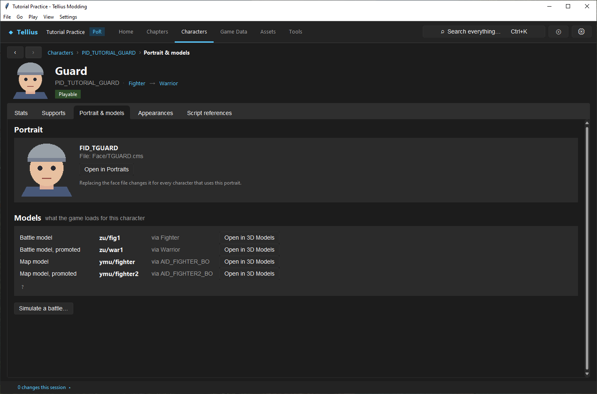
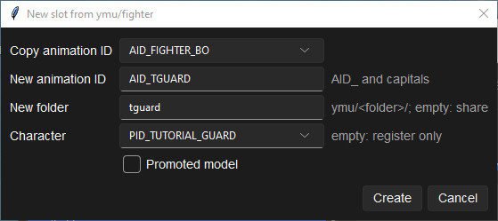
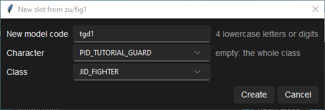
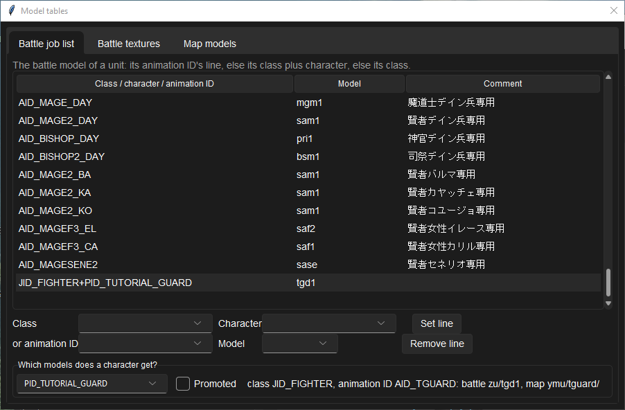
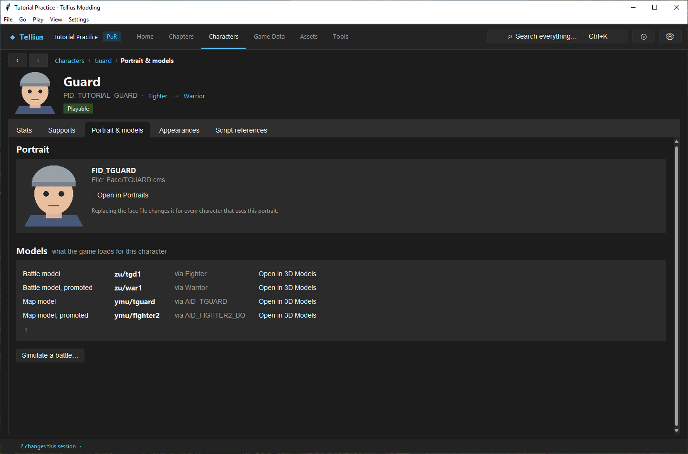

# Give a character unique models

**Route:** a character's **Portrait & models**; Assets → **3D Models** → **New slot…** / **Model tables…**

## What you will make

You will give `PID_TUTORIAL_GUARD` its own map model and its own battle model, both copies of what it uses now (Boyd's), and check that Boyd and every other Fighter still get theirs. At the end you can say, for any character, which table line picks each of its four models, and you have two slots ready to receive new geometry.

## Before you begin

- `PID_TUTORIAL_GUARD` from [Create a character](10-create-character.md), saved.
- A copy of the project folder: slots write `FE8Anim.bin`, `zdbx.cmp`, `FE8Data.bin` and new model folders.

## How the editor fits together

A unit has four models: a battle model and a map model, each unpromoted and promoted. They are chosen by two separate systems:

| Model | Chosen by | Stored in |
| --- | --- | --- |
| Map model (`ymu/<folder>/`) | The character's **Unpromoted** / **Promoted** animation ID (AID) on its **Stats** tab; empty uses the class's | `FE8Data.bin` (the AID), `FE8Anim.bin` (AID → folder and textures) |
| Battle model (`zu/<code>/`) | The **Battle job list**: the unit's animation ID's line, else its *class + character* line, else its class's line | `zdbx.cmp` (`zdbx/jobList.dbx`) |

A model folder is shared by everyone whose line or AID points to it: every Fighter uses `zu/fig1`; Boyd and his copy share `AID_FIGHTER_BO`, which uses `ymu/fighter`. Editing that geometry changes all of them. A **slot** is a copy of a model under a new name, plus the line or AID that sends one character to it.

## Guided walkthrough

### 1. Read what the character gets

<!-- screenshot 12-look.png -->
<figure class="tutorial-figure" markdown="1">

<figcaption markdown="span">**Portrait & models** answers which models a character gets: *Battle model* `zu/fig1` via Fighter, *Map model* `ymu/fighter` via `AID_FIGHTER_BO`, and the promoted pair. Every Fighter shares `zu/fig1`; Boyd and his copy share `AID_FIGHTER_BO`.</figcaption>
</figure>

Open the Guard › **Portrait & models**. Under **Models**: *Battle model* `zu/fig1` via Fighter, *Battle model, promoted* `zu/war1` via Warrior, *Map model* `ymu/fighter` via `AID_FIGHTER_BO`, *Map model, promoted* `ymu/fighter2` via `AID_FIGHTER2_BO`. **Open in 3D Models** opens each one.

### 2. Make a map-model slot

<!-- screenshot 12-a-setup.png -->
<figure class="tutorial-figure" markdown="1">

<figcaption markdown="span">**New slot…** on `ymu/fighter`: **Copy animation ID** `AID_FIGHTER_BO` (Boyd's), **New animation ID** `AID_TGUARD`, **New folder** `tguard` (its own copy of the files), **Character** `PID_TUTORIAL_GUARD`, **Promoted model** off.</figcaption>
</figure>

1. Press **Open in 3D Models** on the *Map model* row (`ymu/fighter`), then **New slot…**.
2. **Copy animation ID**: `AID_FIGHTER_BO`. **New animation ID**: `AID_TGUARD` (*AID_ and capitals*). **New folder**: `tguard` (*ymu/<folder>/; empty: share*: empty would make a new AID that uses the same files). **Character**: `PID_TUTORIAL_GUARD` (*empty: register only*). **Promoted model**: off.
3. Press **Create**. The app copies `ymu/fighter/` to `ymu/tguard/`, adds `AID_TGUARD` to `FE8Anim.bin`, and sets the Guard's **Unpromoted** map model to it in `FE8Data.bin`. If `FE8Data.bin` had unsaved edits, it asks to save them first.

### 3. Make a battle-model slot

<!-- screenshot 12-c-battle.png -->
<figure class="tutorial-figure" markdown="1">

<figcaption markdown="span">**New slot…** on `zu/fig1`: **New model code** `tgd1`, **Character** `PID_TUTORIAL_GUARD`, **Class** `JID_FIGHTER` (filled from the character). **Create** copies the model and adds the job-list line `JID_FIGHTER+PID_TUTORIAL_GUARD`.</figcaption>
</figure>

1. Back on **Portrait & models**, press **Open in 3D Models** on *Battle model* (`zu/fig1`), then **New slot…**.
2. **New model code**: `tgd1` (*4 lowercase letters or digits*). **Character**: `PID_TUTORIAL_GUARD` (*empty: the whole class*). **Class** fills in: `JID_FIGHTER`.
3. Press **Create**. The app copies `zu/fig1` to `zu/tgd1` in `zdbx.cmp` and adds the job-list line `JID_FIGHTER+PID_TUTORIAL_GUARD` → `tgd1`.

### 4. Check every character's result

<!-- screenshot 12-b-result.png -->
<figure class="tutorial-figure" markdown="1">

<figcaption markdown="span">**Model tables…**, **Battle job list**: the new line `JID_FIGHTER+PID_TUTORIAL_GUARD` → `tgd1`. **Which models does a character get?** with `PID_TUTORIAL_GUARD`: battle `zu/tgd1`, map from `AID_TGUARD`. Boyd still gets `zu/fig1` and `AID_FIGHTER_BO`.</figcaption>
</figure>

1. On **3D Models**, press **Model tables…**. The **Battle job list** tab ends with the new line `JID_FIGHTER+PID_TUTORIAL_GUARD`, model `tgd1`.
2. In **Which models does a character get?**, pick `PID_TUTORIAL_GUARD`: *class JID_FIGHTER, animation ID AID_TGUARD: battle zu/tgd1, map ymu/tguard/*. Tick **Promoted**: still `zu/war1` and `ymu/fighter2`.
3. Pick `PID_BOLE`: `zu/fig1` and `ymu/fighter`, unchanged. Pick another Fighter's PID: `zu/fig1`.

<!-- screenshot 12-d-look.png -->
<figure class="tutorial-figure" markdown="1">

<figcaption markdown="span">The Guard's **Portrait & models** after both slots: *Battle model* `zu/tgd1`, *Map model* `ymu/tguard` via `AID_TGUARD`. The promoted rows are unchanged: the slots were made for the unpromoted state only.</figcaption>
</figure>

The Guard's **Portrait & models** now reads *Battle model* `zu/tgd1`, *Map model* `ymu/tguard` via `AID_TGUARD`; the promoted rows are unchanged. The slots hold exact copies, so the game looks the same until you import new geometry into them ([Round-trip a model through Blender safely](51-blender-round-trip.md)).

### 5. Recolour instead of copying

A different colour does not need a slot: the texture tables already pick a texture per character and per army, so a recoloured copy of the texture is enough.

1. On Gatrie's **Portrait & models**, press **Colour variant…**. **Also for** has `PID_GATRIE_EV` (his event record) ticked.
2. Click the blue of his armour in the **Before** picture, press **To…** and choose a red. Narrow **Band ±** until skin and gold stay as they are in **After**; the **Texture** list switches between his battle textures, map textures and portraits.
3. Press **Create**. The changes list shows what is written: `zu/amr1/gatrie_red.tpl` with the line `PID_GATRIE gatrie_red`, the same in `zu/gen1`, a new `tex_<n>.tpl` in `ymu/armor/` and `ymu/general/` with `AID_ARMOR_GA` and `AID_GENERAL_GA` pointing at it, and the portraits `FID_GATRIE_RED` / `FID_L_GATRIE_RED` given to both records.

For a whole army of a class, open the class in **Game Data** › **Classes** and press **Army colours…**: with **Army** enemy and `JID_SWORDER`, the enemy line of `zu/swm1` and the enemy texture number of `AID_SWORDER` point at blue copies, so every enemy Myrmidon without a texture line of its own turns blue.

## Understand every control

### New slot (map model, from a `ymu/` set)

| Control | What it does |
| --- | --- |
| **Copy animation ID** | The AID whose record (folder, textures) is copied; the list holds the AIDs of this folder |
| **New animation ID** | The new AID: `AID_` and capitals |
| **New folder** | The copy's folder under `ymu/`; empty shares the source's files |
| **Character** | The character who gets the new AID; empty only registers it |
| **Promoted model** | Sets the character's **Promoted** AID instead of **Unpromoted** |

### New slot (battle model, from a `zu/` set)

| Control | What it does |
| --- | --- |
| **New model code** | The copy's name: 4 lowercase letters or digits |
| **Character** | With a class, makes a *class + character* line; empty: the whole class uses the copy |
| **Class** | The class of the line; filled from the character |

### Model tables

| Tab / control | What it does |
| --- | --- |
| **Battle job list** | Lines *class*, *class+character* or *animation ID* → model code. **Class**, **Character**, **or animation ID** and **Model**, then **Set line** adds or replaces a line; **Remove line** removes the selected one |
| **Which models does a character get?** / **Promoted** | Resolves a PID as the game does and prints the battle and map models |
| **Battle textures** | Per battle model: which texture file is used for a key (animation ID, character, or army: 自軍 player, 敵軍 enemy, 中立 other, 味方 ally); **Set** / **Remove**; **Remove this slot...** deletes a battle model the mod added |
| **Map models** | Per animation ID: its folder and one texture number per army; **Set textures** writes them (every weapon set of the ID loads `ymu/<folder>tex_<n>.tpl`, `n` picked by the unit's army); **Remove this slot...** deletes an AID the mod added and puts characters that used it back on their previous or class model |

### Colour variant (character page) and Army colours (class form)

| Control | What it does |
| --- | --- |
| **Tag** | Names the new files and IDs: `gatrie_red.tpl`, `FID_GATRIE_RED`, and `<AID>_RED` when a copy of the map records is needed. 1-8 capitals or digits, starting with a letter |
| **Battle texture** / **Map texture** / **Portrait** | Which of the three to recolour (portraits only for a character) |
| **Also for** | Other records with the same name and portrait; ones extending the PID in the same class (`PID_GATRIE_EV`) start ticked |
| **Colours where nothing of the character's own picks one** | The army texture copied when the character has no texture line or texture number of its own |
| **Army whose colours change** / **Its promoted class too** | Class form: the army key and texture slot to recolour, and whether the promoted class follows |
| **From… / To…** | The colour to change and the colour it becomes; clicking **Before** picks the first |
| **Hue to change**, **Band ±**, **Soft edge** | The hues that change: a band around the hue, fading out over the soft edge |
| **Turn hue by**, **Saturation**, **Brightness** | What happens to them (filled from **From…** and **To…**) |
| **Leave greys under** | Colours less saturated than this stay: steel, white and black |

A character whose map animation ID is shared (with the class or other characters) gets a copy of the records under `<AID>_<TAG>`, using the same folder, and the job-list line of the old ID is copied so the battle model stays. Portraits change palette only, so the eye and mouth frames follow.

1. **The promoted state.** Repeat steps 2 and 3 from `ymu/fighter2` and `zu/war1` with **Promoted model** on, then check **Promoted** in **Which models does a character get?**.
2. **A class-wide model.** In **Model tables…**, set the line `JID_FIGHTER` to `tgd1` and look at Boyd: every Fighter now uses the copy. Set it back to `fig1`.
3. **Remove the slots.** **Battle textures** › `tgd1` › **Remove this slot...**, then **Map models** › `AID_TGUARD` › **Remove this slot...**: the Guard falls back to the class models.

## Interactions and precedence

Character map AID overrides class AID; empty character fields fall back to class. Battle resolution uses its own ordered table conditions. Broad JID lines can match before/alongside character-specific intent depending on table structure, so inspect the resolved result, not merely the new row. Texture/model packs may remain shared unless the slot operation copied them.

## Test matrix

| Character/state | Map | Battle |
| --- | --- | --- |
| tutorial unpromoted | cloned only if targeted | cloned only if targeted |
| tutorial promoted | independent expected result | independent expected result |
| source character | original | original |
| same-class third character | original unless JID-scoped | original unless JID-scoped |
| story variant PID | explicitly tested | explicitly tested |
| unchanged clone then imported clone | both render | both render |

## Troubleshooting

If several units change, inspect JID scope and shared resources. If tables show the clone but the old model appears, verify promotion state, saved tables, build identity, and fresh initialization. If map works but battle fails, debug the battle table/resource path separately. If imported geometry distorts, restore the unchanged cloned baseline and audit rig, scale, weights, anchors, materials, and animation compatibility.

## Save, build, and revert

Checkpoint before slot creation. Save FE8Data and model tables/resources they own, run Check, and first build the unchanged clone. Revert assignment and copied resource together; deleting a slot while a table still selects it leaves a dangling presentation path.

## Limits and confidence

- The two resolution systems, the dialogs and what they write are source-reviewed. Both slots of this lesson were created in the app on a US disc, checked in **Model tables…** and on the character page, then removed (app-tested).
- How a copied or replaced model plays in every map action and battle animation needs Dolphin (unknown).
- Colour variants and army colours were created in the app on a copy of a US project and their files and tables read back (app-tested). The per-character battle texture line follows the engine's lookup order and the Boyd test; a new loose `tex_<n>.tpl` texture number for a map model has not been seen in game yet (unknown).

## Related tutorials and references

- [Create and assign a portrait](11-portraits.md)
- [Round-trip a model through Blender safely](51-blender-round-trip.md)
- [Model Formats](../formats/model-formats.md)
- [Combat Animation](../systems/combat-animation.md)

---

[← Previous: Create and assign a portrait](11-portraits.md) · [All tutorials](index.md) · [Next: Create supports and conversations →](13-supports.md)
