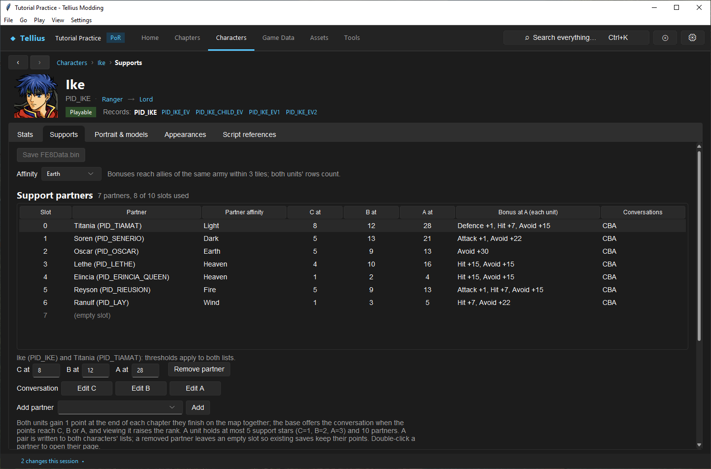
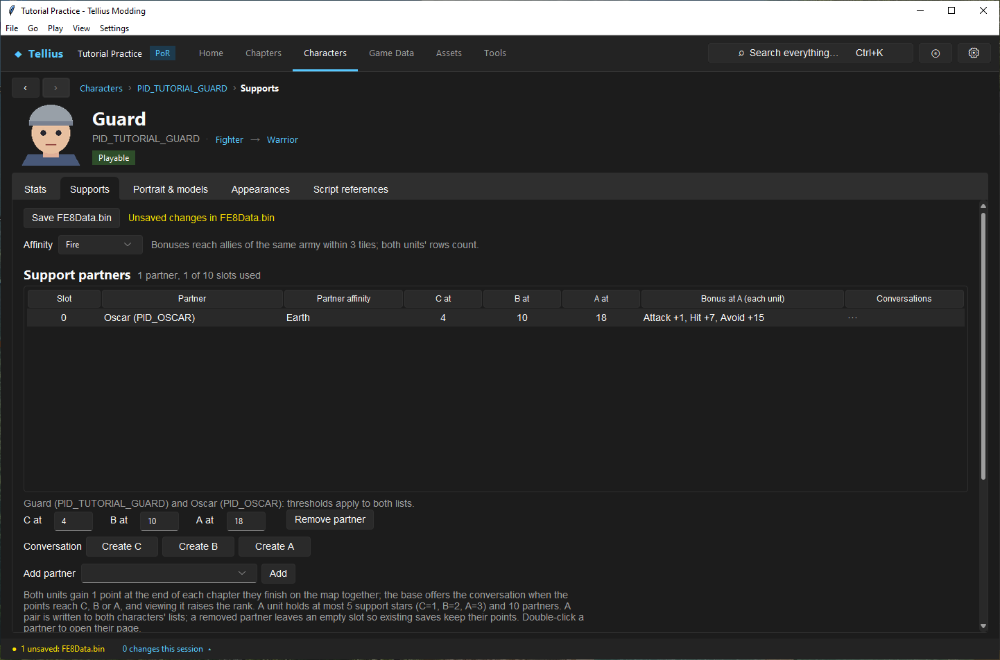
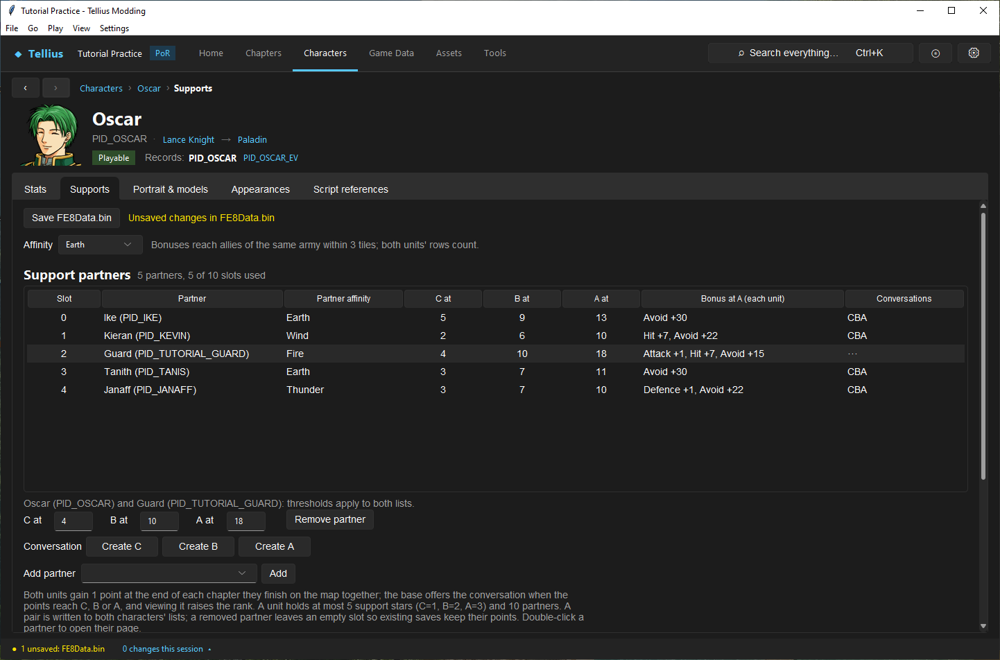

# Create supports and conversations

**Route:** Character → Supports; Game Data → Supports

## What you will make

You will pair `PID_TUTORIAL_GUARD` with Oscar, set the pair's C, B and A thresholds, see the pair on both characters, and read its bonus. At the end you know where supports, bonds and affinity bonuses are stored, what each threshold means in points, and how to add the three conversations.

## Before you begin

- `PID_TUTORIAL_GUARD` from [Create a character](10-create-character.md), saved. A copied character does not copy its template's support list: it starts with no partner.
- A copy of the project folder. Saves remember support points by slot number, so changing a list in a released mod affects saves already made.

## How the editor fits together

| Data | Where it is | Edited on |
| --- | --- | --- |
| Each character's affinity and support list (up to 10 partners, with C/B/A thresholds) | `FE8Data.bin` | the character's **Supports** tab; **Game Data › Supports › Pairs** |
| Bonds (always-on pair effects, separate from ranks) | `FE8Data.bin` | the character's **Supports** tab, **Bonds** |
| Bonus per affinity and rank | `FE8Data.bin` | **Game Data › Supports › Affinity bonuses** |
| The C, B and A conversations | `Mess/yell.m`, `MYELL_…` messages | **Conversation** buttons; **Game Data › Supports › Conversations** |

A pair is written to both characters' lists with the same thresholds. Both units gain 1 point at the end of each chapter they finish on the map together; when the points reach **C at**, **B at** or **A at**, the base offers that conversation, and viewing it raises the rank. A unit holds at most 5 support stars (C = 1, B = 2, A = 3). With a rank, each unit gets the bonus of its own affinity row and its partner's when they are within 3 tiles in the same army.

## Guided walkthrough

### 1. Read a retail list

<!-- screenshot 13-a-setup.png -->
<figure class="tutorial-figure" markdown="1">

<figcaption markdown="span">Ike's **Supports** tab with a partner selected: the pair's C/B/A thresholds, the conversation buttons and **Add bond with**. Both partners hold their own copy of the pair.</figcaption>
</figure>

Open Ike › **Supports**: **Affinity** *Earth*, then **Support partners** *7 partners, 8 of 10 slots used*. Each row gives **Slot**, **Partner**, **Partner affinity**, **C at**, **B at**, **A at**, **Bonus at A (each unit)** and **Conversations** (*CBA*: all three exist). Select Titania: *Ike (PID_IKE) and Titania (PID_TIAMAT): thresholds apply to both lists.*, with 8 / 12 / 28.

### 2. Add a partner

<!-- screenshot 13-c-pair.png -->
<figure class="tutorial-figure" markdown="1">

<figcaption markdown="span">The Guard's **Supports** after **Add partner** `PID_OSCAR` › **Add**: the pair starts at *1 / 3 / 5*; here **C at** 4, **B at** 10, **A at** 18. **Conversation** offers **Create C**, **Create B**, **Create A**: no `MYELL_` scene exists yet.</figcaption>
</figure>

1. Open the Guard › **Supports**. **Affinity** is *Fire* (copied from Boyd); **Support partners** is empty.
2. In **Add partner**, pick *Oscar (PID_OSCAR)* and press **Add**. The pair appears with 1 / 3 / 5, the most common retail thresholds.
3. Set **C at** `4`, **B at** `10`, **A at** `18` (each larger than the last); Tab or Enter applies them. The bar reads *Unsaved changes in FE8Data.bin*.
4. **Conversation** shows **Create C**, **Create B**, **Create A**: no scene exists yet.

### 3. Check the other side

<!-- screenshot 13-b-result.png -->
<figure class="tutorial-figure" markdown="1">

<figcaption markdown="span">Oscar's **Supports**: the same pair, written to both lists with the same thresholds, in the first empty slot of Oscar's list (2). Its **Bonus at A (each unit)** is *Attack +1, Hit +7, Avoid +15* (Fire with Earth). **Remove partner** on either side removes both and leaves the slots empty.</figcaption>
</figure>

Double-click Oscar in the list (or open his page) › **Supports**: *Guard (PID_TUTORIAL_GUARD)* sits in slot 2, the first empty slot of his list, with 4 / 10 / 18 and **Bonus at A (each unit)** *Attack +1, Hit +7, Avoid +15*.

### 4. Write the conversations and save

1. Press **Create C**: **Game Data › Supports › Conversations** opens on a new `MYELL_…` message for the pair in `Mess/yell.m`, filled from a template scene with both characters' large portraits. Write the scene ([Author and connect a dialogue scene](37-dialogue-editor.md)) and press that tab's **Save** (`yell.m` has its own save). Repeat for B and A; the buttons become **Edit C**, **Edit B**, **Edit A**.
2. Press **Save FE8Data.bin**.
3. Run **Tools › Check**: a pair missing from one side, or naming a character that does not exist, is reported under **Supports**.

## Understand every control

### Supports tab

| Control | What it does |
| --- | --- |
| **Affinity** | The character's element; its row of **Affinity bonuses** applies |
| **Support partners** | The list, by slot; *N partners, M of 10 slots used* |
| **C at** / **B at** / **A at** | Points needed for each rank; must increase |
| **Remove partner** | Removes the pair from both lists, leaving the slots empty |
| **Conversation** **Create C** / **Edit C** (B, A) | Opens the rank's message in **Game Data › Supports › Conversations**, creating it from a template scene when missing |
| **Add partner** / **Add** | Adds a pair (1 / 3 / 5) |
| **Bonds** | **With**, **This character is**, **Effect**, **Value**; **Remove bond**; **Add bond with** / **Add** |
| **Save FE8Data.bin** | Writes the lists, bonds and affinities |

Bond effects: an adjacent same-army pair each gains the configured Critical, or opponents have no Critical against the second unit while the first is adjacent. Bonds need no rank.

### Game Data › Supports

| Tab | What it shows |
| --- | --- |
| **Pairs** | Every pair once: **Character**, **Partner**, thresholds, bonus, conversations; problems in yellow |
| **Affinity bonuses** | **Bonus per support rank**: per **Affinity**, Attack, Defence, Hit, Avoid, Critical, Critical avoid |
| **Conversations** | Every `MYELL_` support conversation |

## Things to try next

1. **A bond.** On the Guard's **Supports**, **Add bond with** Boyd and set its **Effect** and **Value**; compare in the **Battle Simulator** with the two units adjacent.
2. **Bonus rows.** In **Affinity bonuses**, read the Fire and Earth rows and add them up: they give the pair's *Bonus at A*.
3. **Remove the pair.** **Remove partner**, save, and look at Oscar's list: slot 2 is empty again.

## Interactions and precedence

Both partners' affinity rows contribute while they are in the same army and within three tiles. Current rank multiplies each row. Bonds require adjacency and operate separately. Chapter parts can cause the support-point pass to run again when configured by the game's flow/patch behavior, so multi-part chapters need explicit observation. Threshold waiting and five-star saturation stop ordinary point gain.

## Test matrix

| Scenario | Expected observation |
| --- | --- |
| Only A deployed | no pair point gain |
| A and B finish chapter | one ordinary point each when eligible |
| At threshold before viewing | no further ordinary gain |
| View C/B/A conversation | final point/rank applied to both |
| Same army within 3 tiles | affinity bonuses included |
| More than 3 tiles | rank exists but combat bonus absent |
| Five stars already held | further rank progression blocked |
| Bond adjacent/nonadjacent | bond effect toggles independently |

## Troubleshooting

If the pair appears on only one side, rerun Check and repair the symmetric data through the editor. If the conversation button exists but content is missing, inspect its `MYELL_` entry and save `yell.m`. If points stop, check pending conversation and total stars. If combat bonuses are absent, check rank, same-army allegiance, distance, and affinity rows rather than thresholds alone.

## Save, build, and revert

Save relationship/affinity/bond data to FE8Data and conversations to `yell.m`; reopen both. Use a fresh save for structural pair-list changes. Revert the pair and its three messages together, leaving empty support slots when removing from a save-sensitive list.

## Limits and confidence

- The data layout, point and rank rules, star cost, range and controls are source-reviewed. Adding the Guard–Oscar pair and setting its thresholds was done in the app on a US disc, then reverted (app-tested).
- Point gain, the base conversations and the bonuses in play are not checked in Dolphin here (unknown).

## Related tutorials and references

- [Create a character](10-create-character.md)
- [Author and connect a dialogue scene](37-dialogue-editor.md)
- [Support System](../systems/support-system.md)
- [Dialogue Engine](../systems/dialogue-engine.md)

---

[← Previous: Give a character unique models](12-character-model-slot.md) · [All tutorials](index.md) · [Next: Recruit by talk and make a boss →](14-recruitment-and-bosses.md)
