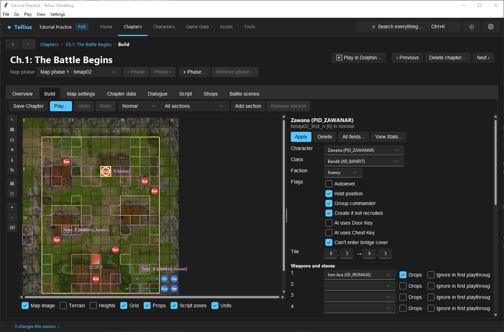
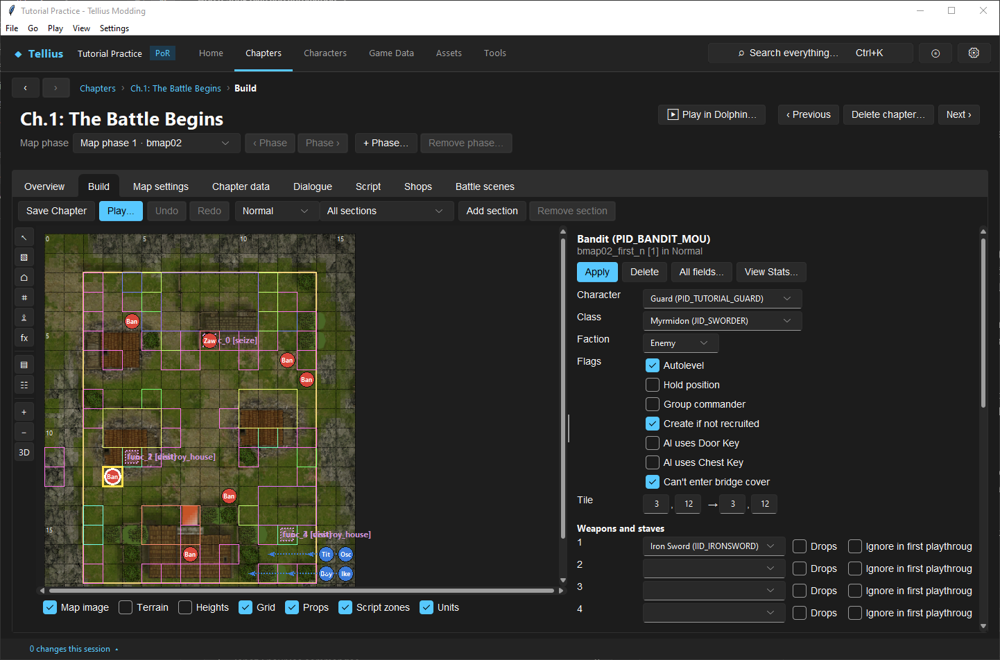
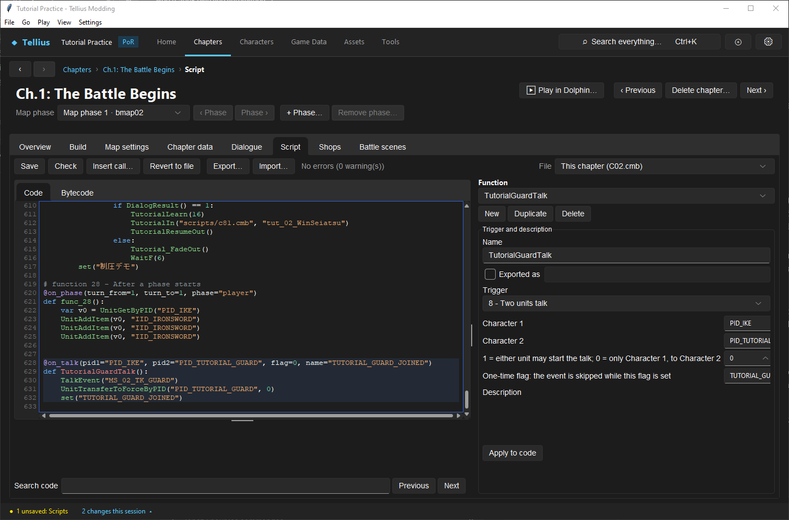
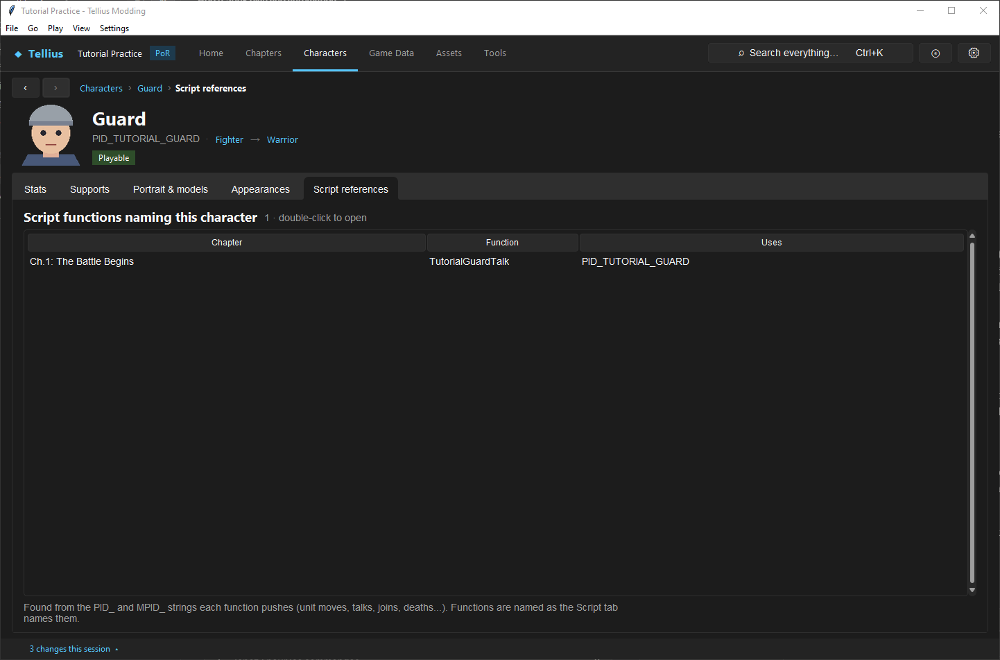

# Recruit by talk and make a boss

**Route:** a chapter's **Build** (the unit), **Dialogue** (the message), **Script** (the talk event)

## What you will make

You will put `PID_TUTORIAL_GUARD` in Ch.1 as an enemy and make it join when Ike talks to it, once. Then you will read how Ch.1's boss, Zawana, is made: the deployment flags that keep him still, and the script events for his quotes and death. At the end you know which of the three files owns each part of a recruit or a boss.

## Before you begin

- `PID_TUTORIAL_GUARD` with its own name ([Create a character](10-create-character.md)).
- [Edit, compile, and test event scripts](33-script-editor.md) and [Design, register, and test event flags](34-event-flags.md): this lesson adds one flag and one event.
- A copy of the project folder.

## How the editor fits together

| Part | Owner | What it decides |
| --- | --- | --- |
| The unit on the map | the deployment file (**Build**) | character, class, army (**Faction**), tile, items, AI, **Flags** such as **Hold position** |
| What is said | the chapter messages, `Mess/c02.m` (**Dialogue**) | the text of `MS_02_TK_GUARD` |
| When it happens and what changes | the chapter script, `Scripts/C02.cmb` (**Script**) | the talk command, the move to the player army, the once-only flag |

A talk is a script event with the trigger `@on_talk(pid1=…, pid2=…, flag=…, name=…)`:

- `pid1`, `pid2`: the two characters;
- `flag=0`: only `pid1` can start the talk, to `pid2`; `flag=1`: either one can;
- `name`: a one-time flag; the event is skipped once it is set. It must be registered with `regist("…")` in the chapter's `Startup`.

The retail pattern is Ch.8's Ilyana: `@on_talk(pid1="PID_IKE", pid2="PID_ELAICE", flag=0, name="イレース仲間")`, whose function plays `TalkEvent("MS_09_TK_ELAICE")`, calls `UnitTransferToForceByPID("PID_ELAICE", 0)` (army 0, the player's) and `set("イレース仲間")`.

A boss is not a kind of record. Zawana is an enemy whose deployment row has **Hold position** and **Group commander**, and whose script has `@on_battle` quote events and an `@on_death` event that sets `ボス死亡`.

## Guided walkthrough

### 1. Read the boss

<!-- screenshot 14-d-boss.png -->
<figure class="tutorial-figure" markdown="1">

[](../assets/images/tutorials/screenshots/14-d-boss.png)

<figcaption markdown="span">Ch.1's boss, Zawana (`PID_ZAWANAR`, `bmap02_first_n`), selected on **Build** (*Normal*): **Faction** *Enemy*, his flags and items, and his AI further down. Nothing in the record says *boss*: his quotes and death event are in the script.</figcaption>
</figure>

1. Open Ch.1: The Battle Begins › **Build**, deployment file *Normal*, and click Zawana on the seize tile (8, 5).
2. Read the panel: **Character** *Zawana (PID_ZAWANAR)*, **Class** *Bandit*, **Faction** *Enemy*; **Flags** **Hold position** (the AI never moves him; he still attacks from his tile), **Group commander**, **Create if not recruited**, **Can't enter bridge cover**; **Weapons and staves** 1: Iron Axe with **Drops**.
3. Open **Script** and pick `func_17`: `@on_battle(pid1="PID_ZAWANAR", pid2="PID_IKE", flag=1, name="ボス戦闘会話アイク")`, his line against Ike. `func_18` (`pid2=None`) is his line against anyone else; `func_19`, `@on_death(pid="PID_ZAWANAR")`, plays `MS_02_DIE` and sets `ボス死亡`. Ch.1 is won by seizing (`func_0`, `@on_location(x=8, y=5, action="seize")`), not by his death.

### 2. Put the recruit on the map

<!-- screenshot 14-a-setup.png -->
<figure class="tutorial-figure" markdown="1">

[](../assets/images/tutorials/screenshots/14-a-setup.png)

<figcaption markdown="span">One Ch.1 bandit (`bmap02_first_n`, *Normal*, tile 3, 12) turned into the Guard: **Character** `PID_TUTORIAL_GUARD`, **Faction** *Enemy*. **Class** stays *Myrmidon*: the deployment's class wins over the character's. **Apply**, then **Save Chapter**.</figcaption>
</figure>

1. Still on **Build** (*Normal*), click the bandit at tile 3, 12 (`bmap02_first_n`).
2. Set **Character** to `PID_TUTORIAL_GUARD`. Keep **Faction** *Enemy*. **Class** stays *Myrmidon*: a deployment's class wins over the character's; empty it to use the Guard's own Fighter class.
3. Press **Apply**, then **Save Chapter**. Do the same on *Hard* and *Maniac* if the recruit should exist there too.

### 3. Write the talk

1. Open **Dialogue**, press **New…**, **Message ID:** `MS_02_TK_GUARD`, **Start from:** a talk template, **Create**.
2. Write two lines between Ike and the Guard ([Author and connect a dialogue scene](37-dialogue-editor.md)) and press **Save Chapter**.

### 4. Add the event

<!-- screenshot 14-c-talk.png -->
<figure class="tutorial-figure" markdown="1">

[](../assets/images/tutorials/screenshots/14-c-talk.png)

<figcaption markdown="span">The talk event at the end of `C02.cmb`, after **Check**: `@on_talk(pid1="PID_IKE", pid2="PID_TUTORIAL_GUARD", flag=0, name="TUTORIAL_GUARD_JOINED")` plays the message, moves the Guard to the player army (force 0) and sets the one-time flag, registered in `Startup`.</figcaption>
</figure>

1. Open **Script**, pick `Startup`, and add the flag after the existing registrations, before `RegistLocationFlags()`:

    ```python
    regist("TUTORIAL_GUARD_JOINED")
    ```

    Adding at the end keeps the slots of the existing flags, which saves rely on.
2. At the end of the script, add:

    ```python
    @on_talk(pid1="PID_IKE", pid2="PID_TUTORIAL_GUARD", flag=0, name="TUTORIAL_GUARD_JOINED")
    def TutorialGuardTalk():
        TalkEvent("MS_02_TK_GUARD")
        UnitTransferToForceByPID("PID_TUTORIAL_GUARD", 0)
        set("TUTORIAL_GUARD_JOINED")
    ```

3. Press **Check**: *No errors (0 warning(s))*. Picking `TutorialGuardTalk` in **Function** shows **Trigger** *8 - Two units talk* with **Character 1**, **Character 2**, the start rule and the one-time flag as fields.
4. Press **Save**.

### 5. Check that everything agrees

<!-- screenshot 14-b-result.png -->
<figure class="tutorial-figure" markdown="1">

[](../assets/images/tutorials/screenshots/14-b-result.png)

<figcaption markdown="span">After **Save** and **Save Chapter**, the Guard's **Script references** lists Ch.1's `TutorialGuardTalk`, and **Appearances** lists its `bmap02_first_n` row: the script and the deployment now agree.</figcaption>
</figure>

Open the Guard › **Script references**: Ch.1 lists `TutorialGuardTalk`. (The `.cmb` itself keeps names only for exported functions; the app keeps your source, with its names, in the project's `script_sources/` folder.) **Appearances** lists its row in `bmap02_first_n`. Run **Tools › Check**: no new error.

In Dolphin, on Ch.1 Normal: move Ike next to the Guard; **Talk** appears; the message plays and the Guard turns blue. Talk is not offered a second time.

## Understand every choice

| Choice | Controls | Does not control |
| --- | --- | --- |
| **Faction** in the deployment | The army the unit starts in | Whether it can join |
| **Hold position** flag | The AI never moves the unit; it still attacks, heals and acts from its tile | Its quotes, its death event |
| **Group commander** flag | Leader of its army: the army list shows it and its Charisma helps its army | Victory |
| `@on_talk` `pid1` / `pid2` / `flag` | Who can talk to whom, in which direction | What happens next |
| `name=` one-time flag | The event runs once | Anything outside this chapter (chapter flags reset at the next chapter) |
| `UnitTransferToForceByPID(pid, 0)` | Moves the unit to the player army | Its AI fields |
| `@on_battle` | A quote when the two fight (`pid2=None`: anyone) | Death or victory |
| `@on_death` | What happens when the unit dies | The chapter goal |
| `@on_location(… action="seize")` / `@on_complete` | How the chapter is won | Boss quotes |

## Things to try next

1. **Either direction.** Set `flag=1`: the Guard can start the talk too.
2. **A recruit that needs a condition.** Wrap the body in `if UnitCheckLiveByPID("PID_BOLE"):` and add a second message for when Boyd is dead.
3. **A boss that moves.** Untick **Hold position** on Zawana, **Apply**, **Save Chapter**, and watch his first enemy phase in [Play and rewind a chapter in the app](58-play-chapter.md).

## Interactions and precedence

The actor must exist before the talk can target it. A flag set too early can permanently suppress recruitment after an interrupted body; set it after success. Allegiance can change while AI/order fields remain unsuitable, so inspect the recruited unit's next action and later roster state. Boss death must converge with objective logic; a quote alone does not mark victory.

## Test matrix

| Test | Expected result |
| --- | --- |
| Chapter start | recruit/boss appear in correct sections |
| Wrong speaker | no recruitment talk |
| Correct speaker/target | dialogue, Join, then guard set |
| Repeat attempt | body cannot run twice |
| Save/reload | recruited state persists as intended |
| Boss target outside range | boss respects hold/activation design |
| Enter activation condition | intended movement/attack begins or stays fixed |
| Quote/non-quote attacker | quote fires only for intended condition |
| Boss defeat | death event and objective converge once |
| All difficulties | matching units, sections, equipment, and triggers |

## Troubleshooting

If talk is absent, confirm both deployed PIDs, registration timing, direction, and guard flag. If dialogue plays but the unit remains hostile, inspect the `Join` target and execution log. If it recruits then repeats, verify the same flag is tested and set after success. If the boss moves, inspect AI/order fields. If victory stalls, trace defeated-state and objective functions separately from the death quote.

## Save, build, and revert

Save each deployment variant, script, and dialogue owner; rerun Check and compile diagnostics. Build and use a fresh chapter state. Revert all coordinated resources together because an orphaned talk trigger, absent actor, or stale victory condition can crash or softlock.

## Limits and confidence

- The trigger fields, the retail patterns quoted and the ownership of each part are source-reviewed. Placing the Guard, adding and compiling the event, saving and reading the references were done in the app on a US disc, then reverted (app-tested).
- The talk command, the join and the one-time behaviour in play are not checked in Dolphin here (unknown).

## Related tutorials and references

- [Edit, compile, and test event scripts](33-script-editor.md)
- [Design, register, and test event flags](34-event-flags.md)
- [AI Activation And Orders](../systems/ai-activation-and-orders.md)
- [Events Scripting](../systems/events-scripting.md)

---

[← Previous: Create supports and conversations](13-supports.md) · [All tutorials](index.md) · [Next: Remove records without corrupting saves →](15-remove-records.md)
