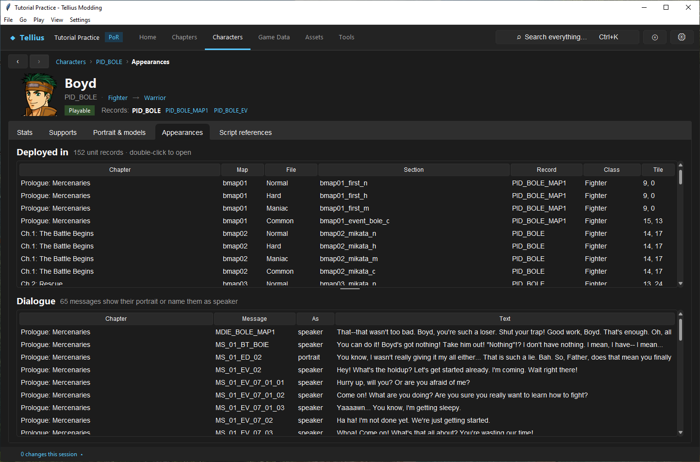
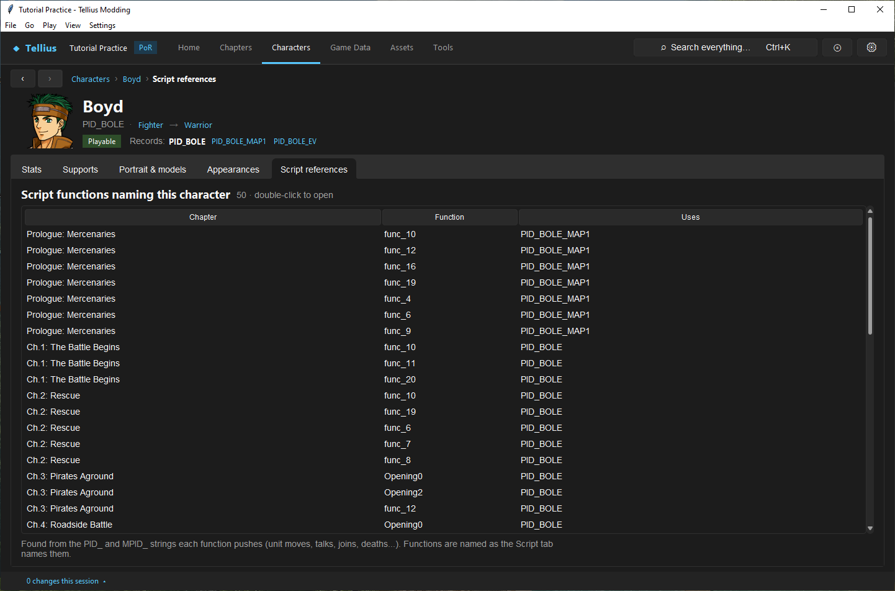
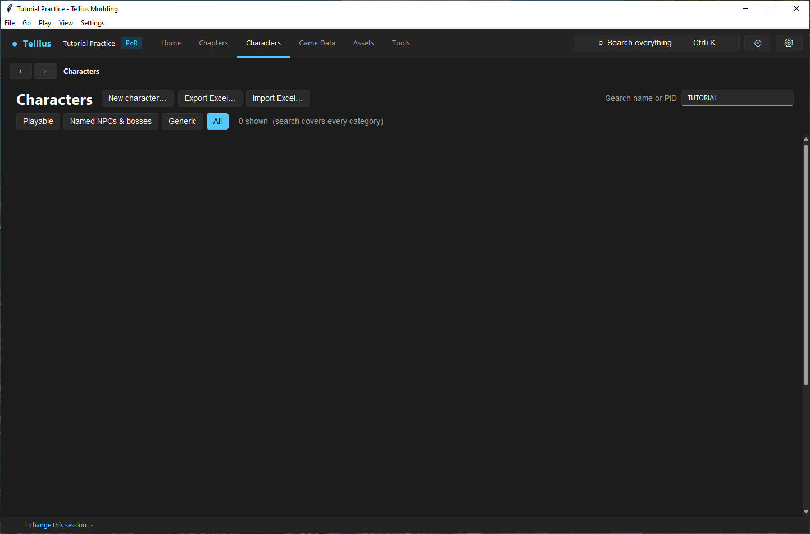

# Remove records without corrupting saves

**Route:** Character or Game Data record → Remove

## What you will make

You will try to remove Boyd and read why the app refuses, then remove `PID_TUTORIAL_GUARD`, which nothing uses, and see what stays behind. At the end you know how to find every user of a record, when a removal renumbers other records, and why that matters for saves.

## Before you begin

- `PID_TUTORIAL_GUARD` from [Create a character](10-create-character.md), not placed in any chapter (undo lesson 14's placement first).
- A copy of the project folder: removal saves nothing by itself, but a saved removal cannot be undone from the app.

## How the editor fits together

Every record of `FE8Data.bin` (character, class, item, skill…) is found by its ID and also has a **number**, its place in its table. Other files use the ID: deployments, scripts, support lists, bonds, shops. Saves use the number for characters, classes and items.

**Remove** checks, before anything changes, every place that names the record's ID: pointer fields of `FE8Data.bin` (support lists, bonds, skill restriction lists, other records), and the strings of every game file that names records (`Scripts/*.cmb`, `zmap/*/dispos.cmp`, the shop files, `zdbx.cmp`, `FE8Anim.bin` and `sys/main.dol`). If one place names it, the removal is refused with the list. If none does, it asks to confirm; removing a record that is not the last one moves every later record up one number, and the confirmation says so.

So a released mod can append records safely, but removing or reordering characters, classes or items makes saves of the previous version load other records. The safe way to retire a record from a released mod is to leave it in place, unused.

## Guided walkthrough

### 1. Read who uses a record

<!-- screenshot 15-a-setup.png -->
<figure class="tutorial-figure" markdown="1">

<figcaption markdown="span">Before removing a record, read its **Appearances**: every deployment row and message that names Boyd. **Script references** lists the script functions.</figcaption>
</figure>

Open Boyd › **Appearances**: **Deployed in** lists every deployment row (*152 unit records*), **Dialogue** every message that shows his portrait or names him.

<!-- screenshot 15-b-result.png -->
<figure class="tutorial-figure" markdown="1">

<figcaption markdown="span">**Script references** for Boyd: the functions that move, talk to or recruit him. A record with rows here or in Appearances is still in use.</figcaption>
</figure>

**Script references** lists the script functions that name `PID_BOLE` or his name key. These two tabs are the quick view; **Remove** runs the complete check.

### 2. Try to remove a record in use

On Boyd's **Stats** tab, press **Remove**. The app refuses: *PID_BOLE is still used*, *PID_BOLE cannot be removed while these name it:* and the first 14 of 72 places (*FE8Data.bin: support list of PID_TIAMAT*, *FE8Data.bin: bond PID_OSCAR / PID_BOLE*, *Scripts/C02.cmb: named 1 time*, *zmap/bmap02/dispos.cmp: …*), then *… and 58 more* and *Point them at another record first.* Nothing changed.

### 3. Remove a record nothing uses

<!-- screenshot 15-c-removed.png -->
<figure class="tutorial-figure" markdown="1">

<figcaption markdown="span">After **Remove** on the Guard (nothing named it, and it was the last record, so no other record moved) and **Save FE8Data.bin**: **Characters** finds nothing for *TUTORIAL*. Its name text `MPID_TUTORIAL_GUARD` and portrait `FID_TGUARD` are still in the project.</figcaption>
</figure>

1. Open the Guard › **Stats** › **Remove**. The check finds nothing, and the confirmation asks *Remove PID_TUTORIAL_GUARD from FE8Data.bin?* The Guard is the last character record (number 340 of 341), so no other record moves; for any other record the dialog adds *The N records after it move up one number.* and the warning about saves.
2. **Yes**. The status reads *Removed PID_TUTORIAL_GUARD: save FE8Data.bin to keep it*. Press **Save FE8Data.bin**.
3. On **Characters**, **All**, search `TUTORIAL`: *0 shown*.

The name text `MPID_TUTORIAL_GUARD` (in `Mess/common.m`) and the portrait `FID_TGUARD` (in `Face/`) are separate resources and stay. Remove the portrait in **Assets › Portraits › Remove** if nothing else uses it; an unused text does no harm.

### 4. Put it back (for the next lessons)

Restore your project copy, or redo [Create a character](10-create-character.md) steps 2–4: the new record takes the same last number.

## Understand every choice

| Choice | What happens | Safe for existing saves? |
| --- | --- | --- |
| Leave the record, unused | Nothing | Yes |
| Point users elsewhere, keep the record | The record is unused | Yes |
| Remove the last record | It goes; no record moves | Yes, unless a save holds that unit |
| Remove a record in the middle | Every later record moves up one number | No for characters, classes, items: start a new game |
| Remove a chapter record | Scripts that change to its id find no chapter | Use **Delete chapter…** instead ([Work with chapter IDs and story order](07-chapter-ids-and-story-flow.md)) |
| **Discard unsaved edits** (Game Data) | Drops the removal before saving | Yes |

## Things to try next

1. **An item in use.** Try **Remove** on `IID_IRONAXE` in **Game Data › Items**: 39 places, starting with `zmap/bmap02/dispos.cmp`.
2. **Retire instead of remove.** Rename a record's name text to `(unused)` and leave the record.
3. **Check after.** Run **Tools › Check** after a removal: references the checker sees would show as errors, but the removal check already refused those.

## Interactions and precedence

The deletion guard sees supported textual references, not semantic numeric state in saves and not every opaque/custom binary. A clean Check after deletion proves supported project links, not old-save compatibility. Renaming and deleting are similarly dangerous because callers may remain in executable or unsupported resources. Chapter-record removal has special risk: scripts changing to its numeric chapter ID can still target the now-missing slot even though record-reference removal does not scan chapter IDs.

## Test matrix

| Test | Expected result |
| --- | --- |
| Removal with known caller | blocked with owner listed |
| Repoint one caller | feature now uses deliberate replacement |
| Remove all supported callers | confirmation becomes available |
| Reopen/search | removed identity absent |
| Check | no dangling supported IDs |
| Neighbor records | identities/data intact after any shift |
| Fresh new game | affected chapters/features load correctly |
| Pre-change save | treated incompatible unless separately proven |

## Troubleshooting

If removal stays blocked, save the edited owner and rerun; the scan reads files/shared-session bytes, not an unapplied field. If the dialog reports `main.dol`, reconsider deletion instead of patching blindly. If Check is clean but runtime fails, search custom/opaque resources and numeric chapter transitions. If an old save loads the wrong unit/item/class, restore the table layout or require a new game.

## Save, build, and revert

Make the checkpoint before repointing callers. After removal, save FE8Data, run Check, rebuild, and test from a fresh save. Revert the full checkpoint if behavior is uncertain; reinserting a similar record at the end does not restore the removed numeric position.

## Limits and confidence

- The reference check, the renumbering and the save rule are source-reviewed; the refusal for Boyd (72 references) and the removal of the Guard were run in the app on a US disc, then reverted (app-tested).
- The check reads IDs as strings in the files it knows (`FE8Data.bin`, scripts, deployments, shops, `zdbx.cmp`, `FE8Anim.bin`, `main.dol`); an ID built at run time from pieces is not found.

## Related tutorials and references

- [Check a project and fix problems](05-check-project.md)
- [Create a character](10-create-character.md)
- [Save Format](../formats/save-format.md)
- [Fe8Data](../formats/fe8data.md)

---

[← Previous: Recruit by talk and make a boss](14-recruitment-and-bosses.md) · [All tutorials](index.md) · [Next: Create and link a class →](16-classes.md)
