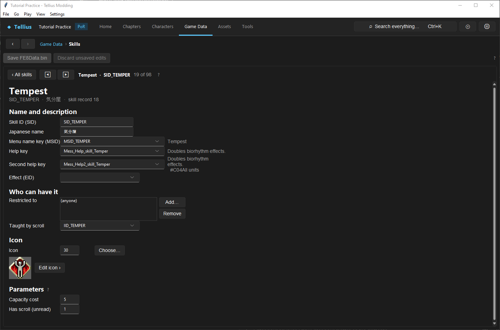

# Understand, assign, and rebalance skills

**Route:** Game Data → Skills

## What you will make

You will study one visible, learnable skill without changing its table position, adjust its capacity cost, restrict its scroll to a disposable character or class, grant it through a controlled ownership source, and test both activation and non-activation cases. You will also identify why hidden engine traits must not be treated as ordinary learnable skills.

## Before you begin

- Complete [Create and test a class](16-classes.md) and [Create an item or weapon](17-items-and-weapons.md).
- Choose an existing visible skill whose trigger and non-trigger conditions are documented. Avoid story, transformation, weapon-permission, boss, sex, or promotion traits for the first exercise.
- Record the skill's record number, SID, text keys, effect, restriction list, teaching item, icon, capacity cost, and every character/class/deployment currently granting it.
- Choose a disposable unit and a test scenario that can produce both a valid activation opportunity and a control case where its condition is absent.
- Save a project checkpoint. Skills are position-bound and cannot be added or removed safely.

## How the editor fits together

`FE8Data.bin` contains exactly 98 skill records. Runtime skill ownership uses the raw table position as a bit index, and native code tests those positions directly. The Skills tab therefore edits existing slots but intentionally provides no **New…** or **Remove** buttons.

The SID is a readable identity used by characters, classes, deployments, scripts, and tooling. Renaming the SID does not move the slot or replace the executable behavior tied to its position. Likewise, changing help text or Effect does not rewrite the native combat/map rule.

A unit can receive skill ownership from several independent sources:

- up to three personal skills in its character record;
- up to five innate skills in its class record;
- up to five chapter-specific deployment skills;
- learned/runtime entries created by a teaching item or script;
- hidden engine traits supplied by character, class, form, or equipment rules.

The game consolidates ownership into a position-indexed runtime bitset. The subsystem that uses a skill decides when to check it, whether it rolls, what suppresses it, and what consequence it applies.

## Guided walkthrough

<!-- screenshot 18-a-setup.png -->
<figure class="tutorial-figure" markdown="1">

<figcaption markdown="span">**Game Data › Skills** with Tempest (`SID_TEMPER`, Boyd's skill): capacity, icon and the lists of who can and cannot have it. Effects are tied to the table position, so skills are edited, not added.</figcaption>
</figure>

### 1. Identify the slot before editing its labels

Select the chosen skill and record `skill record <n>` from the header. Search the [Skills system reference](../systems/skills.md) or its detailed skill page for the native behavior at that position.

Do not select a slot based only on its English name. Internal SIDs sometimes differ from localized names, and 41 of the 98 records are hidden traits or permissions rather than menu skills.

**Checkpoint:** you can state the position-bound effect, every current ownership source, and the conditions under which its consumer checks the bit.

### 2. Understand identity and presentation fields

The top fields are independent references:

- **Skill ID (SID)** is the label other data uses. Changing it repoints the record's own symbol but does not create a new behavior.
- **Japanese name** is an internal name and is not displayed.
- **Menu name key (MSID)** is the visible name message.
- **Help key** and **Second help key** provide displayed explanations used in the skill UI.
- **Effect (EID)** is the presentation effect requested when applicable.

For the exercise, keep the SID and EID unchanged. If desired, give the help text a project-specific clarification and confirm its message preview. The actual effect remains defined by the same slot and native caller.

### 3. Map every current owner

Before changing restrictions, search Characters, Classes, Deployments, scripts, and the skill's teaching-item relationship for this SID. Distinguish innate ownership from learned ownership:

- Character/class/deployment skills are reconstructed from their source and are not ordinary removable learned entries.
- A scroll-teachable skill enters mutable unit state, consumes capacity, and can be removed through the Skills UI when the game permits.
- A hidden trait can lack an icon/help/scroll and still be critical to engine behavior.

Grant the unchanged SID to the disposable unit through exactly one source. For this exercise, use one personal character slot or one deployment slot, not both.

### 4. Edit recipient restrictions deliberately

**Restricted to** accepts PID and JID labels. An empty list means anyone may have/learn the skill where the relevant acquisition path consults restrictions. Add the disposable character PID or its current JID and commit the field.

Restrictions do not remove existing innate ownership and do not necessarily gate every native source. Their major visible use is validating learnable/scroll relationships, including Occult mastery selection. Test the acquisition route you actually intend rather than assuming the list globally strips the bit from other sources.

### 5. Inspect or assign the teaching item

**Taught by scroll** points to one IID. Set it only to an item intended to teach this skill. The relationship is stored on the skill, not inferred from matching names.

For ordinary scroll learning, the game checks the teaching relationship, recipient restrictions, duplicate ownership, nonzero/visible skill data, and remaining capacity before consuming the item and adding the learned skill.

The Occult scroll is special only because several mastery skills name the same item and their restriction lists choose the candidate for the unit's current class. To change a class's mastery, edit **Classes → Occult scroll** or the same mastery restriction here; do not add the mastery to an innate class slot unless permanent innate ownership is truly intended.

### 6. Treat the icon as both presentation and visibility data

**Icon** is `param0`. Value 0 means no icon and excludes the record from lists of skills a unit can learn. Nonzero values select a cell from the second image in `window/icon.tpl` using the skill-icon convention.

Click **Choose…**, inspect the preview and shared-icon warning, and retain the original icon for the exercise. **Edit icon ›** changes the shared graphic cell for every skill using it; selecting a different number merely chooses another existing cell.

Do not give a hidden engine trait an icon just to make it visible. The menus and learning path were not designed to make every internal bit removable.

### 7. Change and test capacity cost

**Capacity cost** is `param1`, an unsigned byte from 0 to 255. Record the unit's class capacity and its other learned-skill costs. Change the selected skill's cost to create one exact-fit case and one over-capacity case.

For example, if the class has 25 capacity and already spends 10, a cost of 15 should fit exactly; a cost of 16 should be rejected. Test through the actual learning/equip UI. Capacity accounting does not change activation chance, and a passive skill consumes capacity even when its condition is currently false.

**Has scroll (unread)** is `param2`. The retail table often marks skills that have scrolls, but the game does not read this byte. Changing it does not create a teaching item or make the skill learnable. Preserve it unless documenting a data-only convention.

### 8. Save and test ownership separately from activation

Click **Save FE8Data.bin**, reopen the skill, and inspect the disposable character/class/deployment source that grants it.

First verify ownership: the unit has the intended SID and no duplicate source. Then verify behavior:

1. Construct a state where the owning subsystem reaches the skill check.
2. Use deterministic/fixed rolls where the simulator supports them.
3. Record the activation, mechanical consequence, and EID/presentation separately.
4. Repeat with the condition absent or a known suppressor present.

A skill not activating can mean missing ownership, an unreached caller, a failed RNG roll, immunity/suppression, wrong equipment/form, or unsupported simulation. Test those gates in that order.

### 9. Restore the slot and ownership

Restore the original cost, restrictions, text keys, teaching IID, and icon. Remove the SID from the tutorial character/deployment source and save both owners. Reopen the skill and rerun the original baseline.

Never “restore” a position-bound skill by deleting it or inserting another record. That would change the index mapping of later slots.

## Understand every control

| Control | Input and meaning | Selection and verification |
| --- | --- | --- |
| Skill list/search | Selects one of exactly 98 position-bound records. | Record the table number and native behavior before editing. |
| **Skill ID (SID)** | Symbol used by data/scripts; renames the record label, not its index. | Preserve for ordinary rebalance work and search every reference before renaming. |
| **Japanese name** | Internal, non-displayed name. | Preserve unless correcting project documentation. |
| **Menu name key (MSID)** | Shared visible-name message. | Confirm preview and intentional sharing. |
| **Help key / Second help key** | Shared displayed descriptions. | Make text match established behavior; text does not specify the behavior. |
| **Effect (EID)** | Presentation effect requested when the native path triggers it. | Keep compatible timing/context and verify mechanics separately from presentation. |
| **Restricted to** | PID/JID allow-list; empty means unrestricted for relevant acquisition checks. | Test permitted and non-permitted scroll recipients; do not assume it removes innate ownership. |
| **Taught by scroll** | One IID associated with learning this skill. | Test relationship, restriction, duplicate, capacity, consumption, and persistence. |
| **Icon** | `param0`, 0–255; 0 hides it from learnable lists. | Use Choose/preview; avoid exposing engine traits casually. |
| **Choose… / Edit icon ›** | Selects a shared cell / edits the shared image. | Read the sharing warning and verify every user after an art edit. |
| **Capacity cost** | `param1`, 0–255 cost against current class capacity. | Test exact-fit and one-point-over cases. |
| **Has scroll (unread)** | `param2`, stored convention not read by the game. | Preserve; it does not create learning behavior. |
| **Save FE8Data.bin** | Persists the shared skill definition and any other session edits. | Reopen the skill and every modified ownership source. |

## Things to try next

1. **Class-specific mastery:** move an Occult mastery between two promoted classes by changing restrictions and test both eligible and ineligible classes.
2. **Capacity rebalance:** create exact-fit, under-capacity, and over-capacity loadouts without changing the skills' native effects.
3. **Chapter-only ability:** grant a visible skill in one deployment and compare the same character in another chapter where the deployment source is absent.
4. **Presentation study:** keep ownership/mechanics fixed while swapping to a known-compatible EID, then compare activation result versus visual effect.
5. **Hidden-trait audit:** inspect a class with flight or story-promotion traits and trace what breaks when the bit is absent in a disposable copy; do not publish it as learnable.

## Interactions and precedence

- Raw table position selects runtime behavior; SID and text are labels around that position.
- Ownership sources consolidate into one runtime bit, so duplicate grants do not create two independent activations.
- The native consumer owns timing, chance, suppression, and consequence. The generic record has no universal activation formula.
- Capacity and restrictions primarily govern learned-skill acquisition; class/personal/deployment traits come from their own sources.
- Icon 0 affects visibility/learning lists but does not erase native meaning at that index.
- Occult selection combines a common teaching IID with class/PID restrictions; it is not an innate class pointer.
- Effect IDs present successful activation but do not implement the mechanical effect.
- Chance-bearing skills share the battle RNG with other rolls, so deterministic tests must control prior RNG consumption.
- Existing saves can retain learned mutable skills. Test fresh acquisition, loaded ownership, removal, and class-capacity changes when supporting old saves.

## Test matrix

| Case | Setup | Expected observation |
| --- | --- | --- |
| Baseline | Original slot, original owner/capacity and documented trigger | Record ownership, menu presentation, activation, consequence, and effect. |
| Intended | One controlled owner plus changed capacity/restriction | Allowed unit acquires/uses it and accounting matches the calculated total. |
| Boundary | Exact capacity, one point over, duplicate skill, restricted recipient | Each acquisition gate accepts or rejects for the documented reason. |
| Failure | Remove the only ownership source or make the activation condition false | The bit/effect is absent or dormant without changing unrelated skills. |

For combat procs, add fixed success/failure rolls, immunity/suppression, and forecast-versus-resolution checks. For commands, add legal and illegal target/state checks.

## Troubleshooting

| Symptom | Inspect | Correction |
| --- | --- | --- |
| Renamed skill still has old behavior | Raw record position | Select a slot with the intended native effect or implement Game Code changes. |
| Skill is owned but not listed | Icon 0, hidden-trait type, ownership source | Do not expose hidden traits; restore or select a visible learnable slot. |
| Scroll teaches nothing | Teaching IID, restrictions, duplicate ownership, capacity | Repair the exact failing acquisition gate. |
| Wrong Occult mastery appears | Current JID and all skills naming `IID_ESOTERIC` | Make restriction lists mutually intentional. |
| Skill is greyed out | Class capacity minus learned costs | Recalculate costs; activation conditions are unrelated. |
| Skill never activates | Ownership, caller condition, equipment/form, suppression/immunity, RNG | Test each gate in order with a deterministic case. |
| Visual effect changed but mechanics did not | EID versus native slot | Treat EID as presentation and restore a compatible effect. |
| Removing learned skill does not remove trait | Character/class/deployment source | Remove or change the owning source; innate traits are reconstructed. |
| Later skills behave incorrectly | Accidental table insertion/reordering | Restore the original 98-slot table from the checkpoint. |

## Save, build, and revert

Fields apply to the shared FE8Data session when focus leaves them. **Save FE8Data.bin** writes the skill definition and any character/class session edits. Deployment-granted skills require **Save Chapter**. Icon art has its own Assets save path. Build again before Dolphin testing.

Revert by restoring every recorded field and ownership source, then saving each owner. If a position was inserted, removed, or reordered outside the supported editor, restore the complete pre-edit `FE8Data.bin`; do not attempt to repair indices by renaming SIDs.

## Limits and confidence

- The fixed count, position-bound runtime bitset, fields, ownership sources, capacity, scroll relationship, restrictions, icon visibility, and unused `param2` are source/engine reviewed.
- Detailed native behavior differs by slot. Use the specific skill article or Script Functions evidence rather than extrapolating from another proc.
- Battle Simulator covers many combat skills but not every map command, AI use, form trait, story rule, or presentation effect. Unimplemented behavior requires Play or Dolphin.
- New skill effects and a larger table require executable changes; the data editor alone cannot supply them.

## Related tutorials and references

- Prerequisites: [Create and test a class](16-classes.md), [Create an item or weapon](17-items-and-weapons.md)
- Ownership: [Create a character](10-create-character.md), [Set unit inventory and flags](31-unit-inventory-and-flags.md)
- Testing: [Simulate and render a fight](56-battle-simulator.md), [Play and rewind a chapter](58-play-chapter.md)
- References: [Skills](../systems/skills.md), [Level-Up Growth](../systems/level-up-growth.md), [Combat Resolution](../systems/combat-mechanics.md), [FE8Data.bin](../formats/fe8data.md)

---

[All curriculum tracks](index.md)
