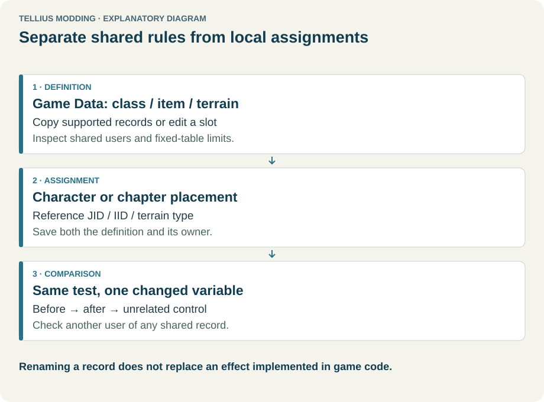
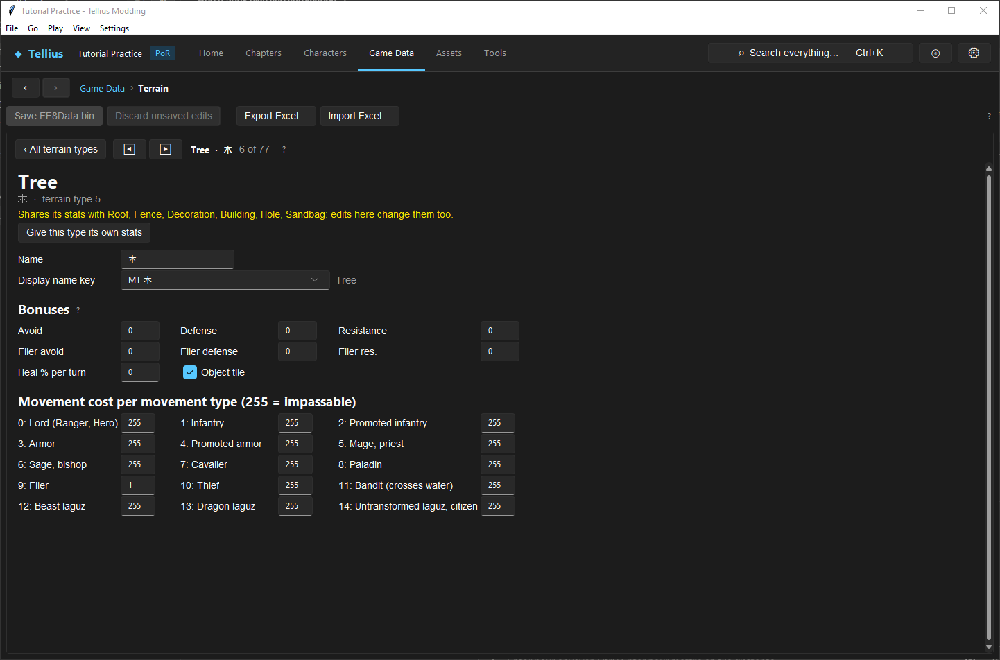

# Edit terrain rules and movement costs

**Route:** Game Data → Terrain types

## What you will make

You will turn one existing terrain type into a controlled test tile. The tile will give a visible defence bonus and will cost ordinary infantry more movement than fliers. You will then place a short strip of it on a test map and prove that the terrain record, the class movement type, and the painted map tile all agree.

The point is not the particular balance change. The exercise teaches the three layers involved in any terrain edit:

1. A map cell stores a terrain type.
2. The terrain type points to a block containing bonuses, flags, and fifteen movement costs.
3. A unit's class selects which movement-cost column the game reads.

Once those relationships are clear, you can create deep snow, cavalry roads, flying-only shortcuts, healing ground, water-crossing classes, or class-specific chokepoints without guessing which number controls the result.

## Before you begin

Use a disposable copy of your project and complete [Save, build, and restore changes](03-saving-and-restoring.md). Choose a small chapter that already opens correctly in Build and Play. Keep one ordinary infantry unit and one flier available for testing.

Record these baseline facts before editing:

- the terrain type painted in the test area;
- the infantry class's **Movement type** in **Game Data → Classes**;
- the flier class's **Movement type**;
- the distance each unit can travel across the unmodified tile;
- the avoid, defence, resistance, and healing shown or observed on that tile.

Do not begin by changing a commonly used type across the whole game. Pick a type used only in the test area, or be prepared to separate its shared stats block. A terrain definition is global: every map cell referring to it can inherit the change.

<figure class="tutorial-figure" markdown="1">

<figcaption>Concept diagram, not an app screenshot. A map chooses the terrain record; the unit's class chooses one movement-cost column within that record. Select the image to open it at full size.</figcaption>
</figure>

## How the editor fits together

The editor contains exactly **77 terrain positions**. These are fixed slots in the game's terrain table, not an expandable list. You can edit a position, but you cannot append a seventy-eighth type. A map grid stores the terrain identity expected at that position, so changing a record can affect every chapter that uses it.

Each terrain position has an identity and a pointer to a stats block. Several positions may point to the same stats block. Shared blocks are useful when two visual or named terrains should behave alike, but they also create the most common editing surprise: changing one type changes another.

**Give this type its own stats** copies the current shared block and repoints only the selected terrain to the copy. Use it before making a local variant. It preserves the current values as a starting point; it does not invent new behavior or repaint any map cells.

Terrain does not decide a unit's movement column. A class record's **Movement type** does that. For example, changing the **Cavalier** cost on a terrain affects every class configured to use that column, even if its name does not contain “Cavalier.” Review [Create and balance a class](16-classes.md) when a unit uses an unexpected column.

## Guided walkthrough

<!-- screenshot 19-a-setup.png -->
<figure class="tutorial-figure" markdown="1">

<figcaption markdown="span">**Game Data › Terrain** with a forest type selected: avoid, defence, healing and one movement cost per movement type.</figcaption>
</figure>

### 1. Choose and isolate the test terrain

Open **Game Data → Terrain types** and select the terrain used in your small test area. Write down its internal name and current values.

If the editor shows that its stats are shared, decide whether the other linked terrain types should change too. For this exercise, choose **Give this type its own stats** so the experiment is isolated. Confirm that the selected type still has the same values immediately after separation.

### 2. Create an obvious normal-unit bonus

Set the normal-unit values to a result that will be easy to observe, such as:

- **Avoid:** `10`
- **Defence:** `2`
- **Resistance:** `0`
- **Heal %:** `0`

Leave the flier values unchanged for the first pass. This creates a deliberate comparison: an infantry unit standing on the tile should receive the normal bonuses, while a flying unit should use the flier values.

Use modest values in the real project. Large values are useful for diagnosis but can hide balance problems, especially when combined with skills, supports, weapon bonuses, or map objectives.

### 3. Change one movement column

Find the column matching the infantry class's **Movement type**. Increase its cost by one for the test. If its original cost is `1`, use `2`. Leave the **Flier** cost at its original value.

Movement cost consumes a unit's movement allowance per tile. A cost of `1` is ordinary travel, `2` consumes twice as much, and **`255` means impassable** for that movement type. Values between those examples are literal costs, not percentages.

Do not use `255` for the first test. A small increase proves that the correct column is being read while still allowing the unit to cross the strip.

### 4. Paint a controlled strip

Open the test chapter in Build. Paint a straight strip two or three cells wide with the selected terrain type, following [Paint terrain and blocking](22-paint-terrain-and-blocking.md). Keep ordinary ground on both sides. Avoid doors, ledges, height changes, props, event tiles, and occupied start positions; each adds another reason movement could differ.

Save the chapter. Terrain definitions and chapter maps are separate data sources, so both the game data and the chapter must be saved.

### 5. Save, reload, and play

Choose **Save FE8Data** to write the terrain table, then save the chapter through its normal Build workflow. Close and reopen the relevant editors. Re-select the terrain and confirm that the bonus and movement values survived the reload.

In Play, move the infantry unit and flier toward the strip. Confirm all of the following:

- the map identifies the painted cells as the intended terrain;
- the infantry range becomes shorter across the strip;
- the flier retains its expected range;
- the infantry receives the normal defence bonus while standing on the tile;
- the flier uses the flier bonus values instead.

Change only one variable between test runs. If you alter the class movement type, the terrain cost, and the painted tile at once, a successful result will not tell you which edit mattered.

## Understand every control

### Identity

**Name** is the terrain's internal identity used by map data. Treat it as a reference key, not merely a label. Renaming it without updating maps that refer to the old name can make those cells fail to resolve as intended.

**Display text key** (the `MT_...` value) selects the localized name shown to the player. Editing the text attached to this key changes what the player reads; changing the key selects a different text entry. It does not change movement, bonuses, or the tile's graphic.

### Shared stats

The sharing indicator tells you that more than one terrain position points to the same stats block. Edits to the block are therefore shared.

**Give this type its own stats** duplicates that block and assigns the duplicate to the selected position. Use it when two types should begin alike and then diverge. There is no benefit to separating a block if all linked types should always have identical rules.

### Normal-unit bonuses

**Avoid**, **Defence**, and **Resistance** are signed values applied to units using the normal terrain bonus set. Their editable range is `-128` to `127`. Positive values grant a bonus; negative values impose a penalty. These values are independent: a forest-like tile may grant avoid without defence, while a fort-like tile can grant both.

These fields do not raise a unit's displayed base stats permanently. They are positional combat modifiers and disappear when the unit leaves the terrain.

### Flier bonuses

The flier **Avoid**, **Defence**, and **Resistance** fields are a second signed set. Flying classes use these instead of the normal values. This lets a visually defensive tile shelter grounded units without granting the same cover to units above it, or lets a special aerial terrain affect only fliers.

Flying movement and flier bonuses are related through class configuration but are not the same setting. A low **Flier** movement cost does not automatically copy the normal bonuses, and changing the flier bonuses does not change passability.

### Heal percentage

**Heal %** is an unsigned value from `0` to `255`. It controls terrain-based healing as a percentage of maximum HP at the relevant turn update. `0` disables healing. Common experimental values such as `10` or `20` are easy to verify without immediately restoring most units to full health.

Test healing with an injured unit that begins and ends the relevant turn on the tile. A full-health unit cannot prove the effect works. If another skill or chapter event also heals the unit, record the baseline first so you can distinguish the sources.

### Object tile flag

**Object tile** marks a terrain as unsuitable for a unit placed or moved by the game's normal positioning logic to land on. It is not a universal replacement for movement costs, chapter collision, props, or event conditions.

Use the flag for object-like cells whose role is not ordinary standing terrain. For a simple wall or inaccessible region, also inspect the movement costs and the map's other blocking systems. A cell can appear blocked for several independent reasons.

### The fifteen movement costs

Every terrain stats block contains one byte for each class movement type:

1. **Lord (Ranger, Hero)**
2. **Infantry**
3. **Promoted infantry**
4. **Armor**
5. **Promoted armor**
6. **Mage, priest**
7. **Sage, bishop**
8. **Cavalier**
9. **Paladin**
10. **Flier**
11. **Thief**
12. **Bandit (crosses water)**
13. **Beast laguz**
14. **Dragon laguz**
15. **Untransformed laguz, citizen**

The labels describe vanilla users of each column; they do not enforce class families. The class's numeric **Movement type** is authoritative. Several vanilla columns happen to contain identical costs on many terrains, but they remain separate columns and can be edited independently.

Costs range from `0` to `255`. Use the existing table as your guide for ordinary values. **`255` is the deliberate impassable sentinel.** Do not treat it as “very slow”: the unit cannot enter the tile through ordinary movement.

## Interactions and precedence

When a movement or bonus result is wrong, trace it in this order:

1. **Painted cell:** Does the chapter cell actually use the terrain type you edited?
2. **Terrain identity:** Does that name still match what the map expects?
3. **Stats pointer:** Is the type using its own stats or a shared block?
4. **Class movement type:** Which one of the fifteen cost columns does the unit's current class select?
5. **Movement cost:** Is that column passable, and how much of the unit's movement does it consume?
6. **Bonus set:** Does the unit use the normal or flier bonuses?
7. **Other map systems:** Is a prop, height rule, object flag, occupied cell, event, or chapter boundary also restricting the result?

Promotion can change the answer if the promoted class uses a different movement type. Transformation can do the same when the transformed class record differs. Test both states when your design depends on consistent access.

Terrain graphics are also separate from terrain rules. Painting a different visual tile does not guarantee a different terrain identity, and changing a terrain definition does not redraw the map art.

## Test matrix

Run a small matrix rather than one successful move:

| Case | Unit/state | Expected result |
| --- | --- | --- |
| Baseline | Infantry on ordinary ground | Original range and no test bonus |
| Intended | Same infantry across the edited strip | Shorter range; normal defence bonus while on the tile |
| Alternate | Flier across and on the strip | Flier cost and flier bonuses are used |
| Boundary | Temporary copy with infantry cost `255` | Infantry cannot enter through normal movement |
| Shared-data check | A formerly linked terrain elsewhere | Unchanged after the selected type received its own stats |
| State change | Promoted or transformed version, if relevant | Result follows that class record's movement type |

Restore the boundary test after proving it. Then reload the project and repeat the intended case once. That final reload catches unsaved game data or chapter edits.

## Troubleshooting

**An unrelated terrain changed too.** The two types probably still share a stats block. Restore the baseline if necessary, select the intended type, use **Give this type its own stats**, and repeat the single change.

**Every unit still moves normally.** Confirm that the strip was painted with the edited terrain identity, then compare each unit's class **Movement type** with the column you changed. Saving only the chapter does not write FE8Data.

**One class ignores the new cost.** Its movement type differs from the label you assumed, or its promoted/transformed form uses another class record. Inspect the exact active class.

**Fliers receive the wrong bonus.** Check the flier-specific bonus fields. Do not infer the bonus set from the movement cost alone.

**The tile is impassable even with a low cost.** Check the object flag, map props, height or ledge rules, chapter boundaries, occupied cells, and event-controlled blocking. Movement cost is only one layer.

**Healing appears not to work.** Use an injured unit, wait through the proper turn update, and remove other healing effects from the test. Confirm that **Heal %** is nonzero and that the unit is still on the tile.

**The edited name disappeared or the map resolves incorrectly.** Restore the original internal name or update every map reference deliberately. Use the display text key when you only want a player-facing rename.

**The values look right until reopening the app.** Save FE8Data, not only the chapter. Reopen immediately after saving to distinguish a write problem from an in-game behavior problem.

## Save, build, and revert

Terrain work has two save boundaries:

- **Save FE8Data** writes terrain definitions, including bonuses, flags, and movement costs.
- The chapter's **Save** writes which terrain type is painted into each map cell.

After both saves, reopen the editors and verify the values before building or launching the test. Keep the original internal name, sharing state, bonuses, and all fifteen costs in your change log.

To revert cleanly, restore the original terrain values and repaint the test strip with its original type. If you separated a shared stats block, restoring equal numbers reproduces the behavior, but it does not necessarily recreate the original shared pointer. For an exact structural rollback, restore the known-good project copy made before the exercise.

## Limits and confidence

The fixed count of 77 terrain positions, the fifteen movement columns, the normal/flier bonus split, signed bonus ranges, healing byte, object flag, shared-block operation, and `255` impassable value are source-reviewed against the app's parser and editor behavior.

The exact moment and presentation of every terrain effect can depend on game runtime logic, chapter scripting, class state, and other map systems. Those combinations are marked **unknown** until exercised in a built game. That is why this article requires normal, alternate, boundary, and reload tests instead of treating a saved value as proof.

## Things to try next

- Make a road cheap for cavalry but ordinary for infantry.
- Create shallow water that bandits and fliers can cross while most ground classes cannot.
- Give grounded units cover without giving fliers the same defensive bonus.
- Make a small healing objective and test its interaction with end-of-turn healing.
- Compare two promoted classes that intentionally use different movement columns.

Change one relationship at a time and add it to the test matrix. A novel terrain rule is safest when you can state exactly which map identity, stats block, class column, and bonus set produce it.

## Related tutorials and references

- [Create and balance a class](16-classes.md)
- [Paint terrain and blocking](22-paint-terrain-and-blocking.md)
- [Map build basics](21-map-build-basics.md)
- [Maps system](../systems/maps-system.md)
- [Map grid format](../systems/map-grid.md)
- [FE8Data format](../formats/fe8data.md)

---

[← Previous: Edit and redistribute skills](18-skills.md) · [All tutorials](index.md) · [Next: Tune difficulty and army groups →](20-difficulty-and-armies.md)
