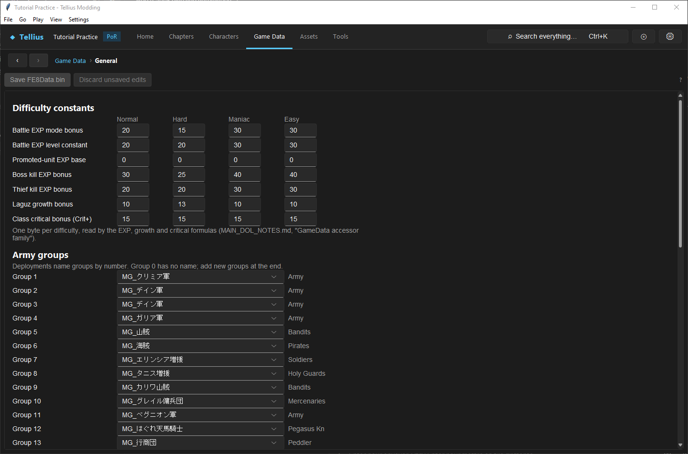

# Tune difficulty and army groups

**Routes:** Game Data → General; Game Data → Chapters; Chapter → Deployment or Build

## What you will make

You will make one chapter's auto-levelled enemies gain two extra levels on Hard without changing Normal, then trace one enemy section from its numbered army group to the name shown in game. The exercise separates three systems that are often confused:

- chapter-local enemy level bonuses;
- global, per-difficulty formula constants;
- numbered army names used by deployment sections.

Afterward, you will know when to edit a chapter, when to edit a global rule, and why inserting or removing an army group can silently retarget deployments.

## Before you begin

Make a restorable project copy and choose a chapter containing at least one auto-levelled ordinary enemy and one fixed or unusual unit for comparison. Record the enemy's level on Normal and Hard, the deployment section name, its army group number, and the army name visible in the game.

Use the same regional build throughout the experiment. Difficulty names and available `GameData` rows differ between Japanese and later regional builds. This tutorial uses the labels shown by the app for the project you opened; it does not authorize copying a table wholesale between regions.

Do not change global constants merely to make one chapter harder. Begin with the chapter-local **Enemy levels +** row. Global constants affect every consumer of that difficulty column.

## How the editor fits together

Path of Radiance difficulty is not one multiplier. The current mode independently selects deployment content, shop files, objectives, chapter enemy bonuses, and columns from the global `GameData` table.

The app exposes the relevant layers in different places:

- **Game Data → Chapters** owns **Enemy levels +** for each chapter and difficulty.
- **Game Data → General** owns seven global formula rows when the regional data contains them.
- **Game Data → General → Army groups** maps numeric group IDs to `MG_...` message keys.
- A deployment section stores the numeric army group used by every unit in that section.

The chapter bonus adds levels only to enemies the game auto-levels, capped at level 20. It does not rewrite each deployment unit's visible level field and may not affect fixed-level or specially scripted units.

An army group is a name and commander-effect grouping, not allegiance. Player, enemy, ally, and other are runtime forces. Two sections can be enemies yet carry different named armies; assigning the same name does not move a unit to another force.

## Guided walkthrough

<!-- screenshot 20-a-setup.png -->
<figure class="tutorial-figure" markdown="1">

<figcaption markdown="span">**Game Data › General**: the difficulty constants, army groups and battle skies.</figcaption>
</figure>

### 1. Establish a cross-difficulty baseline

Open the chapter on Normal and Hard using the same test method. Inspect the same ordinary enemy in each mode and record its level. Also record one boss or fixed-level unit. This tells you whether the chapter already has authored differences and gives you a control unit that may not respond to auto-levelling.

In **Game Data → Chapters**, select the chapter and find **Enemy levels +** under **Enemy levels and trial grades**. The columns follow the app's internal difficulty order: Normal, Hard, Maniac, and—where present—Easy.

### 2. Make a local Hard-mode change

Increase only the Hard value by `2`. Leave the other columns unchanged. Apply the edit, choose **Save FE8Data**, reopen the chapter record, and verify the number survived.

Launch the chapter on Hard with a fresh test state. Compare the ordinary enemy with the baseline. Then inspect the fixed or special unit. The desired result is narrow: the applicable auto-levelled enemy changes, while Normal and unrelated chapters do not.

If every unit changes by exactly the same amount, confirm how those units are authored. If none changes, confirm you launched Hard, saved FE8Data, and selected a genuinely auto-levelled enemy.

### 3. Inspect the global formula table without changing it

Open **Game Data → General**. The **Difficulty constants** table has one byte per difficulty for each available row. Record the current Hard values; do not edit them yet.

Use those values to predict which systems would change globally. For example, **Boss kill EXP bonus** affects boss-kill experience on every chapter using that Hard column. It does not raise enemy levels. Likewise, **Class critical bonus (Crit+)** controls the value granted through the relevant class-critical path; it does not mark a class as eligible.

For a safe first experiment, alter one global constant only in a disposable project, perform a controlled comparison, then restore it. **Boss kill EXP bonus** is easier to observe than growth-related rows: compare the same attacker defeating the same boss on the same difficulty before and after a small change.

### 4. Trace a deployment's army group

Open the chapter's Deployment or Build tab and select the enemy section. Note its **Army** selection and numeric group. Then open **Game Data → General → Army groups** and locate that group number.

The value is an `MG_...` message key. Its preview is the player-facing army name. Editing the text attached to that key can rename every use of the key; assigning a different key changes which message this group resolves.

For a controlled test, add a group with **Add group**. The app appends it to the end. Assign a new or deliberately chosen `MG_...` key, save FE8Data, then assign the new final group to one disposable deployment section. Save the chapter and test the army list or other presentation that exposes the group name.

Do not insert a line in the middle or remove a non-final conceptual group by shifting entries. Existing deployments store numbers, not key identities.

### 5. Prove the boundaries

Retest Normal and Hard. Confirm that the local enemy bonus changes only the selected chapter/difficulty, the army name changes only sections assigned to the new group, and allegiance has not changed. Finally, open an unrelated chapter using an existing group number and confirm its name still resolves correctly.

## Understand every control

### Chapter: Enemy levels +

Each column is an unsigned byte from `0` to `255`, added to auto-levelled enemies on that difficulty and capped at level 20. Easy in the North American data has its own bonus byte but uses Normal deployment and shop files. “Same deployment” therefore does not mean “identical resulting level.”

### Battle EXP mode bonus

This contributes to the kill portion of battle EXP. It combines with the combatants' effective levels and role bonuses. Raising it increases qualifying kill rewards across the selected difficulty; it is not a general experience multiplier.

### Battle EXP level constant

This contributes to the non-kill/base battle EXP calculation before the result is bounded. Compare it with the same attacker, defender, damage outcome, and difficulty. Changing opponent level at the same time invalidates the comparison.

### Promoted-unit EXP base

Promoted units already count as twenty levels higher for relevant EXP comparisons. This row is an additional difficulty-specific adjustment used in the promoted level term for the kill calculation. It does not grant EXP directly or change a unit's displayed level.

### Boss kill EXP bonus

This is added to qualifying kill EXP when the defeated unit has the boss skill/state. Removing a boss marker can eliminate the bonus even when the unit still looks like a boss in dialogue or presentation.

### Thief kill EXP bonus

This is the analogous kill bonus for the thief/steal skill path. A class name alone is not proof that the relevant skill is present.

### Laguz growth bonus

This difficulty byte participates in the transformed-Laguz growth/autolevel path in later regional builds. The Japanese retail table and executable lack this later row/consumer. Treat changes as global and verify transformed and untransformed cases separately.

### Class critical bonus (Crit+)

This is the amount added for classes eligible for the class-critical mechanic in US/PAL behavior. It is not the eligibility switch. Japan lacks this later row and corresponding addend. Test a qualifying and non-qualifying class so a weapon's own critical value is not mistaken for the class bonus.

### Army group entries

**Group 0** deliberately has no name. Groups `1` onward each select an `MG_...` message key. The number beside the entry is the identity stored by deployments.

**Add group** appends a new empty final entry, preserving existing numbers. **Remove last group** removes only the last entry. Before removal, search deployments for that number and reassign every reference. A blank or `-` entry resolves as unnamed; it does not delete or renumber the slot by itself.

### Battle skies and file information

These controls share the General page but are not difficulty or army controls. **Battle skies** maps weather IDs to battle-sky names. **Build time** and **Author** are debug-console metadata and have no gameplay effect. Do not use them as evidence that difficulty changes were saved correctly.

## Interactions and precedence

For enemy difficulty, trace the result in this order:

1. The selected runtime difficulty.
2. Common versus difficulty-specific deployment section chosen by the script.
3. The unit's authored level and autolevel behavior.
4. The chapter's **Enemy levels +** value.
5. Class, character, skill, and regional rules used during stat generation.

For experience, keep deployments and levels constant, then trace the selected global difficulty column, effective promoted level, boss/thief skills, and personal EXP skills.

For armies, distinguish three identities: the deployment section name used by scripts, the numeric named-army group, and the runtime force controlling allegiance. Changing one does not automatically change the other two.

## Test matrix

| Case | What stays fixed | Expected result |
| --- | --- | --- |
| Local baseline | Chapter, unit, Normal mode | Original level |
| Local intended | Same chapter/unit, Hard after `+2` | Applicable enemy gains two levels, capped at 20 |
| Local control | Unrelated chapter on Hard | No change from the chapter-local edit |
| Unit control | Fixed/special unit in the edited chapter | Changes only if it uses the affected autolevel path |
| Global formula | Same actors and outcome before/after one constant | Only the formula output changes |
| Army name | Section assigned to appended group | New name resolves; allegiance remains the same |
| Reference control | Existing group in another chapter | Same name and number as before |

## Troubleshooting

**Normal changed when only Hard was intended.** Check that you edited the Hard column and launched a fresh Hard test. Also inspect shared/common deployments; their presence on every mode is independent of the chapter bonus column.

**The enemy level did not change.** Save FE8Data, use a fresh chapter start, verify the current difficulty, and choose an auto-levelled enemy below level 20. A capped, fixed, or scripted unit is a poor probe.

**EXP changed in every chapter.** That is expected after editing a global `GameData` constant. Restore it and use the chapter enemy bonus or authored deployment data when the design is chapter-local.

**The army has the right color but wrong name.** Color/allegiance and named army are separate. Check the section's numeric group and the corresponding `MG_...` entry.

**Many armies changed names after an edit.** Group numbering shifted or a shared message key was edited. Restore the previous group list, append new entries, and give the new group its own text key when isolation is required.

**A row is missing.** The project may use a regional layout that does not contain it. Do not manufacture the bytes or transplant a later-build table without the matching executable behavior.

## Save, build, and revert

Difficulty constants, chapter enemy bonuses, and army-name keys are written by **Save FE8Data**. Deployment section assignments are written by **Save Chapter**. When an experiment touches both, use both save commands, reopen both editors, and confirm the values before launching.

Revert by restoring each original byte and each section's original group. Removing a newly appended group is safe only after no deployment refers to its final number. For exact recovery after reordered group entries, restore the known-good FE8Data copy rather than attempting to infer every shifted reference.

## Limits and confidence

The exposed rows, byte ranges, regional row boundary, enemy-bonus behavior, group numbering, group-zero rule, and append/remove-last editor behavior are source-reviewed. Exact results of growth, regional menu reachability, scripted autolevelling, commander effects, and every presentation surface still require a built-game test. Those are marked **unknown** until the matrix is executed on the target build.

## Things to try next

- Give one late chapter a larger Hard enemy bonus without touching early chapters.
- Compare Easy and Normal in a US project to see shared deployments but separate formula/bonus columns.
- Create two enemy sections on the same force with different named armies.
- Change one class-critical constant and compare an eligible class with an ineligible control.
- Audit every reference before removing a final unused group.

## Related tutorials and references

- [Edit deployment sections](29-deployment-sections.md)
- [Edit deployment units by difficulty](30-deployment-by-difficulty.md)
- [Difficulty modes and regional builds](../systems/difficulty-and-regions.md)
- [Armies and allegiance](../systems/armies-allegiance.md)
- [Deployment format](../formats/dispo-format.md)
- [FE8Data format](../formats/fe8data.md)

---

[← Previous: Edit terrain rules and movement costs](19-terrain-types.md) · [All tutorials](index.md) · [Next: Use the map Build tab →](21-map-build-basics.md)
