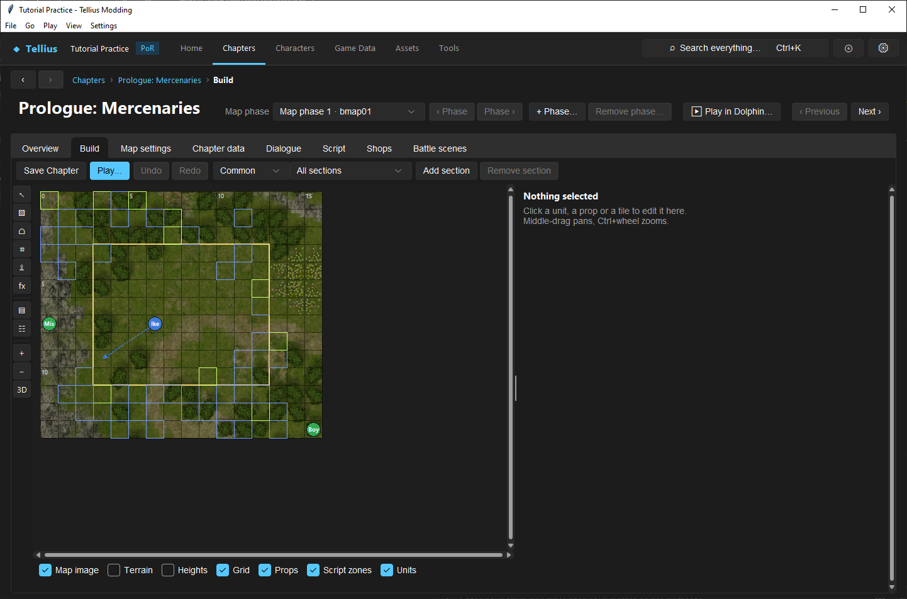
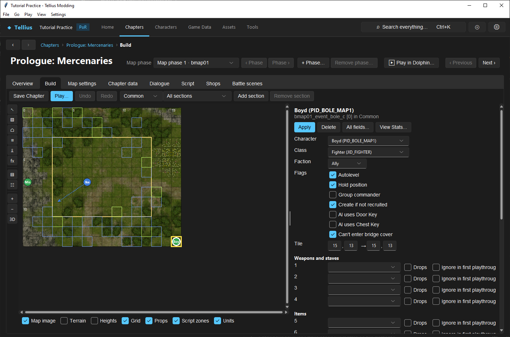

# Use the map Build tab

**Route:** Chapter → Build

## What you will make

You will make and verify a deliberately small chapter edit: move one disposable unit by one tile, repaint one terrain cell, undo and redo both actions, save the chapter, reopen it, and launch the selected chapter variant.

This exercise is an orientation to Build's document model. It teaches which phase and difficulty file you are viewing, what each overlay means, which tool owns which data, and exactly what **Save Chapter** writes. Complete it before attempting a large map conversion.

## Before you begin

Open a known-working chapter with a map and deployment. Record:

- chapter ID and map phase/folder;
- selected deployment variant—Common, Normal, Hard, or Maniac where available;
- selected section name;
- one disposable unit's section, list position, and coordinates;
- the terrain name at an empty nearby cell;
- whether the chapter boots successfully before editing.

Make a restorable project copy. Avoid a chapter with ongoing unrelated work: Build keeps map, deployment, and some script edits in one undo/save workflow, so a single save can legitimately write more than the one object currently selected.

## How the editor fits together

Build is a coordinated view over several resources, not a painted screenshot. Its canvas aligns these sources on one tile grid:

- the rendered map image;
- terrain identities;
- corner-height panels;
- placed props;
- script-function zones;
- deployment units.

The image answers “what does the scenery look like?” Terrain answers “what rules does this cell use?” Heights answer “where can units stand and cross?” Props are 3D instances. Zones visualize coordinates or areas found in script functions. Units come from the selected deployment file and section.

A chapter may have several map phases/folders, while deployment content may have common and difficulty-specific variants. The selectors at the top determine which deployment document and section you see; the chapter page determines which map phase is open. Similar-looking variants are still separate data.

Build maintains an undo history of up to 50 captured edit states. A new edit clears redo history. Undo is not a disk restore and closing without saving can discard the current history.

## Guided walkthrough

<!-- screenshot 21-a-setup.png -->
<figure class="tutorial-figure" markdown="1">

<figcaption markdown="span">The Prologue's **Build** tab: **Save Chapter**, **Play…**, **Undo/Redo**, the difficulty file (**Common**) and section filter, the tool column on the left, the layer checkboxes under the map and the selection panel on the right.</figcaption>
</figure>

### 1. Confirm the active document

Open **Chapter → Build**. Before touching the canvas, read the current phase, difficulty variant, and section filter. Choose a single section rather than **All sections** when you need unambiguous unit selection.

If the chapter has several phases, compare them briefly and return to the intended one. If Build warns about unsaved work while switching, stop and resolve that work; do not assume edits are shared between phases.

### 2. Learn the layers

Use the checkboxes below the canvas one at a time:

- **Map image** shows or hides the top-down visual backdrop.
- **Terrain** overlays the terrain-rule identities.
- **Heights** overlays the interpreted elevation data.
- **Grid** marks tile boundaries.
- **Props** shows placed map objects.
- **Script zones** shows recognized coordinate regions from chapter functions.
- **Units** shows deployment positions.

Start with **Grid**, **Terrain**, and **Units** visible. Hide **Map image** once to prove that a terrain cell exists independently of the art beneath it. Then restore the image.

### 3. Navigate without editing

Middle-drag the canvas to pan. Use **Ctrl+mouse wheel** or the toolbar **+** and **−** buttons to zoom. Ordinary mouse-wheel scrolling moves vertically; Shift+wheel scrolls horizontally.

Hover several cells and read the status information. Select an empty tile with the **Select / move** tool and inspect its coordinates and terrain name. Press **Escape** to clear the selection.

### 4. Move one disposable unit

Activate **Select / move**, show the intended deployment section, and select the disposable unit. Record its original coordinate. Move it one empty tile within the playable grid.

Confirm that the unit's inspector updates. Press **Ctrl+Z** or choose **Undo** and verify the original coordinate returns. Press **Ctrl+Y** or choose **Redo** and verify the new coordinate returns.

If the target tile is occupied, outside the grid, or missing from the selected difficulty file, choose a different test. Do not turn a basic orientation exercise into a collision or cross-variant diagnosis.

### 5. Repaint one terrain cell

Activate **Paint terrain**, choose the current terrain type from the right-side selector, and leave **Fill a rectangle** off. Click one empty test cell. Then choose a visibly different, passable terrain type and paint that cell once.

Toggle **Terrain** off and on to distinguish the rule overlay from the map image. Undo, verify the original terrain identity, redo, and verify the chosen identity.

This edits which terrain type the map cell references. It does not change that type's global movement costs or bonuses; those live in **Game Data → Terrain types**.

### 6. Save and reload

Choose **Save Chapter**. Build writes the edited map, deployment documents, and chapter-script edits owned by the Build session. It does not replace **Save FE8Data** for global terrain, class, item, skill, or chapter-table changes.

Leave Build, reopen the same chapter phase and deployment variant, and verify both the unit coordinate and terrain identity. Use **Play...** to launch the selected chapter through the app's chapter-run workflow and confirm the unit and cell appear where expected.

Finally, restore the original unit coordinate and terrain cell unless you want to keep the exercise.

<!-- screenshot 21-b-result.png -->
<figure class="tutorial-figure" markdown="1">

<figcaption markdown="span">Clicking a unit selects it: the panel shows its character, class, level, items and AI, with **All fields…** for the raw record. Edits here go to the deployment file; **Save Chapter** writes them.</figcaption>
</figure>

## Understand every control

### Top controls

**Save Chapter** writes pending map, deployment, and chapter-script changes in the Build session. The button is a document save, not a full disc build.

**Play...** opens the chapter launch workflow. It is useful for focused iteration, but a successful launch does not prove every difficulty, phase, event, or full-disc transition works.

**Undo** and **Redo** traverse Build's shared edit history. The keyboard equivalents are **Ctrl+Z** and **Ctrl+Y**. New edits after an undo discard the redo branch.

The **difficulty variant** selector changes the deployment file being displayed. Common content is used on every difficulty; Normal, Hard, and Maniac variants can contain distinct units and values.

The **section filter** displays all sections or one section. Script calls deploy sections by name, so a section's existence in the file does not prove the chapter calls it.

**Add section** creates a deployment section in the active context. **Remove section** removes the selected section and can break scripts that call its name. Section design is covered in [Edit deployment sections](29-deployment-sections.md).

### Editing tools

**Select / move** selects a unit, prop, tile, group of tiles, or script zone depending on what is under the pointer. Its inspector exposes actions appropriate to the selection. **Delete** removes a selected unit or prop when supported; **R** rotates a selected prop; **Escape** clears selection.

**Paint terrain** assigns a terrain identity to cells. A click paints one cell. **Fill a rectangle** changes the gesture into a rectangular batch operation. Global terrain behavior remains in FE8Data.

**Place prop** chooses a 3D map object and places an instance. Props do not automatically block movement; paint the footprint's terrain and inspect exits/heights separately.

**Tile heights** selects cells for corner-height, layer, and directional-exit editing. It can also flatten or deduce multiple selected cells. Continue with [Edit tile heights and slopes](23-tile-heights.md).

**Place unit** adds a unit to a common or selected difficulty deployment section. The placement form determines which files receive it; this is not equivalent to moving an existing record.

**Script function / zone** selects recognized script functions and draws or edits their coordinate zones. A drawn zone represents script data, not an automatic terrain trigger.

**Hub: chapter links** appears for an installed hub chapter and edits its action-tile destinations. It is not a general-purpose map link tool.

### Action buttons

**Objects list** opens the complete list of map instances, including objects outside the editable grid. Use it when a prop is hard to select visually.

**Units list** opens the deployment-oriented list and editor. It is the safer surface for inspecting section membership and raw unit organization.

**Zoom in** and **Zoom out** change only the editor view. **Open 3D view** renders the map geometry and props for visual inspection; it does not simulate tactical movement or events.

### View layers

View checkboxes never modify data by themselves. They only decide what the canvas draws. Hiding **Props**, for example, does not delete props, and hiding **Terrain** does not make cells use the image as their terrain rule.

## Interactions and precedence

When the canvas and the game disagree, identify the owning layer:

1. **Appearance:** map geometry, textures, and prop models.
2. **Tile rule:** painted terrain identity and its global definition.
3. **Standing surface:** combined, ground, and roof height panels.
4. **Directional traversal:** automatic height filtering plus explicit exits/link overrides.
5. **Unit placement:** active deployment variant and section.
6. **Activation:** chapter script calls, flags, and current phase.

A wall prop with ordinary-ground terrain may remain walkable. An empty-looking cell painted impassable may block movement. A correctly placed enemy in a section never called by the script may never appear. Build shows these layers together for convenience, but the engine consumes them separately.

## Test matrix

| Case | Editor state | Expected result |
| --- | --- | --- |
| View-only | Toggle every layer | Data and dirty state do not change |
| Unit edit | Move one unit, then undo/redo | Coordinate follows history exactly |
| Terrain edit | Paint one cell, then undo/redo | Terrain identity follows history; art is unchanged |
| Reload | Save, leave, reopen same phase/variant | Both edits persist |
| Variant control | Open another difficulty file | Only intentionally shared/copied edits appear |
| Runtime | Launch selected chapter/difficulty | Intended section and map data are loaded |
| Revert | Restore originals and reopen | Baseline coordinate and terrain return |

## Troubleshooting

**The edit disappeared when I changed difficulty.** You are probably viewing another deployment file. Return to the original variant or use the explicit multi-difficulty tools when the same change belongs in several files.

**The terrain overlay changed but the picture did not.** That is expected. Painting changes rule identity, not map textures or geometry.

**A prop does not block movement.** Props are visual instances. Paint suitable terrain under the footprint and inspect tile exits and heights.

**The unit exists in Build but not in Play.** Verify the launched difficulty, section name, script call, spawn conditions, and whether the unit is in a common or mode-specific file.

**Undo is disabled after reopening.** History belongs to the current editing session and is not stored with the chapter. Restore from a backup for changes made in an earlier session.

**Save Chapter did not preserve a class or terrain-definition change.** Those are FE8Data edits. Use **Save FE8Data**, then reload Build so it reads the current global records.

**The wrong map changed.** Recheck chapter ID and phase/folder. Similar chapter parts may reuse art or scripts while remaining separate map resources.

## Save, build, and revert

Use **Save Chapter** for Build-owned map, deployment, and script changes. Use **Save FE8Data** separately for global records. Build the disc or use **Play...** only after reopening and verifying the saved resource.

Keep a change note containing chapter, phase, deployment variant, section, object/unit identity, original value, and new value. To revert this exercise, restore the original unit coordinate and terrain identity and save again. If multiple layers were changed without a reliable note, restore the known-good project copy.

## Limits and confidence

The listed controls, default layers, shortcuts, 50-state undo cap, and Save Chapter ownership are source-reviewed against the Build implementation. Rendering is an editor approximation, and script activation, native pathfinding, phase transitions, and every regional map layout require runtime verification. A correct 2D or 3D preview is evidence about resources, not proof of full chapter behavior.

## Things to try next

- Paint a costly but passable route and compare two movement types.
- Place a prop, then separately configure its terrain footprint.
- Open the same unit across Normal, Hard, and Maniac variants.
- Use the height tool on a flat disposable area and inspect all three layers.
- Select a script zone and open the owning function before editing it.

## Related tutorials and references

- [Paint terrain and block movement](22-paint-terrain-and-blocking.md)
- [Edit tile heights and slopes](23-tile-heights.md)
- [Place, copy, and import props](24-map-props.md)
- [Edit deployment sections](29-deployment-sections.md)
- [Maps system](../systems/maps-system.md)
- [Map grid format](../systems/map-grid.md)

---

[← Previous: Tune difficulty and army groups](20-difficulty-and-armies.md) · [All tutorials](index.md) · [Next: Paint terrain and block movement →](22-paint-terrain-and-blocking.md)
