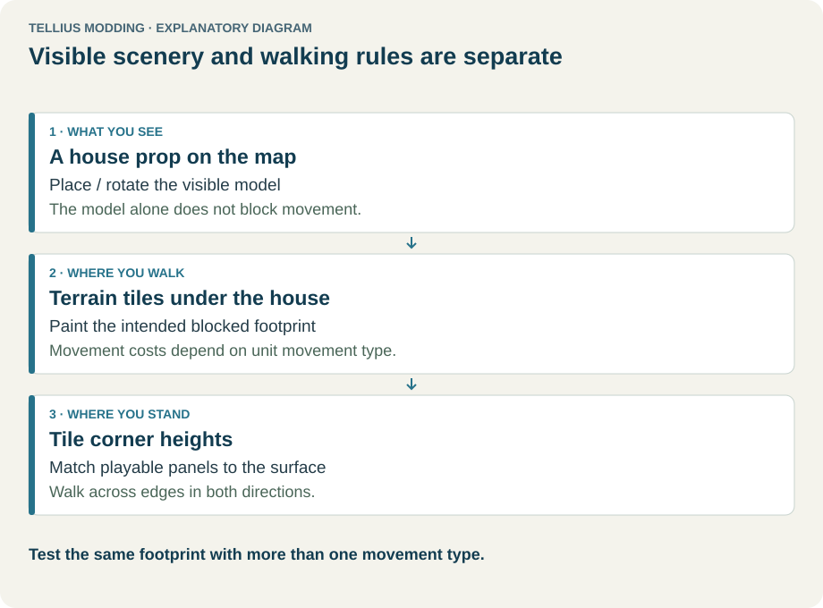
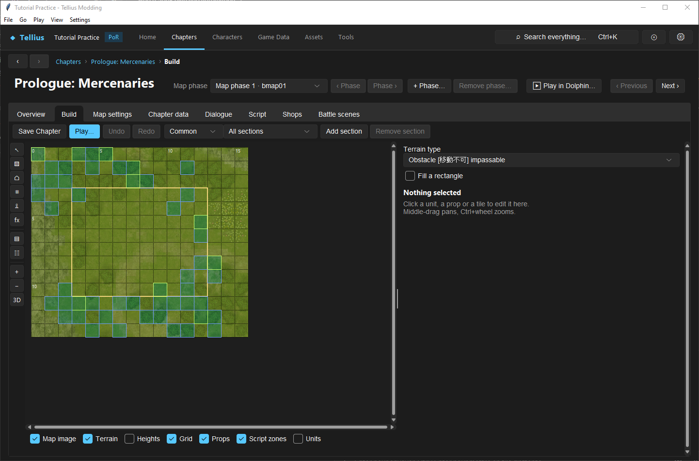

# Paint terrain and control movement

**Route:** Chapter → Build → **Paint terrain** (`▧`)

## What you will make

You will turn a four-tile prop footprint into a deliberate obstacle with a walkable route around it. You will also create one costly test strip and compare how two movement types traverse it. The visible prop, the terrain type, tile heights, directional exits, and scripted interactions will remain separate so you can identify which layer causes each result.

## Before you begin

- Complete [Use the map Build tab](21-map-build-basics.md) and [Edit terrain and movement costs](19-terrain-types.md).
- Use a disposable copy of a small chapter map with one ordinary infantry test unit and a second unit whose class uses a different movement type.
- Choose a prop that visibly covers several tiles, but leave an alternate route around it.
- Record the selected chapter, part/phase, difficulty variant, map dimensions, original terrain names, and both units' movement types.
- Save a chapter checkpoint. Terrain painting changes `map.bin`; it does not create a separate overlay file that can be discarded later.

Do not alter global terrain definitions during the first pass. First prove that the correct existing type is painted onto the correct local tiles.

## How the editor fits together

<!-- diagram terrain -->
<figure class="tutorial-figure" markdown="1">

<figcaption>Concept diagram, not an app screenshot. What you see (props), where you walk (terrain tiles) and where you stand (tile heights) are separate layers. Select the image to open it at full size.</figcaption>
</figure>

The Build tab combines several resources on one canvas:

- **Map image** and **Props** show presentation.
- **Terrain** shows the terrain-name grid read by movement, bonuses, and other tile rules.
- **Heights** and directional exits can close an edge even when the terrain itself is passable.
- **Units** and **Script zones** are separate deployment and event layers.

A prop does not automatically block the tiles it covers. Painting an obstacle does not resize the prop, add a door event, or change elevation. Conversely, a closed height/link edge can block movement between two passable terrain tiles. Diagnose these layers independently.

**Save Chapter** writes the edited chapter resources. **Undo** and **Redo** operate on the current Build-tab history; opening another map clears that history. **Play…** loads the current saved chapter state for an app-level movement test.

## Guided walkthrough

<!-- screenshot 22-a-setup.png -->
<figure class="tutorial-figure" markdown="1">

<figcaption markdown="span">**Paint terrain** with the **Terrain** layer on: pick a terrain type in the panel, then click or drag over tiles (**Fill a rectangle** paints a box). The colours are terrain types, not the picture.</figcaption>
</figure>

### 1. Lock the chapter context

Open the chapter and choose the intended part/phase and difficulty variant before painting. In the Build header, verify the variant selector and section filter. Terrain is map-wide, while the units shown can depend on the selected deployment variant; do not mistake a unit-filter change for a different terrain grid.

Enable **Map image**, **Terrain**, **Grid**, **Props**, and **Units**. Leave **Heights** visible only when you need it, because its shading can obscure the terrain colors. Hover the intended footprint and note the displayed coordinates and terrain names.

**Checkpoint:** you can identify every tile covered by the prop and one uninterrupted route around it.

### 2. Prove one-tile painting and Undo

Select **Paint terrain** (`▧`). In **Terrain type**, choose an existing blocking or appropriately costly type by its displayed label and internal name. The exact correct type depends on its Game Data definition; a terrain called “Wall” is not proof of its movement costs.

Leave **Fill a rectangle** unticked and click one disposable tile. Confirm that the Terrain layer changes only that tile. Click **Undo**, verify the original type returns, then click **Redo** and verify the edit returns. Undo again before continuing.

This establishes the tool, selected type, coordinate, and edit history before a drag can affect many tiles.

### 3. Sample the original terrain

While **Paint terrain** is active, right-click an untouched neighboring tile. The **Terrain type** selector changes to that tile's type. Record it as the restoration type.

Right-click samples; it does not paint. Sampling is safer than choosing a similarly named type from memory because maps may use multiple visually similar terrain records.

### 4. Paint the prop footprint

Choose the intended blocking type again. Paint each covered tile by clicking or dragging across it. If the footprint is a rectangle, tick **Fill a rectangle**, drag from one corner to the opposite corner, inspect the preview, and release. Rectangle fill paints the complete inclusive rectangle; it does not follow the prop's visible silhouette.

Turn **Props** off briefly and confirm that every covered grid tile has the intended terrain color. Turn Props back on and verify that no neighboring route tile was included.

**Checkpoint:** the terrain layer—not merely the image—shows a complete blocked footprint and an open route around it.

### 5. Create a costly strip for comparison

Choose a passable terrain whose cost differs between the two recorded movement types. Paint a one- or two-tile strip on a route away from the prop. The strip must have clear ordinary terrain before and after it so the movement cost is observable.

If no existing terrain type provides the comparison, stop and use the Terrain-definition lesson to make a shared-rule change. Document every other map that uses that terrain record before changing it.

### 6. Save and reload before playtesting

Click **Save Chapter**. Navigate away from the chapter, reopen the same part, enable the Terrain layer, and inspect the obstacle and test strip. This reload check proves persistence; the canvas state before saving does not.

If the grid differs after reload, stop before Play and inspect the save status, active part, and map file.

### 7. Test pathing with two movement types

Click **Play…** and select the infantry unit. Record its highlighted reachable tiles, try to enter each obstacle tile, and route around the footprint. Repeat from the same starting coordinate with the second movement type.

On the costly strip, compare how far each unit can travel with the same movement-point budget. A tile can be passable yet expensive. On the obstacle, decide explicitly whether flying units should cross: some movement types can treat a ground obstacle differently.

The intended result is not “nobody can enter.” It is the movement-type matrix you designed and recorded.

### 8. Separate terrain failure from edge failure

If a passable tile is still unreachable, return to Build and select the tile. Inspect its **Corner heights** and **Exits**. A neighboring corner difference of one step or more can close the way, and unchecked directional exits can create a wall. A `maplinkAbs` override makes exits read-only in this editor.

Do not repaint terrain to compensate for an unintended height or exit rule. Correct the owning layer and repeat the same movement test.

## Understand every control

| Control | Meaning and use | Failure or verification |
| --- | --- | --- |
| Part/variant selector | Chooses the chapter context shown by Build. | Record it before editing; reopening the wrong part can look like lost work. |
| Section filter | Limits which deployed units are shown. It does not select a terrain variant. | Use **All sections** while diagnosing map-wide terrain. |
| **Save Chapter** | Writes the owning chapter resources, including the terrain grid. | Reopen the same chapter/part and inspect the painted coordinates. |
| **Play…** | Opens the app's chapter simulation. | Use it for movement/pathing supported by Play; it is not a substitute for every engine behavior. |
| **Undo / Redo** | Moves through the current Build edit history. | Prove them with one tile before a large fill; changing maps clears the history. |
| **Paint terrain** | Activates click/drag painting and right-click sampling. | The active toolbar button is visually pressed and the terrain controls appear. |
| **Terrain type** | Selects one terrain record name to write into painted grid cells. | Inspect its Game Data movement costs and bonuses; its displayed name alone is insufficient. |
| **Fill a rectangle** | Off: paint visited tiles. On: fill the inclusive rectangle between drag corners. | Preview and inspect with Props hidden; rectangle fill can overpaint around irregular shapes. |
| Right-click tile | Samples that tile's terrain type into the selector. | The selector changes and the grid remains unmodified. |
| **Map image** layer | Shows the rendered/top-down map backdrop. | Turn it off when artwork hides the terrain overlay. |
| **Terrain** layer | Colors cells by terrain category, the same color for every variant of a terrain: green Plain, tan Floor and Stairs, sand Desert and Coast, dark green Thicket, brown Cliff and Rock, blue water, dark grey walls and other impassable tiles, orange doors and gates, gold chests, magenta objective tiles, cyan healing tiles (Throne, Fort, Castle, Heal). | Keep it on while painting and after reload. |
| **Heights** layer | Shades height information; redder means higher. | A route may be closed by heights even when terrain is passable. |
| **Grid** layer | Shows tile boundaries used by terrain and unit coordinates. | Keep it on when matching a prop footprint. |
| **Props** layer | Shows placed scenery. | Toggle off to inspect terrain beneath a prop; props do not supply general path blocking. |
| **Script zones** layer | Shows regions that invoke script functions. | A door/chest/area event is separate from terrain passability. |
| **Units** layer | Shows deployed units for the selected filters/variant. | Use known start tiles for repeatable path comparisons. |
| Hover status | Reports coordinates and visible terrain/objects/units/zones at a tile. | Record exact coordinates instead of describing “near the house.” |
| Tile **Corner heights** | Per-layer corner elevation in steps. | A difference of at least one step between neighboring corners can close an edge. |
| Tile **Exits** | North/west/east/south openings for a tile. | Inspect when passable terrain is unreachable; absolute overrides are not editable here. |

## Things to try next

1. **Forest lane:** alternate ordinary and high-cost passable terrain, then compare infantry and cavalry range from the same tile.
2. **Flying shortcut:** block a ground route with a category that the flying movement column can cross, leaving a longer ground route around it.
3. **Doorway:** paint the wall footprint and keep the doorway tile distinct; then author the door interaction separately instead of making the whole prop passable.
4. **Bridge study:** compare ground terrain, combined/roof heights, and directional exits. Change only one layer per test.

## Interactions and precedence

- A unit's class chooses the movement-type column; the terrain record supplies the cost in that column; the class supplies the movement-point budget.
- `255` in a terrain movement-cost column means impassable. Other values consume that many movement points.
- Height and link data can close movement between otherwise passable tiles.
- Map edges and explicit link flags can apply additional restrictions, including restrictions relevant to fliers.
- Terrain can also provide defense, resistance, avoid, healing, and step effects. Painting for movement may therefore change combat or presentation.
- Props, zones, doors, rolling rocks, and destructible interactions have their own data or scripts. A matching visual footprint does not merge those systems.
- Editing a terrain definition is global to every map cell that names it; painting changes only the selected map cells.

## Test matrix

| Case | Setup | Expected observation |
| --- | --- | --- |
| Baseline | Original terrain, same units and starting tiles | Record reachable tiles and the route through/around the future footprint. |
| Intended | Painted footprint and costly strip after save/reload | Ground route avoids the footprint and both movement types pay their documented strip costs. |
| Boundary | Test each edge of the prop plus the map/height boundary nearest it | No accidental gap, diagonal assumption, or closed neighboring edge changes the intended route. |
| Failure | Temporarily restore one footprint tile or close one passable edge | The route changes for the predicted ownership layer; Undo restores it. |

Repeat the intended case in Dolphin before relying on it for a release-critical objective or AI route.

## Troubleshooting

| Symptom | Inspect | Correction |
| --- | --- | --- |
| Unit walks through a house or rock | Terrain layer under every covered tile | Paint the complete footprint; prop bounds are not general collision. |
| Unit cannot enter visibly open ground | Terrain cost, corner heights, exits, occupancy | Correct the layer that actually closes the route. |
| Flying unit is blocked unexpectedly | Its class movement type, selected terrain column, link/map-edge rules | Verify the actual column and edge flags rather than assuming all fliers ignore all blocking. |
| Paint vanished | Save status, chapter part, map identity | Save Chapter and reopen the same part; restore from checkpoint if the wrong map was edited. |
| Rectangle changed too much | Terrain layer with Props/Image hidden | Undo immediately, sample the original type, and repaint a tighter selection. |
| Changing a terrain type affected other chapters | Shared Terrain record | Restore the shared definition and use a distinct record or local painting strategy. |
| Path highlight differs from expectation | Unit movement points/type and all route tile costs | Add the costs along the complete path; passable does not mean cost 1. |

## Save, build, and revert

Click **Save Chapter**, reopen the chapter, and inspect exact coordinates before launching Play. For Dolphin, build a new image after the chapter save. Existing built images do not update automatically.

To revert a small unsaved edit, use **Undo**. To revert after saving, paint the sampled original terrain back onto the recorded coordinates and save again, or restore the chapter checkpoint. Do not reset the entire project merely to reverse four known cells.

## Limits and confidence

- Paint, sample, rectangle, layers, save ownership, prop separation, height threshold, and exit behavior are source-reviewed.
- Play verifies the app's movement implementation. Release-critical AI, event, and edge behavior still needs a built-game comparison.
- Map layouts outside the verified Path of Radiance US layout can expose read-only or unsupported link behavior; preserve the warning and test in the target revision.
- A screenshot can prove which cells were painted, but only a movement test proves the route.

## Related tutorials and references

- Prerequisites: [Use the map Build tab](21-map-build-basics.md), [Edit terrain and movement costs](19-terrain-types.md)
- Continue with: [Edit tile heights and slopes](23-tile-heights.md), [Place, copy, and import props](24-map-props.md), [Add a reinforcement wave](32-reinforcements.md)
- Test with: [Play and rewind a chapter](58-play-chapter.md)
- References: [Map Grid](../systems/map-grid.md), [Maps](../systems/maps-system.md), [Map Objects](../systems/map-objects.md), [Map format](../formats/map-format.md)

---

[All curriculum tracks](index.md)
