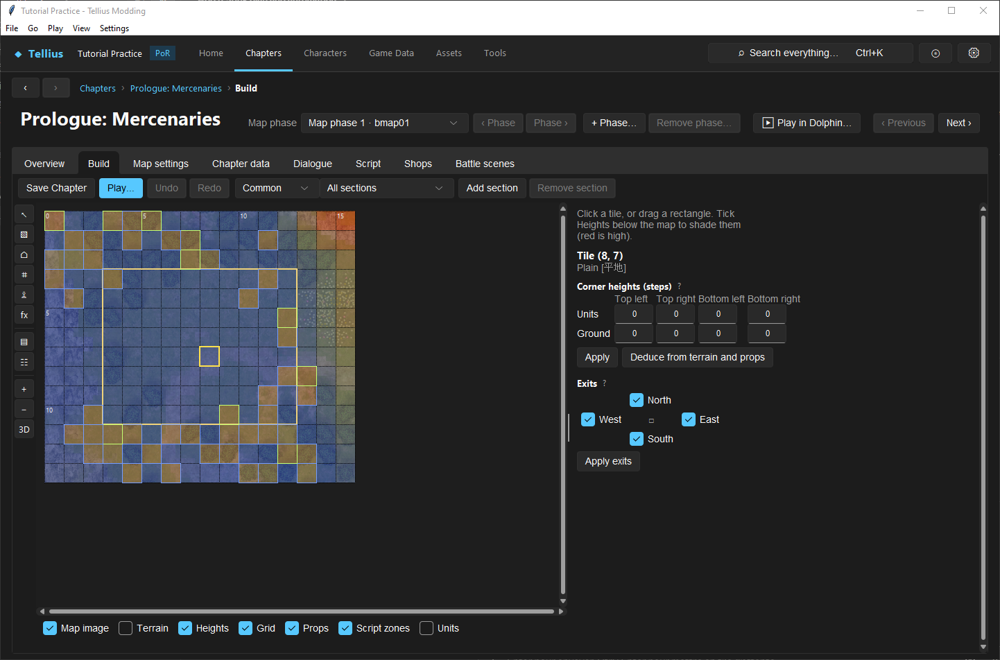

# Edit tile heights, slopes, and exits

**Route:** Chapter → Build → Tile heights

## What you will make

You will create a gentle two-tile ramp in a disposable flat area. You will align its shared corners, compare the Units, Ground, and Roof layers, inspect the automatically calculated exits, and walk across it in both directions. You will then create and revert one deliberately blocked edge to learn the difference between geometry, height-based blocking, and explicit directional exits.

The result is small, but the method scales to bridges, walls, roofs, cliffs, stairs, and raised platforms.

## Before you begin

Complete [Use the map Build tab](21-map-build-basics.md) and choose a working chapter with a verified US map layout. Find two adjacent, empty, visually flat cells away from props, doors, ledges, script zones, and the playable border.

Record for both cells:

- coordinates and terrain identities;
- all four corner values on every available layer;
- north, south, east, and west exit states;
- whether an absolute link override is reported;
- the movement range of a nearby ordinary unit;
- the visible surface in the 3D view.

Make a restorable project copy. Heights can be shared through panel records internally; the editor safely creates/reuses records as needed, but a broad multi-tile edit can still alter a large tactical area.

## How the editor fits together

Each height panel contains four signed corner elevations: top-left, top-right, bottom-left, and bottom-right. The map's panel-index grids assign one panel record to each cell. Path of Radiance maps can carry three distinct layers:

- **Units** (`combined`) is where units and the cursor stand: ordinary ground or the top of a bridge, wall, or roof.
- **Ground** (`base`) describes land underneath placed structures.
- **Roof** describes the building/roof surface used when applicable.

The app displays heights in **steps**. One step equals 400 raw file units and roughly one-fifth of a tile's width. In the editor, higher positive step values mean higher ground. Internally, the rendered world Y translation uses the opposite sign (`-raw / 400`); that file-coordinate detail is why older notes may appear to reverse the sign. Enter the intuitive step value shown by the current editor.

Traversal has another layer: directional exits. The engine first derives closed edges from height differences, then applies sparse map-link data, absolute overrides, and border rules. A surface can look continuous but remain blocked by an exit flag, or look like a wall but remain traversable if its tactical data allows it.

## Guided walkthrough

<!-- screenshot 23-a-setup.png -->
<figure class="tutorial-figure" markdown="1">

<figcaption markdown="span">**Tile heights** on tile (8, 7) with the **Heights** layer on: the panel shows the tile's four **Corner heights (steps)** on each layer and its neighbours' shared corners.</figcaption>
</figure>

### 1. Inspect the two cells

Activate **Tile heights** and select the lower/first cell. In the inspector, read all four corners for each available layer. Select its neighbor and do the same.

For east-west neighbors, the first cell's top-right and bottom-right corners meet the second cell's top-left and bottom-left corners. For north-south neighbors, the touching bottom pair meets the next tile's top pair. Write these pairs down before editing.

Look at **Exits**. The compass checkboxes show the openings stored for the tile after accounting for editable link data. The information tooltip also reports effective map-edge closures and threat-display edge costs. If the checkboxes are disabled because a `maplinkAbs` record fixes the exits, do not use that location for the first exercise.

### 2. Build a gentle ramp

Start with two flat cells at height `0` on the Units layer. For an eastward rise, set the first cell's Units corners to:

| Corner | Value |
| --- | ---: |
| Top left | `0` |
| Bottom left | `0` |
| Top right | `0.5` |
| Bottom right | `0.5` |

Set the eastern cell to continue the surface:

| Corner | Value |
| --- | ---: |
| Top left | `0.5` |
| Bottom left | `0.5` |
| Top right | `0.5` |
| Bottom right | `0.5` |

Use **Apply** after each cell. The shared boundary now matches at `0.5`, and no adjacent corner differs by a full step. If the area's starting height is not zero, add the same offsets to its baseline rather than flattening it to these literal values.

For a ground-only hillside with no structure, make the Ground layer follow the same surface. Do not blindly copy Units into Ground beneath a bridge or building: the separation exists precisely so units can stand above lower land.

### 3. Inspect automatic movement consequences

Reselect both cells and examine **Exits**. A difference of **one step or more between neighboring edge corners** can make the native height filter close that boundary. The half-step ramp should remain below that threshold.

Turn on the **Heights** overlay and open the **3D view**. Look for discontinuities, twists, or a visible seam. The editor's height overlay and 3D view are diagnostic approximations; the built game remains authoritative.

### 4. Test explicit exits

On the lower cell, untick only the exit pointing toward the raised neighbor and choose **Apply exits**. Do not change the reciprocal side yet. Save and inspect movement. This demonstrates that directional openings are stored per tile and can be asymmetric.

Then restore the exit and apply it. For ordinary two-way ground, inspect the neighbor's reciprocal exit too. A one-way tactical edge can be intentional, but accidental asymmetry is difficult to diagnose later.

If **Apply exits** is unavailable, the tile has an absolute override or the map layout is not verified for safe link editing. Move the exercise to another cell rather than attempting a raw workaround.

### 5. Create and revert a blocked-height boundary

Temporarily change the raised cell's touching left corners from `0.5` to `1.5`, leaving the first cell's right corners at `0.5`. The full-step difference should make the height filter close the edge. Inspect the exits/threat information and test movement.

Restore both touching sides to `0.5`. Reopen the cells after saving to ensure the boundary and explicit exit state both returned to the intended values.

### 6. Save and walk the ramp

Choose **Save Chapter**, reopen the phase, and test an ordinary ground unit crossing the boundary from both directions. Check where the model stands on each cell. Then inspect a flier: map-border closures can affect fliers too, while other tactical closures may interact differently with their movement rules.

Restore the original cells when the exercise is complete unless the ramp is part of the design.

## Understand every control

### Tile and terrain label

The inspector identifies the cell coordinate and its painted terrain. Terrain movement cost and height/link traversal are separate inputs. A low terrain cost cannot open an edge closed by height or link data.

### Corner-height table

Each available layer has four editable step values. Whole numbers and decimals such as `1.5` are accepted when representable by the editor's conversion. **Enter** in a field or **Apply** commits the changed layer values to Build's undoable map state.

The four corners can form a flat cell, a simple ramp, or a twisted surface. Twisted opposing-corner patterns may be mathematically expressible but should be checked carefully against the actual terrain mesh and unit placement.

### Units layer

This is the combined standing surface used by units and the cursor. On open land it commonly agrees with Ground. On structures it can describe a bridge deck or upper surface while Ground remains below.

### Ground layer

This is the land beneath props. It supports terrain/prop height deduction and represents the underlying landscape. It is not automatically the surface a unit occupies.

### Roof layer

This records roof or building-top elevation where the map supports it. A map can contain the section even when most cells do not use a distinct roof surface. Do not invent roof elevations solely to make the overlay look uniform.

### Deduce from terrain and props

This estimates corners from the terrain geometry and vanilla prop heights: Ground follows terrain or the deck beneath it, while Units and Roof can rise to the prop-defined surface. It is a starting estimate, not a proof. Review the result in the inspector, 3D view, and game.

### Exits compass

**North**, **West**, **East**, and **South** control which sides a unit may leave from the selected tile. Unticking a side can represent a cliff, fence, wall, or door frame. Use **Apply exits** to write the selection.

The info panel distinguishes effective closures, map edges, and enemy-range display costs. A map edge is closed to fliers as well. Automatic height filtering and sparse/absolute link records participate in the final result.

When `maplinkAbs` fixes a tile's exits, the checkboxes are read-only. That precedence is deliberate: the editor will not pretend a lower-priority edit can override it.

### Multi-tile selection

Selecting multiple cells exposes **Deduce from terrain and props** for the selection and **Set every corner of these tiles**. Choose **All layers**, **Units**, **Ground**, or **Roof**, enter a step value, and choose **Apply** to flatten every corner on the selected layers.

Flatten is appropriate for a plaza or platform. It destroys intentional slopes inside the selection, so inspect the selection boundary first and keep an undo checkpoint.

## Interactions and precedence

Use this order when diagnosing a blocked or floating tile:

1. Painted terrain and the active class's movement cost.
2. Units-layer corner heights on both cells.
3. Shared-edge continuity—not merely each tile's average height.
4. Height-filter closure at a difference of one step or more.
5. Sparse directional link openings.
6. Absolute link override, if present.
7. Tactical grid border/inset.
8. Props, scripts, occupancy, and runtime state.

Visible terrain geometry does not automatically rewrite the height panels. Importing a mesh may require **Deduce from terrain and props** followed by manual correction. Conversely, editing panels changes tactical standing/traversal data but does not reshape the visible mesh.

## Test matrix

| Case | Data | Expected result |
| --- | --- | --- |
| Baseline | Original adjacent flat cells | Original movement and standing height |
| Gentle ramp | Matching shared edge; less than one-step difference | Traversable in both directions |
| Height boundary | One-step or larger edge difference | Height filter closes the edge |
| Explicit closure | Matching heights; one exit unticked | That direction is blocked |
| Reciprocal check | Neighbor's opposite exit inspected | Two-way design is symmetric |
| Layer check | Units above Ground near a structure | Unit stands on Units surface, not underlying land |
| Reload | Save and reopen | Corners and editable exits persist |
| Runtime | Ground unit and flier | Behavior matches intended rule set and border handling |

## Troubleshooting

**The editor shows the slope rising in the wrong direction.** Use the displayed step convention: positive is higher. Do not enter negated raw world-Y values from old file notes.

**A gentle-looking ramp is blocked.** Compare both corners along the shared edge, not only one corner or tile average. Then inspect explicit exits and absolute overrides.

**The unit floats or sinks.** You may have edited Ground while the unit reads Units, or the visible mesh does not match the panel. Compare all layers and use deduction as a reviewed starting point.

**Only one direction works.** Exit openings are per tile. Inspect the source tile's direction and the neighbor's reciprocal direction.

**Exit checkboxes are disabled.** A `maplinkAbs` record has higher precedence, or the layout is not verified for editing. Choose another location or research the owning absolute data before changing it.

**Deduction produced a strange roof.** The inference uses visible terrain and known prop placement/height assumptions. Manually review structures, overlapping props, imported geometry, and cells outside ordinary vanilla patterns.

**A flier cannot cross the outer area.** The tactical grid inset and map-edge flags close the border to fliers too. Moving a prop or lowering terrain does not expand the playable grid.

**Changes vanished after reopening.** Use **Apply** for field edits and **Save Chapter** for the map. Saving FE8Data alone does not write height/link panels.

## Save, build, and revert

Height panels and directional link edits are map data written by **Save Chapter**. After saving, reopen the same map phase and inspect both cells. Build's Undo/Redo can revert changes during the current session, but it is not retained after closing.

For manual rollback, restore every original corner on every edited layer plus each original exit. Matching visible shape is insufficient if link data still differs. For a large flatten or deduction operation, restore the known-good map archive when the exact original panel/link structure matters.

## Limits and confidence

The three layer meanings, four-corner layout, one-step/400-unit conversion, height-filter threshold, link composition order, map-edge behavior, and editor controls are source-reviewed. Exact collision presentation, unusual imported meshes, absolute link semantics for every retail map, and movement interactions outside the tested class/map combination remain **unknown** until exercised in the target build.

## Things to try next

- Build stairs from several half-step strips rather than one full-step edge.
- Put Units above Ground to model a bridge deck, then test units above and props below.
- Flatten a selected platform on only the Units layer.
- Deduce a small prop footprint and compare the result with vanilla neighboring props.
- Make an intentional one-way ledge and document both directional exits.

## Related tutorials and references

- [Use the map Build tab](21-map-build-basics.md)
- [Paint terrain and block movement](22-paint-terrain-and-blocking.md)
- [Place, copy, and import props](24-map-props.md)
- [Map grid format](../systems/map-grid.md)
- [Maps system](../systems/maps-system.md)

---

[← Previous: Paint terrain and block movement](22-paint-terrain-and-blocking.md) · [All tutorials](index.md) · [Next: Place, copy, and import props →](24-map-props.md)
