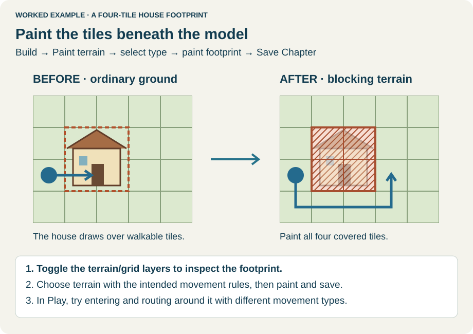
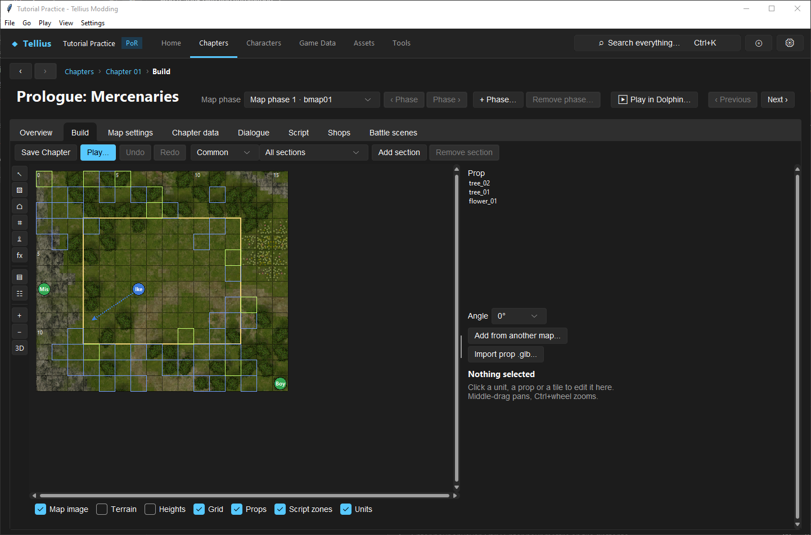
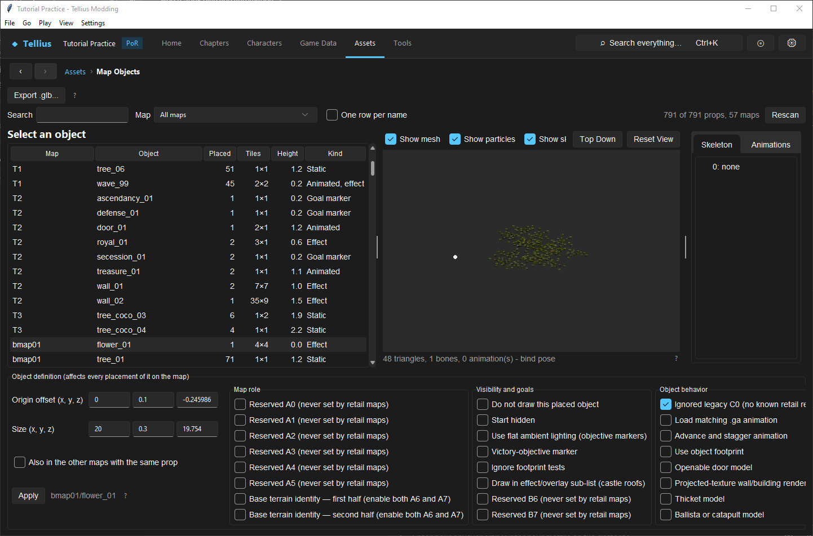

# Place, copy, import, and configure props

**Routes:** Chapter → Build → Place prop; Game Data → Map Objects

## What you will make

You will place and rotate an existing prop, copy a complete prop definition from another map, and perform a minimal GLB export/import round trip. You will then align its bounds, height, and terrain footprint so it looks correct and behaves correctly in movement tests.

The lesson deliberately separates four things that “a prop” can mean:

1. The model, skeleton, animation, and textures stored in one map archive.
2. The object definition: name, bounds, and behavior flags.
3. Each placed instance: tile, angle, footprint, and vertical position.
4. The terrain, heights, and exits that govern units underneath it.

## Before you begin

Use a disposable map phase and save or discard all existing Build edits. Record the intended placement cell's terrain, heights, exits, and occupancy. Pick a small static vanilla prop for the first exercise.

Remember the coordinate contract:

- one tactical tile is **5 model units**;
- the placed tile's corner is the local origin;
- rotation occurs around the tile center `(2.5, 2.5)` in the horizontal plane;
- bounds store a minimum corner as **Origin offset** and a maximum corner as **Size**—Size is not width/height/depth;
- instance vertical placement follows the terrain surface at the tile center.

Make a backup before importing. Prop assets and the shared map texture pack live inside that map's `map.cmp`; replacing a name changes every instance of that object on that map.

## How the editor fits together

<!-- diagram terrain-footprint -->
<figure class="tutorial-figure" markdown="1">

<figcaption>Concept diagram, not an app screenshot. A prop's visible footprint and the terrain tiles painted under it. Select the image to open it at full size.</figcaption>
</figure>

Build's prop list contains model-backed, non-terrain object definitions in the current map. Selecting one and clicking a cell creates an instance referencing that definition. Several instances can share one definition and model.

**Add from another map...** copies the other map's definition and associated model resources into the current map. It is safer than copying a `.gs` model alone because skeleton, animation, texture IDs, and flags can be part of the contract.

**Import prop .glb...** either adds a new definition or replaces the model for an existing name. New images are appended to the current map's texture pack; identical images may be reused, and unused images are compacted afterward.

**Game Data → Map Objects** edits saved object definitions directly in `map.cmp`. It does not edit open unsaved Build state. Saving an older Build buffer afterward can overwrite those direct changes, so save or discard Build work before using that panel.

## Guided walkthrough

<!-- screenshot 24-a-setup.png -->
<figure class="tutorial-figure" markdown="1">

<figcaption markdown="span">**Place prop**: choose a prop of this map (or add one from another map or a .glb), its angle, then click a tile. A prop is only a picture; paint its footprint with Paint terrain.</figcaption>
</figure>

### 1. Place and inspect an existing prop

Open Build and activate **Place prop**. Choose a small object from the list and set **Angle** to `0°`. Click an empty cell. Switch to **Select / move** and select the instance.

The inspector reports its object name, instance number, anchor tile, covered-tile rectangle, and height. Use **View model...** to inspect the resource in isolation. Then press **R** or choose **Turn 90°** and confirm the footprint rotates with it.

Undo and redo the rotation. Use **Delete** once, undo it, and confirm the exact instance returns. This proves the difference between deleting a placement and deleting its shared definition.

### 2. Copy a prop from another map

Return to **Place prop** and choose **Add from another map...**. Search by map, prop name, placement count, footprint, height, or kind. Preview the object before selecting it.

If the chosen name conflicts, give the copy a distinct ASCII name containing only letters, digits, and underscores. After copying, select it from the current map's prop list and place one instance.

Save Chapter, reopen the phase, and verify the prop still previews. A successful preview confirms the copied model resources resolve; it does not yet prove collision, lighting, events, or animation.

### 3. Export a reference GLB

With the copied prop selected, use **Export .glb...** from the object browser or prop action. Keep this untouched export as the scale, origin, materials, skin, and animation reference.

In Blender or another GLB-capable editor, make one obvious but small visual edit. Preserve transforms and keep the object near the exported origin. For this first round trip, do not rescale the scene, rename every material, add several animations, or remodel the footprint simultaneously.

### 4. Import under a new name

Choose **Import prop .glb...**, select the edited file, and enter a new ASCII identifier such as `tutorial_crate`. A new name creates a new object; an existing name replaces that object's model on the current map.

For a static GLB, the importer builds a static model using a one-bone map skeleton. For an animated GLB, it requires both a skin and at least one animation. When prompted, choose whether that first animation loops or plays once.

Read every warning. Important warnings include:

- callback material names such as `map_base` being renamed to avoid terrain behavior;
- multiple animations, of which only the first is used;
- conversion or material limitations;
- a model wider than 12 tiles, which often signals incorrect scale.

Place the imported object beside the original and compare size, orientation, textures, and ground contact.

### 5. Align bounds and footprint

Save the Build session. Open **Game Data → Map Objects**, locate the current map and imported name, and record its six bounds:

- **Origin offset X/Y/Z:** minimum model coordinates;
- **Size X/Y/Z:** maximum model coordinates.

The importer calculates them from the model. Change them only when you understand why the calculated bounding box is unsuitable. An incorrect box can alter footprint tests, culling, selection, and instance coverage.

Use **Also in the other maps with the same prop** only when the browser has proven those maps contain the same prop resources and you intend a global definition edit. The panel writes immediately to saved maps when you choose **Apply**.

Return to Build and reopen the phase after any Map Objects edit so you do not retain a stale buffer.

### 6. Add tactical behavior separately

Turn on **Terrain**, **Heights**, and **Grid**. Paint appropriate terrain under the visual footprint. For a solid obstacle, use a terrain definition impassable to the intended movement types or configure directional exits. For a bridge or platform, align Units/Ground/Roof heights deliberately.

Test at least one infantry class and one flier. A prop model never makes its cells impassable merely by occupying space.

<!-- screenshot 24-b-map-objects.png -->
<figure class="tutorial-figure" markdown="1">

<figcaption markdown="span">**Assets › Map Objects** lists every prop of every chapter map. Select one to export it, edit its bounds and flags, or **Add to this map**.</figcaption>
</figure>

## Understand every control

### Build placement controls

**Prop** selects a model-backed definition already present in the current map. **Angle** selects the initial quarter-turn orientation. The instance can later be rotated with **R** or **Turn 90°**.

**Add from another map...** copies the definition plus `.gs` model, `.g` skeleton, optional `.ga` animation, and required texture images into this map. The copied definition is local; later edits to the donor do not synchronize automatically.

**Import prop .glb...** adds or replaces assets by name. Names must be nonempty ASCII letters, digits, or underscores. Replacing an animated object with a static GLB removes its animation and animated flag. Replacing a shared name changes every placement on that map.

### Selected-instance controls

**Angle** and **Turn 90°** change the instance orientation and recompute its covered rectangle. **Delete** removes only this placement. **View model...** previews its model set; a logic-only marker may have no model.

The displayed **height** is an instance offset expressed relative to the map convention. Placement normally samples terrain at the anchor cell center. A prop spanning uneven ground may still need visual and runtime inspection across its whole footprint.

### GLB animation choices

An imported prop becomes animated only when the GLB contains both a skin and an animation. Its own skeleton is created, the skinned mesh is weighted to it, and the first animation becomes `<name>.ga`. **Loop** restarts it; **play once** stops after the animation's end. Additional GLB animations are ignored with a warning.

### Bounds

**Origin offset X/Y/Z** is the model bounding box's minimum corner. **Size X/Y/Z** is its maximum corner. Footprint width is therefore `size - offset`, converted at five units per tile and rotated for each instance.

### Definition flags

Map Objects exposes all four bytes as named bit checkboxes. Prefer copied vanilla combinations. The best-understood options include:

- **Do not draw this placed object** and **Do not draw this placed object** under runtime/drawing: separate flags can suppress rendering through different paths.
- **Start hidden**, **Victory-objective marker**, and **Use flat ambient lighting** for scripted/objective presentation.
- **Ignore footprint tests**, **Use object footprint**, and **Exclude from tile-object lookup**, which affect different lookup paths rather than terrain movement.
- **Load matching .ga animation** and **Advance and stagger animation**.
- **Openable door model**, **Projected-texture wall/building rendering**, **Thicket model**, and **Ballista or catapult model**.
- **Base terrain marker A6/A7**, which must occur as a pair and should not be assigned to an ordinary prop.

Flags labeled **Reserved** or **Ignored legacy** are not creative feature toggles. Leave them matching a proven donor unless new engine evidence establishes their use.

## Interactions and precedence

Trace a prop problem through these layers:

1. Definition name and model files exist in the current map archive.
2. Texture IDs resolve inside that map's shared texture pack.
3. Instance references the correct definition, tile, angle, and height.
4. Bounds describe the intended footprint and visibility volume.
5. Flags select the intended animation/render/lookup paths.
6. Painted terrain, heights, and exits govern tactical movement.
7. Scripts control doors, objectives, hidden state, damage, or removal where applicable.

Do not solve a movement problem by stretching model bounds, or a rendering problem by making terrain impassable. Those may hide the symptom while corrupting another layer.

## Test matrix

| Case | Expected result |
| --- | --- |
| Existing prop at 0° | Correct size, anchor, and texture |
| Same prop at 90° | Visual rotation and footprint rotate together |
| Copied donor prop | Model, textures, and optional animation resolve after reload |
| Imported round trip | Small edit appears; scale/origin remain aligned |
| Duplicate instance | Both placements share the same definition/model |
| Terrain control | Movement follows painted terrain, not visual geometry |
| Animation control | Looping or one-shot behavior matches the import choice |
| Reload/runtime | Saved map reopens and the built game draws the object correctly |

## Troubleshooting

**The object is enormous or tiny.** Compare it with the untouched export and the five-units-per-tile contract. A width-over-12-tiles warning often indicates unit conversion or unapplied transforms.

**Every copy changed after replacement.** Placements share one named definition and model. Import under a new name when only one visual variant should differ.

**Units walk through the model.** Paint movement terrain and inspect exits. Prop footprint flags are not universal collision.

**The prop floats or sinks.** Check the anchor cell, instance height, terrain surface, and Units/Ground layers. A large footprint may span slopes the single anchor cannot represent perfectly.

**Animation did not import.** Confirm the GLB has a skin and an animation. A transform animation without a glTF skin is treated as static by this workflow.

**Textures or lighting differ.** Inspect importer warnings, material names, UVs, and the current map's texture pack. Terrain callback names are deliberately renamed on ordinary props.

**Map Objects changes disappeared.** An older Build buffer was likely saved afterward. Save/discard Build first, edit the saved definition, then reopen Build.

## Save, build, and revert

Placement, copied/imported assets, instance changes, and their current map definitions are written by **Save Chapter**. Map Objects writes definition changes directly to saved `map.cmp` files when **Apply** is chosen.

Revert a placement with Build undo or delete it. Reverting an imported/replaced model exactly is safest by restoring the pre-import map archive because import may compact and renumber the shared texture pack. The project writer retains original copies, but keep your own named checkpoint before a multi-asset import.

## Limits and confidence

The five-unit scale, object/instance separation, import behavior, animation selection, bounds semantics, texture compaction, and exposed flags are source-reviewed. Several reserved flags and complex scripted object behaviors remain intentionally unlabeled or **unknown**. Preview success does not prove native culling, animation timing, objective logic, or every map-specific callback; verify those in the target build.

## Things to try next

- Make a decorative variant under a new name without changing the original.
- Copy an animated flag or torch and compare loop versus one-shot behavior.
- Build a bridge with separate model, terrain, and Units/Ground heights.
- Compare two vanilla door definitions before attempting a custom door.
- Audit every map containing a shared prop before using the cross-map checkbox.

## Related tutorials and references

- [Use the map Build tab](21-map-build-basics.md)
- [Paint terrain and control movement](22-paint-terrain-and-blocking.md)
- [Edit tile heights, slopes, and exits](23-tile-heights.md)
- [Map objects](../systems/map-objects.md)
- [Map format](../formats/map-format.md)

---

[← Previous: Edit tile heights, slopes, and exits](23-tile-heights.md) · [All tutorials](index.md) · [Next: Replace a terrain mesh →](25-terrain-mesh.md)
