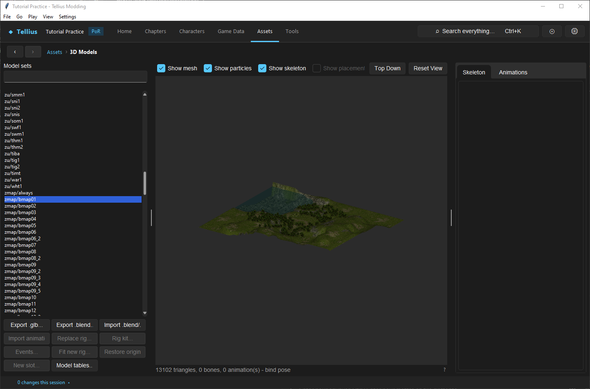

# Replace a terrain mesh safely

**Route:** Assets → Map Models

## What you will make

You will export a chapter's land terrain and road/shore mask, raise one small non-playable feature in a 3D editor, and import it back. You will compare two import strategies: a visual-only replacement and a replacement that moves tactical heights and props with the new ground.

The goal is to understand the boundary between visible mesh and tactical map data. A mesh can look perfect while units stand on old height panels; conversely, a technically valid height update can close routes you did not intend to change.

## Before you begin

Choose a disposable chapter map that already renders and plays correctly. Save all Build work and create a backup of its `map.cmp`. Record:

- map folder and terrain object name;
- playable grid size and border;
- terrain triangle count and texture-pack size if shown;
- representative tile heights, exits, and prop positions around the edit;
- at least one traversable route through the area;
- appearance of roads, shorelines, and lighting.

Export the terrain before editing. The exporter also writes a `_mask.png` beside the GLB when the terrain has a map-texturing mask. Preserve both as your reference.

Use the exported coordinate system. One tile is **5 model units**. Do not apply a global scale or origin change during a first round trip.

To begin with blank ground instead, open **Assets → Map Models**. Select a map and choose **Create new map and
replace…** when the finished terrain should replace that existing map. Choose **Create new map file…** to copy a
template into a separate `zmap/<name>/map.cmp` first; the source map remains untouched and the generated kit
targets the new copy. Set the square ground size, playable-grid width and height, and the grid's X/Y offset within
that ground. Choose another map as the terrain tileset and optionally include a water surface. Ground and grid
dimensions are limited to 63 tiles. The tileset picker groups maps whose decoded atlases are identical and
previews each genuinely distinct atlas. The resulting `.blend` is a normal terrain kit with a flat **FE9 Sculpt**,
the grid already positioned, the base texture without the old map's light overlay, and every unused atlas cell
already available as a visually named paint swatch. The unused-cell grid is inferred independently on each axis
from the map's real UV swatches, including the smaller rectangular regions used by indoor maps. That minimum grid
is only used for detection: adjacent cells whose pixels continue naturally across their shared edge are grouped
into larger rectangular swatches. It does not resize `map.bin`; set the destination map's
tactical dimensions in **Map settings** before importing the finished kit.

## How the editor fits together

The land terrain is a base-terrain object inside the chapter's `map.cmp`. Its `.gs` stores mesh/material data, `.g` supplies the map model skeleton convention, and `texpack.tpl` holds images shared by terrain, water, and props.

The terrain importer rebuilds the static mesh and updates the base terrain's bounds. It can optionally:

- move tile height panels and prop heights with the changed surface;
- fit playable geometry to the tile grid's flat half-tile panels;
- preserve the game's projected road/shore texturing on `map_base`/`map_wall` materials;
- preserve the old light overlay instead of replacing it with white.

These choices are independent. “Keep map texturing” does not move tactical heights, and “Move tile heights” does not preserve an atlas or mask.

## Guided walkthrough

<!-- screenshot 25-a-setup.png -->
<figure class="tutorial-figure" markdown="1">

<figcaption markdown="span">**Assets › 3D Models** with the Prologue terrain (`zmap/bmap01`): **Export .glb…** writes the terrain (and its `_mask.png`), **Import .glb…** opens the import review before anything is written.</figcaption>
</figure>

### 1. Export and archive the reference

Open **Assets → Map Models**, select the exact `zmap/<map>` terrain entry, and export it as GLB. Keep an untouched copy. If the exporter writes `<name>_mask.png`, keep it beside the reference.

The mask spans **640 model units**, or 128 tiles, from the terrain corner: X runs right and Z runs across the map. Black favors the first atlas UV sample and white favors the second. Grey blends them.

Open the GLB in your 3D editor and check its dimensions against the five-units-per-tile rule. Verify that materials intended to retain projected map texturing are named `map_base` or `map_wall` and have `TEXCOORD_0` plus `TEXCOORD_1`.

### 2. Make one isolated geometry edit

Choose a small hill or decorative area outside the main route. Move a few vertices vertically without changing the map origin, overall scale, material names, UV maps, or texture images.

Export GLB with transforms applied consistently. Avoid modifiers that create extreme triangle counts or non-triangulatable geometry. Keep the original and edited GLBs so you can attribute warnings to the single shape change.

### 3. Review every import option

Import the edited GLB into the same terrain slot. The **Terrain import** dialog contains these decisions:

**Move tile heights and props with the new ground** samples the old and new terrain at tactical corners. It moves relevant panel heights and props that stood on the old ground. Props detected as floating, sunk, or standing on another object remain where they were and are reported.

**Fit the playable area to the tile grid** cuts and flattens terrain across each playable tile half so visible ground follows the tactical panel representation. Use it when visual ground should match unit standing surfaces. Leave it off when preserving fine geometry is more important and you will reconcile panels manually.

**Keep map texturing on materials named map_base** reconstructs the atlas/mask callback using both UV sets. Enable it only for materials deliberately authored to that contract.

**Mask image** supplies a replacement road/shore mask. Leaving it empty preserves the current one. If the terrain has no current mask, selecting map texturing requires you to provide one.

**Keep the map's light overlay** reuses the old final light texture. That overlay was painted for the old ground, so it may produce mismatched shadows after major reshaping. With the option off, the importer uses white and leaves imported colors unmodified.

For the first pass, keep map texturing when the export used it, keep the current mask, turn the old light overlay off, and choose whether the small edit is visual-only or should move tactical ground.

### 4. Interpret the import report

Do not dismiss warnings. They explain transformations that cannot be seen from a successful file write:

- triangles cut while fitting the playable grid;
- missing second UV set, causing the mask to have no visible blend effect;
- materials renamed because reserved callback names would trigger map rendering behavior;
- playable tile corners with no terrain underneath after the edit;
- count and maximum amount of height changes;
- props moved, kept, or detected on other props;
- newly blocked passages where adjacent corners differ by one step or more;
- texture-pack size exceeding every observed vanilla map.

Cancel and fix the source when a warning contradicts the design. Do not continue merely because the preview opens.

### 5. Inspect visual and tactical results

Open the map in Build and the 3D view. Compare the edited feature, road/shore blend, material colors, and props. Turn on **Heights**, **Terrain**, and **Grid**.

If heights followed the mesh, inspect every changed tile's Units/Ground/Roof corners and exits. If they did not, confirm the visual edit does not pass under a playable unit or manually reconcile the panels.

Walk the affected route in both directions with an ordinary unit and a flier. Check units near the edge of the changed area for floating, sinking, or newly blocked movement.

### 6. Perform a no-change round trip

Import the untouched reference GLB into a restored copy of the map using the intended production options. A no-change round trip should minimize warnings and preserve appearance. This control distinguishes importer behavior from your mesh edit.

## Understand every control

### Move tile heights and props

The importer samples corresponding old and new terrain surfaces. Tile corners standing on ground follow the difference; corners associated with a prop surface are preserved. Props standing on the old terrain receive an adjusted vertical position, while anomalous props are reported and kept.

Because movement closes edges at a one-step height difference, even a visually reasonable terrain edit can change pathing. The report counts passages that became blocked.

### Fit the playable area

Tactical movement represents each tile through flat panel halves, while an arbitrary mesh can curve inside them. Fitting conforms mesh triangles in the playable area to those panels and may cut triangles at tile boundaries. Sub-tile bumps there are flattened; decorative geometry outside the area remains freer.

### Keep map texturing

Only `map_base` and `map_wall` materials receive the retained projected-texture setup. Every such material must use the same atlas image. The importer constructs three texture stages: atlas sample through the first UV set, the adjacent mask/second sample through the second UV set, and a final light or white multiplier.

Without `TEXCOORD_1`, both samples use the first UV coordinates and the mask cannot reveal a distinct road or shoreline placement.

### Mask image

The mask is stored immediately after the atlas image in the texture pack and uses repeating I4 encoding. Its spatial projection is fixed to the 640-unit map span. Painting a prettier mask at the wrong origin or scale shifts every road and shoreline.

### Keep light overlay

The old overlay can preserve vanilla shading on a no-change round trip. It is not recalculated for new hills. Disable it for a neutral white multiplier or author a new lighting solution through the appropriate material workflow.

### Texture and mesh limits

Imported images are converted for the game's texture formats and texture pack. Individual GX textures are limited to 1024 pixels per side. The importer warns when the resulting `texpack.tpl` exceeds the largest observed vanilla map size; that warning is a compatibility risk, not a cosmetic note.

To use your own tileset, open **Atlas swatches… → Build custom tileset…**. PNG is recommended because it is
lossless and supports transparency; JPEG, BMP and TGA are also accepted. Supply one tileable base image (it is
centre-cropped and resized to 512×512) and any number of tileable extra images. Each extra image's width and height
are fitted independently to 32, 64, 128 or 256 texels, so rectangular indoor walls and trim are supported. The
editor packs them into the 512×1024 terrain atlas and uses each filename as its initial swatch name. Keep important
details away from image edges and prefer source dimensions already matching a supported size to avoid resampling.

If an imported mesh is unusually large, the model panel can offer triangle reduction. Reduction changes geometry and may affect UV seams or silhouettes, so compare before/after renders and routes.

The game's mesh tables use 16-bit indices, so an import with more than 65,536 distinct positions, normals, or UVs
is refused. When **Make Game Mesh** cuts painted terrain on atlas-repeat boundaries, each triangle is cut only on
the repeat lines of swatches that can appear on that triangle. A small swatch therefore adds detail where it is
painted instead of subdividing the whole map. If those required cuts still exceed the triangle budget, the add-on
keeps the smallest mesh it found and warns; lower the budget, paint small swatches less widely, or use larger
swatches.

## Interactions and precedence

Trace terrain behavior through these independent outputs:

1. Mesh geometry controls visual surface shape.
2. Materials, UV sets, atlas, mask, and light overlay control appearance.
3. Terrain object bounds control visibility and object-space extent.
4. Panel heights control where units/cursor stand.
5. Height filtering and explicit links control edge traversal.
6. Painted terrain controls movement cost and bonuses.
7. Prop instances retain their own bounds, flags, and vertical placement.

Changing mesh geometry does not repaint terrain identities. Moving panels does not resculpt mesh. Keeping the light overlay does not calculate new shadows. Treat each as a separate acceptance test.

## Test matrix

| Case | Import choices | Expected result |
| --- | --- | --- |
| Control | Untouched export, matching options | Appearance and routes remain equivalent |
| Visual-only | Heights off, fit off | Mesh changes; tactical panels/props stay fixed |
| Ground-following | Heights on | Applicable panels and grounded props follow surface |
| Grid-fit | Fit on | Playable mesh matches flat panel halves; cuts reported |
| Map-textured | Texturing on, two UV sets | Road/shore mask remains aligned |
| Neutral light | Keep light off | Imported colors multiplied by white |
| Route test | Ground unit and flier | No unplanned closures or floating models |
| Reload/build | Save and reopen/run | Resources survive repack and native load |

## Troubleshooting

**Roads or shorelines disappeared.** Check material name, shared atlas, second UV set, mask selection, and fixed mask projection. A missing `TEXCOORD_1` is reported explicitly.

**Units float above or sink into the mesh.** Tactical height panels did not follow, or the sampled corner has no new terrain underneath. Enable the follow option on a restored copy or edit panels deliberately.

**A route became blocked.** Read the blocked-passage warning and compare shared corner heights and explicit exits. Reduce the slope below one step or redesign the route.

**Props moved incorrectly.** Inspect whether they stood on ground, another prop, or an intentionally offset surface before import. The report distinguishes moved and kept cases.

**The map is unexpectedly bright or shadows are misplaced.** White neutral lighting was selected, or the old light overlay no longer matches the new shape. Choose consciously rather than toggling unrelated material settings.

**The import says playable corners have no terrain.** The edited mesh no longer covers required tactical samples. Extend/fix the mesh before relying on old heights.

**The texture pack is very large.** Reduce unique images and resolution, reuse identical textures, and review the warning before native testing.

## Save, build, and revert

The terrain import writes the map archive through the model workflow and keeps an original copy. Close or reload any open Build view after import so it does not save stale map data over the new archive.

For rollback, restore the entire pre-import `map.cmp`. Reimporting the old mesh may reproduce appearance but not necessarily the exact prior texture ordering, panel sharing, prop heights, or link state after several imports.

## Limits and confidence

The coordinate scale, importer options, map-texturing pipeline, mask span, height/prop following, grid conformance, bounds update, warning calculations, and texture constraints are source-reviewed. Exact native rendering limits above observed vanilla sizes, unusual material callbacks, and every imported topology remain **unknown** until tested on the target build.

## Things to try next

- Raise a decorative hill outside the playable grid with heights disabled.
- Widen a playable platform with grid fitting and inspect every new corner.
- Paint a replacement road/shore mask without changing geometry.
- Compare the old light overlay with neutral white on the same edit.
- Move ground beneath several props and audit which follow automatically.

## Related tutorials and references

- [Edit tile heights, slopes, and exits](23-tile-heights.md)
- [Place, copy, import, and configure props](24-map-props.md)
- [Import water and set its flow](26-water.md): the Sculpt & paint kit carries the map's water and shore waves too.
- [Terrain texture rendering](../systems/terrain-texture-rendering.md)
- [Map format](../formats/map-format.md)

---

[← Previous: Place, copy, import, and configure props](24-map-props.md) · [All tutorials](index.md) · [Next: Import water and set its flow →](26-water.md)
