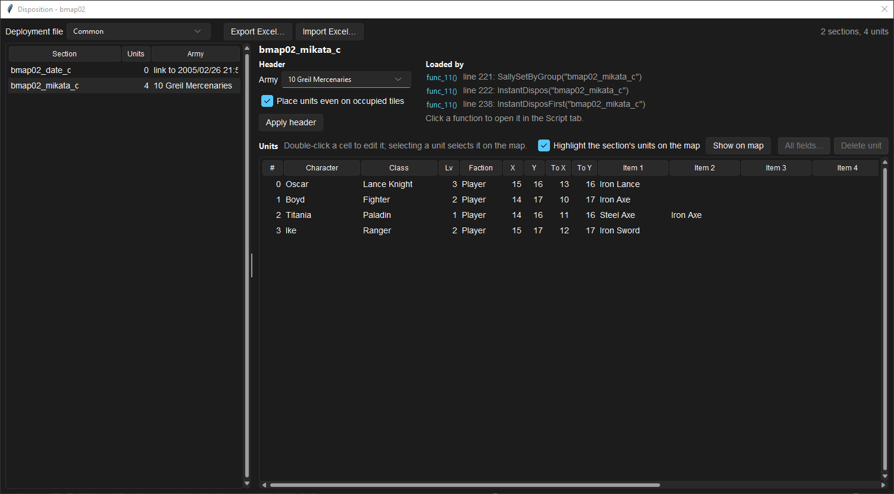
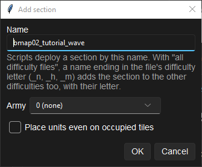

# Design and connect deployment sections

**Routes:** Chapter → Deployment; Chapter → Build → Units list / Add section

## What you will make

You will trace one opening enemy section from its difficulty file to the script call that deploys it, then create an empty reinforcement section with correctly paired Normal, Hard, and Maniac names. You will add one disposable unit, prove the section is absent until called, and confirm that its named army is separate from its faction.

The exercise teaches the central rule of deployment design: a section defines a group of unit records, but it does not schedule itself. A script call, opening routine, or other loader must request the section by name.

## Before you begin

Choose a working chapter that contains:

- a common/player section;
- Normal, Hard, and Maniac deployment files;
- an ordinary opening enemy section;
- at least one later reinforcement or scene-only section.

Record each section's exact name, file, unit count, army group, faction of its first unit, and every script function shown as a caller. Save a backup of `dispos.cmp` and the chapter script.

Do not rename or remove a section until its callers are known. Script lookup is string-based; a valid deployment file can still fail because the requested label no longer exists.

## How the editor fits together

Path of Radiance `dispos.cmp` normally contains four documents:

- `dispos_c.bin`: common records usable on every difficulty;
- `dispos_n.bin`: Normal;
- `dispos_h.bin`: Hard;
- `dispos_m.bin`: Maniac.

Each document contains ordered named sections. A section has a four-byte header followed by up to 127 unit records. Most section names end in `_c`, `_n`, `_h`, or `_m`.

Scripts either name a specific section or pass the shared prefix to a difficulty-selecting helper. Common sections do not automatically merge with same-named difficulty sections; they are separate labels and records loaded by script behavior.

The section header's **Army** is a numeric `GroupData` name assigned to deployed units. Each unit also has a **Faction**—Player, Enemy, Ally, or Partner—which controls side. Name and side are different.

## Guided walkthrough

<!-- screenshot 29-a-setup.png -->
<figure class="tutorial-figure" markdown="1">

<figcaption markdown="span">**Units list** for Ch.1: every section of the deployment file with its army and role (player army, battle start, reinforcement, scene-only), and the units of the selected section.</figcaption>
</figure>

<!-- screenshot 29-c-add-section.png -->
<figure class="tutorial-figure" markdown="1">

<figcaption markdown="span">**Add section**: the name the script will load (`bmap02_tutorial_wave`) and the section header (army, group). The section is added to each difficulty file.</figcaption>
</figure>

### 1. Trace a working opening section

Open **Deployment** and select the Normal variant. In **Sections / Units**, select the opening enemy section. Record its exact name and expand it to inspect its units.

Choose **Edit Section...**. Record the named Army and whether **Place units even on occupied tiles** is enabled. Cancel without changes.

Open Build's **Units list** for the same section. The section panel lists script functions that reference its exact name or the difficulty-neutral prefix used by rank-selection calls. Open each caller in the Script tab and identify when it runs.

This establishes all three requirements for a visible wave: a section exists in the correct file, a caller selects it, and the caller actually runs.

### 2. Compare variants by structure

Switch among Normal, Hard, and Maniac. Compare section names, unit counts, army headers, and ordering. Look for counterpart names that differ only in the final letter.

Do not assume the same unit index means the same character across files. Compare PID, section, and role. Later multi-difficulty editing tools can synchronize shared fields, but each document remains independently authored.

### 3. Add an empty difficulty-paired section

In Build, choose a difficulty variant and **Add section**. Enter a name ending in that file's letter, for example `bmapXX_tutorial_n`. Set a known army group and leave occupied-tile placement off for the first experiment.

When the add operation targets all difficulty files, the `_n`, `_h`, or `_m` suffix is replaced for each destination, producing paired names. Verify the actual results in all three variants. A name without the recognized suffix cannot be assumed to generate the intended counterparts.

### 4. Add one disposable unit

Activate **Place unit**, choose the new section, and select **Difficulty files**. Tick only Normal for the first pass. Place a copied/test unit on an empty playable cell.

Inspect its faction in the Units list. The section's Army name does not convert it to Enemy or Player; set faction intentionally in the unit form. Keep spawn and destination coordinates equal so it does not walk after appearing during this structural test.

Save Chapter, reopen Deployment, and verify the unit exists only in the Normal counterpart.

### 5. Prove the section is data, not timing

Launch the chapter without adding a script call. The new unit should remain absent even though the section and record are valid.

Copy the pattern of an existing reinforcement caller in the Script editor, substitute the correct difficulty-neutral prefix or exact label as required by that function, and place it behind a disposable trigger/guard. Save the script and launch again.

The unit should now appear only when the call executes. Remove or disable the experimental caller afterward unless it belongs to the design.

### 6. Test occupied-tile handling

Temporarily arrange for the spawn cell to be occupied. With **Place units even on occupied tiles** off, the loader searches for a nearby free cell. With it on, the section requests placement on the specified tile even when occupied. Test this only on a disposable setup; overlapping placement may interact with runtime rules and is not a substitute for good coordinates.

## Understand every control

### Difficulty variant / Deployment file

This chooses which `dispos_*.bin` document you inspect. Common is a real file, not a visual merge of every difficulty. Switching variants can select a counterpart section when one exists, but it does not prove the records are synchronized.

### Sections / Units tree

The tree preserves file order and groups records by section. Link sections can contain no units and point through their header rather than behaving as ordinary unit groups. Do not populate or remove one merely because its unit count is zero.

### Edit Section: Army

**Army** is a byte-sized numeric index into FE8Data `GroupData`. Group `0` keeps each unit's current named army; a nonzero value assigns the section's group when units deploy. It controls army-list naming and group-scoped commander behavior, not hostility.

### Place units even on occupied tiles

Off means a unit whose intended cell is taken is moved to the nearest free cell. On stores a nonzero occupied-tile byte and skips that normal free-cell check. Preserve the original raw nonzero value when the checkbox stays on.

### Mode byte

The section mode byte is `4` in every vanilla section. It tells the reader that occupied-tile and army bytes follow. The editor preserves it rather than exposing it as a creative mode selector.

### Add section

**Name** is the runtime string scripts deploy. With an all-difficulty operation, a terminal `_n`, `_h`, or `_m` is rewritten for the other files. The dialog also defines the initial section header. New sections are empty until units are added.

### Remove section

Removal deletes the selected section from the active destination(s). Search script references first. Removing data does not remove or repair calls; a dangling call can fail at runtime.

### Units list tools

The list shows section, unit count, and army, plus the selected section's script callers. **Highlight the section's units on the map** dims other groups. **Show on map** centers the group. Double-click cells for common fields; **All fields...** exposes the complete raw record for that deployment file only.

**Export Excel...** and **Import Excel...** operate across loaded deployment documents. Import validates before applying, but a structurally valid workbook can still contain wrong section names or script relationships.

## Interactions and precedence

A section appears in play only when these layers agree:

1. Correct map phase loads the intended `dispos.cmp`.
2. Current difficulty selects common/specific behavior expected by the caller.
3. Section name or shared prefix matches the script argument.
4. Trigger and guard allow that script call to run once at the intended time.
5. Section header supplies named army/placement behavior.
6. Unit faction supplies allegiance.
7. Unit coordinates, absence/recruitment state, flags, and occupancy permit creation.

Section order can also matter to scripts or deterministic commander/list traversal. Append new groups where possible and avoid broad reordering without a caller audit.

## Test matrix

| Case | Expected result |
| --- | --- |
| Existing opening section | Caller runs and expected units appear |
| New section without caller | No unit appears |
| New section with trigger | Unit appears only after trigger |
| Difficulty pairing | `_n/_h/_m` counterparts exist as intended |
| Normal-only record | Unit absent from Hard/Maniac counterparts |
| Army/faction comparison | Displayed army name changes independently of side |
| Occupied off | Blocked spawn relocates to nearby free cell |
| Reload | Names, header, units, and script call survive saves |

## Troubleshooting

**A valid section never appears.** Search callers, verify current phase/difficulty, and inspect trigger guards. Existence is not scheduling.

**The wrong difficulty's group appears.** Confirm helper semantics and suffixes. An exact `_n` call does not automatically choose `_h` or `_m`.

**Units have the right army name but wrong color/side.** Edit unit faction. The header group and faction are independent.

**A wave appears immediately.** Its caller runs during opening, or the unit was added to an opening/common section rather than a reinforcement section.

**A scene actor leaks into battle.** Keep scene-only actors in a section loaded and removed by the scene's script, not an ordinary opening section.

**A removed section still has references.** Restore it or update every script caller. Saving the deployment does not repair strings in the script.

**A unit moved from its authored tile.** The cell was occupied and the section's occupied-tile option was off, or its secondary destination differs from spawn.

## Save, build, and revert

Deployment edits made through Build use Build's Undo/Redo and **Save Chapter**. Script edits must also be saved/compiled through the chapter workflow. The standalone Deployment view has its own save state when used directly; verify the status before leaving.

To revert, restore the original sections and script calls together. Deleting an experimental section is safe only after its calls are removed. For broad Excel imports or reorderings, restore `dispos.cmp` from the pre-edit copy.

## Limits and confidence

The four-file structure, suffix behavior, section layout, header meanings, script-reference display, group/faction separation, occupied-tile handling, and structural writer are source-reviewed. Exact behavior of malformed names, overlapping forced placement, unusual link sections, and chapter-specific script helpers remains **unknown** until tested in that chapter.

## Things to try next

- Split opening enemies and turn-based reinforcements into separate sections.
- Give two enemy sections different named armies while keeping Enemy faction.
- Create a scene-only group and prove it is absent from ordinary combat.
- Compare all three difficulty counterparts with Excel export.
- Add a guarded reinforcement call that can execute only once.

## Related tutorials and references

- [Place units for each difficulty](30-deployment-by-difficulty.md)
- [Create reinforcements](32-reinforcements.md)
- [Edit chapter scripts](33-script-editor.md)
- [Deployment format](../formats/dispo-format.md)
- [Armies and allegiance](../systems/armies-allegiance.md)

---

[← Previous: Assign battle scenery by map and terrain](28-battle-backgrounds.md) · [All tutorials](index.md) · [Next: Place units for each difficulty →](30-deployment-by-difficulty.md)
