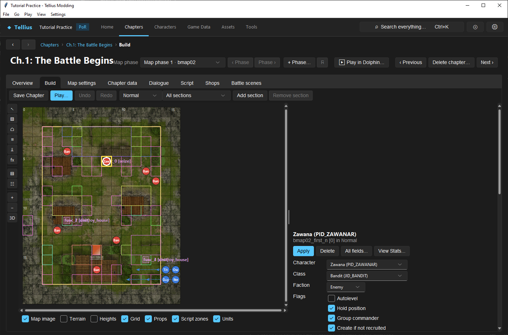

# Set unit inventory, drops, skills, AI, and flags

**Route:** Chapter → Deployment → select a unit

## What you will make

You will turn a plain enemy into a controlled test unit: one usable weapon, one Vulnerary, one item that drops, explicit combat and movement AI, and a single deliberate deployment flag. You will also learn what every visible field in the unit form controls, which combinations have special behavior, and which results must be verified in-game.

This lesson edits an existing record so that deployment timing and difficulty matching are already known. The goal is not to make the strongest enemy; it is to make a record whose behavior you can predict before pressing **Play**.

## Before you begin

Complete [Place and tune units by difficulty](30-deployment-by-difficulty.md). Choose an ordinary enemy that already appears correctly on the intended difficulty. Save a backup of the chapter and record:

- its section and faction;
- its spawn and destination coordinates;
- all eight inventory slots and their two item flags;
- its five skill slots;
- the three AI labels, movement type, turn order, unit flags, and gauge;
- its level and eight deployment stat bonuses.

Use a disposable test chapter or a copied unit. For the first pass, do not combine a drop test with a class ring, recruitment condition, door/chest routine, or transformed Laguz weapon. Each of those adds a separate rule that can hide a simple slot error.

## How the editor fits together

A deployment unit record answers several different questions at once:

| Question | Controls |
| --- | --- |
| Who is created? | **Character**, optional **Class**, **Faction** |
| Where do they begin and go? | spawn X/Y and destination X/Y |
| What do they carry? | weapon slots 1–4, item slots 5–8, per-slot flags |
| What extra abilities do they have? | five **Skills** slots |
| How does the CPU use them? | Attack/Move/Heal AI, movement type, turn order |
| What lifecycle exceptions apply? | eight decoded **Flags** |
| What changes by difficulty? | presence, level, and eight stat bonuses |
| How transformed are they? | **Laguz gauge** override |

The section header's army and the unit's **Faction** are separate data. The section groups records for loading; the faction determines whether this individual record is Player, Enemy, Ally, or Partner. A unit can therefore sit in a misleadingly named or mismatched section. Treat that as a diagnostic clue, not a supported design shortcut.

Build and Deployment expose the same underlying records through different workflows. If the unit has Normal/Hard/Maniac counterparts, **Apply** updates shared fields across the matched copies while level and stat bonuses stay per difficulty. Review lesson 30 before using **All fields...**, which targets only the current file.

## Guided walkthrough

<!-- screenshot 31-a-setup.png -->
<figure class="tutorial-figure" markdown="1">

<figcaption markdown="span">An enemy of Ch.1 selected: its items with the per-slot drop flag, and its deployment flags. The drop flag belongs to the item slot, not to the unit.</figcaption>
</figure>

### 1. Establish a predictable identity and position

Select the test enemy. Keep its working **Character** and **Class** for now. If **Class** is empty, the character's normal class is used; entering a JID here overrides that class for this deployment record.

Leave **Faction** as Enemy. Set spawn X/Y to a clear walkable tile. For a stationary test, copy the same coordinates into destination X/Y. For an arrival or scripted move, the two coordinate pairs may intentionally differ, but that behavior belongs in a separate test.

Click **Apply**, switch away from the record, then select it again. Confirm that all four coordinates survived the round trip before changing equipment.

### 2. Build a minimal legal inventory

Put a weapon the class can use in slot 1. Slots 1–4 are the weapon/staff half of the record; slots 5–8 are the ordinary item half. Put a Vulnerary in slot 5 and the intended reward in slot 6. Clear unused slots instead of leaving unrelated template equipment in them.

For each occupied slot, inspect both item flags:

- **Drops** makes that specific slot the defeated unit's drop. Merely placing an item in inventory does not make it drop.
- **Ignore in first playthrough** is the class-ring availability flag. It is meaningful for the game's first-playthrough/repeat-playthrough handling, not a general-purpose hidden-item switch.

Enable **Drops** on slot 6 only. The format supports one drop per unit, so treat a second checked drop as invalid design even if the editor can display the bits. Leave the ring flag off for this ordinary reward.

### 3. Add skills without replacing class or character skills

The five **Skills** boxes add deployment skills to the unit. They do not rewrite the character or class record. Leave all five empty for the baseline run, then add one easy-to-observe skill for the second run.

Choose a skill whose conditions you can trigger in one turn. Record which slot you used. If the skill does not appear, first confirm that the SID resolves in Game Data and that the skill's own activation conditions were met; moving the same SID among the five deployment slots should not change its meaning.

### 4. Preserve a known AI set, then change one dimension

The form stores three AI labels: **Attack AI**, **Move AI**, and **Heal AI**. They are independent inputs to the enemy's decision logic. Copy all three from a nearby enemy that already behaves the way you want.

For the first run, alter only **Move AI** or enable **Hold position**, not both. This lets you tell whether a movement change came from the selected AI routine or from the explicit position flag. Keep **Movement AI**/movement type equal to the template until the basic behavior is proven; it participates in how the movement routine interprets the unit.

**Turn order** is a signed priority byte from -128 through 127. It influences ordering among CPU-controlled units; it is not the chapter turn on which the unit appears. Test ordering with two otherwise similar enemies before relying on a particular value.

The **AI controlled** choice is relevant to player-faction records. It determines whether a player unit is CPU-controlled rather than manually controlled. Enemy, Ally, and Partner factions already follow their side's control path, so do not use this checkbox as a substitute for choosing the correct faction.

### 5. Choose one deployment flag deliberately

The decoded flag checklist maps individual bits to these behaviors:

| Flag | Use it when | First verification |
| --- | --- | --- |
| **Autolevel** | the unit should receive the game's automatic level/stat treatment | compare displayed stats with known chapter enemy-level additions |
| **Hold position** | the unit should not leave its assigned position through normal movement AI | end a turn outside attack range, then inside it |
| **Group commander** | the record should be the commander/reference unit for a group | compare with an original section that uses a commander |
| **Create if not recruited** | creation depends on that character not already being recruited | test fresh and recruited campaign states |
| **AI uses Door Key** | CPU logic may consume its Door Key | provide the key and a reachable locked door |
| **AI uses Chest Key** | CPU logic may consume its Chest Key | provide the key and a reachable chest |
| **Can't enter bridge cover** | pathing must exclude the bridge-cover terrain case | test on a map that actually contains it |
| **0x80 (unread)** | only when reproducing a known vanilla record | preserve it and document the source record |

For this exercise, enable **Hold position** and leave the other decoded flags as they were. Never assign a guessed meaning to **0x80**. If copying a unit with that bit set, preserve it until an isolated comparison establishes its effect.

### 6. Leave difficulty bonuses and Laguz gauge controlled

The **Level** field and HP/Str/Mag/Skl/Spd/Lck/Def/Res values are deployment inputs, not the character's permanent bases. They can differ across difficulty counterparts. A signed bonus adds to or subtracts from the deployed result; it does not rewrite the class cap or character growth.

For a Beorc test unit, leave **Laguz gauge** at 0. For a Laguz, 0 means use its normal/default gauge setup; values 1–19 override the starting gauge. The gauge does not place an ordinary weapon into a slot, and a transformed Laguz weapon must be inspected through the transformation/class system rather than treated as a normal inventory weapon.

### 7. Save and run the baseline

Click **Apply**, save the deployment data, and use the chapter's validation/check path. Enter Play from a fresh state. Confirm the enemy exists, equips slot 1, stays in place under the chosen condition, uses the expected AI, and yields slot 6 after defeat.

Return to the editor, add the one observable deployment skill, save again, and replay the same actions. This isolates the skill test from inventory and AI setup.

## Understand every control

### Character, class, and faction

**Character** selects the PID and therefore links identity-dependent data such as name, portrait, and the character's normal class. **Class** is a deployment override: blank inherits the character's class; a JID forces another class for this record. The override still needs compatible models, animations, weapons, and skills.

**Faction** is the record's allegiance. Moving a record between sides is not cosmetic. The deployment format clears its drop bit when a side transfer is performed, preventing an old enemy drop from silently following a newly playable unit. Recheck every slot after changing faction.

### Spawn and destination tiles

Spawn X/Y is where the record is created. Destination X/Y provides the target used by applicable deployment/arrival behavior. Equal pairs make the safest static test. Neither pair validates terrain passability, collision, or event timing by itself.

### Inventory slots and flags

The eight slots are ordered. Weapons and staves belong in 1–4; ordinary items belong in 5–8. The class must have the rank and weapon type required to use equipped weapons. A valid IID in a slot can still be unusable in battle.

**Drops** belongs to the slot, not to the IID globally. Moving the reward to another slot without moving the flag changes what drops. For a class ring, **Ignore in first playthrough** suppresses its ordinary first-playthrough availability. When both flags are set on that ring, its purpose is to appear as the defeated unit's drop rather than as a normal carried option; verify this once in a first playthrough and once in repeat-playthrough state.

### Skills

The five slots are additive deployment assignments. Final in-game abilities can also come from character, class, equipment, transformations, or script state. When diagnosing an unexpected skill, inspect all of those sources instead of assuming the deployment row is authoritative.

### AI controls

Attack, movement, and healing labels select separate routines. A unit may have a valid attack routine but never reach a target because movement or **Hold position** prevents it. Door/chest flags grant the AI permission to use the matching key; they do not create a key, a reachable target, or a movement route.

Turn order affects relative CPU processing, while the script/deployment loader controls arrival timing. Laguz gauge controls transformation readiness. None of these fields replaces the others.

## Interactions and precedence

- A deployment **Class** override wins over the character's usual class for this record, but it does not manufacture missing model or weapon compatibility.
- Unit **Faction** controls allegiance; section army remains a group/load attribute.
- **Hold position** can mask a movement-AI experiment. Change only one for the first comparison.
- Door/chest permission matters only when the matching key is carried and the target is reachable.
- A drop is the intersection of an occupied slot and that slot's **Drops** bit. The IID alone is insufficient.
- Changing faction can clear drop state. Always re-open the record afterward.
- Class-ring first-playthrough handling and drop handling are two different bits that can be combined.
- **Autolevel**, chapter enemy-level additions, difficulty-specific level, and signed stat bonuses can all affect the displayed combat result. Record each input before comparing difficulties.
- Deployment skills stack with other skill sources; removing the deployment SID may leave an innate skill intact.
- A nonzero Laguz gauge overrides the starting value but does not replace transformed-weapon/class behavior.

## Test matrix

| Test | Setup | Expected observation |
| --- | --- | --- |
| Baseline inventory | one usable slot-1 weapon, items in 5 and 6 | all three appear; weapon is usable |
| Drop | **Drops** only on slot 6 | slot 6 is awarded after defeat |
| Slot move | move reward from 6 to 7 but leave flag on 6 | demonstrates that the flag, not item identity, selects the drop |
| Faction transfer | change Enemy to Player and re-open | allegiance changes; drop state is rechecked/cleared by transfer handling |
| Hold position | target first outside, then inside attack range | unit does not perform ordinary movement; attack behavior is observed separately |
| Door/chest | correct key plus reachable target | AI permission can be observed without inventing an item |
| Added skill | one visible deployment SID | skill appears/activates in its documented condition |
| Class ring | first and repeat playthrough states | ring flag behavior differs only where the game rule applies |
| Laguz gauge | 0, then one value from 1–19 | starting gauge follows default, then override |
| Reload | save, close, reopen | slot order, flags, AI, and coordinates round-trip unchanged |

Repeat the relevant rows on every difficulty where the unit exists. Use a fresh chapter/campaign state for recruitment and first-playthrough conditions; a save made after the condition changed cannot prove the other branch.

## Troubleshooting

### The enemy carries the reward but drops nothing

Open the exact occupied slot and check **Drops**. Confirm no later faction transfer cleared it and no second slot also claims the single drop. Defeat the same PID shown in the editor.

### The wrong item drops

The bit stayed on the old slot when items were reordered. Clear all drop bits, enable it only on the intended occupied slot, save, reopen, and retest.

### The weapon is present but unusable

Check class weapon type/rank, item restrictions, and whether the class override resolved. Inventory placement bypasses neither weapon compatibility nor transformation rules.

### The unit does not move or use a key

Inspect **Hold position**, movement AI/type, carried key, permission flag, reachable terrain, and target existence in that order. A key-permission flag cannot overcome a blocked route.

### Stats differ more than the entered bonus

Separate character/class bases, deployment level, **Autolevel**, chapter enemy-level additions, and the eight signed bonuses. Compare one difficulty with one changed input at a time.

### A skill remains after clearing its slot

Inspect the character, class, equipped item, and transformation state. The skill may not have come from deployment.

## Save, build, and revert

Use **Apply**, save the deployment/Build resource, then save the chapter. Reopen the unit and verify the eight slots, item flags, five skills, AI labels, flags, coordinates, and gauge before building an ISO.

For a clean revert, restore the recorded field values or the backed-up deployment file. Reverting only the item IID does not restore its per-slot flags, and reverting only faction may not restore a cleared drop bit.

## Limits and confidence

Field labels, slot ranges, flag mappings, difficulty behavior, gauge range, and faction/drop handling are source-reviewed against the current application and format implementation. The engine effects of **0x80** remain unknown; this tutorial intentionally does not name it.

AI labels select game routines whose full behavior depends on map geometry, targets, inventory, and engine state. The editor can store and validate labels but cannot prove an AI outcome without a controlled playtest. Class-ring and recruitment flags also require the matching campaign state.

## Things to try

- Give two nearby enemies the same AI but different signed turn-order values and record which acts first.
- Compare **Hold position** with a movement AI that naturally waits; note how each reacts when a target enters range.
- Put the same drop IID in two different slots across two copies and prove that the flagged slot controls the reward.
- Create a Laguz test copy with gauge 0, 1, 10, and 19; record initial gauge and first transformation opportunity.
- Remove a deployment skill from a unit that also owns it innately and verify the remaining source.

## Related tutorials and references

- [Place and tune units by difficulty](30-deployment-by-difficulty.md)
- [Create an item or weapon variant](17-items-and-weapons.md)
- [Assign and verify skills](18-skills.md)
- [Characters](../systems/characters.md)
- [Items and weapons](../systems/items-weapons.md)
- [Dispo format](../formats/dispo-format.md)

---

[← Previous: Place units for each difficulty](30-deployment-by-difficulty.md) · [All tutorials](index.md) · [Next: Add a reinforcement wave →](32-reinforcements.md)
