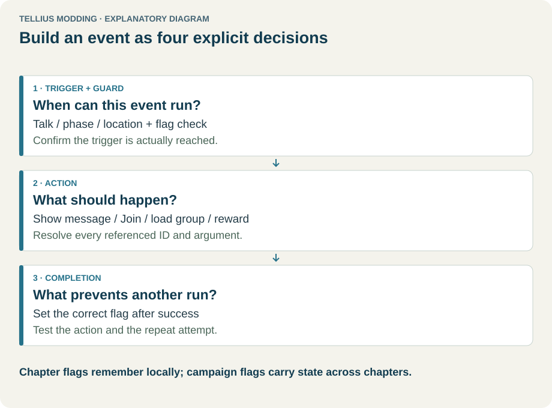
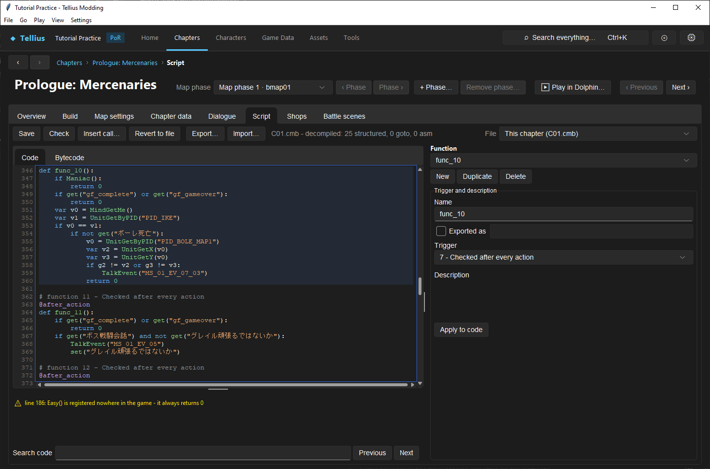
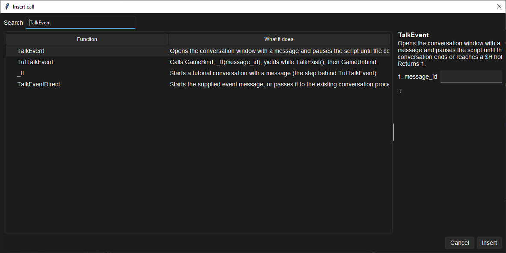

# Edit, compile, and test event scripts

**Route:** Chapter → Script

## What you will make

You will duplicate a working chapter event, give the duplicate a controlled turn/phase trigger and description, change one message or harmless presentation call, compile it, and prove both the trigger and function body run. You will then disable the duplicate and restore the original behavior.

The goal is to understand the complete editing loop: choose the correct script file, identify a function, edit either its source or trigger form, read diagnostics, save compiled bytecode plus readable sidecar source, and exercise the event from the state that makes its trigger eligible.

## Before you begin

- Complete [Understand a chapter's parts](06-chapter-anatomy.md) and [Save changes and restore originals](03-saving-and-restoring.md).
- Use a chapter that already compiles and plays. Record a baseline **Check** result before editing.
- Identify one short event whose trigger you can reproduce quickly. Prefer a turn/phase event or a harmless message/presentation event over recruitment, victory, inventory, or permanent campaign state.
- Record the selected chapter, script filename, function name, trigger type and parameters, called message/resources, and any one-time flag.
- Create a project checkpoint before changing a shared script such as `startup.cmb` or `ending.cmb`.

Compilation success proves that source is structurally valid. It does not prove that the trigger can fire, that an identifier resolves to the intended resource, or that asynchronous calls are ordered correctly.

## How the editor fits together

<!-- diagram events -->
<figure class="tutorial-figure" markdown="1">

<figcaption>Concept diagram, not an app screenshot. An event as trigger and guard, action, and completion flag. Select the image to open it at full size.</figcaption>
</figure>

A `.cmb` file is compiled bytecode. The editor exposes it as readable `.fe9s` source. The source text is the authority for the function list, trigger form, and compilation:

- Selecting or editing a function changes the source view.
- **Trigger and description → Apply to code** rewrites that function's decorators and name in source; it does not save the file.
- **Check** compiles the complete current source in memory and reports diagnostics; it does not write.
- **Save** compiles and writes the `.cmb`, then stores readable source in the project's `script_sources` sidecar area.
- On reload, the sidecar is reused only if it still compiles to the current binary. If the binary changed elsewhere, the app decompiles the current file rather than silently overwriting it with stale source.

The **File** selector can point at the current chapter or a shared script. `startup.cmb` supplies shared helpers and campaign flags used while compiling chapter scripts. Editing it has wider consequences than editing one chapter.

A trigger answers **when the engine selects a function**. The code body answers **what happens after selection**. A function with trigger type 0 runs only when another function or the engine calls it.

## Guided walkthrough

<!-- screenshot 33-a-setup.png -->
<figure class="tutorial-figure" markdown="1">

<figcaption markdown="span">The **Script** tab on the Prologue (`C01.cmb`) with a function selected: the code, the **Function** list, **Trigger and description** with **Apply to code**, and **Check**/**Save**.</figcaption>
</figure>

<!-- screenshot 33-c-call-help.png -->
<figure class="tutorial-figure" markdown="1">

<figcaption markdown="span">**Insert call…**: search the game's script functions; the selected one shows its purpose and numbered arguments before it is inserted at the cursor.</figcaption>
</figure>

### 1. Select the owning file and record the baseline

In **File**, choose **This chapter (`CNN.cmb`)** for the open chapter. Confirm the status names that file. Click **Check** before changing anything and record the error/warning count.

Use **Search code** to find a known message ID, PID, flag, section, music cue, or function name. Search is case-insensitive and wraps at the end; **Previous**, **Next**, `F3`, and `Shift+F3` move through matches. Selecting a match synchronizes the Function selector when the cursor enters a recognized function.

Choose the small baseline function and record its **Name**, **Exported as**, **Trigger**, dynamic trigger parameters, and first-line description.

### 2. Duplicate instead of rewriting the baseline

Click **Duplicate**. The editor creates a distinct function name and copies the selected body and metadata into source. Use the **Name** field to assign a descriptive local name such as `TutorialTurnEvent`.

Leave **Exported as** off unless another script or the engine must call the function by a registered name. A local triggered event does not need an exported name. Duplicate exported names can change which function resolves through the global registry.

In **Description**, explain the exercise and expected trigger. Click **Apply to code**, then inspect the generated decorators and function definition in **Code**. The form is a source-editing convenience, not separate metadata.

### 3. Configure a reproducible trigger

Choose a documented turn/phase **Trigger** and enter its generated parameter fields. Use a near turn number, one force/phase, and a range that fires once. The available labels and number controls depend on the selected trigger type.

Do not guess raw trigger parameters. If the editor shows **Raw params (comma-separated numbers)**, the trigger is unknown or was preserved in raw form; keep it unchanged unless the format reference and a controlled comparison establish the numbers.

Click **Apply to code** again and verify that the source now represents the intended trigger. Changing the dropdown without applying does not update source.

### 4. Change one safe action with Insert call

Place the cursor inside the duplicated function body and click **Insert call…**. Search by function name or the “What it does” description. Select a known call and read its argument names, hover help, source group, and return note.

For string-like arguments, the dialog quotes selected values. A variable or expression must use the dialog's expression convention rather than being accidentally quoted as a literal. Select existing resources from the offered values when possible.

Insert one harmless call or change one existing message/resource reference. Keep required start/wait pairs together: dialogue, camera, movement, fades, movies, and effects do not all have the same blocking behavior. Consult [Script Functions](../systems/script-functions.md) before moving or deleting a wait.

### 5. Read live parse and compile feedback

After typing, the editor reparses automatically. Errors and warnings appear in the Problems list and as code markers. Select a problem to jump to its line. Signature help and completion describe known local, shared-script, and native functions.

Click **Check**. It compiles the entire selected file with the current base binary and startup context. Resolve every error. Review warnings individually; “0 errors” is not permission to ignore an unexpected warning.

If an error appears outside the duplicated function, fix or revert the actual file-wide problem. Saving one function still compiles the whole file.

### 6. Use Bytecode as a diagnostic, not an authoring surface

Select the duplicate and open **Bytecode**. A successful compile shows the function index, trigger type, parameters, argument/local slot counts, and disassembly. Use it to confirm which function compiled and to compare a suspicious construct with the baseline.

Bytecode is read-only. Return to **Code** to edit. Do not use instruction offsets as stable identifiers; recompilation can move strings, functions, and branches.

### 7. Save and prove persistence

Click **Save**. The status must report `Saved <file> (<n> warning(s))`. If compilation fails, the app reports that nothing was saved.

Switch to another file and back, or reopen the chapter. Search for `TutorialTurnEvent`, select it, and confirm its trigger, description, and body. This verifies the binary/sidecar round trip.

### 8. Exercise the trigger, not merely the code

Restart **Play…** from a state before the configured turn/phase. Advance to the precise boundary and inspect the script/message log. Record:

- whether the trigger became eligible;
- whether the body started exactly once;
- whether the chosen message/resource resolved;
- whether waits completed in the intended order;
- whether a flag or state change suppresses repeats.

If the function never runs, debug the trigger, export/caller wiring, file selection, and current state before rewriting the body. If it starts but produces the wrong result, inspect call arguments and resource IDs.

### 9. Disable and restore the exercise

Either delete the duplicate after proving no caller refers to it, or set it to an untriggered local function for later use. Click **Save** and repeat **Check**. Re-run the baseline event to prove that the original function remains intact.

## Understand every control

| Control | Meaning | How to use and verify |
| --- | --- | --- |
| **Save** | Compiles and writes the entire selected script plus readable sidecar source. | Require a saved status, reopen the file, and trigger the behavior. |
| **Check** | Compiles current source in memory and refreshes diagnostics/bytecode. | Compare error and warning counts with the baseline; it does not write. |
| **Insert call…** | Catalog of local, startup, and native calls with typed argument assistance. | Read the function note and every argument; verify required waits and return use. |
| **Revert to file** | Discards current source and decompiles the on-disk `.cmb` again. | Use only after confirming all unsaved edits may be lost. |
| **Export…** | Saves the complete readable source as `.fe9s` for external editing. | It does not modify the game script; retain encoding and import it explicitly. |
| **Import…** | Replaces the complete in-editor source after confirmation, then checks it. | Nothing is written until Save; compare file identity and diagnostics first. |
| **File** | Selects this chapter or a shared script. | Verify the filename/status before editing; shared scripts affect many chapters. |
| **Function** | Selects a parsed function and highlights its body. | The description summary helps distinguish similarly named functions. |
| **New** | Appends a new local function skeleton. | Configure name/trigger/body, check, then prove a caller or trigger reaches it. |
| **Duplicate** | Copies the selected function with a distinct generated name. | Change trigger/name deliberately and avoid duplicate exported identities. |
| **Delete** | Removes the function; later functions move position. | Local calls are recompiled by name, but external/engine expectations still require review. |
| **Name** | Source-level function identifier. | Must be a valid, unique identifier in this script. |
| **Exported as** | Registers a callable name for engine/other-script lookup. | Use only when a known caller requires it; inspect special-entry notes. |
| **Trigger** | Numeric trigger type with friendly name. | Select by event semantics and fill every generated parameter. Type 0 means called only. |
| Trigger parameters | Labels, enums, or 0–65535 numeric values defined by trigger type. | Use current project IDs and the format reference; preserve unexplained raw values. |
| **Description** | Source-side documentation retained in the sidecar, not engine dialogue. | State purpose, trigger, important state, and caller; apply it to code. |
| **Apply to code** | Rewrites name, decorators, trigger data, and description in source. | Inspect the Code tab afterward; Save is still required. |
| **Code** | Editable `.fe9s` source and the compilation authority. | Use completion/signatures and keep changes small enough to compare. |
| **Bytecode** | Read-only disassembly of the last successful compile for the selected function. | Use for verification/debugging, never as a stable editing interface. |
| **Search code** | Case-insensitive wrapped search across the selected file. | Search resource IDs and callers, not only function names. |
| Problems list | Sorted errors and warnings with source lines. | Select an entry to jump; saving is blocked by compile errors. |

## Things to try next

1. **One-time turn scene:** combine a turn/phase trigger with a chapter flag so an open range cannot repeat the payload.
2. **Area event:** create the zone in Build, then open its generated function and add the body. Verify rectangle eligibility and body behavior separately.
3. **Shared helper:** move repeated source into a deliberately exported startup helper only after searching all name collisions and testing two chapters.
4. **Conditional reinforcement:** call a known deployment helper behind an explicit flag/living-unit condition and test both branches.

## Interactions and precedence

- File order does not make functions execute in order. The engine evaluates trigger kinds and runs eligible functions according to the event dispatcher.
- Trigger metadata and body source belong to one function; the right-hand form rewrites source decorators.
- Chapter compilation uses exported helpers and campaign flags from the current startup script.
- Local function names resolve within the script; exported/shared and native names use broader registration. Labels such as `PID_` and `IID_` use different namespaces again.
- Unknown native call names can return zero rather than crash, turning a spelling error into incorrect control flow.
- Native calls may finish immediately, block, start asynchronous work, or require a matching wait. Preserve established sequencing until the call contract is known.
- Flags and game state, not the script file alone, suppress or enable later events. Reloading source does not reset a save's flags.
- Skipping an event can follow a different presentation path. State-changing sequences must converge in normal and skipped execution.

## Test matrix

| Case | Setup | Expected observation |
| --- | --- | --- |
| Baseline | Original file and reproducible trigger | Existing event fires with the recorded output and baseline diagnostics. |
| Intended | Duplicated function with unique one-time trigger | It fires once at the documented boundary and the changed resource/action appears. |
| Boundary | Enter just before/after the turn, phase, zone, or pair condition | Only the exact eligible state fires; unrelated units/phases do not. |
| Failure | Temporarily use a nonexistent resource/call in the duplicate or leave its trigger unreachable | Diagnostics or runtime log match the predicted failure; restoring the value restores behavior. |

For state-changing events, add normal versus skipped execution and fresh-save versus previously-triggered-save cases.

## Troubleshooting

| Symptom | Inspect | Correction |
| --- | --- | --- |
| Function never runs | Selected File, trigger type/parameters, flags, phase/turn, caller/export | Reach the exact trigger state or repair the wiring before changing the body. |
| Form changes disappeared | **Apply to code** and unsaved status | Apply the form, inspect Code, then Save. |
| Check passes but wrong message/resource appears | Argument namespace and selected ID/path | Use the correct project resource; compilation checks shape, not authorial intent. |
| Save fails after a small edit | Entire Problems list | The whole file compiles; fix every file-level error or revert the change. |
| Shared helper is unresolved | startup file, export identity, argument count | Load/save the correct startup source and match the registered signature. |
| Event repeats | Trigger range and one-time flag | Add or fix the documented guard; do not rely on physical function order. |
| Presentation overlaps or races | Start/wait sequence and call contract | Restore the required wait or choose the blocking variant. |
| Reopened source differs | On-disk `.cmb`, stale sidecar handling, external edits | Treat current binary as authority and compare the preserved source backup. |

## Save, build, and revert

**Check** never writes. **Save** compiles and writes the selected `.cmb` and its readable sidecar. **Export…** writes only an external source copy. **Import…** changes only the unsaved editor until Save.

Use **Revert to file** to discard all unsaved source for the selected script. After saving, restore the project checkpoint or import the recorded original source and Save. Build a new image before Dolphin testing; a previously built image still contains the earlier script.

## Limits and confidence

- Editor controls, whole-file compilation, source-sidecar validation, diagnostics, imports/exports, function operations, and trigger-form rewriting are source-reviewed.
- Trigger families, VM behavior, registration, flag gating, and event order are backed by the system and format research.
- Play is useful for reproducible triggers but does not implement every native, timing path, presentation detail, or skip behavior. Such claims require Dolphin.
- Unknown/raw trigger parameters must remain labeled unknown until a controlled trace establishes them.
- A clean Check and readable Bytecode prove compilation, not reachability or correct game state.

## Related tutorials and references

- Prerequisites: [Understand a chapter's parts](06-chapter-anatomy.md), [Save changes and restore originals](03-saving-and-restoring.md)
- Continue with: [Use campaign and chapter flags](34-event-flags.md), [Build common chapter events](35-event-recipes.md), [Edit startup helpers and endings](36-shared-scripts.md)
- Related tools: [Add a reinforcement wave](32-reinforcements.md), [Author dialogue and cutscenes](37-dialogue-editor.md), [Play and rewind a chapter](58-play-chapter.md)
- References: [Event Script](../formats/event-script.md), [Events & Scripting](../systems/events-scripting.md), [Script Functions](../systems/script-functions.md), [Event Flags](../systems/event-flags.md)

---

[All curriculum tracks](index.md)
