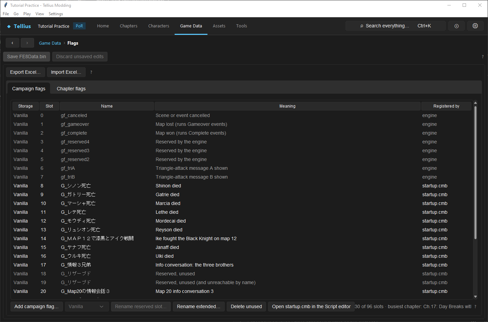

# Design, register, and test event flags

**Routes:** Game Data → Flags; Chapter → Script; Tools → Saves

## What you will make

For a hub-specific workflow, see [Create a hub and plan chapter unlocks](hub-chapters.md). It explains persistent unlock/completion flags and why flags alone do not yet hide generated chapter entrances.

You will create and verify two named state switches:

- a chapter flag meaning “the turn-3 reinforcement wave has loaded”;
- a campaign flag meaning “the optional ally was recruited.”

The chapter flag will reset when the game changes chapter. The campaign flag will remain meaningful across chapter changes and save/reload. You will register each flag through **Game Data → Flags**, use `get`, `set`, and `clr` safely in script logic, inspect every detected user, and prove the intended lifetime.

This is also a resource-management lesson. Path of Radiance's vanilla event table has 96 slots shared by engine, campaign, and current-chapter registrations. A good flag is not merely named correctly: it occupies the intended bank, remains at a stable slot, and has a tested lifecycle.

## Before you begin

Complete [Edit and compile event scripts](33-script-editor.md) and make a backup of `startup.cmb` plus the chapter script you will edit. If lesson 32's reinforcement exists, use that event as the chapter-flag exercise.

Write each state as a sentence and answer four questions:

| Question | Reinforcement example | Recruitment example |
| --- | --- | --- |
| What becomes true? | wave loaded | ally recruited |
| Who needs to remember it? | current chapter only | later chapters |
| When is it written? | after load begins successfully | after recruitment succeeds |
| When may it become false? | next chapter | only through intentional story logic |

Choose distinctive names that describe completed state, such as `F_CH05_WAVE3_DONE` and `G_RECRUIT_TEST_ALLY`. The prefix is a human convention, not what creates scope; registration location/storage determines scope.

Before adding anything, open **Game Data → Flags** and record the campaign count, the selected chapter's local count, and the number of free vanilla slots. If the project has verified extended-flag support, also record the selected bank and its separate remaining capacity.

## How the editor fits together

The **Flags** page reads registrations from scripts and presents their effective slots and uses:

- **Campaign flags** include eight engine-created `gf_*` names followed by `global("name")` registrations reachable from `RegistGlobalFlags` in `startup.cmb`.
- **Chapter flags** are `regist("name")` calls reachable from that chapter's `Startup` function.
- Script code reads with `get("name")`, turns on with `set("name")`, and turns off with `clr("name")`.

In the vanilla 96-slot table, campaign flags fill upward from slot 0 and chapter flags fill downward from slot 95. At least one slot must remain between them. If all 96 slots become named, the next chapter-start cleanup can unregister campaign names; if registrations exceed capacity, later `regist` calls are ignored.

```text
slot 0  → engine flags → campaign flags → [at least one empty slot] ← chapter flags ← slot 95
```

A save stores flag bits by slot, not by the human meaning of a name. This is why appending new registrations is safe while reordering old registrations is dangerous. Renaming a genuinely unused reserved slot keeps the slot number. In a verified extended project, campaign and chapter entries can instead live in separate extended banks; the UI identifies the **Storage** and exact slot.

The Flags page writes and compiles the owning script immediately. It refuses to overwrite conflicting unsaved Script-tab work. Save or revert the open script before adding, renaming, importing, or retiring flags.

## Guided walkthrough

<!-- screenshot 34-a-setup.png -->
<figure class="tutorial-figure" markdown="1">

[](../assets/images/tutorials/screenshots/34-a-setup.png)

<figcaption markdown="span">**Game Data › Flags**: campaign flags (kept in the save) and chapter flags, with their names, users and the room left.</figcaption>
</figure>

### 1. Inspect the campaign table and shared budget

Open **Game Data → Flags → Campaign flags**. Read these columns:

- **Storage**: Engine/Vanilla, Extended, or project-specific reserved storage such as Hub.
- **Slot**: the actual bit position or extended-bank position.
- **Name**: the exact script string.
- **Meaning**: known engine/vanilla purpose where documented.
- **Registered by**: engine or `startup.cmb`.

The summary reports campaign usage and the busiest chapter. A new vanilla campaign flag consumes one shared table slot in every chapter, so the busiest chapter determines whether the addition is safe.

Do not rename the engine's first eight names. Do not repurpose a named vanilla story flag merely because your current test chapter appears not to use it. Select a grey reserved campaign row only when **Rename reserved slot...** is enabled and the page identifies it as unused.

### 2. Add the campaign flag

Click **Add campaign flag...** and enter `G_RECRUIT_TEST_ALLY` or your documented equivalent. The app checks duplicate names, Shift-JIS encodability, and forbidden quotes, backslashes, or line breaks.

If the project has verified extended flags, choose **Extended** unless your design explicitly needs the vanilla bank. If the project is vanilla-only, inspect the near-full warning carefully. The flag is appended to `RegistGlobalFlags`; earlier slots remain fixed.

After the operation:

1. locate the new row and record its storage/slot;
2. click **Open startup.cmb in the Script editor**;
3. select `RegistGlobalFlags` and confirm the new `global(...)` call is present after existing registrations;
4. run **Check** without changing the order.

### 3. Add the chapter flag

Switch to **Chapter flags** and select the chapter containing the reinforcement. The table shows each name, its storage/slot, the function that registers it, and every statically detected user.

Click **Add chapter flag...** and enter `F_CH05_WAVE3_DONE` or your equivalent. The app appends a `regist(...)` call to the chapter's reachable `Startup` registration path. In a vanilla project, the new local occupies the next available high slot; in an extended project, the storage selector determines the bank.

Double-click the new row or choose **Open in the Script editor**. Confirm the registration is unconditional. Do not put `regist` behind the event condition it is meant to remember; `set` and `get` on an unregistered name silently fail/read as false in the engine.

### 4. Guard a one-time action

In the reinforcement function, use **Insert call...** to choose the project's real `get` and `set` natives. Follow the source language's existing conditional style. The intended control flow is:

```text
if the completion flag is already on:
    leave without loading
load the reinforcement section
turn on the completion flag
```

This pseudocode is a design outline, not paste-ready source. Use **Insert call...** for argument quoting and copy a compiled chapter conditional for syntax.

Set the flag after the action has been reached. Setting it first can permanently suppress the event if later code branches away or fails before the visible result.

Run **Check**, save the chapter script, return to **Game Data → Flags**, and refresh. The **Used by** column should list the reinforcement function's `get` and `set` references.

### 5. Use the campaign flag across chapters

In the recruitment event, test `G_RECRUIT_TEST_ALLY` before giving the reward/join outcome and set it after recruitment succeeds. In a later chapter, use it only for state that genuinely depends on that earlier decision—alternate dialogue, deployment, or a route condition.

Run **Check** on `startup.cmb`, the source chapter, and every later chapter that references the exported name. The Script editor knows campaign names from `startup.cmb`; a misspelled or unregistered name should be treated as an error/warning to fix, not as a new implicit flag.

### 6. Prove chapter lifetime

Start the test chapter fresh and inspect **Play → Flags**. The chapter flag should be registered and false. Trigger the reinforcement, confirm it becomes true, then cause the trigger to be considered again. No duplicate should load.

Save and reload within the same chapter. Confirm the value remains true. Then advance to another chapter and inspect that chapter's registrations: the old local name is no longer a current chapter flag unless the new chapter independently registers the same string.

Reusing the same local string in two chapters does not create one campaign-wide bit. Each chapter registers its own high-slot name after local cleanup.

### 7. Prove campaign lifetime

Start before recruitment with the campaign flag false. Recruit the ally and confirm it becomes true. Save/reload, finish the chapter, and enter the later chapter that consumes the state. The value should remain true and select the intended branch.

Also test a run where recruitment does not occur. The later chapter must observe false and take the alternate branch. Testing only the true branch cannot catch an accidentally pre-set flag.

### 8. Inspect a real save when needed

For Path of Radiance `.gci` files, use **Tools → Saves** to inspect the chosen save block's flags by slot/name. Keep the game closed while overwriting a save it uses. The tool updates the block checksum when saving changes.

Choose the block that actually resumes into your chapter; chapter-local names are derived from that block's map script. Editing a bit is useful for branch diagnosis, but it is not proof that your event sets the flag correctly during normal play.

## Understand every control

### Campaign tab actions

- **Add campaign flag...** appends a registration, preserving existing slot meanings.
- **Storage** appears for a verified extended project and chooses Extended or Vanilla for the new entry.
- **Rename reserved slot...** renames a recognized unused vanilla reservation without moving its slot.
- **Rename extended...** changes an assigned extended flag's name while retaining its slot and updating supported literal references.
- **Delete unused** retires an unused extended name but permanently reserves its slot; it is not compacted away.
- **Open startup.cmb in the Script editor** navigates to `RegistGlobalFlags` for direct review.

### Chapter tab actions

- **Chapter** selects which script's local registrations are shown.
- **Add chapter flag...** appends to that chapter's `Startup` registration path.
- **Open in the Script editor** opens the selected registration owner or `Startup`.
- **Rename extended...** and **Delete unused** apply only to the selected extended entry.
- **Used by** lists literal `get`, `set`, `clr`, and supported trigger references detected by the parser. Dynamic references require manual review.

### Excel actions

**Export Excel...** writes campaign and chapter registrations with their order. **Import Excel...** is for planned bulk additions, not reshuffling. Existing vanilla registrations must remain in their original order; the importer validates duplicates, capacity, and compilation before writing.

For extended layouts, the workbook also carries storage and slot information. Review additions before import and keep the project/runtime layout together. A workbook from another project is not a portable flag map unless its existing registrations and extended layout match.

### Script operations

- `global(name)` registers a campaign name from the bottom/up and clears its bit at boot.
- `regist(name)` registers a chapter name from the top/down and does not itself express event completion.
- `set(name)` writes true.
- `clr(name)` writes false.
- `get(name)` reads 1/0 for conditions.

Registration and value are separate. A name can be registered and false; a true bit without the intended current name/slot mapping is meaningless to scripts.

## Interactions and precedence

- Scope comes from registration path/storage, not an `F_` or `G_` prefix.
- Campaign registrations consume vanilla capacity in every chapter; locals consume it only while their chapter is current.
- Existing registration order is a save compatibility contract. Append; do not sort alphabetically.
- At least one vanilla slot must remain empty between campaign and local regions.
- `set`/`clr` on an unregistered name are silent no-ops, and `get` returns false. Always verify registration first.
- A chapter flag survives an in-chapter save/resume but is cleared/unregistered at the next chapter transition.
- A campaign flag survives chapter transitions, but boot-time registration order must continue mapping the saved bit to the same meaning.
- The Flags page writes scripts immediately; unsaved Script-tab edits must be resolved first.
- A trigger label can itself consume/reference a flag. Check **Used by** before renaming.
- Extended flag renames retain slots; retiring an entry does not make that historical slot reusable.

## Test matrix

| Case | Chapter flag | Campaign flag | Expected result |
| --- | --- | --- | --- |
| Fresh chapter | false | prior story value | reinforcement eligible |
| After event | true | unchanged | repeated entry is blocked |
| In-chapter save/reload | true | unchanged | local completion remains for resume |
| Next chapter | not registered by old chapter | preserved | later recruitment branch works |
| Recruitment skipped | unrelated | false | later alternate branch works |
| Recruitment completed | unrelated | true | later recruited branch works |
| Misspelled name | unregistered | unregistered | Check/usage review catches it; runtime would read false |
| Capacity boundary | one free vanilla slot retained | counts included | no registration is silently dropped |
| Source reload | registrations unchanged | registrations unchanged | same slots and users appear |

For save compatibility, keep a save from before the flag additions and another after. Load both after rebuilding and verify that pre-existing story flags retain their meanings.

## Troubleshooting

### The event repeats

Confirm the name is registered, the guard calls `get` before the action, and the success path calls `set` on the exact same spelling. Inspect Play's flag list after the first activation.

### The event never runs

Check whether the flag begins true in the save, whether another event sets it, and whether a campaign flag was chosen when a fresh chapter-local false state was intended. Do not clear unrelated flags as a first response.

### The flag is listed but `set` has no effect

Make sure the current chapter executed its `Startup` registration path and that the local was not dropped because the vanilla table is full. Compare the displayed slot against **none**/capacity warnings.

### Adding a campaign flag breaks a busy chapter

The campaign addition reduced every chapter's remaining vanilla space. Inspect the busiest chapter summary and remove the new registration from your backup/revert, reuse a verified reserved slot, or use verified extended storage. Do not delete/reorder existing named flags to manufacture space.

### A rename leaves callers broken

Literal references can be updated safely by supported rename flows; computed/dynamic flag arguments cannot be proven automatically. Search every script, check trigger labels, compile all users, and retain the old name until the audit is complete.

### A save shows the wrong meaning for a bit

Registration order changed after the save was created, or the wrong save block/chapter map was selected. Restore the original order and re-open the correct block. Names are labels reconstructed from scripts; the save itself stores bits by slot.

## Save, build, and revert

The Flags page saves registration edits immediately after compiling the affected script. Still run **Check** in `startup.cmb`, the edited chapter, and every later user. Save any separate event-body changes in Script, then save/build the project.

To revert, restore both owning scripts from the project backup: `startup.cmb` for campaign registrations and the chapter CMB for locals. Also restore any source sidecars that belong to those CMBs through the application's normal revert workflow. Never fix a mistake by reordering all subsequent entries; that changes their saved slot meanings.

For an extended project, use its supported retire/rename workflow and keep the extended layout/patch state intact. Manually deleting layout metadata can leave scripts and runtime storage inconsistent.

## Limits and confidence

The 96-slot vanilla layout, registration directions, one-empty-slot requirement, UI controls, name validation, save-slot behavior, and supported extended operations are source-reviewed. Exact story meaning for undocumented vanilla flags still requires chapter-script tracing and gameplay confirmation.

Play exposes current flag state and supports controlled branch tests, but final persistence should be verified through a real save and Dolphin. Radiant Dawn uses a different 128-slot table and its saves are not decoded by the current save-flag editor; this Path of Radiance lesson should not be applied to it unchanged.

## Things to try

- Clear the chapter completion flag in a disposable save and prove the event becomes eligible again.
- Compare two chapters that use the same local name and record their independently assigned current slots.
- Export the flag workbook before and after one append; verify that no existing row moved.
- Add a temporary campaign flag in a test copy and observe how every chapter's free vanilla count decreases.
- Use Play's flag view to watch `get`/`set` behavior while stepping through a guarded event.
- Build a true/false dialogue branch for the campaign recruitment flag in the next chapter.

## Related tutorials and references

- [Add and verify a reinforcement wave](32-reinforcements.md)
- [Edit and compile event scripts](33-script-editor.md)
- [Build reliable chapter events](35-event-recipes.md)
- [Event flags](../systems/event-flags.md)
- [Events and scripting](../systems/events-scripting.md)
- [Campaign flow](../systems/campaign-flow.md)

---

[← Previous: Edit and compile event scripts](33-script-editor.md) · [All tutorials](index.md) · [Next: Build reliable chapter events →](35-event-recipes.md)
