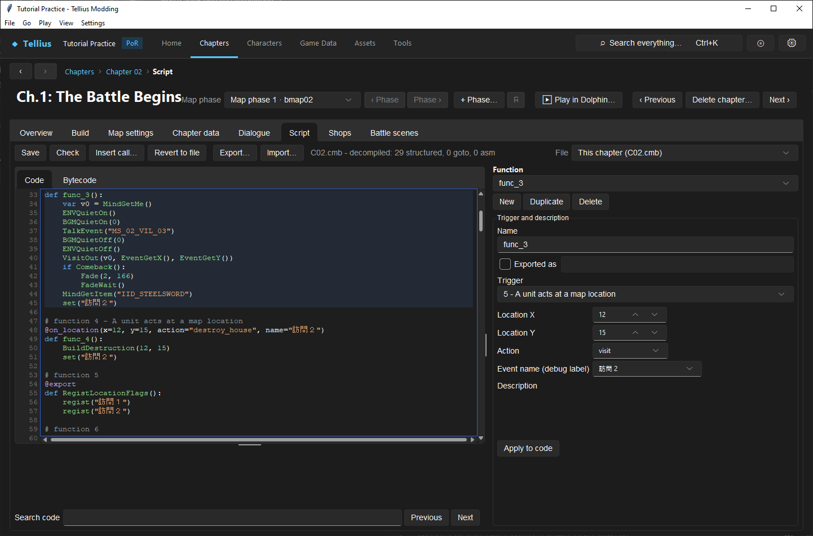

# Build reliable chapter events

**Routes:** Chapter → Build → Events and zones; Chapter → Script

## What you will make

You will build a one-time Visit event on a known map tile. The first valid visit will play a message, give one reward through the chapter's established reward helper, and set a chapter flag. A second attempt will not grant the reward again. You will then use the same trigger–condition–action–state method to reason about recruitment, battle/death dialogue, victory, defeat, reinforcements, and phase-map changes.

The lesson does not provide a universal block of source to paste. Path of Radiance chapters use different shared helpers and surrounding sequences. Instead, it shows exactly how to select the trigger, copy a compatible native/helper signature, order the logic, and test every branch without guessing function arguments.

## Before you begin

Complete lessons [32](32-reinforcements.md), [33](33-script-editor.md), and [34](34-event-flags.md). Choose a chapter with:

- an existing working Visit/location event;
- an unused walkable tile for the test;
- one existing message resource you can safely duplicate/edit;
- one modest item reward;
- a chapter script that passes **Check** before edits.

Record the reference event's trigger type and fields, message call, reward call/helper, event-mode or camera setup, cleanup/wait calls, and one-time flag behavior. Copy a reference from the same chapter where possible. A call that works in another chapter can depend on messages or map data not loaded here.

Define the event before editing:

| Layer | Test design |
| --- | --- |
| Trigger | player chooses Visit at X/Y |
| Conditions | completion flag is false; reward recipient/context is valid |
| Actions | show message, grant one item using the reference sequence |
| State | set one chapter flag after success |
| Failure/alternate branch | second activation grants nothing |

Save a backup and register a chapter flag such as `F_CH05_TEST_VISIT_DONE` through **Game Data → Flags**.

## How the editor fits together

Every dependable chapter event can be reviewed as four layers:

```text
trigger eligibility → additional conditions → visible/gameplay actions → committed state
```

The trigger is stored on the function, not inside its body. The **Trigger and description** form edits the decorator/type and parameters when you click **Apply to code**. The body contains calls, branches, and state changes. The Build event/zone tools and Script editor both modify the same source representation, so reopen the function after switching tools.

Path of Radiance trigger types exposed by the editor are:

| Trigger | What causes evaluation | Important fields |
| --- | --- | --- |
| **Callable** | another function calls it | function arguments and callers |
| **Map goal achieved** | watched flag becomes set | normally `gf_complete` |
| **Map goal failed** | watched flag becomes set | normally `gf_gameover` |
| **Before a phase starts** | pre-phase boundary | first/last turn, phase |
| **A unit acts inside a zone** | action in inclusive rectangle | x1/y1/x2/y2, side, label |
| **A unit acts at a map location** | command at one tile | x/y, action, label |
| **After a phase starts** | post-phase boundary | first/last turn, phase |
| **After every action** | action completion polling | conditions belong in body |
| **Two units talk** | Talk interaction | PID pair, direction flag, one-time name |
| **A fight starts** | combat pair | PID pair, direction flag, one-time name |
| **Death on map / in battle** | named PID dies | PID and timing variant |
| **Scenario complete** | chapter completion processing | debug/event label |
| **Support conversation** | support pair/level | two PIDs, level 1=C/2=B/3=A |
| **Base conversation** | base Info entry | flag, MPID, star count |
| **Selecting a unit** | selection | body must identify/guard intended state |

The form's label/name fields do not all mean the same thing. For Talk and Battle, **name** is a one-time flag and the event is skipped when it is set. For Area, Location, and Scenario Complete, it is an event/debug label. Read the displayed parameter description rather than treating every “name” as a completion flag.

## Guided walkthrough

<!-- screenshot 35-a-setup.png -->
<figure class="tutorial-figure" markdown="1">

[](../assets/images/tutorials/screenshots/35-a-setup.png)

<figcaption markdown="span">A village recipe in Ch.1's script: the visit trigger, the guard flag test, the reward and the flag set at the end, so the visit runs once.</figcaption>
</figure>

### 1. Duplicate the closest working Visit event

Open **Chapter → Script** and select **This chapter**. Run **Check** and record its warnings. Find a short working function whose trigger is **A unit acts at a map location** with action **visit**.

Choose **Duplicate**. The copy receives a unique function name and retains the original body/trigger. Rename it to a valid descriptive identifier such as `TestVisitReward`; function names must be valid source identifiers and unique within the script.

Immediately edit the description to record the intended tile, reward, and flag. Click **Apply to code** and check that only the duplicate's decorators/name/description changed.

### 2. Move the trigger to the test tile

In **Trigger and description**, keep **A unit acts at a map location** and set:

- **Location X/Y** to the chosen tile;
- **Action** to `visit`;
- **Event name** to a unique debug label, not the chapter completion flag.

Click **Apply to code**. Check the source for an `on_location` decorator with the intended coordinates and action. Coordinate values are map tiles. Confirm the tile is walkable/reachable and is not already claimed by another location event.

You can also create or edit this location through Build's Events/zones workflow. Whichever route you use last becomes source truth, so refresh Script and verify the decorator before continuing.

### 3. Strip copied actions to the smallest safe reference sequence

In the duplicated body, identify:

- event start/mode/camera preparation;
- dialogue/message call;
- reward helper/native;
- waits or synchronization;
- event cleanup/end calls;
- any copied story flags, unit movement, map changes, or BGM changes.

Remove copied story-specific actions only after understanding paired setup/cleanup. Keep the reference's outer event sequence intact for the first run. Replace its message ID with your test message and its item/reward argument with your test reward.

Use **Insert call...** rather than typing an unfamiliar function name. Search for the call used by the reference; the dialog shows its source group, return note, typed arguments, and suggestions. Text-like IDs are quoted for you. A variable/expression must be wrapped as the dialog instructs rather than entered as an ordinary literal.

### 4. Add the one-time guard

At the top of the body, test `F_CH05_TEST_VISIT_DONE`. If it is already true, leave without dialogue or reward. Follow a working conditional/return pattern from the same script and insert `get` through **Insert call...**.

At the end of the successful action sequence, call `set` on the same flag. Place it after the reward action has been reached but before the event returns. Do not use the location's debug label as though it were automatically registered state.

Run **Check**. Open **Game Data → Flags → Chapter flags**, refresh, and confirm the new function appears in **Used by** for both reading and writing the completion flag.

### 5. Check for competing locations and branches

Search the script for the same X/Y and for the unique event label. Check Build's event/zone list for overlapping location entries. Two handlers for the same command/tile can make the selected result depend on ordering and other conditions.

If the original house can be destroyed, the Visit and destroy-house paths need a shared state model:

- visiting commits the reward state;
- destruction commits an unavailable/destroyed state;
- each branch checks the other state before acting;
- neither path grants twice after save/resume.

For the minimal exercise, use a tile without destruction behavior. Add mutually exclusive branches only after the one-state Visit passes.

### 6. Save and exercise both branches

Run **Check**, select each diagnostic to resolve it, and save the script. Close/reopen the file and confirm the function still has the correct trigger and body.

Start Play from before chapter initialization. Verify the flag is registered and false. Move a player unit to the tile and choose Visit:

1. the correct message appears;
2. the reward reaches the intended recipient/convoy according to the copied helper;
3. the flag becomes true;
4. control returns without camera/audio/event-mode problems.

Attempt the action again or re-enter the handler through a test call. It must not display the reward sequence or grant another item. Save after the first visit, reload, and retry to prove state persistence.

### 7. Add a deliberate alternate branch

Once the success/no-repeat behavior passes, add a short “already visited” branch only if the design needs visible feedback. Avoid repeating the reward helper. Check and test the branch from a state with the flag already true.

If vanilla behavior removes the Visit command entirely after completion, copy that reference's one-time trigger/state mechanism instead of forcing the function to run and display a message.

## Understand every choice

### Trigger timing

**Before phase** and **After phase starts** are distinct boundaries. Turn ranges are inclusive; `turn_from = 0` means every turn for the documented phase triggers. **After every action** is broad and must perform cheap, explicit condition checks before expensive actions.

**Death in battle** runs at combat-death timing, while **death handled back on the map** is the map-side timing. Dialogue, camera, unit removal, and objective transitions may require one rather than the other. Copy the timing variant used by a similar vanilla event.

### Area coordinates

Area rectangles are inclusive. X2/Y2 value 0 has the documented edge-relative meaning for Path of Radiance, not always literal top-left tile zero. Use Build's zone display to inspect the actual highlighted rectangle and test every edge.

The Area **side** controls which army's action triggers it. It does not change the acting unit's faction or restrict a later native unless the body also checks that state.

### Talk and battle ordering

For Talk, direction flag 0 means Character 1 initiates toward Character 2; 1 permits either to start. For Battle, flag 0 requires Character 1 to attack Character 2; 1 permits either ordering/side arrangement. The **name** field is the one-time flag and must be registered/set according to the chapter's established pattern.

### Calls, helpers, and return values

**Insert call...** lists game natives, local functions, and exported `startup.cmb` helpers. Similar names may have different argument counts or runtime contracts. Read the help and inspect a working call site.

A return value is meaningful only when the catalog/reference documents it. Do not interpret every zero as failure: some shared helpers return 0 implicitly after performing their work.

### Objective commitment

Goal text, a throne/area marker, boss status, or an empty enemy list does not itself finish the chapter. Authored logic observes the condition and ultimately sets `gf_complete`. Defeat logic sets `gf_gameover`. Only commit those engine flags after the real condition and any required event sequence.

## Interactions and precedence

- Trigger parameters decide when a function is considered; body guards decide whether its actions may run.
- A trigger label is not automatically a registered state flag unless that trigger type explicitly documents one-time flag semantics.
- `get` on an unregistered name returns false, which can make an apparently guarded reward repeat forever.
- Visible objective text does not enforce victory/defeat; script state does.
- A working reward call can still fail in another chapter if its message/resource/helper context is absent.
- `gf_complete` and `gf_gameover` are engine campaign-flow signals. Do not use them as ordinary recipe-completion flags.
- A broad `after_action` function may race with other handlers that change the same state. Commit one flag and make repeated evaluation idempotent.
- Reinforcement sections define units; phase events and deployment calls schedule them.
- Map changes can invalidate coordinates, paths, cameras, and later triggers. Test every active map state.
- Skip and resume must reach the same committed state even if presentation calls are shortened or omitted.

## Recipe variations

### Talk recruitment

Use **Two units talk** with exact PIDs and choose whether only PID1 initiates or either unit may initiate. Use a registered one-time name/flag. Follow a working sequence that plays the dialogue and calls the documented `Join` target. Test both initiators when bidirectional, a full player roster/convoy state, unit death before talk, save/reload, and attempting the talk twice.

Do not assume `Join` also sets your story campaign flag. If later chapters need recruitment history beyond roster state, set the documented campaign flag after the join succeeds.

### Boss battle and death dialogue

Use **A fight starts** for pre-combat quotes and choose whether order matters. Use the appropriate death trigger for defeat dialogue. Guard each one-time conversation separately if both can occur. Test player initiation, enemy initiation when allowed, lethal and nonlethal combat, skipped event, and alternate boss forms/PIDs.

### Rout or boss victory

For Rout, copy a working checker using the documented enemy-force query (for example the catalogued `EnemyDeadCheck`) and ensure intended reinforcements have already spawned or are disabled. For boss defeat, observe the required PID's death/retreat state. Perform clear dialogue/rewards, then set `gf_complete` once. Test scripted removals and recruitment/side transfer, because current force membership—not the original deployment list—determines an empty-force check.

### Seize, arrive, escape, and protect

Use a location/area plus the corresponding action and actor/state conditions. Moving the visible throne, gate, or marker does not move the script coordinate. For Escape, decide whether the lord, a count, or every relevant player must escape. For Protect, observe the exact PID or area invasion condition and set `gf_gameover` only when failure is irreversible.

### Defend/survive

Use a phase boundary with inclusive first/last turns. Decide whether completion occurs before or after the final enemy phase and make objective text match. Test the turn immediately before, the boundary phase, and one turn after. Off-by-one behavior is a design bug even if the event compiles.

### Reinforcement wave

Use the full workflow in [Add and verify a reinforcement wave](32-reinforcements.md): dedicated sections, exact turn/phase, a compatible deployment-call family, and one-time state where re-entry is possible.

### Phase-map or multi-stage objective

Copy a working map-change sequence including its `MapLoad` family, waits, unit relocation, camera state, and deployment calls. Commit a stage flag only after the new state is established. Update goal text/state and ensure resume reconstructs the new stage instead of replaying rewards or transformations.

## Test matrix

| Path | Starting state | Action | Pass condition |
| --- | --- | --- | --- |
| First visit | completion false | Visit test tile | message + one reward + flag true |
| Repeat visit | completion true | invoke/Visit again | no second reward |
| Wrong tile | completion false | Visit another tile | test event does not run |
| Wrong action | completion false | wait/open adjacent object | test event does not run |
| Save/resume | completion true in chapter save | reload and retry | no second reward |
| Event skip | completion false | trigger and skip presentation | same reward/state outcome |
| Full inventory | recipient cannot hold item | Visit | copied helper's convoy/failure behavior is understood |
| Overlap audit | another event near tile | exercise both | each handler runs only in intended case |
| Script reload | saved source reopened | Check | zero errors and trigger unchanged |
| Dolphin | fresh built ISO state | repeat core paths | timing, audio, UI, and persistence match design |

Add recipe-specific rows before release. A recruitment event needs both initiator orders; a battle event needs attacker/defender order; an objective needs boundary and failure cases; a map phase needs before/after resume states.

## Troubleshooting

### The command never appears or the handler never runs

Confirm X/Y, action type, trigger type, active map state, eligible unit, and competing location records. Reopen the function to verify **Apply to code** was used.

### The event runs but grants nothing

Inspect the reward helper's argument kinds and resource context. Test inventory-full behavior. Compare the complete setup/action/wait/cleanup sequence with the working reference rather than swapping only the IID.

### It grants repeatedly

Verify the completion flag is registered, initially false, checked before actions, and set after success. Check exact spelling and Play's live flag value. A debug label alone is not state.

### A talk or battle quote works in only one direction

Inspect the trigger's direction/order flag and PID ordering. Value 0 and value 1 deliberately express different pairing rules.

### Victory happens early

Find every `set("gf_complete")` path and the conditions immediately before it. Objective text and markers cannot compensate for an unconditional or broadly triggered completion write.

### The event works until a map change or reload

Coordinates, loaded messages, flags, and units may differ in the second state. Test/reconstruct the stage from its committed flag and copy the chapter's resume/map-load sequence.

## Save, build, and revert

Run **Check**, save the chapter script, then save any Build zones, messages, deployment data, or chapter records touched by the recipe. Reopen all changed resources and run the test matrix before building.

To revert, restore the script plus every connected resource: registered flag, zone/location entry, message, deployment section, map state, and objective text. Removing only the function can leave a dead command/zone; removing only the zone leaves unreachable code.

## Limits and confidence

Trigger types/fields, the Script editor operations, flag semantics, objective commitment, and the trigger distinctions above are source-reviewed. Exact native/helper sequences for rewards, map phases, camera work, and some recruitment presentations vary by chapter; the compatible in-chapter reference remains authoritative.

Play approximates some presentation and map-load behavior. Verify choices, complex camera/audio sequences, map transitions, event skip, and real save persistence in Dolphin.

## Things to try

- Change the Visit tile into an Arrive event and compare command-driven versus movement/action-driven eligibility.
- Create a bidirectional Talk event, then switch its order flag to one-way and test both initiators.
- Add a destroyed-house branch with mutually exclusive state flags and prove neither ordering grants twice.
- Make a two-stage objective that changes text/state without setting `gf_complete` until stage two.
- Add a scenario-end Bonus EXP condition using a documented `AchieveSet` reference.
- Duplicate a boss battle quote and constrain it to attacker order, then test the reverse combat order.

## Related tutorials and references

- [Edit and compile event scripts](33-script-editor.md)
- [Design, register, and test event flags](34-event-flags.md)
- [Add and verify a reinforcement wave](32-reinforcements.md)
- [Edit startup helpers and endings](36-shared-scripts.md)
- [Events and scripting](../systems/events-scripting.md)
- [Objectives](../systems/objectives.md)
- [Script functions](../systems/script-functions.md)

---

[← Previous: Design, register, and test event flags](34-event-flags.md) · [All tutorials](index.md) · [Next: Edit shared startup helpers and endings →](36-shared-scripts.md)
