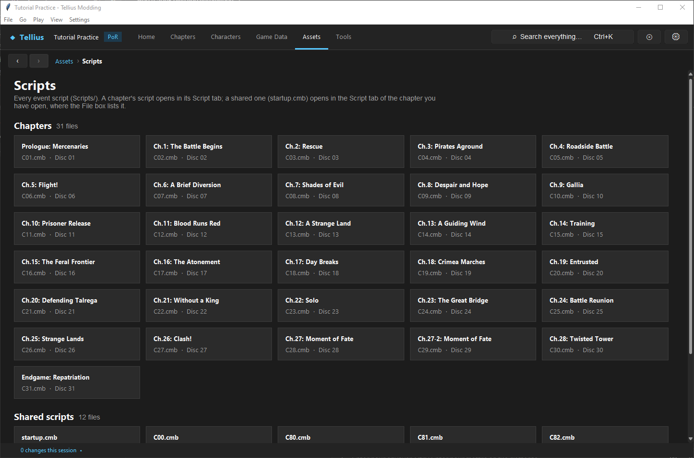

# Edit shared startup helpers and endings

**Route:** Chapter → Script → File → shared script

## What you will make

You will add one small exported helper to `startup.cmb`, call it from two disposable chapter events, and prove that its name and argument count form a cross-file interface. You will then trace `ending.cmb` from final-chapter completion through its `Ending` sequence and make one presentation-only test change without altering eligibility, ordering, credits, or clear-data behavior.

The exercise teaches two different kinds of sharing:

- `startup.cmb` supplies campaign flag registration and exported helper functions that chapter scripts can compile and call;
- `ending.cmb` is a separately loaded shared script whose authored sequence owns finale and epilogue presentation at the campaign boundary.

Both have campaign-wide consequences, but they are not interchangeable libraries.

## Before you begin

Complete [Edit and compile event scripts](33-script-editor.md), [Design, register, and test event flags](34-event-flags.md), and [Build reliable chapter events](35-event-recipes.md).

Create a project checkpoint containing at least:

- `Scripts/startup.cmb` and its saved source sidecar;
- `Scripts/ending.cmb` and its saved source sidecar;
- both chapter scripts that will call the helper;
- the final chapter script and any message resource used by the ending change.

Open **Assets → Scripts** or a chapter's **Script** tab and record the complete **Shared scripts** list. `startup.cmb` should be first; other non-chapter CMBs, including `ending.cmb`, appear after it. Run **Check** on `startup.cmb`, `ending.cmb`, and the two caller chapters before changing anything.

Choose an existing zero- or one-argument `startup.cmb` helper whose behavior is harmless and visible, such as a short presentation wrapper. Do not begin by modifying flag registration, chapter routing, event mode, save writing, or a complex helper with many callers.

For the ending exercise, prepare two equivalent final-chapter saves: one before victory and one immediately before the epilogue sequence if available. Record the unmodified watched and skipped outcomes.

## How the editor fits together

The Script **File** selector contains **This chapter** plus shared scripts found in `files/Scripts/` whose names are not chapter CMB names. Selecting a shared file does not make it chapter-local. If you change chapters while a shared script is open, the editor intentionally keeps that shared file open.

When a chapter script is checked or saved, the compiler reads two interfaces from the current `startup.cmb`:

1. campaign flag names registered by `RegistGlobalFlags`;
2. functions marked **Exported as**, with their exported name and argument count.

That lets **Insert call...** list startup helpers and lets chapter compilation validate the number of arguments. The compiler does not prove that a helper's new internal behavior is safe for every caller.

```text
startup.cmb
  ├─ RegistGlobalFlags → campaign flag names visible to chapter compilers
  └─ exported helpers  → name + argument count visible to chapter compilers
                             ↓
                         every chapter caller

final chapter victory → campaign finale route → GrandFinale → ending.cmb:Ending
                                                        ↓
                                           epilogues → credits → clear state
```

The editor preserves readable `.fe9s` source in the project's `script_sources` directory while compiling onto the CMB. If the CMB changes outside the editor and no longer matches, the stale source is moved aside as a `.bak` and the binary is decompiled again. Treat CMB and matching sidecar as one authored unit when reviewing or restoring work.

## Guided walkthrough

<!-- screenshot 36-a-setup.png -->
<figure class="tutorial-figure" markdown="1">

[](../assets/images/tutorials/screenshots/36-a-setup.png)

<figcaption markdown="span">**Assets › Scripts**: each chapter's script, then the shared scripts (`startup.cmb` with the helpers every chapter calls, and the others).</figcaption>
</figure>

### 1. Audit the startup helper before copying it

Select `startup.cmb` in **File**. Use **Search code** for the helper's local definition name and exported name. Record:

- the source function name;
- **Exported as** name (these may differ);
- parameter count and order;
- calls it makes and state it changes;
- every chapter caller found by project-wide search;
- whether any other exported helper calls it.

Select the function and inspect **Trigger and description**. A reusable helper should normally be **Callable (not triggered automatically)**. **Exported as** makes it visible outside this script; it does not schedule the function.

Do not assume the Function dropdown label is the external contract. Callers resolve the exported identity recorded by the decorator/form.

### 2. Duplicate and narrow the new helper

Choose **Duplicate**. Duplication removes the copied export so you cannot accidentally publish a second function under the original exported name. Rename the source function to a unique identifier such as `TestSharedNotice`.

Reduce the body to one small, reversible behavior based on the reference. Keep the same single argument for the exercise, for example a message ID or numeric duration whose kind is established by the copied call sites.

In **Trigger and description**:

- keep **Callable (not triggered automatically)**;
- enable **Exported as**;
- enter a unique external name, normally matching the source name;
- write a description stating the argument contract, side effects, return behavior, and required loaded resources.

Click **Apply to code**. Confirm the source shows the intended export decorator and one parameter in the function definition.

### 3. Check and save startup before writing callers

Run **Check** on `startup.cmb`. Resolve duplicate export names, unknown calls, flag warnings, and parameter errors. Inspect the **Bytecode** header for the helper to confirm its argument count.

Save `startup.cmb` before opening the callers. Chapter compilation and **Insert call...** build their helper catalog from the saved startup CMB, not from an unsaved intention in another file.

Reopen `startup.cmb` and verify:

- the export name is unchanged;
- the parameter count is one;
- `RegistGlobalFlags` order is byte-for-byte/logically unchanged by this helper edit;
- existing helpers still pass **Check**.

### 4. Insert the helper into the first chapter

Select the first disposable chapter script. Open a short event that you can trigger reliably. Put the cursor at the intended point and choose **Insert call...**. Search for the new exported name.

The entry should identify `startup.cmb` as its group and show one argument. Enter a known valid value and insert. Do not manually type the call if it does not appear: absence means the saved startup interface was not loaded or the export is missing.

Run **Check**, save, and play the exact trigger. Confirm the helper's visible behavior plus the caller's normal cleanup and state.

### 5. Prove the interface with a second caller

Repeat the call in a second chapter using a resource/value that is valid there. Check and save. This catches hidden assumptions: a helper that references a chapter-only message, PID, map group, or loaded image may work in the first chapter and fail elsewhere despite a valid signature.

Test both chapters from clean state. Record whether the helper requires an event mode, camera state, loaded message file, or particular phase. Add these preconditions to its description or redesign it so callers pass the dependency explicitly.

### 6. Perform a controlled breaking-change experiment

In the project checkpoint/test copy only, add a second parameter to the shared helper and save `startup.cmb`. Open each original caller and run **Check**. Both should now report an argument-count mismatch until updated.

This demonstrates the interface contract. Restore the one-argument signature from the checkpoint and re-check both callers. Do not leave the breaking version in the release project unless every caller has been found, updated, and tested.

Renaming the exported identity has the same cross-project effect: callers use the export name, not the local definition name.

### 7. Trace the ending entry path before editing

Select the final chapter script and find the successful objective path that sets `gf_complete`. Trace the campaign boundary rather than adding a direct call from an ordinary midgame event.

For retail Path of Radiance, final campaign routing invokes the finale for chapter number 32 over chapter 31's map, runs `GrandFinale`, then calls `Ending` from `Scripts/ending.cmb` before returning to title. The final battle, campaign router, and ending script have separate responsibilities.

Open `ending.cmb`, locate `Ending`, and follow its local calls. Classify each part:

- story/finale presentation;
- eligibility or variant selection;
- deterministic card ordering;
- card/record presentation;
- credits/staff roll;
- cleanup and completion/clear-data handoff.

Do not infer eligibility from message-file order. The script consumes persistent roster, survival, relationship, story, difficulty, and playthrough facts to choose authored variants.

### 8. Make one presentation-only ending change

Choose an existing ending message/card branch whose eligibility you will not change. Duplicate or edit its message text through the appropriate message editor, then update only the exact message argument in the existing presentation call if necessary.

Keep function order, branch conditions, roster queries, flags, card advancement, staff roll, and final cleanup unchanged. Run **Check** on `ending.cmb` and save.

Previewing the text is useful for layout but does not test the ending path. Play through final victory or use the closest supported full route from the prepared save.

### 9. Test watched and skipped endings

From equivalent pre-victory state, run one ending without skipping and one with presentation skip. Both runs must:

- enter the finale after final victory;
- select the same eligible card variants in the same order;
- avoid duplicate/missing characters;
- reach credits/cleanup;
- write equivalent campaign completion/unlock consequences;
- return to the intended title/postgame route.

Also test one changed input at a time—recruited versus absent, alive versus dead/retreated, or one relationship/story flag—when the edited branch depends on it.

## Understand every control

### File selector

**This chapter** follows the currently open chapter. A named shared file remains that shared file even when chapter navigation changes. Always read the selected filename before saving.

### Exported as

An unexported callable is local to its own script. Enabling **Exported as** registers an external identity usable by the engine or other scripts. The text is the public name; the function definition name is the local source identity. Matching them reduces confusion but is not required by the format.

Changing export name or argument count is a breaking interface change. Changing internal side effects can be behaviorally breaking even when every caller still compiles.

### New, Duplicate, and Delete

**New** creates a basic triggered function by default; convert it to Callable for a helper. **Duplicate** copies the selected function with a unique local name and without duplicating its export. **Delete** recompiles local calls by name, but cannot repair chapter scripts in other files that called an exported helper.

Before deleting a shared export, search all script source/CMB-decompiled source. Absence from one chapter's Function list proves nothing about other callers.

### Check, Save, Bytecode, Export, and Import

**Check** compiles in memory and reports diagnostics. **Save** writes the compiled CMB and matching readable sidecar. **Bytecode** shows the compiled function's type, trigger parameters, argument count, locals, and instructions for inspection. **Export...** writes the whole current source to a standalone `.fe9s`; **Import...** replaces the whole editor buffer but writes nothing until Save.

Import is not a one-function merge. Diff the entire file before saving an externally edited source.

### startup.cmb special entries

`RegistGlobalFlags` defines campaign flag registration order. Other exports provide helpers. Keep flag registration unconditional and stable. A helper addition should not reorder `global(...)` calls.

`startup.cmb` is loaded as campaign infrastructure. A chapter-local message or map resource is not guaranteed to exist when an arbitrary caller invokes a helper.

### ending.cmb responsibilities

`ending.cmb` sequences the authored finale and consumes persistent facts for eligibility, variant choice, and ordering. Presentation calls show the chosen result; credits and completion logic close the route. Skip may accelerate presentation but must converge on the same required state changes.

Staff credit content itself is edited under the dedicated **Staff Credits** asset, not by treating the script call as the entire credits file.

## Interactions and precedence

- The saved `startup.cmb` export table is the interface seen by chapter compilers.
- Export identity, not local function name, is what external callers use.
- Signature compatibility proves argument count only; it does not prove that resources or runtime state exist in every chapter.
- Campaign flags and helpers share `startup.cmb` but have different contracts. A helper edit must not disturb registration order.
- A shared helper can call another startup helper, multiplying the impact of an internal change.
- `ending.cmb` is reached through campaign routing; opening its presentation in isolation does not prove the final transition.
- Setting `gf_complete` commits final battle victory but does not replace `GrandFinale`, `Ending`, credits, or clear-data routing.
- Eligibility, variant selection, and ordering precede card presentation. Editing text cannot add a new eligible character by itself.
- Watched and skipped paths must converge before completion state is written.
- Sidecar source is trusted only while it recompiles to the current CMB; outside changes force a fresh decompile and preserve stale source as backup.

## Test matrix

| Test | Files/state | Pass condition |
| --- | --- | --- |
| Startup baseline | unmodified `startup.cmb` | Check passes with recorded warnings |
| Export discovery | saved new helper | appears in **Insert call...** as `startup.cmb`, correct argument count |
| Caller A | first chapter | compiles and behavior runs once |
| Caller B | different chapter/resources | compiles and behavior runs without hidden dependency failure |
| Signature break | temporary added argument | both old callers fail Check predictably |
| Signature restore | one-argument backup restored | both callers pass again |
| Flag audit | compare `RegistGlobalFlags` | names/order unchanged |
| Finale watched | pre-victory save, no skip | correct route, cards, credits, completion state |
| Finale skipped | equivalent pre-victory save, skip | same selection/order consequences and final state |
| Eligibility false/true | one persistent fact changed | only the documented ending variant changes |
| Reload | reopen shared files | selected exports, bodies, and checks remain intact |

After any nontrivial helper change, expand the matrix to every known caller. For a core helper with many callers, representative testing is not enough if its state/resource preconditions changed.

## Troubleshooting

### The helper is absent from Insert Call

Confirm `startup.cmb` is selected, **Exported as** is enabled, **Apply to code** was clicked, Check passes, and the shared script was saved. Reopen the chapter so its compile context reloads the saved startup exports.

### A caller reports the wrong argument count

Compare the saved helper definition parameters with the call. Check whether the export name resolves to another function. Update all callers together or restore the old signature.

### One chapter works and another fails at runtime

The signature is valid but the helper depends on a resource/state available only in the first chapter. Inspect message IDs, loaded assets, PIDs, groups, map/camera state, event mode, and flags. Pass the dependency as an argument or keep the operation local.

### Campaign flags become unknown or story state shifts

Inspect `RegistGlobalFlags` for deleted/reordered registrations. Restore its original order before loading old saves. A helper edit should not modify that list.

### The ending text previews but never appears in the campaign

Trace final victory into the correct finale route, then inspect eligibility and variant priority. The edited message may belong to an ineligible or lower-priority branch.

### Skipping the ending misses completion or hangs

Restore the reference order around presentation, card advancement, credits, cleanup, and completion calls. State-changing calls must not exist only on the fully watched timing path.

### The script was decompiled fresh and my formatting disappeared

The on-disk CMB no longer matched its sidecar source. Find the preserved `.fe9s.bak`, compare semantic changes against the fresh decompile, and reapply only the intended edit. Do not overwrite the new CMB blindly with stale whole-file source.

## Save, build, and revert

Save shared scripts before callers, then re-check callers against the saved interface. Recommended order:

1. Check and save `startup.cmb`.
2. Reopen, inspect exports and `RegistGlobalFlags`.
3. Check/save every changed caller.
4. Check and save `ending.cmb`.
5. Save changed messages/credits assets.
6. Build and run cross-chapter/finale tests.

To revert a helper change, restore `startup.cmb` and its matching sidecar, then restore or remove every caller added for it. To revert an ending change, restore `ending.cmb`, its sidecar, and the changed message/credits assets. Re-check final routing after restoration.

## Limits and confidence

The shared-file selection behavior, startup compile context, export discovery, argument-count validation, sidecar lifecycle, global registration ownership, and final campaign route are source-reviewed. The exact side effects of individual vanilla helpers remain function-specific; use their catalog entries and real call sites.

Ending eligibility and ordering are authored and can be traced, but a complete census of every retail epilogue variant is outside this workflow. Final clear-data and skip equivalence require Dolphin testing from controlled saves.

## Things to try

- Export a helper under a name different from its local definition and observe which name appears to callers.
- Create a two-argument wrapper around a documented presentation native, then test values at both boundaries.
- Search which existing startup export has the most callers and write its explicit contract before changing it.
- Add a helper that accepts a message ID instead of hard-coding one, then call it safely in two chapters.
- Change one ending eligibility input in a copied save and record variant selection without changing assets.
- Compare watched and skipped final saves for roster, clear/unlock state, and next destination.

## Related tutorials and references

- [Edit and compile event scripts](33-script-editor.md)
- [Design, register, and test event flags](34-event-flags.md)
- [Build reliable chapter events](35-event-recipes.md)
- [Script functions](../systems/script-functions.md)
- [Campaign flow](../systems/campaign-flow.md)
- [Endgame and ending cards](../systems/endings.md)
- [Event script format](../formats/event-script.md)

---

[← Previous: Build reliable chapter events](35-event-recipes.md) · [All tutorials](index.md) · [Next: Author dialogue and cutscenes →](37-dialogue-editor.md)
