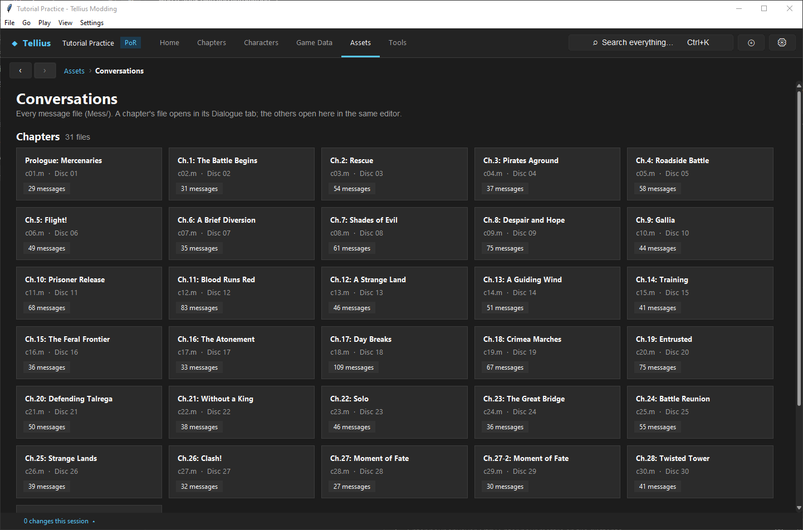

# Edit support, base, and world-map conversations

**Routes:** Game Data → Supports → Conversations; Assets → Conversations; Chapter → Dialogue and Script

## What you will make

You will perform three controlled edits without confusing their owners:

1. edit one existing C-rank support conversation stored in `Mess/yell.m`;
2. trace one base Info conversation from its `on_base_talk` trigger to its message and make a text-only change;
3. duplicate one chapter-owned world-map narration message using the **World map narration** template, then connect it to a disposable caller.

Each edit will keep identity stable for the first test, preserve the true starting scene context, and be exercised through the actual support/base/world-map route—not only in Live Preview.

## Before you begin

Complete lessons [37](37-dialogue-editor.md), [39](39-inline-text-and-fonts.md), and [34](34-event-flags.md). Make backups of `Mess/yell.m`, the selected chapter message file, `startup.cmb` if shared helpers are involved, and the chapter script.

Choose:

- an existing support pair whose C conversation currently works;
- an existing base Info entry that can be reached in a real save;
- a chapter narration/opening message whose caller is easy to find.

For each one, record the Message ID, owning file, trigger/caller, preceding message/context, and entry conditions. Do not rename anything until this ownership table is complete.

| Content | Typical owner | Typical consumer |
| --- | --- | --- |
| FE9 support-rank dialogue | shared `Mess/yell.m` | support conversation system/pair identity |
| Base Info conversation | message file plus chapter/base trigger | `on_base_talk` flag/MPID/stars and its body |
| Chapter/world-map narration | chapter `Mess/cNN.m` | chapter opening/event script |

## How the editor fits together

**Game Data → Supports** combines FE8Data support mechanics and a Dialogue editor for `yell.m`:

- **Pairs** lists character pairs, C/B/A thresholds, computed A-rank bonus, and which conversation IDs exist.
- A character's own **Supports** tab edits partners/thresholds/bonds and provides C/B/A conversation buttons.
- **Conversations** hosts the same Dialogue editor model, but its Save writes `yell.m`, not the currently open chapter's `cNN.m`.

Support IDs are deterministic: remove `PID_`, sort the two names alphabetically, and form `MYELL_<A>_<B>_<rank>`. For example, the C-rank button creates/selects the canonical C ID. When absent, the app creates it from the background-scene template and substitutes the pair's known face IDs.

**Assets → Conversations** lists every message file. Chapter files route to their Chapter → Dialogue page; shared files open in the Assets-hosted Dialogue editor. The visible editor looks similar, so always read the filename before saving.

World-map narration is not a separate text database. It is message content using the **World map narration** layout, narration typing sound, and narration-log action, normally called by chapter script in the world-map sequence.

## Guided walkthrough

<!-- screenshot 40-a-setup.png -->
<figure class="tutorial-figure" markdown="1">

<figcaption markdown="span">**Assets › Conversations**: every message file, the chapters' and the shared ones (base conversations, world-map narration, support talks).</figcaption>
</figure>

### 1. Edit an existing C support without changing identity

Open **Game Data → Supports → Pairs** and find the selected pair. The **Conversations** column uses `C`, `B`, `A` for present ranks and a dot for missing ones. Double-click/open the owning character, choose its **Supports** tab, select the partner, and click the existing **C** conversation.

The app opens **Supports → Conversations** on the canonical `MYELL_..._C` ID in `yell.m`. Confirm both PIDs in the ID are alphabetized independently of which character page you opened.

Change one recognizable spoken sentence while retaining layout, portraits, seats, waits, and ID. Preview from a fresh background-scene context, then inspect any intended inherited context.

Choose **Save Chapter** in this embedded Dialogue editor. Here the button saves `yell.m`; the label reflects the actual shared file. Return to Pairs and confirm the C marker remains present.

### 2. Understand what the support message does not control

The message controls presentation/content. It does not create the support pair, thresholds, availability, affinity bonuses, or rank progression. Those live in FE8Data support tables edited in the pair/character panels.

For this text lesson, leave partner slots and C/B/A thresholds unchanged. If the conversation does not unlock in-game, inspect the support mechanics and save state before changing its Message ID.

### 3. Test the support through the real route

Use a save where the pair can reach/select C support. Enter the support conversation through the game's intended menu/event. Verify the edited sentence, both portraits, background, text-log speaker names, and return to the menu/base flow.

Test conversation skip and reload after viewing. The support system's “seen/rank” state must remain correct; a Live Preview does not write or test that progression.

### 4. Trace a base Info conversation

Open the relevant chapter Script and select the function whose trigger is **Base conversation** (`on_base_talk`). Record:

- **Info flag name**;
- **Character (MPID_)**;
- **Number of stars**;
- function body and message call;
- any separate completion/story flag.

The trigger fields describe the base-list entry/availability presentation. The function body still owns dialogue and consequences. The flag field is part of the trigger contract; do not replace it with an arbitrary chapter flag or message ID.

Search the called Message ID in **Assets → Conversations** or the relevant chapter Dialogue. Confirm the owning filename. Edit one line without renaming the ID, save that owning file, then Check the unchanged script.

### 5. Test base availability and consumption

Enter the base from a save that satisfies the event's conditions. Confirm the Info entry displays the intended MPID portrait/name and star count, opens the edited dialogue, and follows its one-time/repeat behavior.

Test a save before the availability condition and one after viewing. If the entry is absent, debug the trigger flag/campaign state and base route, not the message text.

### 6. Create chapter-owned world-map narration

Open the chosen chapter's **Dialogue** page. Choose **New...**, assign an unused chapter-local ID, and select **World map narration** as the template.

The template establishes:

- the world-map narration layout;
- typing sound 3;
- narration-log mode so the text log has no speaker name;
- an input wait.

Replace the placeholder with two short narration lines. Keep the narration action before the text. Preview with the true predecessor selected through **Inherit from message** or **Auto**. World-map visuals/camera belong to the surrounding script; the message preview represents dialogue state, not the full map animation.

### 7. Connect the narration caller

Open Script and duplicate the smallest narration call sequence from the same world-map/opening context. Use **Insert call...** to preserve the actual message function and replace only the Message ID.

Keep the reference's map setup, captions, camera movement, fades, waits, and message handoff. If the message yields to the script with `$H`/release operations, edit both sides only after tracing their resume order.

Run **Check**, save Script, then save the chapter. A correct message cannot create a world-map route; it only supplies text/presentation when the caller reaches it.

### 8. Exercise complete context

Run the opening/world-map path from before its first scene. Confirm:

- map/camera state is already established by the script;
- narration uses the intended layout and sound;
- no speaker name appears in the text log;
- previous dialogue portraits/backgrounds do not leak;
- normal and skipped playback converge on the next event step.

Repeat after save/reload where the route permits it. Finish in Dolphin for world-map visuals and timing.

## Understand every control

### Supports → Pairs

- **Character / Partner** identify the pair.
- **C at / B at / A at** are progression thresholds, not Message IDs.
- **Bonus at A** is computed from both affinities and rank.
- **Conversations** reports whether canonical C/B/A IDs exist in `yell.m`.
- Double-clicking opens the character's support editor; it does not directly edit the shared message file.

### Character → Supports conversation buttons

Each C/B/A button opens its canonical pair/rank ID. If missing, the app offers/creates a background-scene template using the two face IDs. Creation supplies text data only; mechanics still require a valid reciprocal pair/list and reachable rank.

### Supports → Conversations

This is the Dialogue editor scoped to `yell.m`. **Save Chapter** means save the selected message file, despite the generic button text. Message management, notation, stage, preview, inheritance, export, and import behave as in lesson 37.

### Assets → Conversations

Cards show all message files. A chapter-owned file redirects to its Chapter page; shared/nonchapter files open in Assets. Use this route to answer “which file contains this ID?” before editing.

### Base conversation trigger

**Info flag name** identifies the base Info event state, **MPID** supplies the listed character identity, and **stars** display importance. The body must still call the dialogue and perform consequences. Test availability separately from message rendering.

### World-map narration actions

- **World map narration** layout selects the appropriate text presentation.
- Typing sound 3 provides narration cadence/audio.
- Narration-log mode records following text without a speaker name.
- The script owns world-map graphics, movement, captions, and scene timing around it.

## Interactions and precedence

- Support pair/rank mechanics choose when a conversation is available; `yell.m` supplies what it says.
- Canonical support IDs sort PID names alphabetically, so editor entry direction does not create a second identity.
- Saving the embedded support Dialogue writes `yell.m`; saving Game Data/FE8Data writes mechanics separately.
- Base trigger availability and message content are independent failure points.
- A base Info flag is not interchangeable with a message ID or arbitrary completion flag.
- Chapter narration belongs to `cNN.m`; support conversations belong to shared `yell.m`.
- World-map layout/narration codes affect text presentation; script calls establish the actual world-map scene.
- Inherited Preview context is diagnostic setup, not saved message state.
- Renaming an ID requires every trigger/body caller or system-derived identity to be considered.

## Test matrix

| Case | Route/state | Pass condition |
| --- | --- | --- |
| Support editor | canonical C ID in `yell.m` | edited line previews and persists |
| Support unavailable | rank not reached | conversation cannot be selected prematurely |
| Support available | rank reached | correct pair/rank scene opens |
| Support viewed | complete/skip | rank/seen state and return flow remain correct |
| Base before condition | Info flag/state false | entry follows vanilla availability rule |
| Base eligible | trigger fields satisfied | correct MPID/stars and dialogue appear |
| Base after view | completion state set | intended one-time/repeat behavior |
| Narration preview | actual predecessor | correct layout/sound/log mode |
| Narration runtime | full world-map caller | map visuals and text sequence synchronize |
| File audit | reopen `yell.m` and `cNN.m` | each edit is in the intended owner only |

## Troubleshooting

### The support button creates a new blank/template scene

The canonical rank ID is missing from `yell.m`. Confirm pair/PIDs/rank and search for a differently named legacy message before saving a duplicate. Rename/update intentionally only after tracing the system's expected ID.

### Support text exists but never unlocks

Inspect reciprocal support lists, thresholds, rank points/save state, and availability rules. Message presence is not progression.

### The base message previews but no Info entry appears

Inspect the `on_base_talk` trigger's flag, MPID, stars, current campaign flags, and whether the campaign actually enters that base. The text file is downstream.

### The wrong file changed

Read the Dialogue editor's current filename. Restore the accidental file, open the ID through Assets → Conversations, and save the true owner. Similar IDs can exist across files, and loaded registration order matters.

### Narration shows a speaker name or dialogue typing sound

Restore the World map narration template's narration-log action and typing sound 3 before the text. Confirm an inherited ordinary layout/action is not overriding the intended state.

### Narration preview works but world-map visuals are absent

Preview is not the event VM. The script must load/control the world-map resources and camera. Restore the reference caller sequence and test the full route.

## Save, build, and revert

Save `yell.m` in Supports → Conversations, save the chapter message in Chapter → Dialogue, and Check/save each changed Script. Save FE8Data only if support mechanics changed; text-only edits do not require fabricating a table change.

To revert, restore each owner independently: `yell.m` for support text, the chapter `cNN.m` for narration/base text, FE8Data for pair mechanics, and the CMB for callers/triggers. Reopen Assets → Conversations to verify no duplicate ID remains in the wrong file.

## Limits and confidence

File ownership, canonical support IDs, support editor behavior, base trigger fields, narration layout/sound/log semantics, and inheritance analysis are source-reviewed. Exact base/world-map availability and presentation sequences remain chapter-specific and must follow real callers.

The app edits existing support/base/world-map content and can create messages; it does not infer a completely new base-screen or world-map route from text alone. Runtime route, skip, and persistence require Dolphin testing.

## Things to try

- Open the same support pair from each character's page and prove both resolve to one alphabetized ID.
- Create a missing B-rank conversation from the template in a test project, then verify mechanics remain separate.
- Change only the base star count and compare list presentation without touching dialogue.
- Preview world-map narration with and without its true predecessor to reveal inherited state.
- Inspect the text log for ordinary dialogue versus `$G` narration.
- Move a copied narration message to a different chapter file and observe why the original caller cannot resolve it without the correct loaded resource.

## Related tutorials and references

- [Author and connect a dialogue scene](37-dialogue-editor.md)
- [Control dialogue text, timing, icons, and fonts](39-inline-text-and-fonts.md)
- [Design, register, and test event flags](34-event-flags.md)
- [Support system](../systems/support-system.md)
- [Base system](../systems/base-system.md)
- [Dialogue engine](../systems/dialogue-engine.md)
- [Message format](../formats/message-format.md)

---

[← Previous: Control dialogue text, timing, icons, and fonts](39-inline-text-and-fonts.md) · [All tutorials](index.md) · [Next: Set chapter title cards and movies →](41-chapter-opening-movies.md)
