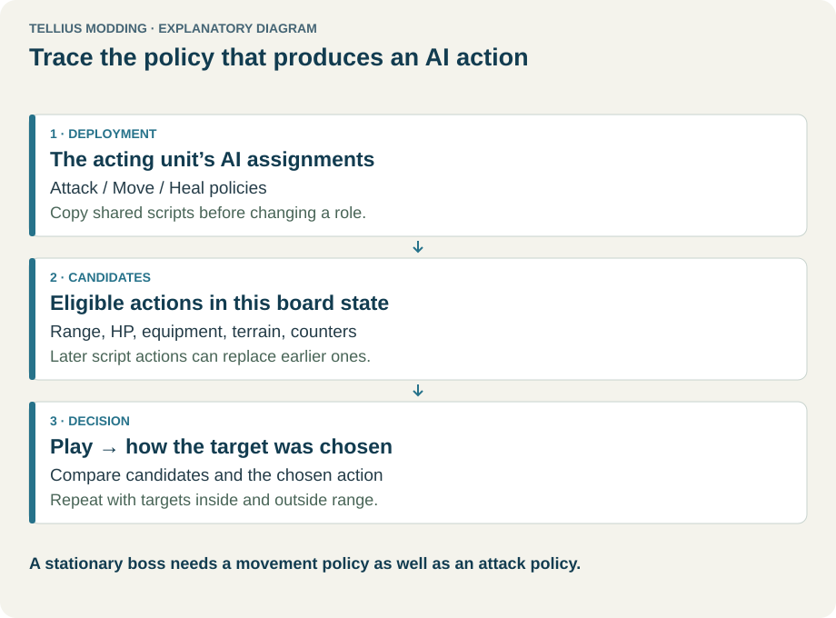

# Read and edit AI scripts

**Route:** Game Data → AI (CP) → Attack / Move scripts

## What you will make

You will copy one existing attack or movement sequence, read it as a small program, change one decision, assign the copy to one deployed enemy, and observe the interpreter in **Chapter → Build → Play…**. The exercise teaches the boundary between a unit's Attack, Move, Heal, and Movement type fields rather than treating “AI” as one setting.

The safe first result is intentionally small: a copied attack script that attacks from the current tile only. That makes the changed behavior obvious without also changing target scores, equipment, terrain costs, or event activation.

## Before you begin

Use a disposable project copy and a chapter with one ordinary enemy. In that unit's deployment record, write down:

- **Attack** (`SEQ_*` attack list), **Move** (`SEQ_*` move list), **Heal**, and **Movement type**;
- starting tile, weapon, range, and faction;
- whether a chapter script replaces its AI after a turn, area, damage, or flag condition.

Place one player unit inside the enemy weapon's range without moving and another reachable only after moving. Keep a second enemy on the original scripts as a control. Save the deployment before opening AI data.

Do not edit a retail sequence in place for this exercise. A sequence may be shared by many deployments and script setters. Select it and press **Find** under **Used by** before copying it.

<figure class="tutorial-figure" markdown="1">

[](../assets/images/tutorials/ai.svg)

<figcaption>AI is a pipeline. Attack and Move sequences permit actions; legality and scoring choose among their candidates. Select the image to open it at full size.</figcaption>
</figure>

## How the editor fits together

`cp_data.bin` contains several related tables. The editor exposes them without pretending they are interchangeable:

| Tab | What it owns | What it does not own |
| --- | --- | --- |
| **Attack / Move scripts** | ordered 28-byte instructions, branches, action builders, movement goals | weapon legality, terrain costs, deployment activation |
| **Heal** | HP thresholds and whether the pre-attack recovery step runs | which medicine exists or whether a staff can reach |
| **Movement types** | signed weights used to rank attack target/weapon/tile combinations | the class terrain-cost table or the Move sequence |
| **Steal items** | legal AI-steal item identities and their priority order | the thief skill, Speed check, or inventory capacity |
| **Routes & targets** | waypoint tables and PID filter lists referenced by instructions | the deployment's starting sequence assignment |

The **Attack** and **Move** radio buttons select different ID lists. A save file stores numeric positions from those lists, so **New…** and **Create copy…** append records. The editor refuses to delete a non-final record because shifting later IDs would reinterpret saved units.

The two script views represent the same instructions. **Readable code** compiles named calls and branches; **Raw entries** exposes opcode plus words `a` through `f`. Prefer readable code for normal work. Use raw entries to inspect a field the language reports, compare an exact retail instruction, or preserve an unknown value—not to guess undocumented opcodes.

## Guided walkthrough

### 1. Resolve the sequence that actually reaches the unit

Open the deployment and copy the exact Attack sequence name. In **Game Data → AI (CP)** choose **Attack**, select that name, and press **Find**. Results can include deployment data and other CP scripts. A chapter event can later call a sequence setter, so search the event scripts too when the unit changes behavior mid-map.

Select **Create copy…**, not **New…**. Give the copy an uppercase ASCII name beginning with `SEQ_`, such as `SEQ_TUTORIAL_HOLD_ATTACK`. **New…** starts from `SEQ_NOATTACK` or `SEQ_NOMOVE`, which is useful for building from nothing but hides the working program you are trying to learn.

### 2. Read the sequence as control flow

Read from top to bottom. Labels are destinations; `goto` is unconditional; comparisons read one of four registers; `if found` tests whether an action candidate currently exists. `stop()` and `end()` finish the current run. A `resume` label changes where the next run starts.

The important mental model is “candidate, then commit.” An action line such as `attack(...)` searches legal target/weapon/tile combinations and registers the best candidate. It does not immediately perform the attack. A later successful action line replaces that candidate. Retail scripts therefore commonly branch after a success:

```text
attack_in_place(chance=100)
if found: goto L1
stop()
L1:
stop()
```

The two stops look redundant, but the branch makes the intended success path explicit. Without the branch, adding another action below the attack may replace it. `clear_found()` deliberately discards the current candidate.

### 3. Change exactly one operation

In your copied attack sequence, use **Insert → Actions** to inspect the available statement shapes. Replace the ordinary attack call with `attack_in_place(...)`, preserving its chance and target filter. This operation permits weapon attacks but exposes only the unit's current tile to attack search. It does not freeze the unit forever: the separately assigned Move sequence can still register movement if the attack run finds nothing.

Press **Check**. The bottom panel reports errors and warnings without changing data. Select a diagnostic to jump to its line. Press **Apply** only after there are zero errors. Apply compiles the source into the selected record; it is not yet written to disk.

Switch to **Raw entries** and select the changed row. Confirm that its help identifies `ATTACK_IN_PLACE` and explains each populated word. Return to **Readable code** without editing the raw values.

### 4. Assign and save both owners

Return to the deployment editor and assign `SEQ_TUTORIAL_HOLD_ATTACK` to only the test enemy's **Attack** field. Leave its Move, Heal, Movement type, weapon, and coordinates unchanged. Save the deployment.

Return to AI (CP) and press **Save AI data**. **Apply** and **Save AI data** are separate boundaries: Apply updates the in-memory CP document; Save writes `cp_data.bin`. The readable source, including comments, is kept under the project's `ai_sources` directory while it still compiles to the saved entries.

### 5. Observe the interpreter

Open **Chapter → Build → Play…** and advance to the enemy phase one action at a time. Select the enemy. Its unit panel shows Attack and Move identities plus their program counters. The AI panel shows stage, registers, found flag, threat limit, entries executed, current sequence, and candidate.

With only the adjacent/in-range player present, the copied Attack sequence should register an attack without moving. With only the distant player present, the in-place attack should find nothing; the outcome then depends on the unchanged Move sequence. This comparison proves which half of the policy produced the movement.

## Understand every control

### Script-list controls

- **Attack / Move:** chooses the ID list and the kind of no-op template used by **New…**.
- **New…:** appends a do-nothing sequence. Use it when you intend to author every branch.
- **Create copy…:** appends a structural copy and retains its readable source when available. This is the normal safe starting point.
- **Delete:** works only for the last record and refuses CP-internal references. External deployment references can still break, so run **Find** first.
- **Used by → Find:** searches CP sections and project game files for the selected identity. Search results describe references, not whether a branch executes at runtime.

### Readable-code controls

- **Check:** parses and validates without replacing the compiled entries.
- **Apply:** compiles the current text, replaces entries when compilation succeeds, and records the source. Switching script/view or saving also attempts to apply pending text.
- **Insert:** inserts syntax for flow, actions, movement, or register operations. It is the best way to learn accepted parameter names.
- **Reload from data:** discards unapplied source after confirmation and decompiles the current entries.
- **Problems:** lists line-specific errors and warnings. A warning can describe deliberate fallthrough; document why it is safe rather than ignoring it silently.

### Core language concepts

- **Registers `r0`–`r3`:** temporary integers cleared at the start of a unit's turn. Movement and tests write result codes such as `8` for arrived, `9` for nothing found, and `10` for a try limit.
- **`found`:** whether an action candidate exists. It is independent of register values.
- **`chance`:** the executable rolls 0–99 and succeeds when the roll is less than or equal to the field. Consequently `100` is certain, while `0` still has an inclusive 1% edge. Do not use `0` as “disabled.”
- **`targets`:** no list means every hostile unit. A PID table with `exclude=False` means members regardless of side; with `exclude=True`, it means hostile units not in the list.
- **`threat_limit`:** a non-default `b` word constrains movement operations to tiles at or below that threat value. It is not the same as the Movement type's threat weight.
- **`set_scripts`:** replaces only the named Attack and/or Move sequence; `keep` retains the other. Replacing the running sequence ends that run, and replacing both also resets try and route state.
- **Fallthrough:** a sequence with no terminating instruction can continue into the next physical CP section, including labels owned by it. Retail data uses this deliberately. Copies can change adjacency, so add an explicit stop unless cross-section fallthrough is intentional and verified.

## Interactions and precedence

The phase scheduler first chooses an eligible unit. Its healing/special layer may act before the Attack sequence. The Attack sequence can register a combat, staff, steal, skill, or object action. If nothing commits, the Move sequence can register movement or another action. Legality removes impossible targets before scores are compared.

Priority mistakes usually come from editing the wrong layer:

- a **Move** sequence can move a “stationary” unit after `attack_in_place` fails;
- a **Heal** profile can pre-empt an available attack while the unit needs recovery;
- a chapter event can replace an assigned sequence after activation;
- an unusable weapon means an attack operation has no candidate, regardless of its chance;
- a later action instruction overwrites an earlier candidate unless control flow exits;
- Movement type weights choose among legal attacks but cannot create an illegal one.

## Test matrix

| Case | Setup | Expected observation |
| --- | --- | --- |
| In-place success | valid target already in weapon range | Attack stage sets `found`; candidate keeps the current tile |
| Distant target | target reachable only after movement | copied attack finds none; Move sequence explains the next action |
| No usable weapon | remove/break weapon | attack produces no candidate; no phantom combat occurs |
| Two plausible targets | both in range from current tile | selected target follows Movement type scoring |
| Heal pre-emption | lower HP below the assigned retreat threshold and provide medicine | recovery occurs before ordinary attack when profile priority permits it |
| Event replacement | trigger the unit's activation/order event | unit panel displays the replacement sequence and reset program counter |
| Save/reload | save mid-map after a sequence/state transition | stored sequence identity and interpreter state do not revert to deployment defaults |
| Control enemy | leave second unit on retail sequence | it retains baseline behavior, proving the copy isolated the edit |

## Troubleshooting

**The editor says the code changed but the unit uses the old sequence.** Confirm **Apply**, **Save AI data**, deployment assignment, and deployment save. Restart Play after project-data edits; rewind restores snapshots from the current run and does not reload changed resources.

**An attack is found, then the unit does something else.** Read the remaining instructions. A later action replaced the candidate. Branch on `found` or terminate the success path.

**A hold-position enemy walks away.** `attack_in_place` constrains only that attack search. Inspect the Move sequence, recovery behavior, and any later sequence setter.

**Check reports an unknown label.** The label may be a typo or deliberate cross-section fallthrough. Inspect the retail neighbor before preserving the latter; do not invent a destination.

**Other enemies changed.** The retail sequence was edited in place, or an event assigns your copy to a group. Restore the original AI data and reapply the change to an appended copy.

**A 0% action occurs rarely.** This matches the confirmed inclusive comparison. Use control flow or remove the operation when it must never run.

## Save, build, and revert

Save every changed owner: **Save AI data** for `cp_data.bin`, plus the relevant deployment or event script. Run project checks, build, and repeat the matrix in Play. Use Dolphin for final engine parity, especially when your sequence uses an operation marked strong or tentative in raw help.

To revert, reassign the original sequence to the unit and save the deployment. If the copied sequence is the final record and has no CP references, it can then be deleted. Keeping an unused appended sequence is safer than deleting an earlier ID. Restore the project backup if a shared retail sequence was changed.

## Limits and confidence

Sequence layout, list-ID stability, readable compilation, candidate replacement, registers, chance semantics, sequence setters, and core operation meanings are source-reviewed against the editor and executable research. Play implements the documented common pipeline, but not every engine term or rare opcode has full parity. Unknown or non-confirmed operations are labeled in Raw entries. A successful app simulation is evidence for the authored logic, not a substitute for a built-game test.

## Related tutorials and references

- [Create common AI orders](44-common-ai-orders.md)
- [Inspect why AI chose a target](45-inspect-ai-decisions.md)
- [Place and tune units by difficulty](30-deployment-by-difficulty.md)
- [AI Engine, Targeting & Scoring](../systems/ai-engine-and-scoring.md)
- [AI Activation, Routes & Orders](../systems/ai-activation-and-orders.md)
- [CP data format](../formats/cp-data-format.md)

---

[← Previous: Import a translation font](42-font-translation.md) · [All tutorials](index.md) · [Next: Create common AI orders →](44-common-ai-orders.md)
