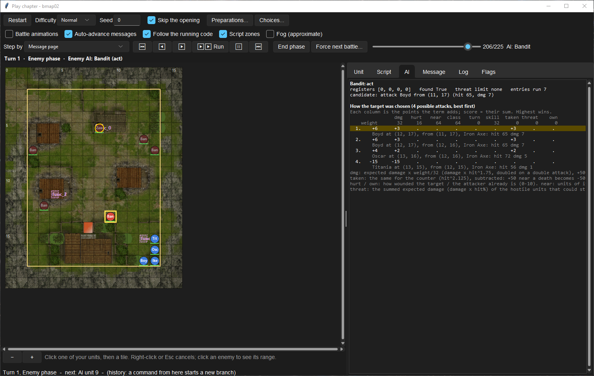

# Inspect why AI chose a target

**Route:** Chapter → Build → Play… → AI

## What you will make

You will produce a reproducible explanation of one enemy attack: which sequence instruction ran, which target/weapon/standing-tile combinations were legal, how the displayed terms contributed to each score, why the winning row beat the runner-up, and which engine terms still require Dolphin confirmation.

The goal is not “the AI likes weak units.” It is an evidence trail that another modder can replay from the same chapter state.

## Before you begin

Create a turn with one unacted enemy and two or three plausible player targets. Avoid reinforcements and event-driven sequence changes during the first comparison. Record:

- unit PIDs, classes, factions, tiles, current/max HP, skills, and acted/status state;
- enemy Attack, Move, Heal, and Movement type identities;
- all usable weapons, their ranges and uses;
- terrain and obstacles around every possible attack tile;
- current turn number.

Save the project, start a fresh Play run, and stop immediately before the enemy phase. Rewind/history is valuable inside this loaded run. After changing project data, restart Play; an old snapshot intentionally preserves the resources it loaded.

## How the editor fits together

The Play window exposes three views needed for an AI diagnosis:

- the **unit panel** shows the selected unit's stats, items, skills, AI identities, and Attack/Move program counters;
- the **AI tab** shows the currently acting unit's stage, four registers, `found`, threat limit, entries executed, active script lines, and pending candidate;
- after an attack decision, **How the target was chosen** lists the highest-ranked legal target/weapon/tile rows, best first, with score-term contributions.

These views answer different questions. Script trace explains which candidate builder ran. The candidate list proves what survived legality. The score columns explain ordering only among survivors. An absent row is an eligibility problem, not a low score.

## Guided walkthrough

### 1. Freeze a reproducible boundary

Advance one command or AI action at a time until the chosen enemy is next. Confirm the unit panel shows the expected `SEQ_*` names. Write down the Play history position. If another AI unit acts first, its action can change occupancy, HP, threat, or availability; either include that in the reproduction or isolate your unit.

### 2. Follow the sequence before reading scores

Open **AI** while the unit acts. Read the stage and highlighted script line. Watch:

- **registers** for counts and result codes;
- **found** for whether an action candidate exists;
- **threat limit** for movement filtering;
- **candidate** for the action that would currently commit;
- owner annotations when execution falls through into another CP section.

If a later instruction replaces the candidate, the ranking shown for the earlier attack is no longer the committed decision. First identify the last successful candidate builder on the executed path.

### 3. Separate missing candidates from losing candidates

When the attack commits, expand/read **How the target was chosen**. Each possible attack is a combination of target, equipped weapon instance, and reachable standing tile. Check that the expected option appears.

If it does not, work through legality in this order: operation target filter and allegiance, target state, usable weapon, minimum/maximum range from a reachable tile, terrain/path cost, occupancy/object tiles, status restrictions, and in-place/hold flags. Scoring cannot rescue a rejected combination.

### 4. Read the score row

The heading shows Movement type weights in 32nds. A weight of 32 counts its term once, 64 doubles it, 16 halves it after integer truncation, 0 ignores it, and a negative value reverses preference. Each candidate row shows points after weighting; **score** is their sum.

| Column | Meaning in the displayed score |
| --- | --- |
| **dmg** | hit-adjusted expected damage, weighted; +50 kill bonus when the weighted damage reaches target HP |
| **hurt** | target's existing wounded share on a 0–10 scale |
| **near** | friendly-to-attacker units around the attack tile, using the fixed three-tile neighborhood weights |
| **class** | bonuses for target class categories such as mage, armor, flier, laguz, or hero |
| **turn** | current turn number multiplied by its weight |
| **skill** | Provoke +50, Shade −50; Shade wins if both apply |
| **taken** | expected counter/death risk, subtracted; safe attacks can gain a small inverse benefit |
| **threat** | summed hostile expected damage on the standing tile divided by 16, then weighted and subtracted |
| **own** | attacker's current wounded share, weighted and subtracted |

The `dmg` forecast discounts uncertain hits using `hit^1.75`; counter expectation uses `hit^2.125`. This is not simply displayed damage × displayed hit. Integer truncation means a small term can contribute zero.

### 5. Explain the winner against the runner-up

Compare the first two rows one column at a time. State the decisive delta, for example: “Both attacks score +10 damage, but target A receives the +50 kill bonus and target B does not,” or “the same target is attacked from tile X because tile Y adds four threat points.”

If scores are equal in Play, the simulator sorts the shorter walk first after score. Preserve row order and test the built game before treating that tie rule as universal executable behavior; exact equal-score ordering across every engine scorer remains an open edge.

### 6. Change one input and replay

Rewind to the boundary and change one run-state input if Play supports it, or edit the project and restart. Good experiments are:

- heal the preferred target above the kill threshold;
- move one target onto a tile that changes legal standing tiles;
- replace Provoke with Shade;
- switch the enemy to a copied Movement type with one weight changed;
- remove the only ranged weapon;
- mark a nearby hostile as acted, which can alter the generated threat map.

Predict the affected eligibility row or score column before replaying. A useful diagnosis is falsifiable.

<!-- screenshot 45-b-result.png -->
<figure class="tutorial-figure" markdown="1">

<figcaption markdown="span">The **AI** pane during an enemy's attack: its registers, the candidate it holds, and **How the target was chosen**, every possible attack best first with the points each term adds and the unit's MTYPE weights.</figcaption>
</figure>

## Understand every control

- **Advance/step controls:** progress the simulation at command or action boundaries. Use them to stop on the deciding AI unit rather than letting the whole phase erase context.
- **Follow current activity:** automatically selects the relevant diagnostic tab while work is pending. Turn it off when comparing a previous unit.
- **Unit selection:** exposes the current AI identities and program counters; selection does not change AI state.
- **AI trace:** live interpreter state. The highlighted instruction is the next/current program position, not a promise that it will find a candidate.
- **Last decision:** when no AI unit is active, the tab retains the latest attack decision in the current phase so its ranking can still be read.
- **History/rewind:** restores a deep snapshot of the current simulation. It does not re-read edited deployment, CP, item, or map files.

## Interactions and precedence

Decision explanation follows a strict order:

1. scheduler order determines which unit sees the map first;
2. recovery/special logic may pre-empt ordinary Attack;
3. sequence control flow selects an operation and target population;
4. legality enumerates target/weapon/tile combinations;
5. Movement type weights rank legal attacks;
6. later sequence operations may replace the candidate;
7. commitment revalidates and performs the action.

The threat map is rebuilt for the deciding unit. It sums forecast damage from eligible hostile units that could strike each reachable tile and caps tile values. Hostiles that are dead, carried, hidden/reserve, under a roof, or marked acted are excluded by the documented engine path. Thus an earlier action in the phase can change a later unit's score without editing any AI table.

## Test matrix

| Variation | Prediction to write first | Evidence to inspect |
| --- | --- | --- |
| target in/out of range | row appears/disappears | candidate count and row list |
| lethal/nonlethal HP | `dmg` changes by kill bonus | `dmg`, total score, row text |
| counter/no counter | `taken` becomes safer | range and `taken` |
| Provoke/Shade/neither | `skill` shifts ±50/0 before weighting | `skill` column |
| safe/dangerous attack tile | same target/weapon may have different threat | tile in row and `threat` |
| healthy/wounded target | `hurt` changes | target HP and `hurt` |
| different class category | copied Movement type class bonus applies | `class` column |
| two weapons | separate rows or a different winning item | item names in ranked rows |
| same score, different path | shorter simulator path appears first | score, source/destination, Dolphin parity |
| healing threshold crossed | ordinary ranking may never run | stage and recovery output |

## Troubleshooting

**The target I expected is absent.** Diagnose legality and filters before weights. Check range from every reachable tile, usable inventory, allegiance/list semantics, status, occupancy, and hold position.

**The displayed arithmetic seems not to match a simple forecast.** The AI uses hit exponents, term weights in 32nds, integer truncation, kill/death bonuses, and a special inverse value when expected damage is below one. Use the displayed point cells, not mental damage × hit alone.

**The unit selected the top attack, then moved or used something else.** Another instruction replaced the candidate or recovery/special dispatch ran at a different stage. Follow the trace through termination.

**Rewind does not show my CP edit.** Restart Play. Rewind restores the original loaded snapshot.

**Play and Dolphin disagree.** Preserve the exact project build, turn, history of earlier actions, unit records, RNG-relevant setup, and all ranked rows. Check documented simulator gaps before changing the design.

## Save, build, and revert

This lesson can be purely diagnostic. Save only intentional edits to deployment, items, skills, or copied Movement types. After a project edit, restart Play, reproduce the matrix, run project checks, build, and repeat the decisive comparison in Dolphin.

Keep a short diagnosis note containing the winning and runner-up rows plus the changed variable. Revert experimental assignments and copied weights after the explanation is complete; do not leave a diagnostic Movement type assigned accidentally.

## Limits and confidence

The displayed trace, common legality, documented score terms, weights, expected-damage exponents, kill/death bonuses, and per-unit threat construction are source-reviewed. Play deliberately does not fully simulate adjacent-foe and skill terms in every circumstance, and rare skills/actions remain incomplete. Exact equal-score ordering and simpler alternate engine scorers are not fully documented. Treat these as explicit Dolphin verification points, not reasons to disregard the rest of the trace.

## Related tutorials and references

- [Read and edit AI scripts](43-ai-language.md)
- [Create common AI orders](44-common-ai-orders.md)
- [Play and inspect a chapter](58-play-chapter.md)
- [AI Engine, Targeting & Scoring](../systems/ai-engine-and-scoring.md)
- [AI Healing & Special Actions](../systems/ai-healing-and-special-actions.md)
- [CP data format](../formats/cp-data-format.md)

---

[← Previous: Create common AI orders](44-common-ai-orders.md) · [All tutorials](index.md) · [Next: Edit armory, vendor, forge, and gold →](46-shops.md)
