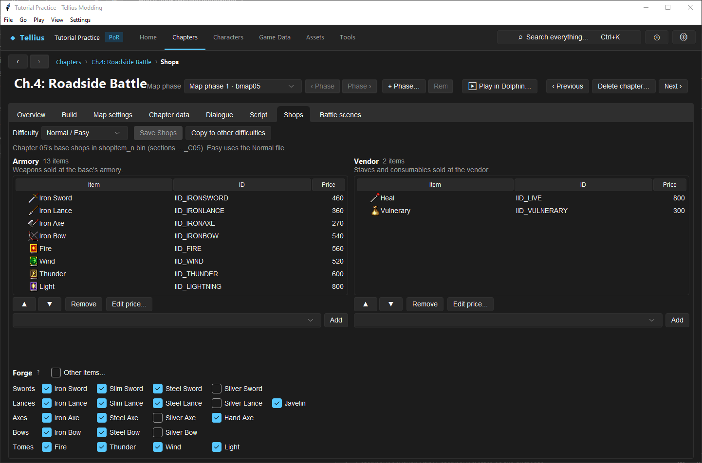

# Edit armory, vendor, forge, and gold

**Route:** Chapter → Shops; Game Data → Items; Tools → Game Code

## What you will make

You will give one chapter a deliberately different Armory, Vendor, and Forge on each difficulty; change one item's shared price with full awareness of its global scope; and verify successful, cancelled, unaffordable, full-inventory, sale, and forge transactions. You will also distinguish ordinary stock edits from executable gold-cap or forge-rule patches.

## Before you begin

Choose a chapter whose base is reachable on a fresh test save. Note that the project's numeric chapter identity is the disc number: Prologue is `01`, Chapter 1 is `02`, and so on. Shop sections use that number, not the displayed story label.

Write three stock plans—Normal/Easy, Hard, and Maniac—and a 5×9 forge plan. Give the test party enough gold for one purchase but not two. Keep a unit with one free item slot, another with a full inventory, and enough convoy space to observe delivery routing.

Back up `shop/shopitem_n.bin`, `shopitem_h.bin`, `shopitem_m.bin`, and `FE8Data.bin`. A price edit changes the global item definition and can affect every shop, difficulty, reward, and owned instance that displays that definition's value.

## How the editor fits together

The three shop files contain every chapter's stock:

| File | Difficulty | Sections per chapter |
| --- | --- | --- |
| `shopitem_n.bin` | Normal and Easy | `WSHOP_ITEMS_Cnn`, `ISHOP_ITEMS_Cnn`, `FSHOP_ITEMS_Cnn` |
| `shopitem_h.bin` | Hard | same three identities |
| `shopitem_m.bin` | Maniac | same three identities |

`W` is the ordered Armory IID list, `I` the ordered Vendor IID list, and `F` a fixed 45-cell forge grid. Stock rows store only item identities. Price, uses, stats, flags, and icon index come from the shared `FE8Data.bin` item record.

The sell shop has no authored stock list: it enumerates the party's owned instances and rejects protected/valuable items according to item properties. Current gold and report counters are party state, not shop-file fields.

## Guided walkthrough

<!-- screenshot 46-a-setup.png -->
<figure class="tutorial-figure" markdown="1">

[](../assets/images/tutorials/screenshots/46-a-setup.png)

<figcaption markdown="span">A chapter's **Shops** tab: the armory and vendor stock per difficulty, the forge grid, **Copy to other difficulties** and **Save Shops**.</figcaption>
</figure>

### 1. Confirm the chapter and difficulty owner

Select the chapter, open **Shops**, and read the banner. It names the chapter number, active `shopitem_*.bin`, and `…_Cnn` section suffix. Change the **Difficulty** picker and verify which plan you are viewing. Easy intentionally uses Normal data.

If the chapter has no complete section trio, the base gets an empty Armory/Vendor and the built-in forge list. Press **Add shops for chapter nn**. The editor copies the nearest suitable earlier chapter when available and creates sections across difficulty files that lack them. Immediately review all three difficulties; the template is a starting point, not an assertion that their balance should match.

### 2. Build Armory and Vendor lists

Use each list's picker to select an item by name/IID and press **Add**. With a row selected, the new item is inserted after it; without a selection, it appends. Duplicate IIDs in the same list are refused.

Use **▲ / ▼** to establish display order and **Remove** (or Delete) to remove the selected row. Armory is conventionally weapons; Vendor is conventionally staves and consumables. The binary format accepts IIDs, but putting an unusual category in a facility should be tested for menu presentation, purchase routing, and help text rather than assumed safe from the label alone.

Add one familiar retail item first, then the new/custom item. The familiar row proves the shop itself opened and lets you separate a broken custom definition from a broken stock section.

### 3. Understand and edit price

Select a row and press **Edit price…** (double-click also opens it). The displayed price is:

```text
purchase price = item cost per use × item uses
```

The dialog changes **cost per use** in `FE8Data.bin`; it does not create a chapter-specific sale. If uses are zero, the product remains zero and the editor directs you to **Game Data → Items** first. After confirming, the status includes `FE8Data.bin` among unsaved resources.

To make a one-chapter sale without changing the item globally, create a distinct item definition with its own IID/cost and stock that version. Check rewards and inventory conversions so the sale IID does not leak into contexts where the original was intended.

### 4. Author the forge grid

The compact Forge checkboxes expose vanilla-shaped offerings. A checked box means that family/base cell contains an IID; unchecked means empty. The base columns are Iron, Slim, Steel, Silver, Thrown, Fire, Thunder, Wind, and Light. Rows are Swords, Lances, Axes, Bows, and Tomes.

Enable **Other items…** to reveal the raw 5×9 grid. Each cell answers: “When the player chooses this family and base, which item definition becomes the forge base?” Choose **(none)** to leave a cell empty. Replacing a cell with an unusual IID does not automatically make its weapon type, animation, rank, effects, or forge stat bounds coherent; those remain properties of the item and forge runtime.

Forge availability is per chapter and difficulty. Separately, the game permits one completed forge per chapter by a saved party flag. Cancelling before successful delivery must not consume the opportunity.

### 5. Deliberately copy—or keep differences

Finish and inspect the source difficulty first. **Copy to other difficulties** replaces that chapter's Armory, Vendor, and Forge in every other available difficulty after confirmation. It is a whole-shop copy, not a merge. Do not use it when Hard/Maniac scarcity is part of the design.

Switch through all difficulties afterward. Because Easy uses Normal, your effective test set is Normal/Easy, Hard, and Maniac.

### 6. Save and exercise transactions

Press **Save Shops**. The editor writes only difficulty files marked edited and also saves the shared FE8Data session when a price or another game-data page is dirty. Read the final status so you know whether shop files, `FE8Data.bin`, or both were committed.

Build, enter the base on each difficulty, and execute the transaction matrix. For a successful purchase, confirm stock name/order/price, destination prompt, new item instance/uses, gold debit, and next report's Spent counter. Cancel at confirmation and verify nothing changes. Attempt an unaffordable purchase and a purchase with no legal delivery destination; both must leave gold and inventory untouched.

Forge once, cancel once before confirmation on a separate save, and try a second completed forge in the same chapter. Confirm custom name/color/stat result, quote, delivery, gold, and saved one-per-chapter lock.

## Understand every control

- **Difficulty:** selects the backing shop document. Normal is also Easy.
- **Save Shops:** writes every edited difficulty file and any dirty shared FE8Data session.
- **Copy to other difficulties:** replaces all three current-chapter facilities in other modes.
- **Add shops for chapter:** creates missing W/I/F sections, using a nearby complete chapter as template when possible.
- **Item picker / Add:** inserts a valid FE8Data IID after selection or at the end.
- **▲ / ▼ / Remove:** changes order or membership in the selected facility only.
- **Edit price…:** changes global cost per use; the list's displayed total recomputes from uses.
- **Forge checkboxes:** toggle the normal item for known family/base cells.
- **Other items…:** exposes every raw grid cell and permits another IID or `(none)`.

## Interactions and precedence

Shop selection begins with current campaign chapter and difficulty, then resolves that facility's named section. Missing data follows an explicit empty/default path; it does not borrow arbitrary neighboring stock at runtime.

A purchase follows validate → confirm → create instance → deliver → debit. Failure or cancellation before commit leaves inventory, gold, and report counters unchanged. Gold clamps at 9,999,999, and report Earned/Spent records only the accepted delta.

Forge confirmation additionally requires an unused chapter forge flag and a free persistent forge record. The party holds 48 forge records; exhaustion must fail before charging or delivery. Custom Might, Hit, Critical, Weight, name, and trail color belong to the created instance, while the stock grid only selects its base definition.

## Test matrix

| Case | What to verify |
| --- | --- |
| Normal and Easy | identical Normal-backed stock and order |
| Hard / Maniac | each reads its own plan, including forge cells |
| successful purchase | exact instance delivered, uses preserved, correct debit and report spending |
| cancel | no item, debit, or report change |
| insufficient gold | refusal with atomic state |
| full personal inventory | convoy/prompt/failure route is coherent and no duplicate instance appears |
| global price | same IID shows changed price in another chapter/difficulty |
| sell | protected item rejected; eligible exact instance removed and accepted gold credited |
| forge cancel | chapter opportunity remains available |
| forge success | quote, stats/name/color, destination, record link, debit, and lock persist |
| second forge | unavailable after one committed forge in the chapter |
| save/reload | balance, inventory, report counters, forge instance, and lock persist |

## Troubleshooting

**The wrong chapter's stock appears.** Compare the selected project's numeric/disc chapter ID with the `Cnn` banner; do not infer it from the story label.

**Easy and Normal cannot differ.** This is a data ownership rule: both use `shopitem_n.bin`.

**A price changed everywhere.** That is expected. Price lives on the shared item definition, not the stock row. Restore the original cost or create a distinct IID.

**The shop is empty on one mode.** That difficulty may lack a complete W/I/F trio, or its edits were not saved. Select it and read the banner/status.

**A forge option is checked under a surprising base.** Open **Other items…** and inspect the exact family/base cell. The compact checkbox reflects whether the cell is occupied, including replacement IIDs.

**Gold changed after a failed transaction.** Reproduce from a clean save and record the exact delivery/capacity path; transaction rollback is a confirmed invariant and this is a defect, not intended balance.

## Save, build, and revert

Save Shops, run project checks, build, and perform the matrix in a fresh save for each difficulty. Keep the pre-edit shop files and `FE8Data.bin` together because restoring only one can leave stock and price out of sync.

To revert stock, restore or recreate the original W/I/F lists for that chapter/difficulty. To revert a price, restore the item's original cost per use in Game Data → Items. Executable changes made under Game Code—gold cap or forge rules—must be reverted through that patch's own control; replacing shop files cannot undo code patches.

## Limits and confidence

Shop section ownership, Easy/Normal sharing, list/grid layout, price formula, editor save boundaries, gold accounting, purchase/sale transaction order, forge lock and record pool are source-reviewed. Individual custom item behavior, unusual category presentation, and any executable patch remain dependent on their owning systems and require built-game testing.

## Related tutorials and references

- [Create, balance, and present an item or weapon](17-items-and-weapons.md)
- [Understand a chapter's parts](06-chapter-anatomy.md)
- [Install and revert game-code changes](57-game-code.md)
- [Economy](../systems/economy.md)
- [Shop format](../formats/shop-format.md)
- [Items & Weapons](../systems/items-weapons.md)

---

[← Previous: Inspect why AI chose a target](45-inspect-ai-decisions.md) · [All tutorials](index.md) · [Next: Replace or add music →](47-music.md)
