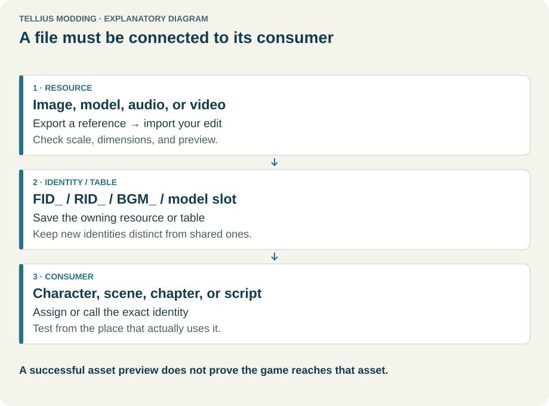
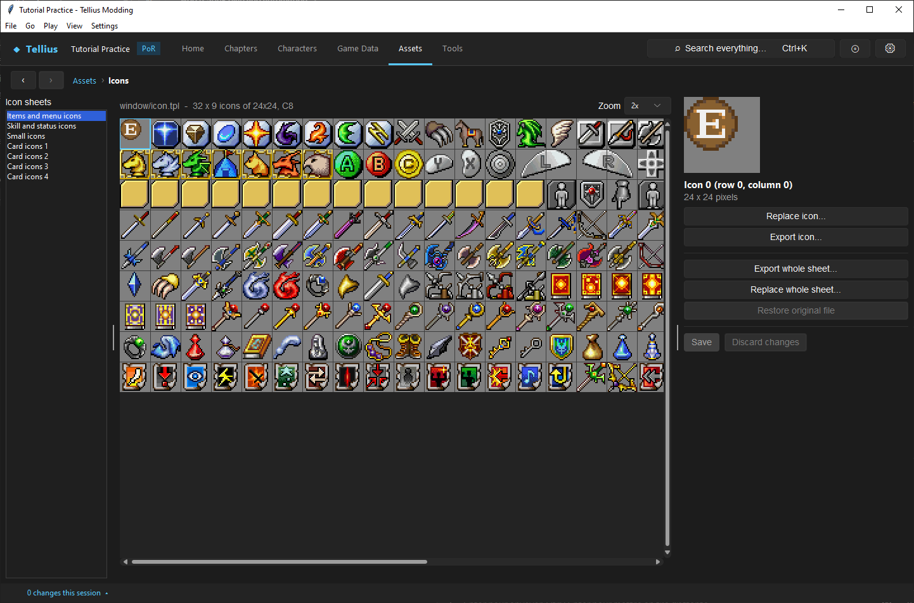
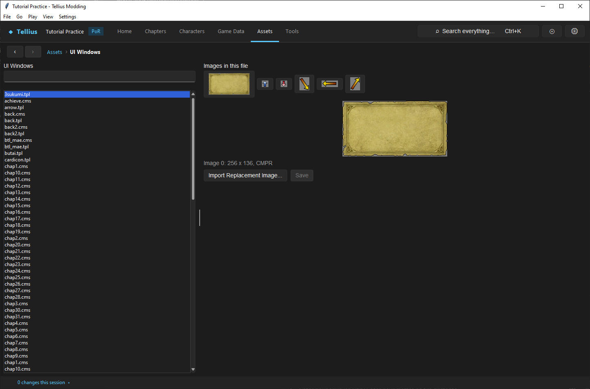
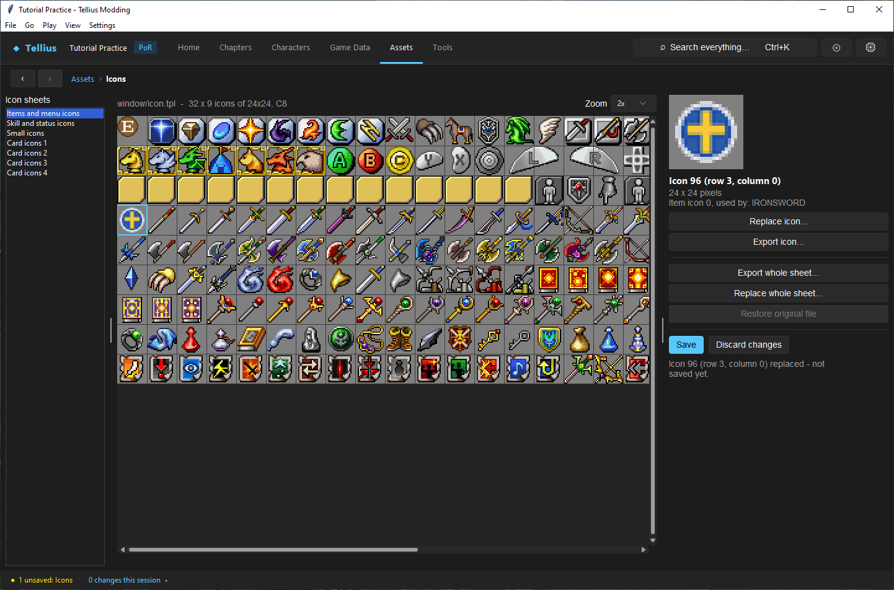

# Replace 2D graphics

**Route:** Assets → Icons / UI Windows / Illustrations / Ending Art / Misc Graphics / World Map / Equipment / Sound Room / Staff Credits

## What you will make

You will replace one item-icon cell without disturbing its atlas neighbors, replace one image inside a multi-image TPL/CMS archive, and verify the result in its consuming screen. You will also learn when Sound Room art and Staff Credits require structured records rather than a simple image replacement.

## Before you begin

Follow the graphic from consumer to resource first. Record filename, archive image index, dimensions, texture format, compression wrapper, transparency, and every known user. Export the icon or sheet/reference image before editing.

Use PNG with RGBA for transparency-sensitive work. Keep source art at the exact target size; the app stretches other dimensions, which is useful for conversion but can blur pixel art and distort UI borders.

## How the editor fits together

<!-- diagram assets -->
<figure class="tutorial-figure" markdown="1">

<figcaption>Concept diagram, not an app screenshot. A replaced file must be connected through its identity or table to the screen that uses it. Select the image to open it at full size.</figcaption>
</figure>

Most supported graphics are TPL textures. `.cms` files are LZ10-compressed TPLs; saving recompresses them. A TPL can contain several independent images, each with its own fixed dimensions/format and sometimes a palette. Specialized consumers add another identity layer:

- **Icons** use fixed atlas cells, not filenames.
- **Illustrations, Ending Art, UI Windows, Misc Graphics, World Map, Equipment** browse file archives and replace a selected image index.
- **Sound Room** stores an ordered slideshow of `RID_*` background resources plus X/Y offsets; its 64 music cues live elsewhere.
- **Staff Credits** owns three-column text/layout records rather than being only a bitmap.

Path of Radiance reads the icon sheet bundled into `system.cmp`; the project build synchronizes the edited loose `window/icon.tpl` into that archive.

## Guided walkthrough

<!-- screenshot 50-a-setup.png -->
<figure class="tutorial-figure" markdown="1">

<figcaption markdown="span">**Assets › Icons**: the icon sheets cut into cells, the selected cell with the records that use it, **Export icon…** / **Replace icon…** and the whole-sheet actions.</figcaption>
</figure>

<!-- screenshot 50-ui-windows.png -->
<figure class="tutorial-figure" markdown="1">

<figcaption markdown="span">**Assets › UI Windows**: every image of the selected texture file as thumbnails; select one to read its size and format before **Import Replacement Image…**.</figcaption>
</figure>

### Replace one icon cell

Open **Assets › Icons** and choose the sheet in **Icon sheets** (*Items and menu icons*, *Skill and status icons*, *Small icons*, *Card icons 1–4*); the line above the grid names the file and its cells (*window/icon.tpl · 32 x 9 icons of 24x24, C8*). Navigate by grid/cell number. Item icon number `n` maps to cell `96 + n` in image 0 (24×24 cells). Skill icon number `n` maps to cell `n - 1` in image 1 (32×32 cells). Read **used by** before editing because several IIDs/SIDs can share a number.

Press **Export icon…**, create an exact-size transparent PNG, then **Replace icon…**. The editor changes only that region and allocates colors from spare entries in the sheet's shared palette. Inspect adjacent cells and transparent edges. Press **Save** only after the preview is correct; **Discard changes** returns to the last saved bytes, while **Restore original file** restores the extracted sheet and removes every modification in it.

<!-- screenshot 50-b-result.png -->
<figure class="tutorial-figure" markdown="1">

<figcaption markdown="span">**Replace icon…** on the Iron Sword's cell (*Icon 96 (row 3, column 0)*, 24 × 24, *used by: IRONSWORD*) with a 32 × 32 shield drawn for this lesson, stretched to the cell: the sheet redraws and the status says *not saved yet*. **Save** writes `window/icon.tpl`; this capture uses **Discard changes**.</figcaption>
</figure>

Path of Radiance's sheets have no 16:9 copy. In a Radiant Dawn project, whose icon sheet has one, **Also update the widescreen sheet** (on by default) pastes the same image into it too, so both display modes match.

Use **Export whole sheet… / Replace whole sheet…** only for coordinated atlas work. A whole-sheet replacement can alter menu glyphs, items, skills, statuses, and badges at once.

### Replace an archive image

Open the appropriate specialized viewer (**UI Windows**, **Backgrounds**, …) and select the exact file. **Images in this file** shows every image in it as a thumbnail. Select the required image index and read dimensions plus texture format. “View-only, can't import” means the writer does not support that encoding; do not force a different format externally.

Choose **Import Replacement Image…**. The app stretches it to the stored dimensions and re-encodes in the existing supported format. Review every sibling thumbnail, then **Save**. Switching files with unsaved changes prompts to discard.

### Sound Room and credits

The Sound Room slideshow (**Pictures, in slideshow order**), its 64 music cues and the staff credits (**Save credits**) have their own lesson: [Edit the Sound Room, credits and in-game tutorials](73-sound-room-credits-tutorials.md).

### Verify the consumer

Build and open the actual inventory/help/menu/world-map/ending/equipment/Sound Room/credits screen. Check at native scale, against light and dark backgrounds, at transitions, and with every state that uses the cell. An isolated thumbnail does not exercise clipping rectangles, layout, filtering, layer order, or palette interactions.

## Understand every control

- **Sheet/file search:** locates resources; identity remains the selected path/image/cell.
- **Zoom:** nearest-neighbor inspection only; it does not change pixels.
- **Replace icon:** edits one atlas region and preserves other decoded pixels.
- **Export/Replace whole sheet:** bulk operation with correspondingly broad risk.
- **Save / Discard changes:** commits or drops pending in-memory replacements.
- **Restore original file:** recoverable full-file rollback, affecting all cells/images in that file.
- **Archive thumbnails:** select one TPL image index; replacement preserves container siblings.

## Things to try next

1. **A skill icon.** On *Skill and status icons*, find skill icon `n` at cell `n - 1` (32 × 32) and replace it; check **used by** first.
2. **Read a palette limit.** Replace a cell with a picture of many colours: the app maps it to the sheet's shared palette; compare the preview with your source.
3. **Restore.** After a saved replacement, **Restore original file** puts the whole sheet back.

## Interactions and precedence

Consumer lookup precedes texture decoding. Correct pixels under the wrong cell, RID, archive index, or path remain invisible. Archives loaded from `system.cmp` can outrank loose duplicates, which is why build synchronization matters.

Paletted textures share finite colors at image/sheet scope. A one-cell import may approximate colors or fail when spare entries are insufficient. Alpha treatment and edge colors affect halos under filtering. UI layout rectangles can crop a correctly encoded image.

## Test matrix

| Case | Check |
| --- | --- |
| edited icon | correct IID/SID screen uses new cell |
| shared users | every record using the same icon is intentionally changed |
| neighboring cells | pixel-identical and no palette recoloring |
| transparency | no solid box/halo on light and dark UI |
| multi-image file | only selected index changed |
| compressed CMS | reopen after save and build successfully |
| UI/world-map image | correct clipping, scale, filtering, and layer |
| Sound Room | RID, offset, order, track/image separation |
| credits | all three columns and full scroll |
| clean rebuild | bundled/loose precedence resolves edited asset |

## Troubleshooting

**Unrelated icons changed.** You replaced a whole sheet, selected the wrong cell, or exhausted/shared palette colors. Restore and retry a single region with fewer colors.

**The icon preview is right but the game is unchanged.** Confirm the item's icon number/cell mapping and rebuild `system.cmp` through the normal project build.

**Edges have halos.** Preserve transparent RGB edge colors and inspect against multiple backgrounds; resampling a small icon often introduces colored transparent pixels.

**A replacement is stretched.** Match the reported stored dimensions before import.

**Sound Room music and picture do not align.** They are separate ordered resources. Check the picture list and fixed cue list independently.

## Save, build, and revert

Save the owning panel, run project checks, build, reopen the resource, and exercise the consuming screen. Keep exports as visual references, not as a substitute for original binary backups.

Use **Discard changes** before save, or **Restore original file** afterward where available. Restore shared sheets as whole files and retest every consumer. Structured Sound Room/credits edits require restoring their own data, not the referenced image alone.

## Limits and confidence

TPL/CMS decoding, supported re-encoding, icon mappings, shared palettes, archive precedence, and specialized record ownership are source-reviewed. Color quantization, unusual view-only formats, and every consumer-specific clipping/layout state cannot be proven from the asset preview. Built-game verification remains required.

## Related tutorials and references

- [Create and display dialogue backgrounds](38-backgrounds.md)
- [Create, balance, and present an item or weapon](17-items-and-weapons.md)
- [Graphics & Images](../systems/graphics-system.md)
- [TPL texture format](../formats/tpl-texture.md)
- [Sound Room format](../formats/sound-room.md)
- [Staff roll format](../formats/staffroll.md)

---

[← Previous: Replace a video and manage disc size](49-videos.md) · [All tutorials](index.md) · [Next: Round-trip a model through Blender →](51-blender-round-trip.md)
