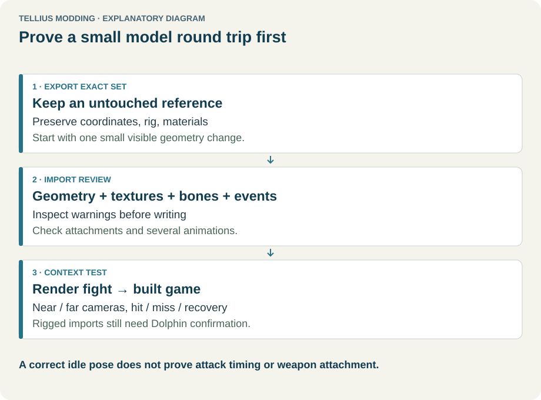
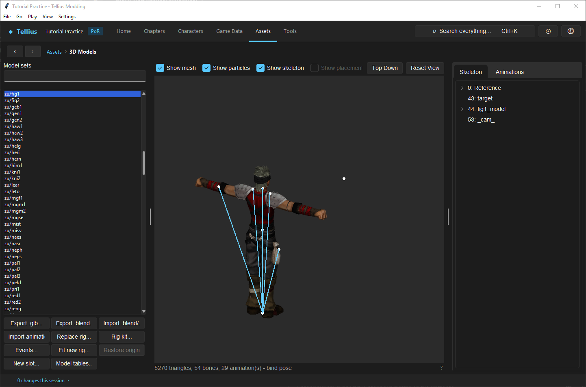

# Round-trip a model through Blender safely

**Route:** Assets → 3D Models

## What you will make

You will export one existing model set to `.glb`, make a tiny reversible geometry change in Blender, import it into the same slot, inspect every proposed output and warning, write it, and compare bind pose plus animations with the original. This is a pipeline proof, not a character redesign.

The exercise teaches the boundary between static scenery, map-character bodies, battle bodies, weapons, rigs, and animations. After it passes, you can decide whether a larger change belongs to **Import .glb…**, **Import animation…**, **Replace rig…**, or **Fit new rig…**.

## Before you begin

- Complete [Save changes and restore originals](03-saving-and-restoring.md) and [Edit model budgets](54-model-budgets.md).
- Install a Blender version that can import and export glTF 2.0 binary files.
- Use a disposable project checkpoint and begin with a simple static `zbg/` scenery or non-bow `xwp/` weapon. Static geometry removes rig and animation variables from the first proof.
- In **Assets → 3D Models**, record the exact set label, current triangle/position/shape/file-size figures, texture appearance, and available animations.
- Export the untouched `.glb` and keep a second unedited copy for direct re-import comparison.

!!! warning "Do not start with a new rig"
    A correct bind-pose preview does not prove animation retargeting, weapon sockets, event timing, transparency, or game stability. Prove static import first, then body import, then animation or rig changes as separate experiments.

## How the editor fits together

<!-- diagram model -->
<figure class="tutorial-figure" markdown="1">

<figcaption>Concept diagram, not an app screenshot. A small model round trip: export, edit, import review, then pose and attack checks. Select the image to open it at full size.</figcaption>
</figure>

Model-set prefixes identify different contracts:

- `zbg/` scenery and most `xwp/` weapons use static mesh replacement.
- `ymu/` map-character sets import a body weighted to the existing class skeleton.
- `zu/` battle sets import a fully blended battle body weighted to the existing skeleton.
- `zmap/` and chapter terrain have map-specific geometry, texturing, and grid/height options.
- Bows are skinned/composite weapon meshes and are refused by the ordinary weapon importer.

**Export .glb…** exports the selected set. **Import .glb…** replaces only the mesh/body contract appropriate to that set and preserves other resources where documented. Import conversion happens before writing. The **Import Review** shows the preview, current-versus-imported figures, proposed files, joint mappings, and warnings. Nothing changes until **Write files**.

Written files go through the project backup mechanism, which keeps extracted originals. **Restore original…** becomes available when originals exist for that model folder.

## Guided walkthrough

<!-- screenshot 51-viewer.png -->
<figure class="tutorial-figure" markdown="1">

<figcaption markdown="span">**Assets › 3D Models** with the Fighter battle model `zu/fig1`: preview with mesh and skeleton, animations, and the export/import buttons (**Export .glb…**, **Export .blend…**, **Import …**).</figcaption>
</figure>

### 1. Select and document one exact set

Use the model-set search box to locate the intended `zbg/` or supported `xwp/` set. Select it and record the full prefix/name; similar display names are not interchangeable slots.

Inspect the preview from several angles. Record the triangle and bone counts shown below it. For animated sets, also record the animation list, frame counts, event counts, and bind-pose silhouette. Toggle **Show mesh** and **Show skeleton** to distinguish geometry from hierarchy.

### 2. Export the reference `.glb`

Click **Export .glb…** and save outside the extracted project tree using the proposed set-based filename. Re-select the set after export and confirm that export itself did not modify the project.

For chapter terrain, export may also write a `_mask.png`; it maps a 640 × 640-unit area and records how the two UV sets blend the atlas. Preserve it beside the `.glb`. This first exercise should avoid chapter terrain unless you are specifically following the terrain-mesh lesson.

### 3. Import into Blender without “cleanup”

In Blender, import the exported glTF 2.0 file. Before editing:

- keep object, mesh, material, image, armature, joint, and animation names;
- do not apply an arbitrary scale or rotation to “make it look right”;
- do not merge materials, delete apparently empty anchor bones, normalize away deliberate weights, or recalculate transparency modes;
- inspect whether faces are single- or double-sided and whether alpha is cut-out or blended;
- for a rigged set, retain vertex groups and parentage and avoid changing the armature in a body-only exercise.

The exported scene is a compatibility reference. Simplifying it before the first re-import removes the evidence needed to identify which Blender operation caused a failure.

### 4. Make one unmistakable geometry change

For a static model, move one small group of vertices enough to be visible without changing the object's overall scale, material assignment, or origin. Do not add a second texture, geometry nodes, modifiers that are not applied, or a new armature.

For a later body-only test, move a small surface region while keeping the existing armature and weights. Do not edit socket or anchor bones. Save the `.blend` before export so you can inspect Blender state independently of the `.glb`.

### 5. Export glTF 2.0 binary

Export a `.glb` containing the intended objects, materials, images, and—only when relevant—armature and animations. Use the Blender export report to catch missing images or unsupported features. Keep the original exported `.glb`, the edited `.blend`, and the edited `.glb` as separate files.

Do not overwrite the untouched reference. A byte-identical source is valuable when determining whether an import warning was introduced by Blender or already present in the exported set.

### 6. Convert and read the complete Import Review

Return to the same model-set label and choose **Import .glb…**. Select the edited file. For `ymu/` sets above the known map-body triangle range, the app may offer reduction; keep the mesh for the first comparison unless you are deliberately testing reduction.

The conversion opens **Import Review**. Inspect every tab before writing:

- **Preview:** compare silhouette, orientation, scale, materials, transparency, and—when applicable—posed animation.
- **Changes:** record every output filename and compare Triangles, Vertex positions, Shapes, Blended vertices, Bones used, stored precision steps, and File size.
- **Joints:** for skinned imports, check every glTF joint → game bone mapping and how it matched.
- **Warnings:** read all budget, material, texture, weight, bone, socket, and conversion warnings. Red figures exceed every vanilla model of that kind; this is a risk notice, not merely decoration.

Click **Cancel** if any output, mapping, or unexplained warning differs from the intended one-variable edit. Cancel writes nothing.

### 7. Write, reopen, and compare

When the review matches the experiment, click **Write files**. Re-select the set and verify that the main preview reloads from the written files.

Compare with your baseline notes:

- the deliberate vertex change is visible;
- global scale, origin, and orientation are unchanged;
- opaque, alpha-tested, and translucent surfaces still look appropriate;
- no unrelated output file changed;
- figures remain within the intended budget;
- skeleton and animations remain present when the import type promised to preserve them.

For an animated set, scrub the beginning, middle, and end of every representative animation and use **Play**. Check deformation at major joints and the weapon/socket area. The preview implements decoded posing and skinning but is not itself proof of engine playback.

### 8. Restore and prove recovery

Click **Restore original…**, review the targeted originals, and restore the set. Re-select it and compare the original figures and silhouette. Then repeat the import once from the untouched exported `.glb`. A no-edit round trip should minimize differences and is the best diagnostic if Blender changed something unexpectedly.

### 9. Escalate through the model pipeline one boundary at a time

After static import passes:

1. Use **Import .glb…** on a body that keeps its existing skeleton.
2. Use **Import animation…** for one named animation while retaining the rig/body.
3. Use **Rig kit…** to inspect anchor bones, weapons, required animations, frames, and events.
4. Use **Replace rig…** only when the new glTF provides the complete required skeleton/animation contract.
5. Use **Fit new rig…** when importing a different humanoid and retargeting the set's animations through an explicit bone map.

Do not combine these transitions into one first test.

## Understand every control

| Control | Meaning | How to choose and verify |
| --- | --- | --- |
| Model-set search | Filters known `ymu/`, `zu/`, `zmap/`, `zbg/`, and `xwp/` sets. | Record the full selected label before exporting and importing. |
| **Export .glb…** | Converts the selected set or map terrain to binary glTF. | Preserve the file as a reference; export is non-mutating. |
| **Import .glb…** | Rebuilds the compatible mesh/body for the selected set. | Use for static mesh or body-on-existing-rig work; bow imports are refused. |
| **Import animation…** | Replaces one target `.ga` from a named glTF animation. | Match source and target deliberately; review frames/events afterward. |
| **Replace rig…** | Replaces skeleton, body, and required animations from a glTF rig. | Use only with a complete rig contract and inspect missing/extra animation warnings. |
| **Rig kit…** | Exports reference `.glb`, checklist `.md`, and animation list `.json`. | Treat its anchors, weapons, animations, frames, and events as requirements. |
| **Events…** | Edits animation event tracks. | Preserve gameplay-critical hit/swing/throw events and test timing in battle. |
| **Fit new rig…** | Maps a different humanoid rig and retargets existing animations. | Review every bone mapping, generated fitted `.glb`, and dropped/added-bone warning. |
| **Restore original…** | Restores extracted originals kept by prior writes. | Verify the exact selected set and compare figures after reload. |
| **New slot…** | Creates another supported model slot and associated mappings. | Use only after understanding the identity tables; it is not needed for a replacement. |
| **Model tables…** | Opens model-resolution tables. | Use to diagnose or create class/character/weapon mappings separately from mesh import. |
| **Show mesh** | Toggles rendered geometry. | Turn off to inspect skeleton placement. |
| **Show particles** | Toggles previewed particle stages. | Relevant to effect-bearing animations; absence in a static model is normal. |
| **Show skeleton** | Toggles bone markers/hierarchy display. | Inspect anchor/socket placement and unexpected hierarchy changes. |
| **Reset View / Top Down** | Restores framing or map-oriented view. | Use consistent views for before/after comparison. |
| **Skeleton** tab | Displays hierarchy and highlights selected bones. | Compare names/parents with the reference or Rig kit. |
| **Animations** tab | Lists `.ga` files, summary, playback, frame scrub, curve data, and events count. | Sample bind pose plus representative and gameplay-critical animations. |
| Review **Changes** | Lists outputs and old/new resource figures. | Explain every changed file and every red/large difference before writing. |
| Review **Joints** | Shows joint-to-bone matching for skinned imports. | Reject unintended or ambiguous mappings. |
| Review **Warnings** | Combines budget analysis and importer warnings. | Treat warnings as test requirements; cancel when their consequence is unknown. |
| **Write files** | Commits every reviewed output while retaining extracted originals. | Reopen the set and inspect the on-disk result. |
| **Cancel** | Closes review without writing. | Use whenever the conversion differs from the planned change. |

## Things to try next

1. **Texture-only variant:** keep geometry unchanged, alter one permitted texture, and compare opaque/cut-out edges.
2. **Low-cost prop:** duplicate the exercise with a simplified static object and verify that triangle, position, and file-size figures decrease without silhouette loss.
3. **Body silhouette edit:** move one weighted body region while retaining the existing rig; test several poses for weight artifacts.
4. **Single animation replacement:** change timing in one non-critical animation, then inspect its event count and target selection before a battle-critical attack.

## Interactions and precedence

- The selected set determines whether import is static, skinned to an existing rig, battle-blended, map-specific, or refused.
- Battle bodies require the engine's blended path, including vertices that effectively follow one bone. A good modern-viewer result does not permit changing that contract.
- glTF material alpha mode maps to different engine draw passes. Incorrect opaque/cut-out/blended classification can produce dark rectangles, sorting errors, or missing surfaces.
- Character model identity and model tables determine whether the game loads the edited set. Importing a mesh does not assign it to a class or character.
- Weapon models are separate from body placeholders and sockets. Bows use a different skinned contract from ordinary rigid weapons.
- Animations depend on bone identity and carry gameplay/presentation event tracks. Geometry import should preserve them; rig replacement must rebuild or retarget them.
- File budgets and stored coordinate precision are engine-facing constraints. A desktop GPU preview does not show GameCube allocation or quantization failures.

## Test matrix

| Case | Setup | Expected observation |
| --- | --- | --- |
| Baseline | Original selected set | Record figures, silhouette, materials, hierarchy, and representative poses. |
| Intended | One small geometry edit, same slot/material/rig contract | Only the intended silhouette/figure differences appear and the set reloads. |
| Boundary | Inspect the largest pose, transparent edge, socket area, and figure nearest its vanilla maximum | No clipping, detached geometry, mapping ambiguity, or unexplained over-budget figure. |
| Failure | Cancel an import with a removed texture, changed bone name, or excessive geometry in a disposable copy | Review exposes the problem and Cancel leaves the written set unchanged. |

For a rigged or battle asset, add rendered-fight and Dolphin tests covering idle, move, attacks, criticals, dodge, damage, death, weapons, and skip/timing as applicable.

## Troubleshooting

| Symptom | Inspect | Correction |
| --- | --- | --- |
| Model is rotated, offset, or wrong size | Blender object transforms, origin, armature/object hierarchy | Return to the exported reference and redo the edit without applying arbitrary transforms. |
| Transparent areas are dark or opaque | Material alpha mode, texture alpha, review warnings | Restore the matching opaque/cut-out/blended intent. |
| Body explodes in poses | Joint mapping, vertex groups, weight count, skeleton changes | Cancel, restore the original armature/weights, and test a smaller body-only edit. |
| Weapon appears detached | Hand/socket bones and model tables | Preserve required anchors and verify the separate weapon mapping. |
| Animation exists but attack never completes | Animation event track and target situation | Restore required hit/swing/throw events and test the exact battle situation. |
| Preview works but game crashes or corrupts | Red budget figures, file size, blended buffer, unsupported feature | Reduce to/below a proven range and test each feature boundary in Dolphin. |
| Import wants unrelated output files | Selected set and glTF contents | Cancel and export only the intended compatible objects/resources. |
| Bow import is refused | `xwp/` bow's composite/skinned contract | Do not force static import; use a supported specialized workflow when available. |
| Restore is unavailable | Whether this project has recorded originals for the folder | Restore the project checkpoint rather than overwriting more files. |

## Save, build, and revert

Conversion and review are non-writing until **Write files**. Writing changes every output listed in the review and keeps extracted originals through the project backup mechanism. Re-select the set to confirm the written result.

Use **Restore original…** for the exact set when available. Otherwise restore the saved project checkpoint. Build a new image for Dolphin; neither Blender export nor the app preview changes an older image.

## Limits and confidence

- Export/import routing, supported set types, review figures, warnings, joint mappings, backup writes, and preview controls are source-reviewed.
- The preview uses decoded engine-style poses and skinning, but it is not the retail renderer and cannot prove memory budgets, draw ordering, timing, or resource lookup.
- Static imports and selected model-format contracts have stronger evidence than arbitrary new rigs. Rigged and smoothly blended user imports remain Dolphin-test requirements.
- Multi-texture materials, some blend flags, and specialized skinned weapons are not covered by the ordinary first-pass importer.
- Do not upgrade `unknown` model behavior to verified because one idle pose looks correct.

## Related tutorials and references

- Prerequisites: [Save changes and restore originals](03-saving-and-restoring.md), [Edit weapon and scenery models within budgets](54-model-budgets.md)
- Continue with: [Replace or fit a humanoid rig](52-replace-rig.md), [Import animations and edit events](53-animation-import.md), [Edit battle presentation](55-battle-presentation.md)
- Assignment and testing: [Give a character unique models](12-character-model-slot.md), [Simulate and render a fight](56-battle-simulator.md)
- References: [Model Formats](../formats/model-formats.md), [Combat Animation](../systems/combat-animation.md), [Battle Staging](../systems/battle-staging.md)

---

[All curriculum tracks](index.md)
