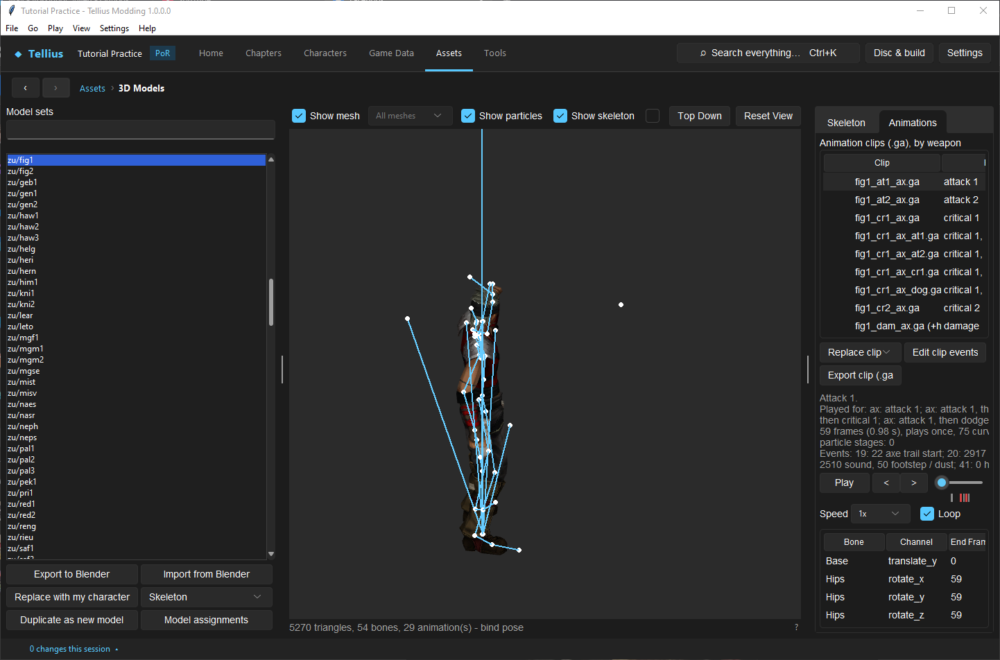
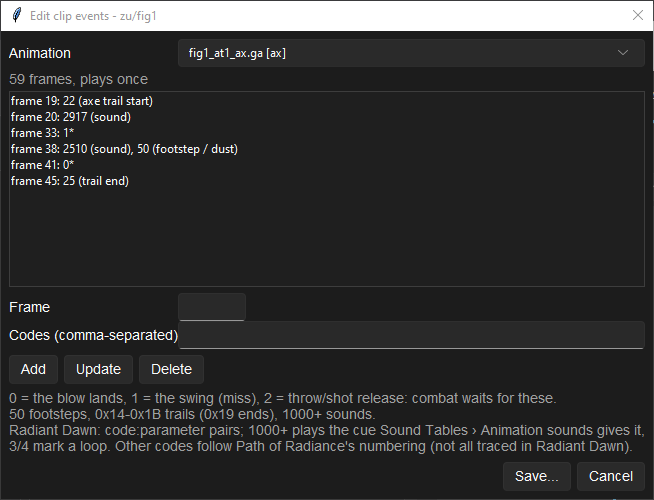

# Import animations and edit events

**Route:** Assets → 3D Models → **Animations** tab → Replace clip / Export clip (.ga) / Edit clip events

!!! warning "Imported animation needs game verification"
    The conversion and event validators are source-reviewed; imported rig animation has not completed Dolphin verification.

## What you will make

You will replace one animation clip on an existing skeleton, preserve its template role/loop/events unless deliberately overridden, align synchronization markers to the new motion, review range and bone warnings, and test the full action from entry through recovery.

## Before you begin

Select the exact map or battle model set and target `.ga`. Record filename, role, weapon pack, frame length, loop settings, bone tracks, event frames/codes, and the clips that transition before/after it. Export the set/glTF as a skeleton and naming reference.

In Blender, animate against that exact armature. Apply no destructive skeleton changes, keep bone names, avoid object-scale animation, and export one clearly named glTF animation. Note whether the clip should loop. For attack/projectile/effect roles, identify every original hit, swing, release, sound, visibility, or completion marker before import.

## How the editor fits together

A `.ga` stores transforms plus timing/loop/event metadata but no external symbolic name; the containing filename/registry/role table supplies identity. **Replace clip › From a .glb file** asks for a glTF and the existing animation it replaces, imports tracks against the selected set's skeleton, and uses the old `.ga` as a template.

If the glTF does not supply an event track, the importer preserves the old events and loop settings. If it does supply events, that track becomes authoritative. **Edit clip events** rewrites only the selected clip's event keys: frame plus one to four numeric codes.

## Guided walkthrough

### Choose the exact target

<!-- screenshot 53-a-setup.png -->
<figure class="tutorial-figure" markdown="1">

<figcaption markdown="span">**3D Models** on `zu/fig1`, the Fighter's battle model, **Animations** tab: the clips of each weapon archive with their role, frames and combat events; the selected attack plays on the skeleton with **Play** / **Pause** and its frame counter. **Replace clip › From a .glb file** and **Edit clip events** work on this set.</figcaption>
</figure>

Select the set in **Model sets** (`zu/fig1`, the Fighter) and open the **Animations** tab. **Animation clips (.ga), by weapon** lists one branch per weapon archive (*axe (ax)*, *hand axe (ha)*…) with, for each clip:

- **Role**: what the file name says it is (*attack 1*, *critical 1, followed by attack 1*, *dodge*…). Path of Radiance battle files follow `<model>_<role>_<weapon>`; Radiant Dawn's `att1_ax`, `cri1_ax`, `dog1_ax`… and its map clips `wait_1`, `atk_2`… are named too where the role is traced.
- **Frames** and **Combat events**: the frames of the hit (code 0), swing (1) and release (2) the fight waits for.
- A clip several weapons share is listed once, with the others in brackets (`fig1_dam_ax.ga (+ha)`): it is one file, and an import or an event edit changes every copy. When two archives hold different files of the same name, each is its own line and changes alone.

Selecting a clip shows what plays it (the `zu/<code>.dbx` roles on Path of Radiance, the weapons and motions of `FE10Anim` on Radiant Dawn's map units), its length in frames and seconds, whether it loops, and each event by name (*41: 0 hit*, *50 footstep / dust*, *2510 sound*). **Play** runs at the game's 60 frames a second; **Speed** slows it to 0.5x or 0.25x, **Loop** stops it at the last frame, **<** / **>** step one frame. The marks under the slider are the event frames (red: hit, swing, release); click one to go to it. The **Skeleton** tab lists the bones.

For battle models, confirm the weapon archive and role suffix (`at1`, `at2`, `cr1`, `dog`, `dam`, `ded`, combined follow-ups). Similar names are distinct presentation transitions. For map models, relate the file to the FE8Anim action mask.

### Import one clip

Press **Replace clip › From a .glb file**, choose the glTF, select its animation and the target it replaces, then import. Read current-versus-imported frame/track/event figures. Inspect warnings for unmatched joints, constant/bind tracks, fixed-point range, duration, and retained events.

Preview from frame 0 through the final recovery and across the loop boundary when applicable. Check root movement, foot contact, interpolation, weapon hand, and whether the last pose connects to the following idle/role.

If animation extremes exceed the body's encoded blended-vertex range, follow the review warning and reimport/rebuild the body using the complete animation set. Clipping numeric ranges is not a safe substitute.

### Edit a clip in Blender with Tellius Forge

[Tellius Forge](https://github.com/ltra043/tellius-forge), by Jade, is a Blender add-on that opens and writes `.ga` files directly. It is not part of the app (it is GPL-3.0): **Settings › Preferences › Download and install Tellius Forge** fetches it from its repository and installs it in the Blender set there.

1. Select the clip in the **Animations** tab, then **Export clip (.ga)**. The file is saved as stored, under its own name.
2. In Blender, import the model and the clip with Tellius Forge (*File › Import › FE9 & FE10 Animation*), edit, and export the action as `.ga`. Its guides cover the workflow: [animation workflow](https://github.com/ltra043/tellius-forge/blob/main/docs/animation-workflow.md), [which models' animations it handles](https://github.com/ltra043/tellius-forge/blob/main/docs/animation-compatibility.md). On Radiant Dawn, set the action's *ga_game_flag* to 1.
3. Back in the app, select the same clip and **Replace clip › From a .ga file**. The file must be the set's game format and animate only bones the set's skeleton has. A file without events (an action made in Blender has none) gets the replaced clip's events, moved in proportion to the new length; check them in **Edit clip events**.

Tellius Forge reads the battle (`zu/`) archives' clips once exported this way, but its own compatibility notes cover map models: test battle clips in **Simulate a battle…** and Dolphin.

### Copy a clip from another model

**Replace clip › From another model** replaces a clip of the selected set with another model's, with no export or import: from the same game (the male swordmaster's attack onto the female one) or from the other game (a Path of Radiance fighter's attack onto Radiant Dawn's, and back).

1. Select the clip to replace in the **Animations** tab (or pick it in the dialog), then **Replace clip › From another model**.
2. In **Copy from**, pick this project, a vanilla disc registered in *Settings › Vanilla discs* (the other game's included), or **Browse files folder...** for any extracted `files` folder.
3. Pick the model and its clip. The dialog proposes the clip it replaces: the same name without the set codes (`swm1_at1_sw.ga` → `swf1_at1_sw.ga`), else the same role (Path of Radiance's `fig1_at1_ax.ga` → Radiant Dawn's `att1_ax.ga`). Change it if needed, then **Copy** and review.

The clip is played on this set's skeleton: each bone matched by name (and `Head`/`_head_`, `Top`/`_top_` across the games) turns as the source bone deforms its mesh; the others keep their rest pose (the review lists both). A model sharing fewer than a quarter of the source's moving bones is refused: give it the animations with **Replace with my character**. Within a game the source clip's events come along; between the games the replaced clip's are kept and moved to the new length, since sound and effect numbers differ between the discs. Check them in **Edit clip events**, then in **Simulate a battle…** and Dolphin.

A copy replaces an existing clip; it does not add a clip the set lacks.

### Edit synchronization events

<!-- screenshot 53-c-events.png -->
<figure class="tutorial-figure" markdown="1">

<figcaption markdown="span">**Edit clip events**: one animation's event track, one key per line (frame and codes). **Frame** and **Codes (comma-separated)** with **Add**, **Update**, **Delete**; *0 = the blow lands, 1 = the swing (miss), 2 = throw/shot release*: combat waits for these. **Save...** writes the set.</figcaption>
</figure>

Open **Edit clip events**. **Animation** picks the clip (*59 frames, plays once*); the list shows one key per line, e.g. `frame 33: 1*` and `frame 41: 0*` (the asterisk marks codes the battle script waits for). Select a key to load it into **Frame** and **Codes (comma-separated)**, then **Update**; **Add** a new key, or **Delete** the selected one. Frames must be numeric and fall from 0 through the clip's frame count. Preserve unknown codes unless executable evidence assigns them.

Move markers to the frame where the new action visually reaches the synchronization point. Impact/swing markers coordinate hit/dodge presentation; release markers detach arrows/thrown weapons; effect markers transfer spells or select hit/miss stages; other markers can control visibility, dust, water, snow, or completion.

Press **Save…** to produce an Import Review. Required-event validation warns or rejects roles whose battle script would wait forever. Do not delete a required marker to silence a visual mismatch; adjust motion or marker timing.

### Review and test transitions

In Import Review, inspect proposed files and warnings, then **Write files**. Reopen the clip and verify events persisted. Test normal hit, miss/dodge, critical, double/follow-up, ranged release, damage, death, and skip/animation-off paths relevant to the role. Gameplay consequences are precomputed, but missing markers can stall or desynchronize presentation.

## Understand every control

- **Animations** tab, **Animation clips (.ga), by weapon**: each weapon archive's clips with role, frames and combat events; a shared clip once.
- **Play** / **Pause**, **<** / **>**, slider, *frame N/M*, **Speed**, **Loop** and the event marks: preview at the game's 60 frames a second.
- **Export clip .ga... / Replace clip › From a .ga file:** the selected clip to and from a `.ga` file (Tellius Forge).
- **Copy clip from another model...:** another model's clip, from this game or the other one, onto the selected set's clip.
- **Import animation…:** chooses source glTF animation and exact replacement target (a clip listed with several weapons changes in each). A glTF animation named `stem@ha` targets the hand-axe archive's copy; **Export to Blender** and **Skeleton › Export skeleton template** use the same names.
- **Template:** preserves target role, events, and loop data when source omits them.
- **Events… list:** ordered event keys shown by frame.
- **Frame:** callback position within `0..length_in_frames`.
- **Codes:** one to four raw numeric values owned by the active presenter.
- **Add / Update / Delete:** edits the in-dialog event list only.
- Code legend: *0 = the blow lands, 1 = the swing (miss), 2 = throw/shot release: combat waits for these.* *50 footsteps, 0x14-0x1B trails (0x19 ends), 1000+ sounds.*
- **Save…:** validates and opens Import Review; it is not yet the final write.
- **Write files:** commits proposed packed/loose `.ga` output.

## On Radiant Dawn

On Radiant Dawn, a unit's animations are in `.pak` archives beside its model. Each animation file ends with a chain of extra blocks instead of Path of Radiance's fixed table ([Model formats](../formats/model-formats.md)). Some of those blocks are not decoded yet, so check an imported clip's events in the preview and in the game. In a round trip, a bone that moves as in the game keeps the game's own keys, and only edited bones get new ones.

## Things to try next

1. **Move a hit frame.** In **Edit clip events**, move the code-0 key of `fig1_at1_ax.ga` two frames later, **Save...**, and compare the hit timing in **Simulate a battle…** ([Simulate and render a fight](56-battle-simulator.md)).
2. **Read the roles.** Compare the event tracks of `at1`, `cr1` and `dog`: which codes each role waits for.
3. **Footsteps.** Find the `50` codes of a run cycle and line them up with the feet.

## Interactions and precedence

Combat resolves hit/damage/strike order before animation. The role table selects a clip; its transforms pose the skeleton; event markers signal presentation callbacks; the state machine transitions to the next legal role. Markers do not create damage, but missing impact/release/completion markers can leave the presenter waiting.

Map and full-battle models use different registries and files. Editing one does not automatically update the other. Weapon/effect actors depend on anchors from the rig and timing from the clip.

## Test matrix

| Case | What to observe |
| --- | --- |
| frame 0 / final frame | no bind-pose pop; clean entry/exit |
| loop crossing | stable pose/root and intended loop metadata |
| hit | impact marker matches contact/effect |
| miss/dodge | defender and attacker callbacks remain synchronized |
| ranged/thrown | release marker detaches projectile once |
| critical/follow-up | correct role/fallback and event set |
| damage/death | reaction, fade, and teardown complete |
| weapon variants | selected pack uses edited target, others unchanged |
| skip/animation off | scene converges to identical gameplay state |
| rebuild/reload | frames, loop, events, and target identity persist |

## Troubleshooting

**The wrong clip changed.** Recheck selected set, weapon pack, and replacement target. glTF animation name alone does not select the game role.

**Motion twists or bones stay still.** Exported tracks target missing/misnamed joints or a different rest pose. Re-export against the exact skeleton.

**The fight waits forever.** Compare required original markers and import diagnostics. Restore missing impact/release/completion events.

**The event fires before visual contact.** Move its frame in **Edit clip events**; do not change combat timing to compensate for presentation.

**Preview works but vertices distort at extremes.** The body range was sized for older animations. Reimport the body with the new complete animation set.

## Save, build, and revert

Keep the source Blender/glTF, original event table, and target filename together. Write the reviewed output, run checks, reopen/preview, build, and execute the matrix in Dolphin.

Restore the original target `.ga` or model folder as one owning resource. If a body was rebuilt for animation range, restore body and animation together. Avoid partial rollback across packed and loose variants.

## Limits and confidence

Animation parsing/writing, template preservation, event editing, range validation, role-based marker ownership, and import review are source-reviewed. Unknown event codes remain deliberately undocumented, and local preview cannot validate every presenter callback, fallback, effect, sound, or skip route. Dolphin verification remains required.

## Related tutorials and references

- [Replace or fit a humanoid rig](52-replace-rig.md)
- [Round-trip a model through Blender safely](51-blender-round-trip.md)
- [Combat & Battle Animation](../systems/combat-animation.md)
- [FE8Anim.bin](../formats/fe8anim.md)
- [Model formats](../formats/model-formats.md)

---

[← Previous: Replace or fit a humanoid rig](52-replace-rig.md) · [All tutorials](index.md) · [Next: Edit weapon and scenery models within budgets →](54-model-budgets.md)
