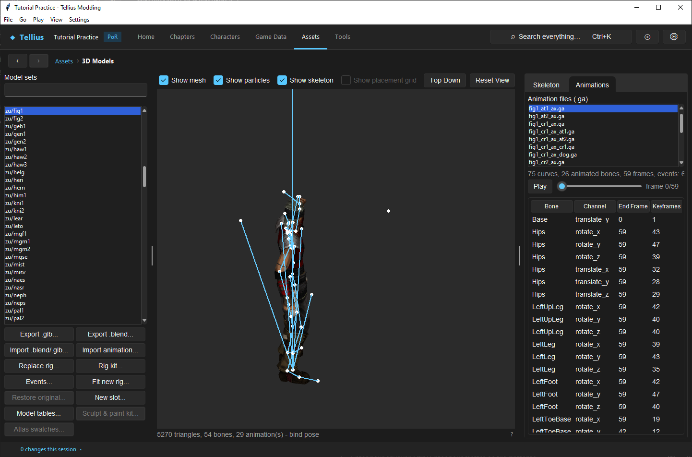
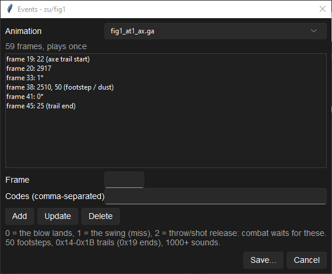

# Import animations and edit events

**Route:** Assets → 3D Models → Import animation… / Events…

!!! warning "Imported animation needs game verification"
    The conversion and event validators are source-reviewed; imported rig animation has not completed Dolphin verification.

## What you will make

You will replace one animation clip on an existing skeleton, preserve its template role/loop/events unless deliberately overridden, align synchronization markers to the new motion, review range and bone warnings, and test the full action from entry through recovery.

## Before you begin

Select the exact map or battle model set and target `.ga`. Record filename, role, weapon pack, frame length, loop settings, bone tracks, event frames/codes, and the clips that transition before/after it. Export the set/glTF as a skeleton and naming reference.

In Blender, animate against that exact armature. Apply no destructive skeleton changes, keep bone names, avoid object-scale animation, and export one clearly named glTF animation. Note whether the clip should loop. For attack/projectile/effect roles, identify every original hit, swing, release, sound, visibility, or completion marker before import.

## How the editor fits together

A `.ga` stores transforms plus timing/loop/event metadata but no external symbolic name; the containing filename/registry/role table supplies identity. **Import animation…** asks for a glTF and the existing animation it replaces, imports tracks against the selected set's skeleton, and uses the old `.ga` as a template.

If the glTF does not supply an event track, the importer preserves the old events and loop settings. If it does supply events, that track becomes authoritative. **Events…** rewrites only the selected clip's event keys: frame plus one to four numeric codes.

## Guided walkthrough

### Choose the exact target

<!-- screenshot 53-a-setup.png -->
<figure class="tutorial-figure" markdown="1">

<figcaption markdown="span">**3D Models** on `zu/fig1`, the Fighter's battle model, **Animations** tab: **Animation files (.ga)** lists the set's clips; the selected attack plays on the skeleton with **Play** / **Pause** and its frame counter. **Import animation…** and **Events...** work on this set.</figcaption>
</figure>

Select the set in **Model sets** (`zu/fig1`, the Fighter) and open the **Animations** tab: **Animation files (.ga)** lists the clips (`fig1_at1_ax.ga`, the first attack with an axe). Selecting one gives its curves, animated bones, frames and events (*75 curves, 26 animated bones, 59 frames, events: 6*); **Play** / **Pause** and the slider step through it (*frame 0/59*). The **Skeleton** tab lists the bones. Preview the original animation. For battle models, confirm the weapon pack and role suffix (`at1`, `at2`, `cr1`, `dog`, `dam`, `ded`, combined follow-ups). Similar names are distinct presentation transitions. For map models, relate the file to the FE8Anim action mask.

### Import one clip

Press **Import animation…**, choose the glTF, select its animation and the target it replaces, then import. Read current-versus-imported frame/track/event figures. Inspect warnings for unmatched joints, constant/bind tracks, fixed-point range, duration, and retained events.

Preview from frame 0 through the final recovery and across the loop boundary when applicable. Check root movement, foot contact, interpolation, weapon hand, and whether the last pose connects to the following idle/role.

If animation extremes exceed the body's encoded blended-vertex range, follow the review warning and reimport/rebuild the body using the complete animation set. Clipping numeric ranges is not a safe substitute.

### Edit synchronization events

<!-- screenshot 53-c-events.png -->
<figure class="tutorial-figure" markdown="1">

<figcaption markdown="span">**Events...**: one animation's event track, one key per line (frame and codes). **Frame** and **Codes (comma-separated)** with **Add**, **Update**, **Delete**; *0 = the blow lands, 1 = the swing (miss), 2 = throw/shot release*: combat waits for these. **Save...** writes the set.</figcaption>
</figure>

Open **Events...**. **Animation** picks the clip (*59 frames, plays once*); the list shows one key per line, e.g. `frame 33: 1*` and `frame 41: 0*` (the asterisk marks codes the battle script waits for). Select a key to load it into **Frame** and **Codes (comma-separated)**, then **Update**; **Add** a new key, or **Delete** the selected one. Frames must be numeric and fall from 0 through the clip's frame count. Preserve unknown codes unless executable evidence assigns them.

Move markers to the frame where the new action visually reaches the synchronization point. Impact/swing markers coordinate hit/dodge presentation; release markers detach arrows/thrown weapons; effect markers transfer spells or select hit/miss stages; other markers can control visibility, dust, water, snow, or completion.

Press **Save…** to produce an Import Review. Required-event validation warns or rejects roles whose battle script would wait forever. Do not delete a required marker to silence a visual mismatch; adjust motion or marker timing.

### Review and test transitions

In Import Review, inspect proposed files and warnings, then **Write files**. Reopen the clip and verify events persisted. Test normal hit, miss/dodge, critical, double/follow-up, ranged release, damage, death, and skip/animation-off paths relevant to the role. Gameplay consequences are precomputed, but missing markers can stall or desynchronize presentation.

## Understand every control

- **Animations** tab, **Animation files (.ga)**, **Play** / **Pause**, slider and *frame N/M*: previews the selected encoded clip.
- **Import animation…:** chooses source glTF animation and exact replacement target.
- **Template:** preserves target role, events, and loop data when source omits them.
- **Events… list:** ordered event keys shown by frame.
- **Frame:** callback position within `0..length_in_frames`.
- **Codes:** one to four raw numeric values owned by the active presenter.
- **Add / Update / Delete:** edits the in-dialog event list only.
- Code legend: *0 = the blow lands, 1 = the swing (miss), 2 = throw/shot release: combat waits for these.* *50 footsteps, 0x14-0x1B trails (0x19 ends), 1000+ sounds.*
- **Save…:** validates and opens Import Review; it is not yet the final write.
- **Write files:** commits proposed packed/loose `.ga` output.

## Things to try next

1. **Move a hit frame.** In **Events...**, move the code-0 key of `fig1_at1_ax.ga` two frames later, **Save...**, and compare the hit timing in **Simulate a battle…** ([Simulate and render a fight](56-battle-simulator.md)).
2. **Read the roles.** Compare the event tracks of `at1`, `cr1` and `dog`: which codes each role waits for.
3. **Footsteps.** Find the `50` codes of a run cycle and line them up with the feet.

## Interactions and precedence

Combat resolves hit/damage/strike order before animation. The role table selects a clip; its transforms pose the skeleton; event markers signal presentation callbacks; the state machine transitions to the next legal role. Markers do not create damage, but missing impact/release/completion markers can leave the presenter waiting.

Map and full-battle models use different registries and files. Editing one does not automatically update the other. Weapon/effect actors depend on anchors from the rig and timing from the clip.

## Test matrix

| Case | What to observe |
| --- | --- |
| frame 0 / final frame | no bind-pose pop; clean entry/exit |
| loop crossing | stable pose/root and intended loop metadata |
| hit | impact marker matches contact/effect |
| miss/dodge | defender and attacker callbacks remain synchronized |
| ranged/thrown | release marker detaches projectile once |
| critical/follow-up | correct role/fallback and event set |
| damage/death | reaction, fade, and teardown complete |
| weapon variants | selected pack uses edited target, others unchanged |
| skip/animation off | scene converges to identical gameplay state |
| rebuild/reload | frames, loop, events, and target identity persist |

## Troubleshooting

**The wrong clip changed.** Recheck selected set, weapon pack, and replacement target. glTF animation name alone does not select the game role.

**Motion twists or bones stay still.** Exported tracks target missing/misnamed joints or a different rest pose. Re-export against the exact skeleton.

**The fight waits forever.** Compare required original markers and import diagnostics. Restore missing impact/release/completion events.

**The event fires before visual contact.** Move its frame in **Events…**; do not change combat timing to compensate for presentation.

**Preview works but vertices distort at extremes.** The body range was sized for older animations. Reimport the body with the new complete animation set.

## Save, build, and revert

Keep the source Blender/glTF, original event table, and target filename together. Write the reviewed output, run checks, reopen/preview, build, and execute the matrix in Dolphin.

Restore the original target `.ga` or model folder as one owning resource. If a body was rebuilt for animation range, restore body and animation together. Avoid partial rollback across packed and loose variants.

## Limits and confidence

Animation parsing/writing, template preservation, event editing, range validation, role-based marker ownership, and import review are source-reviewed. Unknown event codes remain deliberately undocumented, and local preview cannot validate every presenter callback, fallback, effect, sound, or skip route. Dolphin verification remains required.

## Related tutorials and references

- [Replace or fit a humanoid rig](52-replace-rig.md)
- [Round-trip a model through Blender safely](51-blender-round-trip.md)
- [Combat & Battle Animation](../systems/combat-animation.md)
- [FE8Anim.bin](../formats/fe8anim.md)
- [Model formats](../formats/model-formats.md)

---

[← Previous: Replace or fit a humanoid rig](52-replace-rig.md) · [All tutorials](index.md) · [Next: Edit weapon and scenery models within budgets →](54-model-budgets.md)
