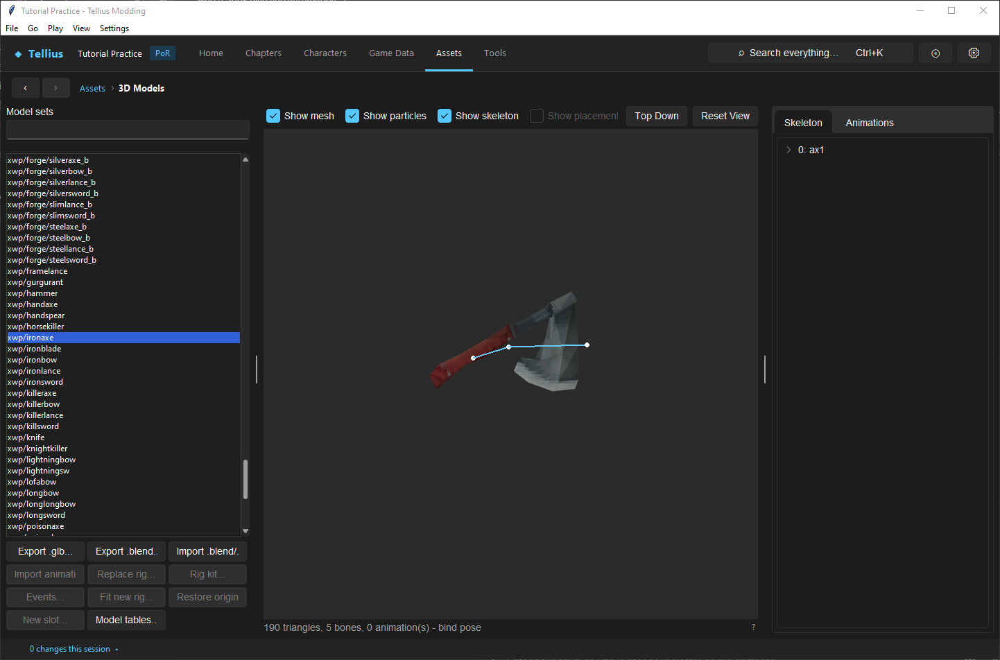

# Edit weapon and scenery models within budgets

**Route:** Assets → 3D Models → `xwp/` or `zbg/`

## What you will make

You will replace one supported static weapon or battle-scenery mesh, compare it with the slot's original and the retail corpus maxima, reduce excess geometry when necessary, and verify scale, attachment, materials, transparency, mip behavior, camera clearance, and built-game stability.

## Before you begin

Complete the Blender round trip. Avoid bows for the first exercise: bow strings/composite skinning are not supported by the ordinary static-weapon importer. Export the untouched set and record file size, triangles, vertices/positions, shapes, materials, textures, dimensions, and alpha mode from Import Review.

Create a fixed Battle Simulator setup using the asset. Record actors, weapon, distance, scenery, camera, hit/miss result, and animation role.

## How the editor fits together

`xwp/` contains attached weapon resources; `zbg/` contains battle scenery. **Export .glb…** converts the current slot. **Import .glb…** rebuilds the slot-specific `.gs`/texture output and opens Import Review. The review compares current and imported figures, lists files to write, and reports limits or above-retail values. Nothing changes before **Write files**.

The importer supports its documented material subset. Geometry, UVs, texture encoding, shape/render family, coordinate system, and model-local transforms jointly determine the result. Raising a count does not add engine support for an unsupported blend or skinning mode.

### Reference figures

Import Review compares the new model with the one it replaces and with the largest figures found on the disc. These are sizes the game is known to handle; no engine limit is known.

| Model kind | File size | Triangles | Positions | Bones used | Blended vertices |
| --- | --- | --- | --- | --- | --- |
| Map body (`ymu/<class>/body.gs`), median 444 triangles | 19,936 bytes | 853 | 715 | 70 | 0 |
| Battle model (`zu/<code>/<code>.gs`, 93 on the disc) | 209,636 bytes (`pal3`) | 8,840 (`drm2`) | 55 | 113 (`pal2`) | 5,800 (`pal3`) |
| Chapter terrain (`zmap/<map>/map.cmp` land), one bone | 393,868 bytes (`bmap25`) | 20,982 | 10,664 | 1 | 0 |
| Terrain `texpack.tpl` | 1,519,072 bytes | | | | |

Battle models draw almost everything as blended vertices (skinned on the CPU every frame); map bodies use none. A map-model import over 853 triangles opens **Map model size**: *The model has N triangles; vanilla map models have 444 (median) and at most 853.* **Reduce to** *n* **triangles** › **Reduce** shrinks it (edge collapses that keep UV seams, material borders and skin joints), **Keep all** imports it as it is, **Cancel** stops the import.

## Guided walkthrough

<!-- screenshot 54-a-setup.png -->
<figure class="tutorial-figure" markdown="1">

<figcaption markdown="span">The Iron Axe's weapon model (`xwp/ironaxe`) in **3D Models**: the triangle count under the preview is the first budget figure to compare after an import.</figcaption>
</figure>

Make one visible, low-risk change while retaining origin, scale, orientation, UVs, and material alpha family. Reuse the exported texture when possible. Preserve mip levels/appropriate texture size so a close preview does not hide distance shimmer.

Import into the exact source slot. In Import Review compare every figure, not only triangles. A low triangle count can still create too many shapes/material state changes or oversized textures. Treat values above the retail maximum as an explicit research risk, not spare capacity promised by the engine.

If the model is excessive, remove hidden/internal faces, merge coplanar/detail geometry, reuse vertices/materials, and reduce texture dimensions before using automatic reduction. When reduction is used, reopen the reduced glTF and inspect silhouette, UV seams, normals, thin parts, and weapon tips.

Write the files, reopen the set, and rotate/zoom the preview. Render the fixed fight from near/far and both actor sides. Check hand alignment, ground intersection, back-face disappearance, transparency sorting, projectile path, camera obstruction, and scenery scale. Build and repeat in Dolphin.

## Understand every control

- **Export .glb…:** creates the editable reference at the selected slot's scale/origin.
- **Import .glb…:** converts but does not immediately write.
- **Import Review figures:** current/imported resource costs and structural changes.
- **Warnings:** unsupported or above-reference conditions requiring correction or game evidence.
- **Reduce mesh:** trades geometric detail for budget; it does not repair UV/material design.
- **Write files / Restore original…:** transaction commit and whole-resource recovery.

## Things to try next

1. **Read a retail outlier.** Open `zu/drm2` and `zu/pal3` and read their figures under the preview: they set the battle references.
2. **Reduce a map model.** Export a battle model as `.glb`, import it onto a map model slot made with **New slot...**, and choose **Reduce** to 800 triangles; compare the silhouette.
3. **A texture budget.** Halve a weapon texture and compare the file size in Import Review.

## Interactions and precedence

The weapon definition chooses a presentation resource, the battle actor attaches it to a rig anchor, and the asset's local transform positions it. Scenery selection and camera staging decide visibility. A mechanically correct weapon can have a broken model without changing combat results.

Texture alpha and shape flags determine render-list behavior; app preview cannot reproduce every GX state, trail, or particle interaction. Budget safety is multi-dimensional: geometry, shapes, textures, file size, and scene concurrency all matter.

## Test matrix

| Case | Check |
| --- | --- |
| static preview | scale, normals, UVs, alpha, all angles |
| idle/attack/critical | hand attachment and no body intersection |
| ranged/thrown | travel orientation and release position |
| near/far camera | mip stability and silhouette |
| left/right actor | mirroring/culling and camera clearance |
| hit/miss/death | effect/weapon/scenery coexistence |
| busiest scene | memory/performance with both actors and effects |
| clean rebuild | exact slot resolves and remains stable in Dolphin |

## Troubleshooting

**Weapon floats or clips.** Compare origin/local transform and the rig's hand anchor; scaling geometry around the wrong origin changes attachment.

**Faces vanish from one side.** Fix winding/normals or use the supported cull/material contract; duplicating every face inflates the budget.

**Transparent parts render incorrectly.** Match a retail material in the same render family and finish in Dolphin.

**Review is red despite modest triangles.** Inspect shapes, positions, textures, and file size separately.

## Save, build, and revert

Write only the reviewed file set, run checks, reopen, render, build, and test in Dolphin. Keep the source glTF plus baseline figures. Revert with **Restore original…** for the entire slot; restore related texture outputs together.

## Limits and confidence

Static import contracts, review figures, resource outputs, and retail comparisons are source-reviewed. Skinned bows, unsupported material modes, and values above the retail corpus remain unproven. The app omits some GX, trail, and particle behavior.

## Related tutorials and references

- [Round-trip a model through Blender safely](51-blender-round-trip.md)
- [Edit battle presentation](55-battle-presentation.md)
- [Battle Staging](../systems/battle-staging.md)
- [Model formats](../formats/model-formats.md)

---

[← Previous: Import animations and edit events](53-animation-import.md) · [All tutorials](index.md) · [Next: Edit battle presentation →](55-battle-presentation.md)
