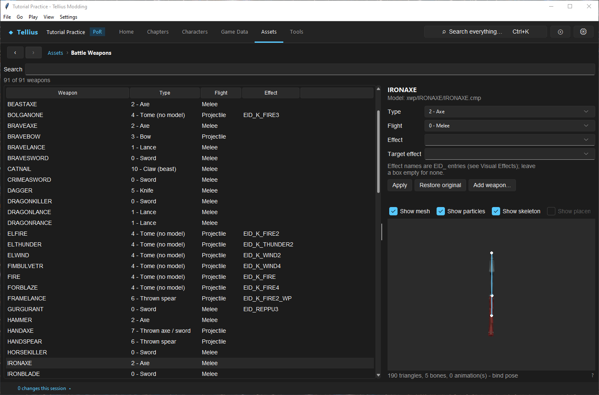
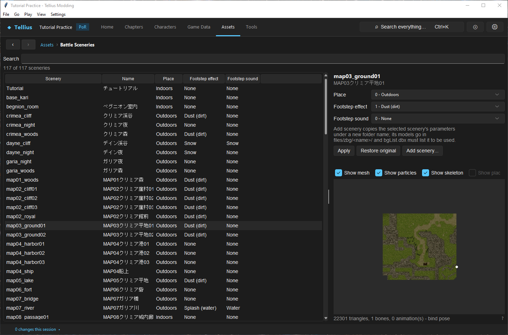
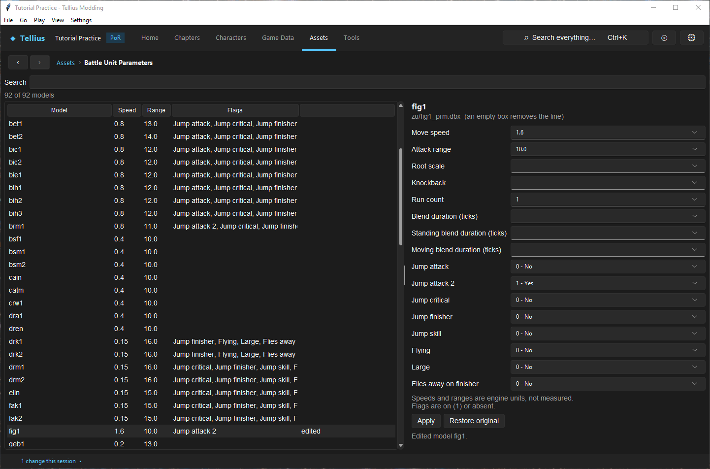

# Edit battle presentation

**Route:** Assets → Battle Weapons / Battle Sceneries / Battle Unit Parameters

## What you will make

You will read how a battle scene is put together from three tables of the battle archive: the weapon a unit holds, the backdrop it fights on, and how its battle model moves. Then you will make one controlled change, doubling how fast the Fighter's battle model moves, compare the same fight before and after with **Render fight**, and restore the original. Cameras, the battle HUD and spell effects have lessons of their own: [Edit battle cameras](70-battle-cameras.md), [Edit DBX files and the battle HUD](71-dbx-files-and-hud.md) and [Edit visual effects and particles](69-visual-effects.md).

## Before you begin

- Set up the fixture of [Simulate and render a fight](56-battle-simulator.md): Ike against Boyd, **Distance** 1, **Random** seed 1, **Scenery** `map03_ground01`. Render it once and note how far Boyd runs before he strikes.
- These pages change presentation only. The strike log (who hits, for how much) must be the same before and after every edit in this lesson.

## How the editor fits together

The battle engine stages a fight from small text tables (`.dbx`) stored in the archive `zdbx.cmp`, one file per weapon, scenery or battle model:

| Page | Table | What it decides |
| --- | --- | --- |
| **Battle Weapons** | `xwp/<NAME>.dbx` | Which weapon actor an item gets in battle (its model in `xwp/<name>/`), how it is held (**Type**), whether it flies (**Flight**), and which effects play with it |
| **Battle Sceneries** | `zbg/<scenery>/param.dbx` | Whether a backdrop is indoors or outdoors, and the footstep effect and sound of units on it |
| **Battle Unit Parameters** | `zu/<code>_prm.dbx` | How a battle model moves and attacks: speed, attack range, run count, blending, jump attacks, flying, size |

Which battle model a unit uses comes from the battle job list (see [Give a character unique models](12-character-model-slot.md)); which scenery a map uses, from its **Battle scenes** tab ([Assign battle scenery by map and terrain](28-battle-backgrounds.md)). An item's battle weapon is found by its name without `IID_`.

All three pages work the same way: a searchable table, a form for the selected entry, **Apply**, **Restore original**, and a 3D preview when the entry has a model. **Apply** writes `zdbx.cmp` at once; the first edit of an entry keeps the vanilla text, which **Restore original** puts back. Edited rows are marked *edited*.

## Guided walkthrough

### 1. Read a weapon

<!-- screenshot 55-a-setup.png -->
<figure class="tutorial-figure" markdown="1">

<figcaption markdown="span">**Assets › Battle Weapons** with `IRONAXE`: its **Type** (`2 - Axe`), **Flight** (`Melee`), **Effect** and **Target effect** (`EID_` names, empty for none), and the model it uses (`xwp/IRONAXE/IRONAXE.cmp`) in the preview.</figcaption>
</figure>

Open **Assets → Battle Weapons** and select `IRONAXE`. The form shows **Type** `2 - Axe`, **Flight** `0 - Melee`, and empty **Effect** and **Target effect** boxes (an iron axe plays no special effect). The line under the name gives the model file, `xwp/IRONAXE/IRONAXE.cmp`, drawn in the preview. Compare with `FIRE`: **Type** `4 - Tome (no model)`, **Flight** `1 - Projectile`, **Effect** `EID_K_FIRE`.

### 2. Read a scenery

<!-- screenshot 55-sceneries.png -->
<figure class="tutorial-figure" markdown="1">

<figcaption markdown="span">**Assets › Battle Sceneries** with `map03_ground01`, the plain behind the simulator's fights: **Place** (outdoors or indoors), **Footstep effect** and **Footstep sound**, and the backdrop model.</figcaption>
</figure>

Open **Battle Sceneries** and select `map03_ground01`, the plain used by the fixture. **Place** is `0 - Outdoors`, **Footstep effect** `1 - Dust (dirt)`, **Footstep sound** `0 - None`. The **Name** column is the label from `bgList.dbx`, the list of sceneries the game knows.

### 3. Change how the Fighter moves

<!-- screenshot 55-c-params.png -->
<figure class="tutorial-figure" markdown="1">

<figcaption markdown="span">**Assets › Battle Unit Parameters** with `fig1`, the Fighter's battle model: **Move speed** and **Attack range** (engine units), run count, blend durations, and the jump, flying, large and finisher flags. An empty box removes the line.</figcaption>
</figure>

1. Open **Battle Unit Parameters** and select `fig1`, the Fighter's battle model (Boyd's).
2. Read its values: **Move speed** 0.8, **Attack range** 10.0, **Run count** 1, **Jump attack 2** `1 - Yes`, every other flag `0 - No`, the blend boxes empty (the engine default).
3. Set **Move speed** to `1.6` and press **Apply**.

<!-- screenshot 55-b-result.png -->
<figure class="tutorial-figure" markdown="1">

<figcaption markdown="span">**Move speed** of `fig1` doubled from 0.8 and applied: the row is marked *edited* and the status says *Edited model fig1.* The change is written to `zdbx.cmp` at once; **Restore original** brings back the vanilla text.</figcaption>
</figure>

The row now reads 1.6 and *edited*, and the status says *Edited model fig1.*

### 4. Compare and restore

1. Close the **Battle Simulator - fight** window if it is open (it reads the battle archive once, when it opens). In **Tools → Battle Simulator**, press **Render fight** with the same fixture: Boyd covers the same distance in about half the time, and the log is unchanged.
2. Back in **Battle Unit Parameters**, select `fig1` and press **Restore original**: the speed returns to 0.8 and the *edited* mark disappears.

## Understand every control

### Shared by the three pages

| Control | What it does |
| --- | --- |
| **Search** | Filters the table by entry name. |
| Table | One row per entry; *edited* marks entries changed in this project. |
| **Apply** | Writes the form's values into the entry in `zdbx.cmp`. *No change.* when nothing differs. |
| **Restore original** | Puts back the vanilla text of the selected entry. *Already the original.* when it is. |
| Preview | The entry's model, when it has one (**Show mesh**, **Show particles**, **Show skeleton**, **Top Down**, **Reset View**). |

### Battle Weapons

| Field | Values | Meaning |
| --- | --- | --- |
| **Type** | 0 Sword, 1 Lance, 2 Axe, 3 Bow, 4 Tome (no model), 5 Knife, 6 Thrown spear, 7 Thrown axe / sword, 8 Wave blade (Rune/Sonic sword), 9 Arrow, 10 Claw (beast), 11 Breath (dragon) | How the weapon is held and used in battle |
| **Flight** | 0 Melee, 1 Projectile, 2 Special (wave) | Whether something leaves the attacker |
| **Effect** | an `EID_` name or empty | The effect played with the attack (see Visual Effects) |
| **Target effect** | an `EID_` name or empty | The effect played on the target |
| **Add weapon…** | | Asks for the item name without `IID_` (`DEVILAXE`) and whether it has a model in `files/xwp/<NAME>/<NAME>.cmp`, then adds its table. |

### Battle Sceneries

| Field | Values | Meaning |
| --- | --- | --- |
| **Place** | 0 Outdoors, 1 Indoors | Indoor or outdoor backdrop |
| **Footstep effect** | 0 None, 1 Dust (dirt), 2 Splash (water), 3 Snow, 4 Grass | Particles under moving units |
| **Footstep sound** | 0 None, 1 Dirt, 2 Water, 3 Snow, 4 Grass | Their footstep sound |
| **Add scenery…** | | Copies the selected scenery's parameters under a new folder name. Its models go in `files/zbg/<name>/`, and `bgList.dbx` must list it before maps can use it. |

### Battle Unit Parameters

| Field | Meaning |
| --- | --- |
| **Move speed** | How fast the model runs to its target (engine units; required) |
| **Attack range** | How close it gets before striking (engine units) |
| **Root scale** | Scale of the model's root |
| **Knockback** | How far it is pushed back when hit |
| **Run count** | Number of run cycles before the strike |
| **Blend duration (ticks)**, **Standing blend duration (ticks)**, **Moving blend duration (ticks)** | How long animations blend into each other; empty uses the engine default |
| **Jump attack**, **Jump attack 2**, **Jump critical**, **Jump finisher**, **Jump skill** | Whether that attack uses a jump |
| **Flying** | The model flies (pegasus, wyvern, bird laguz) |
| **Large** | A large model (dragons), framed differently |
| **Flies away on finisher** | Leaves the screen after a finishing blow |

An empty box removes the line from the file; flags are on (1) or absent. Speeds and ranges are engine units, not measured in tiles. Texture lines of the same files are edited in **Assets → 3D Models**.

## Things to try next

1. **A thrown weapon.** Compare `HANDAXE` (`7 - Thrown axe / sword`, `Projectile`) with `IRONAXE`, then render a fight at **Distance** 2 with a Hand Axe.
2. **Snowy footsteps.** Set a scenery's **Footstep effect** and **Footstep sound** to `3 - Snow`, render a fight on it, then restore it.
3. **A jump.** Turn on **Jump critical** for `fig1`, fix a critical in the simulator, and render.
4. **A new weapon actor.** After making a weapon model ([Edit weapon and scenery models within budgets](54-model-budgets.md)), **Add weapon…** with its item name and check it in **Render fight**.

## Interactions and precedence

- The item record (Game Data) decides the numbers; these tables decide only what the fight looks like.
- A weapon's battle table is found by the item's name; renaming the item breaks the link.
- Several battle models share a parameter file only if they share a code; editing `fig1` changes every unit using the Fighter battle model.
- Effects named here must exist in the effect registry (Visual Effects), or nothing plays.
- Cameras follow the actors: a faster or longer run changes what the camera frames ([Edit battle cameras](70-battle-cameras.md)).

## Test matrix

| Case | Setup | Expected result |
| --- | --- | --- |
| Baseline | Fixture rendered with vanilla tables | Boyd's run and strike as recorded |
| Intended change | `fig1` **Move speed** 1.6 | Faster run; identical strike log |
| Boundary | **Move speed** emptied | Refused: *cannot be empty* (it is required) |
| Likely failure | A weapon **Effect** naming an unregistered `EID_` | No effect plays; check Visual Effects |

## Troubleshooting

| Symptom | Likely cause | What to do |
| --- | --- | --- |
| The weapon is missing in battle | No table in `xwp/`, or *No Model block* | **Add weapon…** with a model, or check the item's name |
| The change does not show in **Render fight** | The renderer read the file before the edit | Close and reopen the render window |
| A unit runs through its target | **Attack range** too small for its model | Restore, then change the value in small steps |
| Footstep particles do not show | The renderer approximates particles | Check in Dolphin |

## Save, build, and revert

**Apply** writes `zdbx.cmp` immediately and logs the change in **Changes this session**; there is no separate save. **Restore original** reverts one entry. Build the disc to test in game.

## Limits and confidence

- The table formats and the three pages are source-reviewed; the `fig1` edit, its render and its restore were done in the app (app-tested).
- The meaning of the speed and range units, the blend defaults and some flags come from the files and their names; their exact effect in game is not measured.
- The app's renderer approximates particles, trails and some timing. Check the final look in Dolphin.

## Related tutorials and references

- Before: [Edit weapon and scenery models within budgets](54-model-budgets.md), [Simulate and render a fight](56-battle-simulator.md)
- Next: [Edit visual effects and particles](69-visual-effects.md), [Edit battle cameras](70-battle-cameras.md), [Edit DBX files and the battle HUD](71-dbx-files-and-hud.md)
- Reference: [Battle Staging & Camera](../systems/battle-staging.md), [ZDBX & DBX](../formats/zdbx.md), [Combat & Battle Animation](../systems/combat-animation.md)

---

[← Previous: Edit weapon and scenery models within budgets](54-model-budgets.md) · [All tutorials](index.md) · [Next: Simulate and render a fight →](56-battle-simulator.md)
