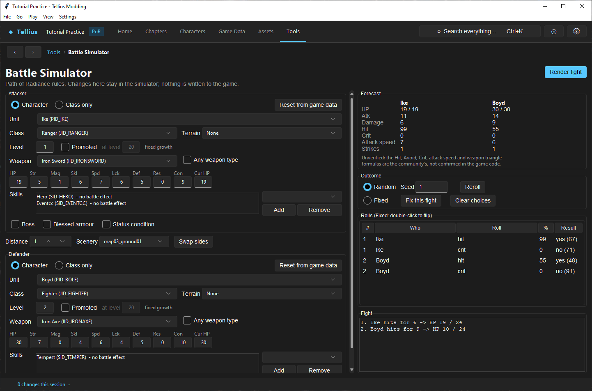
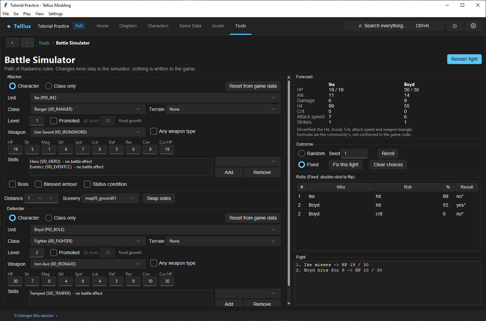
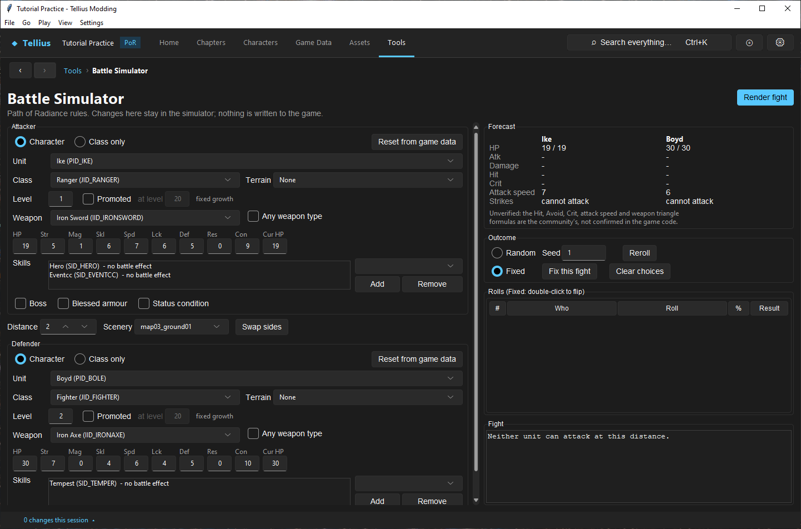
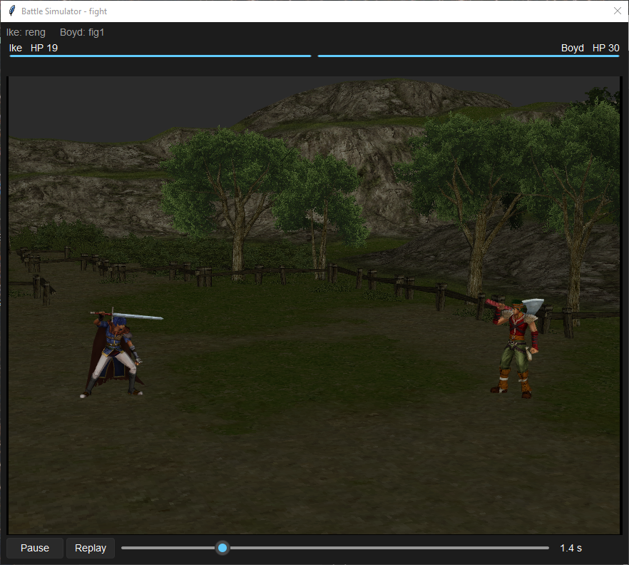

# Simulate and render a fight

**Route:** Tools → Battle Simulator (also **Simulate a battle…** on a character's **Portrait & models** tab)

## What you will make

You will set up one fight that always comes out the same: Ike attacking Boyd with iron weapons. You will read its forecast and its strike log line by line, force one roll to the other outcome, try a distance at which neither unit can attack, and then watch the same fight with **Render fight**. At the end you can tell which questions the simulator answers (the numbers and the strike order) and which only the built game answers.

## Before you begin

- Save, or at least **Apply**, every Game Data edit you want the simulator to use. It reads the shared FE8Data.bin session, so an applied but unsaved edit is already visible here, and a discarded one disappears.
- Nothing you change on this page is written to the game. You can try values freely.
- Keep the example values below until the end of the walkthrough. Every number quoted here comes from an unmodified USA disc.

## How the editor fits together

The page has three parts:

- **Attacker** (top left) and **Defender** (bottom left). Each side builds one temporary unit from a character or a bare class in FE8Data.bin, at a level you choose, with its weapon, skills and a few battle flags.
- The **battle bar** between them: **Distance**, **Scenery** and **Swap sides**.
- The results (right): **Forecast**, **Outcome**, **Rolls (Fixed: double-click to flip)** and **Fight**.

Every change runs the fight again after a short pause; there is no "run" button. The maths are the Path of Radiance rules in `battle_sim`: Hit uses two rolls averaged and Crit one roll, a critical hit triples damage, and a unit attacks twice when its attack speed is at least the opponent's plus 4. The caption under the forecast says what is not confirmed: the Hit, Avoid, Crit, attack speed and weapon triangle formulas are the community's, not read from the game code.

**Render fight** takes the resolved fight (who strikes, hit or miss, damage, death) and stages it with battle models, weapons, animations, the camera and the scenery. It does not roll again: what you see is the log you just read.

## Guided walkthrough

### 1. Build the baseline fixture

<!-- screenshot 56-a-setup.png -->
<figure class="tutorial-figure" markdown="1">

<figcaption markdown="span">The baseline fixture: Ike (Ranger, level 1, Iron Sword) attacks Boyd (Fighter, level 2, Iron Axe) at **Distance** 1, **Random** with **Seed** 1. The **Forecast**, the **Rolls** list and the **Fight** log on the right follow every change at once.</figcaption>
</figure>

1. Open **Tools → Battle Simulator**.
2. In **Attacker**, keep **Character** and choose **Unit** `Ike (PID_IKE)`. The class (`Ranger (JID_RANGER)`), **Level** 1 and **Weapon** `Iron Sword (IID_IRONSWORD)` fill in from the game data.
3. In **Defender**, keep **Character** and choose **Unit** `Boyd (PID_BOLE)`. He comes in as a level 2 Fighter with an Iron Axe.
4. Leave **Distance** at 1, **Scenery** at `map03_ground01`, both **Terrain** boxes at `None`, and **Outcome** on **Random** with **Seed** `1`.

Read the forecast and compare it with the stat rows:

| Row | Ike | Boyd | Where it comes from |
| --- | --- | --- | --- |
| HP | 19 / 19 | 30 / 30 | **Cur HP** / the HP stat |
| Atk | 11 | 14 | Str + weapon Might, ±1 for the weapon triangle (the sword beats the axe) |
| Damage | 6 | 9 | Atk − the opponent's Def (+ terrain defence) |
| Hit | 99 | 55 | weapon Hit + Skl × 2 + Lck ÷ 2, ±10 for the triangle, − the opponent's Avoid; clamped to 0–100 |
| Crit | 0 | 0 | weapon Crit + Skl ÷ 2 − the opponent's Lck |
| Attack speed | 7 | 6 | Spd − max(0, weapon weight − **Con**) |
| Strikes | 1 | 1 | `x2` when attack speed ≥ the opponent's + 4 |

Then read the **Fight** log: `1. Ike hits for 6 -> HP 19 / 24` and `2. Boyd hits for 9 -> HP 10 / 24`. The pair after `HP` is always attacker / defender: Boyd is at 24 after the first strike and Ike at 10 after the second.

The **Rolls** table lists every roll the fight asked for, in order: strike number, who, what (`hit`, `crit`, or a skill), the chance, and the result with the number rolled. `yes (67)` means the hit chance was 99 and the averaged roll was 67, under it.

### 2. Force one roll

<!-- screenshot 56-c-fixed.png -->
<figure class="tutorial-figure" markdown="1">

<figcaption markdown="span">**Fix this fight** copies every roll of the random fight into **Fixed** mode; double-clicking Ike's first hit roll flipped it (marked `*`). The fight is re-run with only that change.</figcaption>
</figure>

1. Press **Fix this fight**. **Outcome** switches to **Fixed** and every roll of the current fight is kept as a fixed choice, marked `*` in **Result**.
2. Double-click Ike's first `hit` row. It flips to `no*` and the fight runs again: `1. Ike misses -> HP 19 / 30`, then Boyd's strike as before.

Ike's `crit` row is gone: a miss never asks for a crit roll, so the list of rolls depends on the earlier results. **Clear choices** drops every fixed choice.

Use **Fixed** whenever you compare two setups: change one input, keep the same choices, and the difference in the log comes from your change only. **Reroll** goes back to **Random** with a new seed; typing a seed again replays that fight exactly.

### 3. Try a boundary

<!-- screenshot 56-d-distance.png -->
<figure class="tutorial-figure" markdown="1">

<figcaption markdown="span">The boundary case: at **Distance** 2 neither iron weapon reaches, so the forecast reads *cannot attack* for both sides and no roll is asked for.</figcaption>
</figure>

Set **Distance** to 2. Iron weapons reach 1 tile, so **Strikes** reads `cannot attack` for both sides, the rolls table is empty and the log says *Neither unit can attack at this distance.* Set **Distance** back to 1.

Do the same around any threshold you rely on: one point of Spd below and at the doubling limit, the exact lethal damage, the minimum and maximum range of a bow or tome.

### 4. Render the fight

<!-- screenshot 56-b-result.png -->
<figure class="tutorial-figure" markdown="1">

<figcaption markdown="span">**Render fight** stages the baseline fight with the battle models (`zu/reng` against `zu/fig1`), the weapons, camera and the **Scenery** `map03_ground01`; **Pause**, **Replay** and the time slider scrub it. It checks presentation; the forecast and log check the numbers.</figcaption>
</figure>

1. Make sure **Outcome** is back on **Random** with **Seed** `1` (press **Clear choices** if needed).
2. Press **Render fight**. The **Battle Simulator - fight** window opens and plays the fight: Ike's battle model `zu/reng` against Boyd's `zu/fig1`, on the chosen **Scenery**.
3. Use **Pause**, **Replay** and the time slider to stop on Ike's strike and check the weapon in his hand, the camera and the HP bars.

The render follows the log from step 1. If a strike looks wrong here but the log is right, the problem is in presentation data (models, animations, battle weapons, cameras), not in the stats.

## Understand every control

### Each side (Attacker, Defender)

| Control | What it does | How to choose |
| --- | --- | --- |
| **Character** / **Class only** | Build the unit from a character record (personal bases, growths, skills) or from a bare class (class bases, Luck 0, class skills). | **Character** to test a real unit; **Class only** for a generic enemy of that class. |
| **Reset from game data** | Reloads stats, skills and weapons from FE8Data.bin, dropping your edits on this side. | After an experiment, before the next comparison. |
| **Unit** | The character (disabled in **Class only**). | |
| **Class** | The class the unit fights in. Another class keeps the character's personal values. | A promoted class shows a promoted unit. |
| **Terrain** | The terrain type the unit stands on; the list shows its avoid / defence / resistance bonuses. | The tile the unit would really stand on. |
| **Level** | The level to reach. A character cannot go below their base level. | |
| **Promoted** / **at level** | Level in the start class up to **at level** (10–20), promote, then level in the promoted class to **Level**. Only for an unpromoted class that has a promotion. | The level the player would promote at; 20 by default. |
| *fixed growth* | Reminder that levels are gained in the game's fixed growth mode: each level adds the growth rate to a counter and pays one point per 100 (90 with `SID_FRAC90`), starting from the character's **Fixed growth start**. | Random growth is not simulated. |
| **Weapon** | The equipped weapon, limited to the class's weapon ranks. `(unarmed)` is always offered. | |
| **Any weapon type** | Lists every combat weapon, whatever the class can wield. | Only to try a weapon the class cannot use in game. |
| **HP Str Mag Skl Spd Lck Def Res** | The stats after levelling. Type a value, or use Up/Down in a box. | Edit to test "what if this unit had 1 more Spd". |
| **Con** | Build: the class's build plus the character's own, which can be negative (Boyd: Fighter 12, personal −2, so 10). Compared with weapon weight for attack speed. | |
| **Cur HP** | HP at the start of the fight, at most the HP stat. | Lower it to test Wrath or a lethal strike. |
| **Skills** / **Add** / **Remove** | The unit's skills, personal then class. A skill the simulator does not model is listed with *no battle effect* (Hero, Tempest…). | Add a skill to see its proc in the rolls table. |
| **Boss** | Marks the unit as a boss, so weapons effective against bosses apply. | |
| **Blessed armour** | The unit takes 0 Attack from weapons without the `weakA` property. | |
| **Status condition** | The unit is under a status: hits against it are 100%. | |

### Battle bar and results

| Control | What it does |
| --- | --- |
| **Distance** | Tiles between the two units (1–10). Decides who can attack and counter. |
| **Scenery** | The battle backdrop (`zbg/` folder), used by **Render fight** only. It changes no number. |
| **Swap sides** | Exchanges attacker and defender, keeping each side's unit, class and weapon. |
| **Forecast** | Each side's HP, Atk (marked *effective* when effectiveness applies), Damage, Hit, Crit, Attack speed and Strikes. `-` means the side cannot attack. |
| **Random** / **Seed** / **Reroll** | Roll the fight from a seed: the same seed and inputs give the same fight. **Reroll** picks a new seed. |
| **Fixed** / **Fix this fight** / **Clear choices** | Decide the rolls yourself. **Fix this fight** keeps the current random fight's results; **Clear choices** empties them. |
| **Rolls (Fixed: double-click to flip)** | Every roll in order. In **Fixed** mode a double-click flips one; `*` marks a fixed choice. |
| **Fight** | The strike log: number, striker, `hits` / `crits` / `misses`, damage, skill names in brackets, heal, `defeated`, and HP attacker / defender after the strike. |
| **Render fight** | Opens **Battle Simulator - fight** and plays the current log. |

### Render window

**Pause**, **Replay** and the time slider control playback. The top line names each side's battle model (`Ike: reng`), from the battle job list. A note replaces the picture when neither unit has a battle model, or when a model cannot be loaded.

## Things to try next

1. **A doubling threshold.** Raise Ike's **Spd** from 7 to 9: attack speed 9 against Boyd's 6 is not enough. At 10, **Strikes** turns to `1 x2`.
2. **A promoted unit.** Tick **Promoted** on Ike, keep **at level** 20 and set **Level** 1: he becomes a Lord with his Ranger levels carried through the promotion. Compare with a level 20 Ranger.
3. **A skill proc.** Add Luna to Ike, press **Fix this fight**, then flip the Luna row to compare the damage with and without it in the same fight.
4. **Terrain.** Put Boyd on Thicket (avoid 10, defence 1): Ike's Hit and Damage fall by those amounts.
5. **Your own data.** Change the Iron Axe's Might in **Game Data → Items** and **Apply**: the forecast here already uses the new value.

## Interactions and precedence

- The order is fixed: who can attack (weapon, range, unarmed) → forecast → rolls → strikes → presentation. A side that cannot attack asks for no roll.
- Character values are added to the class's: bases plus personal bonus, class build plus personal build, growth rates plus class growth modifiers.
- **Class** and **Promoted** decide which class bases and caps apply. The model in **Render fight** follows the battle job list for that class and character.
- Skills are matched by their table position or `SID_` label: a skill renamed but left at its position keeps its effect.
- Effectiveness doubles Might; **Boss** adds the `boss` category that some weapons are effective against.

## Test matrix

| Case | Setup | Expected result |
| --- | --- | --- |
| Baseline | Ike vs Boyd, Distance 1, Random seed 1 | Forecast and log as in step 1 |
| Intended change | **Fixed**, Ike's first hit flipped | Ike misses, his crit row disappears, Boyd's strike unchanged |
| Boundary | Distance 2 | Both sides `cannot attack`, no rolls |
| Likely failure | **Weapon** `(unarmed)` on the attacker | The attacker cannot attack; only the defender's counter is rolled |

## Troubleshooting

| Symptom | Likely cause | What to do |
| --- | --- | --- |
| The same setup gives another fight | **Random** with another seed, or a field edited by accident | Type the seed again, or **Fix this fight** before comparing |
| A weapon is missing from **Weapon** | The class has no rank in that weapon type | Tick **Any weapon type**, or check the class's weapon ranks |
| A skill does nothing | It is listed *no battle effect*, or its proc is rolled but not modelled (Colossus, Corrosion, Impact, Snipe's sleep, Sunlight) | Read the rolls table; test the effect in Play or Dolphin |
| The forecast ignores a Game Data edit | The edit was discarded, or never applied | **Apply** it in Game Data, then **Reset from game data** here |
| **Render fight** shows a note instead of a fight | No battle model in the job list for this class and character | Check **Assets → 3D Models › Model tables…** |

## Save, build, and revert

Nothing on this page is saved: closing the app forgets the fixture. Write down the inputs (units, levels, weapons, distance, seed or fixed choices) when a fight is evidence for a change. To act on a result, edit the owning record in Game Data, save FE8Data.bin, press **Reset from game data** here, then build and check the same fight in Dolphin.

## Limits and confidence

- The forecast and strike engine, skill effects and fixed growth are source-reviewed against `battle_sim`; the fight on this page was run in the app on an unmodified disc (app-tested).
- The Hit, Avoid, Crit, attack speed and triangle formulas are the community's and unknown in the game code, as the page says. Astra's halved damage is confirmed; Deathblow and Aether's form are not.
- Random growth, weapon uses, experience, support bonuses, biorhythm and map rules (Canto, rescue) are not simulated here. Use [Play](58-play-chapter.md) for those.
- The render approximates particles, trails and some timing. Check the final look in Dolphin.

## Related tutorials and references

- Before: [Create an item or weapon](17-items-and-weapons.md), [Edit and redistribute skills](18-skills.md), [Create and link a class](16-classes.md)
- Next: [Edit battle presentation](55-battle-presentation.md), [Play and rewind a chapter in the app](58-play-chapter.md)
- Reference: [Battle Forecast](../systems/battle-forecast.md), [Combat Mechanics](../systems/combat-mechanics.md), [Level-up & Growth](../systems/level-up-growth.md)

---

[← Previous: Edit battle presentation](55-battle-presentation.md) · [All tutorials](index.md) · [Next: Apply engine tweaks →](57-game-code.md)
