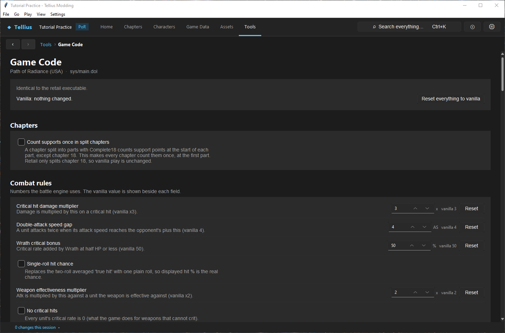
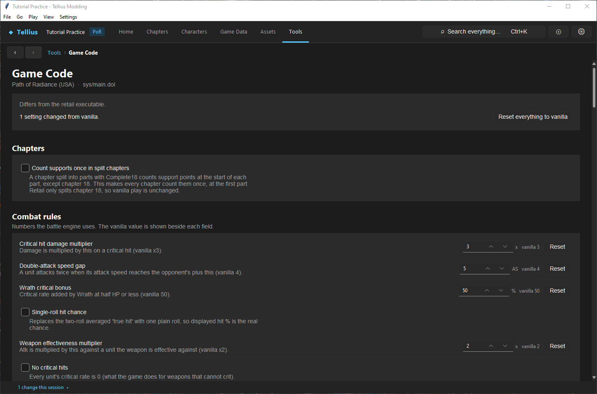

# Apply engine tweaks

**Route:** Tools → Game Code

## What you will make

You will change one rule of the battle engine, the speed gap a unit needs to attack twice, from 4 to 5, check what the page writes, compare the result in the Battle Simulator and in the game, and put the rule back to vanilla. At the end you can use any entry of the page, read its state, and undo it.

!!! warning "Untested in game"
    Only part of the catalog has been played in Dolphin (see [Limits and confidence](#limits-and-confidence)). Every entry is checked on the bytes of the US, PAL and Japanese builds; the game itself is the test of what it does.

## Before you begin

- Extract the disc (the page edits the extracted `sys/main.dol`). It supports the US (GFEE01), PAL (GFEP01) and Japanese (GFEJ01) builds of Path of Radiance; any other executable is listed as unrecognised and nothing can be written.
- Build and boot the unmodified project once, so you know what the vanilla rule looks like in game ([Set up Dolphin and build the game](04-dolphin-setup.md)).

## How the editor fits together

The game's rules live in its executable, `sys/main.dol`, not in a data file. Each entry of the page is one of two kinds:

- a **patch**: an on/off change made of byte edits, shown as a checkbox;
- a **value**: a number stored in an instruction or a data word, shown as a field with its unit, its vanilla value and a **Reset** button.

For each entry the catalog knows, per game version, where its bytes are and what they must be. Before writing, the page checks that the bytes there are the retail ones (or the patched ones); if they are neither, or the entry has no address in your build, it is greyed out. Nothing is ever written blind. A change is written to the extracted `main.dol` at once, kept in the project's `originals` folder the first time, and listed in **Changes this session**. A build packs it like any other extracted file.

Some entries add code: they use a small free area of the executable (a code cave) or, for the battle info window, an unused debug area. Their checkbox writes and removes that code too.

## Guided walkthrough

### 1. Read the page

<!-- screenshot 57-a-setup.png -->
<figure class="tutorial-figure" markdown="1">

<figcaption markdown="span">**Tools › Game Code** on the unmodified project: the recognised build (*Path of Radiance (USA) · sys/main.dol*), *Identical to the retail executable*, *Vanilla: nothing changed*, then the groups of patches (checkboxes) and values (each with its vanilla value and **Reset**).</figcaption>
</figure>

Open **Tools → Game Code**. The top card says which build it recognised (*Path of Radiance (USA) · sys/main.dol*), whether the executable is *Identical to the retail executable*, and how many settings differ from vanilla (*Vanilla: nothing changed.*). **Reset everything to vanilla** is on the right.

Under it, each group has a short note and its entries. Read an entry's description before changing it: it says what the game does with the value and where it applies.

### 2. Change one value

<!-- screenshot 57-b-result.png -->
<figure class="tutorial-figure" markdown="1">

<figcaption markdown="span">**Double-attack speed gap** set to 5: the value is written to `main.dol` at once, the summary reads *1 setting changed from vanilla* and *Differs from the retail executable*, and the change is listed under **Changes this session**.</figcaption>
</figure>

1. In **Combat rules**, find **Double-attack speed gap** (*A unit attacks twice when its attack speed reaches the opponent's plus this (vanilla 4).*).
2. Type `5` in its field and press Enter (or use the arrows).

The page writes it at once: the card now reads *Differs from the retail executable.* and *1 setting changed from vanilla.*, and the status bar counts the change. There is no separate save.

### 3. Check the effect

1. In **Tools → Battle Simulator**, give Ike 10 Spd against Boyd (attack speed 6). With the vanilla gap of 4, Ike attacks twice. The simulator uses its own copy of the rules, not your `main.dol`; it is a reference for what the change should do.
2. Build the project and play the same fight in Dolphin. With a gap of 5, Ike needs attack speed 11 to attack twice; the forecast shows a single attack at 10.

### 4. Put it back

Press **Reset** beside the field. The value returns to 4 and the card to *Vanilla: nothing changed.* if it was the only change. **Reset everything to vanilla** does the same for every entry at once, after asking.

## Understand every control

### Page

| Control | What it does |
| --- | --- |
| Build line | The recognised version and file (`Path of Radiance (USA) · sys/main.dol`), or *Unrecognised executable*. |
| *Identical to / Differs from the retail executable* | Whether the whole `main.dol` matches the retail one, whatever made it differ. |
| Summary | How many entries are not at vanilla. |
| **Reset everything to vanilla** | Restores every entry's retail bytes (asks first). Other edits to `main.dol`, such as the story order, are not entries and are not reset. |
| Checkbox (patch) | Tick to apply, untick to restore the retail bytes. Greyed: not available in this build, or the bytes are neither retail nor patched (a conflict). |
| Field (value) | Type or step the number; the unit and *vanilla* value are beside it. Values outside the entry's range are clamped. |
| **Reset** | Restores that value's vanilla bytes. |
| **Battle window style** | In **Battle screen**: *None (game default)*, *Text lines* (the damage/hit/crit lines) or *Info window at the bottom middle*; turns one on and the other off. |

### Groups

| Group | What it changes | Entries |
| --- | --- | --- |
| **Chapters** | Split chapters | **Count supports once in split chapters** |
| **Combat rules** | The battle maths | critical multiplier, double-attack gap, Wrath bonus, single-roll hit, effectiveness multiplier, no crits, class critical multiplier (not in the Japanese build), no terrain bonus, Charisma and Horror bonus and range, support range and **Double support bonuses**, **Steal from faster units**, the weapon triangle's Hit and Atk |
| **Experience and growth** | EXP formulas | Elite multiplier, Frac90 fraction, EXP and growth cap, promoted-class level bonus |
| **Laguz transformation** | The gauge | gain per turn, drain per turn while transformed, gain and drain when struck, gauge size |
| **Skill activation** | Proc chances | for each of 15 skills: a scale (the chance formula times *n*/4) and a bonus added; the game caps the chance at 100 |
| **Developer tools** | Debug menus and overlays | see [Use the game's debug menus](60-debug-menus.md) |
| **Animation** | Battle scenes | **Animate ally and NPC battles**, **Animation speed** |
| **Level-up growth** | Level-ups | **Force fixed growth mode** / **Force random growth mode**, the points per growth success (random) and per level (fixed) for each stat, the fixed-growth thresholds (100, and 90 with Frac90) |
| **Promotion** | Class change | **Ike and thieves promote normally**, **Grant Fire, Thunder, or Wind on promotion**, **Three-tier promotions** (adds `SID_TIER3` and Master Crown records and text), its crown-only switch and minimum level |
| **Supports** | Support points | points per chapter, star limit |
| **Random numbers** | The random generator | **Same random numbers every boot**, **Random seed** |
| **Gold and forge** | Economy | gold cap, **Forge more than once per chapter**, Hit and Critical per forge step, **Class rings on the first playthrough** |
| **Map and camera** | Map rules | fog on every map / off everywhere, **Bandits do not destroy villages**, unlimited reinforcement uses or the per-map limit, free and smooth camera rotation |
| **Battle screen** | Numbers shown in fights | **Damage, hit and critical in battle scenes** with its position, nudges and size, **Battle info window** (a port of FE7Dragon's FE9 Battle Info Display patch) |
| **Army phases** | Who plays each army | Player, Enemy, Other and Partner phase: played by you, by the computer, or skipped; takes effect at the next chapter |

## Things to try next

1. **A patch.** Tick **Bandits do not destroy villages**, build, and let a bandit reach a village in Ch.1.
2. **A proc chance.** Set **Luna activation bonus** to 50 and compare how often Luna triggers in a few Dolphin fights.
3. **Battle numbers.** Choose *Text lines* in **Battle window style** and read the damage, hit and critical in a battle scene.
4. **Growth.** Tick **Force fixed growth mode** to remove randomness from level-ups while you balance a chapter.

## Interactions and precedence

- Entries are independent unless the description says otherwise. Exclusive pairs (fog on/off, fixed/random growth, the two battle window styles) turn the other off or say so.
- Game Code and Game Data are separate layers: the speed gap here applies to every unit; Spd and weapon weight come from Game Data.
- The Battle Simulator and Play use the vanilla rules of the `battle_sim` package; they do not read your `main.dol`. Their numbers show what the vanilla game would do.
- A patched `main.dol` ends up in your shared patch like any other changed file. A recipient's disc must be the same build.

## Test matrix

| Case | Setup | Expected result |
| --- | --- | --- |
| Baseline | Unmodified project | *Identical to the retail executable.*, *Vanilla: nothing changed.* |
| Intended change | Double-attack gap 5 | *1 setting changed from vanilla.*; in game, attack speed 10 against 6 no longer doubles |
| Boundary | Type 0 or a huge number | The value is clamped to the entry's range |
| Likely failure | A `main.dol` edited by another tool | Entries whose bytes changed are greyed as conflicts; nothing is written there |

## Troubleshooting

| Symptom | Likely cause | What to do |
| --- | --- | --- |
| Everything is greyed, *Unrecognised executable* | Not a US, PAL or JP Path of Radiance build, or a `main.dol` changed elsewhere | Restore the original `main.dol` (it is in `originals`) |
| One entry is greyed | It has no site in this build (some exist in one version only), or its bytes conflict | Read its tooltip/description; reset the conflicting tool's change |
| The change does not show in game | The disc was not rebuilt | **Build disc**, then boot the new image |
| The game crashes after a patch | A patch interacting with another, or with an edited file | Turn patches off one by one, rebuild, retest |

## Save, build, and revert

Changes are written immediately to the project's `output/sys/main.dol` and logged in **Changes this session**; the retail `main.dol` stays in the shared vanilla files. To revert one entry use **Reset**; to revert all use **Reset everything to vanilla**. Build the disc to test.

## Limits and confidence

- Detection and writing are source-reviewed and checked on the retail bytes of all three builds (apply all, revert byte-identical). The change in this lesson was made and reset in the app (app-tested).
- Played in Dolphin on the US build: the first combat rules (critical multiplier, double-attack gap, Wrath, effectiveness, no crits, class critical multiplier, single-roll hit), the skill activation values, the developer tools and the animation entries.
- Verified on bytes only, not yet seen in game: the other combat rules, experience and growth, Laguz gauge, fog, villages, reinforcements, camera, promotion, supports, random numbers, gold and forge, the battle screen entries, split-chapter supports and army phases.

## Related tutorials and references

- Before: [Check a project and fix problems](05-check-project.md), [Set up Dolphin and build the game](04-dolphin-setup.md)
- Next: [Play and rewind a chapter in the app](58-play-chapter.md), [Use the game's debug menus](60-debug-menus.md)
- Reference: [main.dol format](../formats/main-dol.md), [Combat Mechanics](../systems/combat-mechanics.md)

---

[← Previous: Simulate and render a fight](56-battle-simulator.md) · [All tutorials](index.md) · [Next: Play and rewind a chapter in the app →](58-play-chapter.md)
