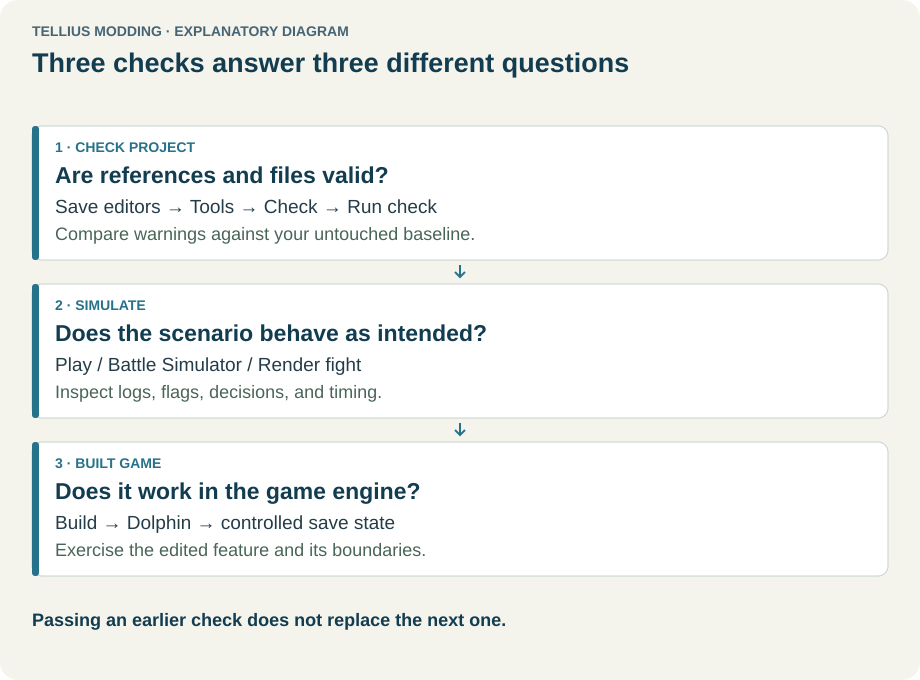
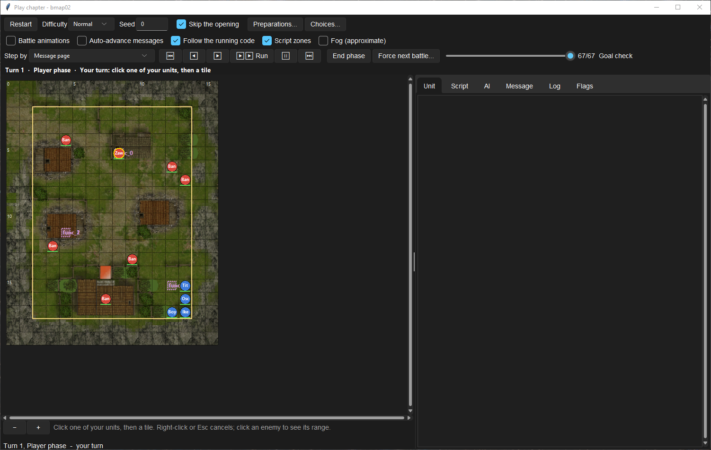
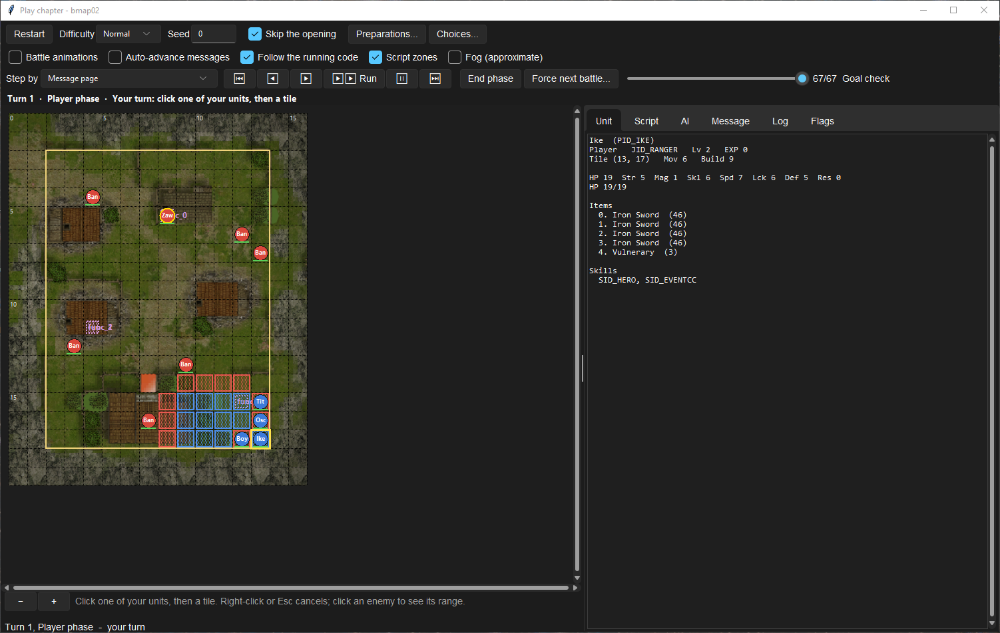
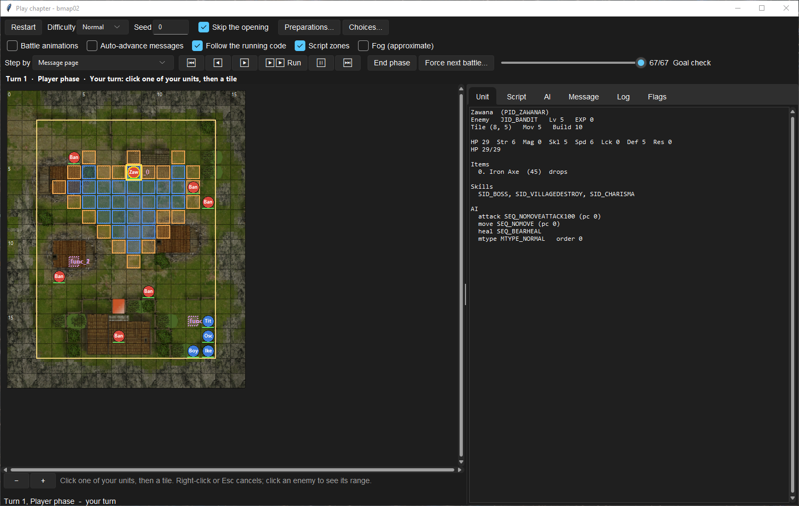
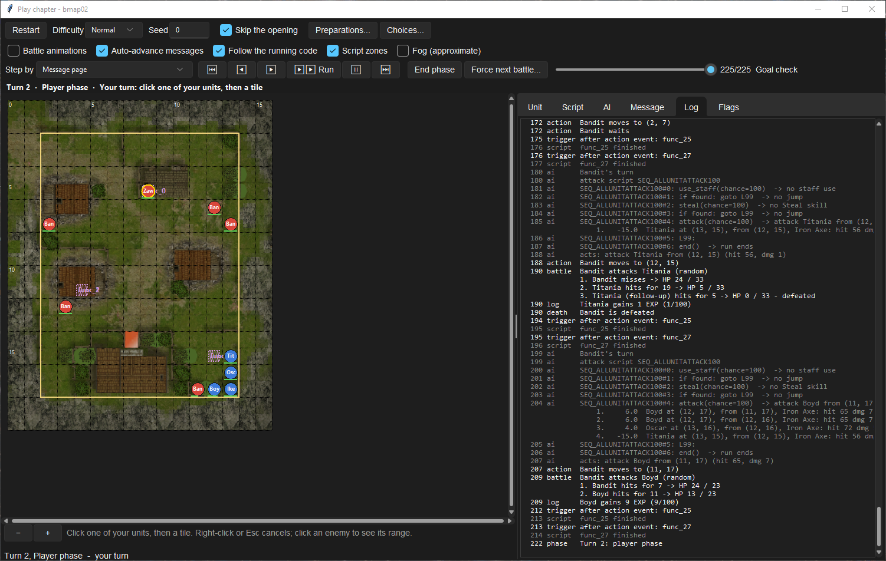
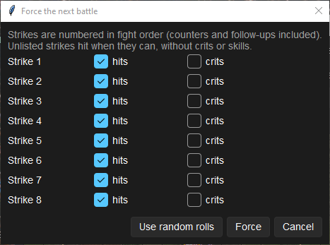

# Play and rewind a chapter in the app

**Route:** Chapter → Build → **Play…**

## What you will make

You will play the first turn of Ch.1 inside the app: start it on Normal, look at what one of your units and one enemy can reach, end your phase and read what the enemy phase did, then step back into that enemy phase to see why a bandit chose its target. You will also force the outcome of the next fight. At the end you can use Play to check an event, a reinforcement or an AI order in seconds, and you know which checks still need Dolphin.

## Before you begin

- Open the chapter you want to test on its **Build** tab and choose the deployment file of the difficulty you want (here: Ch.1, **Normal**).
- Play reads the editors as they are now, saved or not: the map and deployment shown on the Build tab, and the Script tab's code if it has unsaved changes. You do not need to save to test, but you must **Restart** Play after an edit.
- Nothing you do in Play is written to the project.

## How the editor fits together

<!-- diagram testing -->
<figure class="tutorial-figure" markdown="1">

<figcaption>Concept diagram, not an app screenshot. Check, Play and Dolphin answer three different questions. Select the image to open it at full size.</figcaption>
</figure>

Play builds a *world* from the chapter's files (map, terrain, deployment, FE8Data.bin, event script, `cp_data.bin`, messages) and runs the game on a *state* one small step at a time: phases, triggers, event scripts, messages and AI turns. Every step is kept in a history, so you can go back to any earlier moment and play on from there.

The window has four parts:

- **Top rows**: **Restart**, **Difficulty**, **Seed**, **Skip the opening**, **Preparations…**, **Choices…**, then the view options.
- **Transport bar**: **Step by**, the step buttons, **End phase**, **Force next battle…** and the history slider with the current entry's number and label.
- **The map**: the Build tab's map with the units of the current state, an HP bar under each, units that have acted greyed out.
- **The panes**: **Unit**, **Script**, **AI**, **Message**, **Log** and **Flags**.

## Guided walkthrough

### 1. Start the chapter

<!-- screenshot 58-a-setup.png -->
<figure class="tutorial-figure" markdown="1">

<figcaption markdown="span">**Play…** on Ch.1, Normal, with **Skip the opening** ticked: the opening ran without stopping and the window waits at turn 1, player phase. Top rows: **Restart**, **Difficulty**, **Seed**, the options; then **Step by**, the transport buttons, **End phase**, **Force next battle…** and the history slider.</figcaption>
</figure>

1. Open **Chapters → Ch.1: The Battle Begins → Build**, choose **Normal** in the deployment file list, and press **Play…**.
2. Keep **Difficulty** `Normal`, **Seed** `0` and **Skip the opening** ticked.

The opening events run without stopping (they stay in the history) and the window waits at *Turn 1 · Player phase · Your turn*. The slider reads `67/67`: 67 entries were played to get here.

### 2. Look at what units can reach

<!-- screenshot 58-c-select.png -->
<figure class="tutorial-figure" markdown="1">

<figcaption markdown="span">Clicking Ike selects him: blue tiles are where he can move, red the tiles he can strike from there, and the **Unit** pane lists his stats, items and skills. Click a blue tile to get the action menu, with the forecast on each attack entry.</figcaption>
</figure>

Click Ike. Blue tiles are where he can move, red the tiles he can strike from there, and the **Unit** pane lists his class, level, tile, Mov, Build, stats, items and skills.

Click one of the blue tiles: a menu lists what Ike can do there (**Attack** entries with their forecast and the counter, staves, **Talk to …**, **Shove …**, **Visit**, **Seize**…, **Wait**). Choosing one plays it. Right-click or Esc cancels the selection.

<!-- screenshot 58-d-threat.png -->
<figure class="tutorial-figure" markdown="1">

<figcaption markdown="span">Clicking an enemy shows its reach: orange is every tile it can attack this turn. The **Unit** pane adds its AI: attack and move scripts, heal script, MTYPE and order.</figcaption>
</figure>

Click an enemy instead: orange tiles are every tile it can attack this turn, blue where it can move. Its **Unit** pane adds the AI it was deployed with: here Zawana, the boss, has the attack script `SEQ_NOMOVEATTACK100` and the move script `SEQ_NOMOVE`, so he attacks only what comes in reach and stays on his tile.

### 3. End the phase and read the log

<!-- screenshot 58-b-result.png -->
<figure class="tutorial-figure" markdown="1">

<figcaption markdown="span">After **End phase** the enemy phase ran to turn 2. The **Log** lists it in order: each AI unit's scripts and action, every fight with its strikes, and the event checks that ran after each action.</figcaption>
</figure>

1. Tick **Auto-advance messages**, so message pages do not stop the run.
2. Press **End phase**. The enemy phase plays until your turn: the window reaches *Turn 2 · Player phase*.
3. Open **Log**.

Each line is one entry: `ai` lines show a bandit's script running (`SEQ_ALLUNITATTACK100`, its staff and steal checks, then the attack it chose); `action` and `battle` lines show the move and the fight strike by strike; `trigger` and `script` lines show the event functions that run after every action (`func_25`, `func_27`); `death`, `log` (experience) and `phase` lines follow.

### 4. Step back into the enemy phase

<!-- screenshot 58-e-rewind.png -->
<figure class="tutorial-figure" markdown="1">

<figcaption markdown="span">**◀** stepped back through the history into the enemy phase (entry 206 of 225): the status bar says a command from here starts a new branch. The **AI** pane shows the Bandit about to act on its chosen candidate, attacking Boyd from (11, 17).</figcaption>
</figure>

Press **◀** (or Left) until a bandit is about to act, or drag the history slider. The map, the panes and the status line all show that earlier state, and the status bar adds *(history: a command from here starts a new branch)*.

Open **AI**. It shows the acting unit, its registers and the candidate it holds, and under **How the target was chosen** every possible attack scored, best first. See [Inspect why AI chose a target](45-inspect-ai-decisions.md) for reading that table.

Press **⏭** to return to the latest entry. If you instead give a command or press **End phase** at an earlier entry, the entries after it are dropped and play goes on from there.

### 5. Force the next fight

<!-- screenshot 58-f-force.png -->
<figure class="tutorial-figure" markdown="1">

<figcaption markdown="span">**Force next battle…**: tick **hits** / **crits** per strike in fight order (counters and follow-ups included); unlisted strikes hit without crits or skills. **Use random rolls** goes back to the seed.</figcaption>
</figure>

Press **Force next battle…**. Each strike of the next fight, in fight order (counters and follow-ups included), gets **hits** and **crits** boxes; strikes you do not list hit when they can, without crits or skills. **Force** applies it to the next fight only, the status bar says *next battle forced*; **Use random rolls** goes back to the seed.

Use this to test what happens when a boss dies or survives, without retrying seeds.

## Understand every control

### Top rows

| Control | What it does | How to choose |
| --- | --- | --- |
| **Restart** | Builds the world again from the editors' current state and starts over. Needed after any edit. | After every change in Build or Script. |
| **Difficulty** | Normal, Hard or Maniac: which deployment file's units are placed and the difficulty the script sees. | The difficulty you edited. Takes effect on **Restart**. |
| **Seed** | The random seed for hits, crits and AI choices that roll. The same seed and inputs replay the same game. | Change it to see another outcome; note it when a result is evidence. |
| **Skip the opening** | Plays the opening events without stopping and starts at the first player turn. Unticked, the opening runs with the transport rules. | Untick to test the opening itself. |
| **Preparations…** | Which player units are placed, for chapters whose opening deploys nobody (the game's preparations screen). Says so when the script deploys its own units. **Restart with these** applies. | |
| **Choices…** | The entries to pick at the next choice dialogs, in order, counting from 1 (`2, 1`). Empty: always the first. | To test the second branch of a choice. |
| **Battle animations** | Plays each fight with the battle models before going on. | Off for fast runs. |
| **Auto-advance messages** | Message pages advance on their own instead of stopping the run. | On when you test what happens after dialogue. |
| **Follow the running code** | Switches to the **Script**, **AI** or **Message** pane of whatever is running. | Off to keep one pane open. |
| **Script zones** | Draws the chapter's script zones (seize, visit, area events) on the map. | |
| **Fog (approximate)** | Hides units outside the player's vision, using the class vision range only: torches, roofs and line of sight are not modelled. | Fog chapters only, as a rough guide. |

### Transport bar

| Control | What it does |
| --- | --- |
| **Step by** | How far **▶** goes: *Line* (one script instruction, message page or AI entry), *Message page*, *Action*, *AI unit*, *Phase*, or *Until my turn*. |
| **⏮** | Back to the previous command or phase start. |
| **◀** / Left | One history entry back. |
| **▶** / Space | One step of the chosen size. In the history it moves forward; at the end it plays on. |
| **▶▶ Run** | Plays until your turn. |
| **⏸** | Pauses a run. |
| **⏭** | Jumps to the latest entry. |
| **End phase** | Ends the player phase (a unit with Canto left stays where it is) and plays on. |
| **Force next battle…** | Fixes the outcome of each strike of the next fight. |
| History slider | Drag to any entry; the label shows its number and name (`67/67 Goal check`). |

### Map and panes

| Element | What it shows |
| --- | --- |
| Click a unit of yours | Its moves (blue) and strike tiles (red); then a tile for the action menu. |
| Click an enemy or ally | Its threat (orange) and moves (blue); click again to hide. |
| Hover | The tile's coordinates, terrain, avoid and defence, and the unit on it. |
| **−** / **+** | Zoom. |
| **Unit** | The selected unit: faction, class, level, EXP, tile, Mov, Build, stats, items (`drops` marks a dropped item), skills, and for non-player units the attack, move and heal scripts, MTYPE and order. |
| **Script** | The task queue, the running event with its call stack, its instructions with the current one marked, and the function's source. |
| **AI** | The acting AI unit's stage, registers and candidate, its script with the current entry, and **How the target was chosen**. Between turns: the last decision of the phase. |
| **Message** | The current message page drawn as the game shows it, with its text. |
| **Log** | Every entry of the run: phases, triggers, scripts, AI, actions, battles, deaths, EXP, warnings. |
| **Flags** | The campaign and chapter flags and their current values. |

## Things to try next

1. **A reinforcement.** Set **Step by** to *Phase* and step across the turn your reinforcement should arrive. Check the **Log** for the deployment call and the **Flags** pane for its guard flag, then step one more phase to see it does not arrive twice.
2. **A talk recruit.** Move the recruiter next to the target and choose **Talk to …**: the **Script** pane runs the talk event and the target's faction changes in its **Unit** pane.
3. **A boss quote.** Force the next battle so the boss's first strike misses and your unit's hits, then attack the boss and watch the **Message** pane.
4. **Another branch.** Step back to before your last action, choose a different one, and compare the logs.
5. **An AI order.** Change an enemy's move script on the Build tab, **Restart**, and see the new move in the **Log**.

## Interactions and precedence

- What you test is what the editors hold *now*. An unsaved script edit is played; a script edit you then revert is not, until **Restart**.
- The opening decides the state everything else uses: units it places, flags it sets, events it registers. Skipping it plays it all the same.
- After each action the game runs its after-action events, and between phases its phase events, in a fixed order. A run that takes extra actions changes what later checks see, so compare runs from the same history entry.
- Rewinding restores the state, not the files: it never picks up an edit.

## Test matrix

| Case | Setup | Expected result |
| --- | --- | --- |
| Baseline | Ch.1, Normal, seed 0, opening skipped | Turn 1, player phase, the cast of the Normal file on the map |
| Intended change | **End phase** with messages auto-advanced | Turn 2, player phase; the Log lists every enemy action |
| Boundary | Step back into the enemy phase, then **⏭** | The earlier state, then the latest one again, unchanged |
| Likely failure | Edit the map on Build without **Restart** | The window says the map changed; the old map is still played |

## Troubleshooting

| Symptom | Likely cause | What to do |
| --- | --- | --- |
| An expected event never runs | Its trigger is never reached, its guard flag is already set, or it is registered by an opening you skipped | Read the **Script** queue and **Flags** at the expected moment; untick **Skip the opening** |
| An edit does not show | Play was not restarted | **Restart** |
| The run stops at every message | **Auto-advance messages** is off | Tick it, or press **▶** per page |
| A unit's action is missing from the menu | The target is out of range, the event is not registered, or it is a staff the simulator does not offer (Warp, Rescue, Ward, Torch, Hammerne, Unlock) | Check the range and the **Script** queue |
| Play and Dolphin differ | A system Play does not model (see below) | Test that part in Dolphin |

## Save, build, and revert

Play state is never saved. Fix what you find in the owning editor (Build, Script, Dialogue, Game Data), save it, **Restart** Play to confirm, then build and play the same moment in Dolphin.

## Limits and confidence

- Movement, combat (through the Battle Simulator's rules), the event and AI interpreters and the history are source-reviewed; the run shown here was played in the app on an unmodified disc (app-tested).
- Not modelled or partly modelled: fog details (torches, roofs, line of sight), some staves (Warp, Rescue, Ward, Torch, Hammerne, Unlock), item effects other than stat boosters, native script calls and some AI actions (logged as *not simulated*), cameras, map scenes and `MapLoad` presentation, the preparations and base screens beyond the unit choice. Check those in Dolphin.
- A passing run proves your authored logic in the simulator. It does not prove graphics, timing, saves or native code.

## Related tutorials and references

- Before: [Edit, compile, and test event scripts](33-script-editor.md), [Design, register, and test event flags](34-event-flags.md), [Create common AI orders](44-common-ai-orders.md)
- Next: [Inspect why AI chose a target](45-inspect-ai-decisions.md), [Edit and test a save](59-save-editor.md)
- Reference: [Turn, Phase & Action Cycle](../systems/turn-phase-action-cycle.md), [Events & Scripting](../systems/events-scripting.md), [AI Engine, Targeting & Scoring](../systems/ai-engine-and-scoring.md)

---

[← Previous: Apply engine tweaks](57-game-code.md) · [All tutorials](index.md) · [Next: Edit and test a save →](59-save-editor.md)
