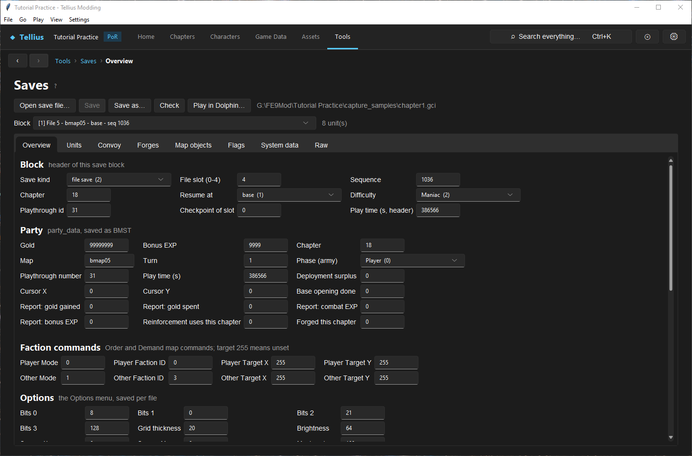
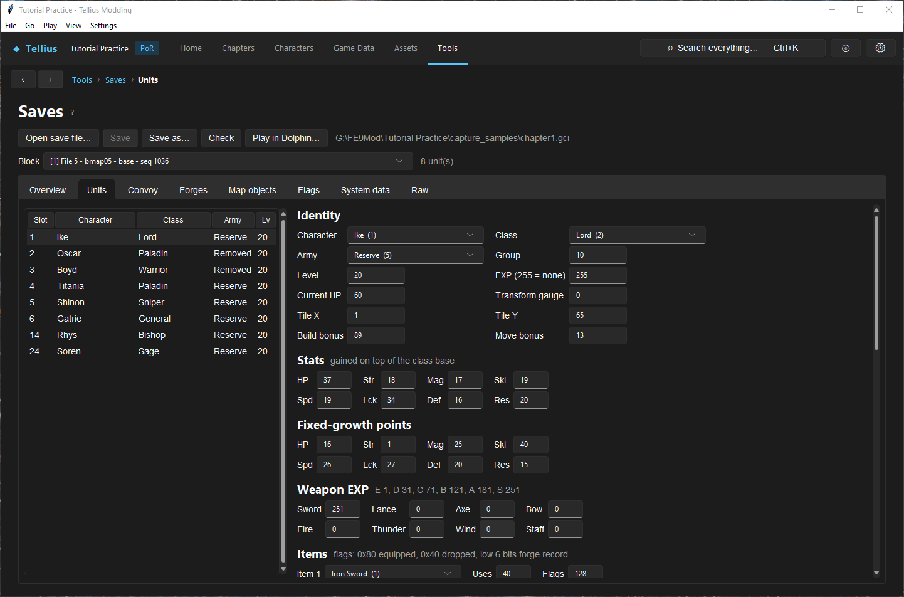
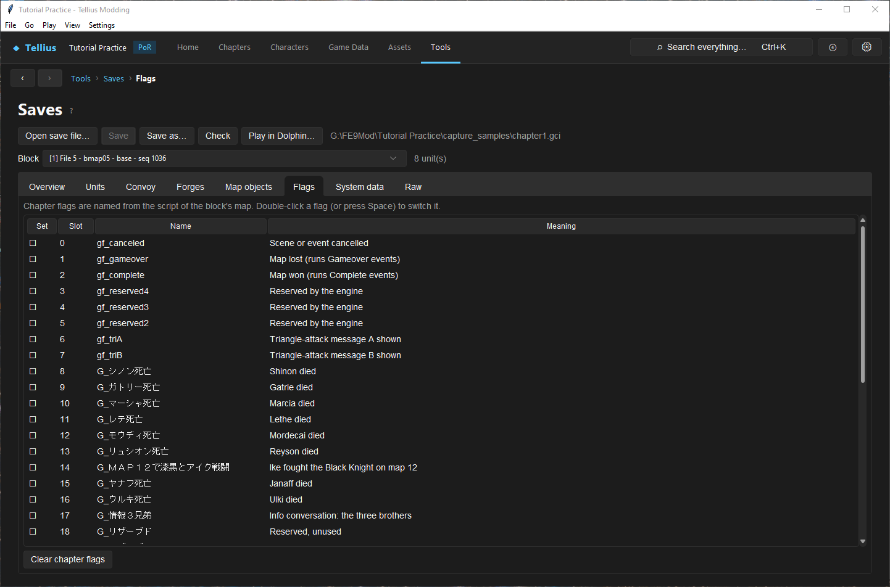
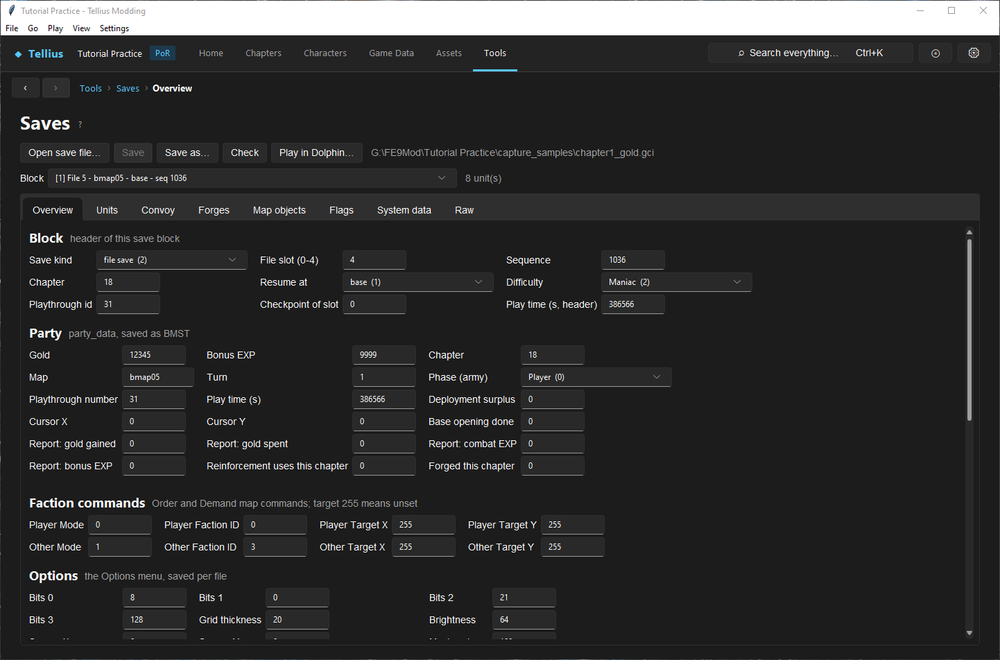
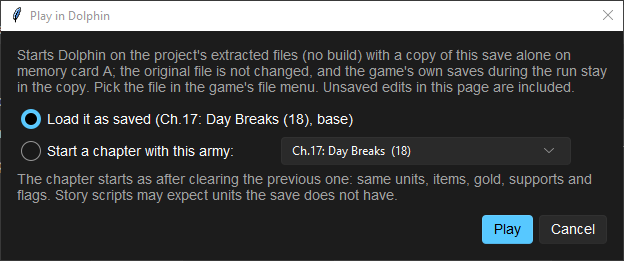

# Edit and test a save

**Route:** Tools → Saves

## What you will make

You will open a copy of a memory-card save, choose the right save block in it, read its party, units and flags, change one value (the gold), write the result to a new file, and prepare it for a Dolphin test, either loaded as saved or moved to the start of another chapter with the same army. At the end you know which block the game will load, what each tab edits, and why the original file stays untouched.

!!! warning "Untested in game"
    Loading an edited save in the game, and **Play in Dolphin…** from a save, have not yet been checked in a recorded Dolphin session. The app reads and writes the format (and its checksums) as decoded; treat the in-game result as the test.

## Before you begin

- Export the save from Dolphin (**Tools → Memory Card Manager**, or the `GC` folder of a GCI-folder card) or GCMM as a `.gci` file, and **copy it** into a folder of your own. Work only on the copy.
- Close the game, or at least do not let it write the card, while you replace a save it uses.
- The walkthrough uses a copy named `chapter1.gci`. The numbers below come from that test save; yours will differ.

## How the editor fits together

A `.gci` file holds one game save file of Path of Radiance. Inside it are **blocks**: up to five *file saves* (one per file slot of the game's file menu, the newest copy of each slot wins) and *checkpoints* (suspend data, consumed when you resume). Each block has a header (kind, file slot, sequence number, chapter, where it resumes, difficulty), the party data, every unit slot, the convoy, the forge records, the map's tile records, the flag bits, and the system data shared by the whole card.

The page edits one block at a time, in memory. **Save** rewrites the opened file, **Save as…** writes a new one; both rebuild every edited block with its checksum. Nothing is written until then.

## Guided walkthrough

### 1. Open the copy and choose a block

<!-- screenshot 59-a-setup.png -->
<figure class="tutorial-figure" markdown="1">

<figcaption markdown="span">**Open save file…** on a copy of a test save: **Block** lists the eight blocks of the file (five file saves and two suspend checkpoints; *loaded* marks the ones the game loads). The *File 5 · bmap05 · base* block is chosen: **Overview** shows its header, the party (gold, bonus EXP, map, turn), the options, the map state and the cleared maps.</figcaption>
</figure>

1. Open **Tools → Saves** and press **Open save file…**. Choose `chapter1.gci`.
2. Open the **Block** list. Each entry reads `[position] kind · map · where it resumes · seq N`, and *loaded* marks the copy the game loads for that slot (the newest valid one). The page selects the newest block first.
3. Choose `[1] File 5 - bmap05 - base - seq 1036`: a file save at the base before chapter 18.

**Overview** shows the block's header and party. Read **Save kind** (`file save (2)`), **Chapter** (18), **Resume at** (`base (1)`), **Difficulty** (`Maniac (2)`) and the party's **Gold** (99999999 in this test save) and **Bonus EXP** (9999).

### 2. Read the units and flags

<!-- screenshot 59-c-units.png -->
<figure class="tutorial-figure" markdown="1">

<figcaption markdown="span">**Units**: every unit slot of the block. Ike's slot shows his character, class, army, level, EXP and HP, his stats gained on top of the class, fixed-growth points, weapon EXP, items, supports and skills.</figcaption>
</figure>

Open **Units** and select Ike. The list shows every used unit slot with its character, class, army (Player, Reserve, Removed, Enemy…) and level; the army list above it filters by army. The fields show the slot as stored: stats are **gained on top of the class base** (not the totals the game displays), **Fixed-growth points** are the level-up counters, **Weapon EXP** uses the thresholds in its header (E 1, D 31, C 71, B 121, A 181, S 251), and item **Flags** combine 0x80 equipped, 0x40 dropped and a forge record number.

<!-- screenshot 59-d-flags.png -->
<figure class="tutorial-figure" markdown="1">

<figcaption markdown="span">**Flags**: the campaign flags and the chapter flags of the block's map, named from the project's scripts. Double-click (or Space) switches one; **Clear chapter flags** resets the chapter's.</figcaption>
</figure>

Open **Flags**. Campaign flags come first, then the chapter flags, named from the project's script of the block's map. A block saved between chapters says so: its chapter flags are leftovers that the game clears when the chapter starts.

### 3. Change the gold and write a new file

<!-- screenshot 59-b-result.png -->
<figure class="tutorial-figure" markdown="1">

<figcaption markdown="span">**Gold** set to 12345 and written with **Save as…** to `chapter1_gold.gci`: reopening that file and the same block shows the new value, and the first copy is untouched. Loading it in the game is the next check.</figcaption>
</figure>

1. On **Overview**, set **Gold** to `12345` and press Enter. The status beside **Block** says *unsaved changes* and **Save** is enabled.
2. Press **Save as…** and write `chapter1_gold.gci` next to the copy.
3. The page reopens the new file. Choose the same block again: **Gold** reads 12345. `chapter1.gci` is unchanged.

Press **Check** before every write you intend to test: it validates the block against the project's FE8Data.bin (characters, classes, items, skills) and rebuilds it, and lists any problem.

### 4. Prepare the Dolphin test

<!-- screenshot 59-e-play.png -->
<figure class="tutorial-figure" markdown="1">

<figcaption markdown="span">**Play in Dolphin…**: load the block as saved, or **Start a chapter with this army:** any chapter, as after clearing the previous one. Dolphin runs the extracted files with a copy of the save alone on memory card A.</figcaption>
</figure>

Press **Play in Dolphin…**. Choose **Load it as saved (Ch.17: Day Breaks (18), base)**, or **Start a chapter with this army:** and pick a chapter: the save is moved to that chapter's start as if the previous one had just been cleared (same units, items, gold, supports and flags). **Play** starts Dolphin on the project's extracted files, without a build, with a copy of this save alone on memory card A. Pick the file in the game's file menu.

The original file is not changed; the game's own saves during the run stay in the copy. Unsaved edits on this page are included in the copy.

## Understand every control

### Toolbar and block

| Control | What it does | How to choose |
| --- | --- | --- |
| **Open save file…** | Reads a `.gci` and lists its blocks. Asks before discarding unsaved edits. | Always a copy. |
| **Save** | Rewrites the opened file with every edited block. | Only on a file you can lose. |
| **Save as…** | Writes the file under a new name, then opens it. | The safe default. |
| **Check** | Validates the selected block (unknown characters, classes, items, skills; values that do not fit) and rebuilds it. | Before every write you will test. |
| **Play in Dolphin…** | Tests the selected file-save block in Dolphin, as saved or moved to a chapter start. Refuses checkpoints and consumed copies. | |
| **Block** | Which save block the tabs edit. *loaded* marks the copy the game loads for its slot. | The newest copy of the slot you use in game. |

### Overview

| Group | Fields |
| --- | --- |
| **Block** (header) | **Save kind**, **File slot (0-4)**, **Sequence** (newer is higher), **Chapter** (also sets the party's), **Resume at** (base, battle preparations, new game, chapter start, chapter part 2–4, suspended map, trial map), **Difficulty**, **Playthrough id**, **Checkpoint of slot**, **Play time (s, header)** |
| **Party** | **Gold**, **Bonus EXP**, **Chapter**, **Map**, **Turn**, **Phase (army)**, **Playthrough number**, **Play time (s)**, **Deployment surplus**, **Cursor X/Y**, **Base opening done**, the chapter report (**gold gained/spent**, **combat EXP**, **bonus EXP**), **Reinforcement uses this chapter**, **Forged this chapter** |
| **Faction commands** | The Order and Demand map commands for the player and the other side (mode, faction, target tile; 255 = unset) |
| **Options** | The Options menu bytes and toggles, saved per file |
| **Map state** | The map's state bytes and the camera (rotation, X, Y) |
| **Cleared maps** | The 40-entry chapter history: chapter, continued, turns, time |

### Other tabs

| Tab | What it edits |
| --- | --- |
| **Units** | Each unit slot: identity (character, class, army, group, level, EXP, current HP, transform gauge, tile, build and move bonus), stats gained, fixed-growth points, weapon EXP, eight items (uses, flags), support points per list slot, skills (double-click to give or remove), records (battles, kills, tiles moved) and advanced links and AI fields. **Copy to new slot** duplicates the selected unit (its forged items become plain); **Remove** empties the slot. |
| **Convoy** | Each convoy slot's item, uses and flags. |
| **Forges** | The forge records: name, Might/Hit/Crit/Weight steps, attack trail colour, and which unit or convoy slot uses each. |
| **Map objects** | The map's tile records: opened doors, chests and roofs, visited villages, breakable walls, ballistae, pits and rocks. Only the first **Count** records are live. |
| **Flags** | The flag bits with their names and meanings; double-click or Space switches one; **Clear chapter flags** resets the chapter's. Extended flags appear with an `X` slot when the project uses them. |
| **System data** | Shared by every save on the card; the game takes it from the newest block at boot, so edit it there. Unlocks (game clear, trial maps), characters met, finished playthroughs. |
| **Raw** | The block as it will be written, in hex (read only). A block the app cannot decode opens here. |

## Things to try next

1. **A new unit.** Select a unit on **Units**, press **Copy to new slot**, change its **Character**, then **Check**: the copy fails if the slot list is full.
2. **Give a skill.** Double-click a skill in Ike's **Skills** list and check its capacity cost in Game Data.
3. **Skip to a chapter.** **Play in Dolphin…** with **Start a chapter with this army:** on the chapter you are building: its opening and first turn then run with a late-game army.
4. **Flag state.** Switch a campaign flag your event reads, save as a new file, and test both copies.

## Interactions and precedence

- The game loads, for each file slot, the valid copy with the highest **Sequence**. Edit that copy, or the game will load another one.
- **System data** is read from the newest block on the card; edits in an older block are ignored at boot.
- Units refer to characters, classes, items and skills by their position in the project's FE8Data.bin. Removing or reordering records changes what a save's numbers mean (see [Remove records without corrupting saves](15-remove-records.md)).
- A block that resumes at a chapter start (new game, chapter start, trial map) clears every chapter flag when it loads, so edit campaign flags there, not chapter flags.
- **Play in Dolphin…** uses the extracted files; unsaved editor changes in the project are not in the run unless you save them.

## Test matrix

| Case | Setup | Expected result |
| --- | --- | --- |
| Baseline | Open the copy, select the block, change nothing, **Check** | *No problems found.* |
| Intended change | Gold 12345, **Save as…**, reopen | The new file's block reads 12345; the copy is unchanged |
| Boundary | **Play in Dolphin…** on a checkpoint block | The page refuses: choose a file save block |
| Likely failure | A unit given an item number the project does not have | **Check** reports it before the write |

## Troubleshooting

| Symptom | Likely cause | What to do |
| --- | --- | --- |
| The game loads the old values | You edited an older copy of the slot | Choose the block marked *loaded* (highest sequence) |
| *Not a Path of Radiance save* | The file is another game's, or not a `.gci` | Export the right save again |
| A block opens on **Raw** only | The app could not decode it (its error shows in **Block**) | Do not edit it; use another copy |
| Names show as `#12` | The project has no FE8Data.bin, or the save was made with other records | Open the project the save belongs to |
| Dolphin shows an empty card | The run copy is on memory card A only | Use card A in the game's file menu |

## Save, build, and revert

Keep the untouched copy of every save you edit; to revert, use it again. **Save as…** writes a complete new file, so each test has its own file. **Play in Dolphin…** needs no build: it runs the extracted files with a temporary card in `build/dolphin_run`.

## Limits and confidence

- Every byte of the save is decoded (see [GameCube Save (.gci)](../formats/save-format.md)); the reading, rebuilding and checksums are source-reviewed and the edit shown here round-trips in the app (app-tested).
- Loading an edited save in the game and the chapter jump are untested in Dolphin.
- Some fields are labelled by position only (`Unused +0x230`, `AI +0x258`); changing them is research, not modding.

## Related tutorials and references

- Before: [Play and rewind a chapter in the app](58-play-chapter.md), [Design, register, and test event flags](34-event-flags.md)
- Next: [Use the game's debug menus](60-debug-menus.md)
- Reference: [Save, Load & Resume System](../systems/save-system.md), [GameCube Save (.gci)](../formats/save-format.md)

---

[← Previous: Play and rewind a chapter in the app](58-play-chapter.md) · [All tutorials](index.md) · [Next: Use the game's debug menus →](60-debug-menus.md)
