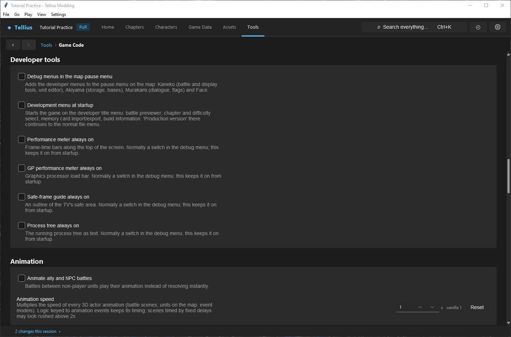
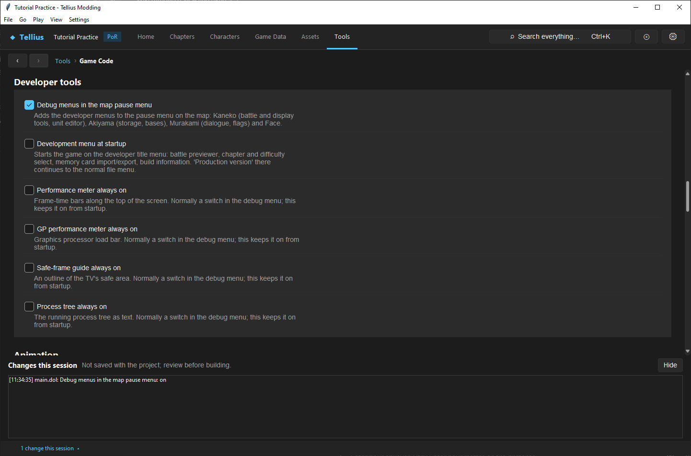

# Use the game's debug menus

**Route:** Tools → **Game Code** → **Developer tools**; then Dolphin, the map's pause menu

## What you will make

You will turn on the game's own developer menus in a test build, use one of them to inspect a unit, and turn them off again before a release. At the end you know the six **Developer tools** entries, what the developer menus contain, and why nothing you see after a debug command proves the mod works.

## Before you begin

- [Apply engine tweaks](57-game-code.md) and [Set up Dolphin and build the game](04-dolphin-setup.md).
- A test save, or the chapter jump (F5). Debug commands change live game state without the events that normally do it: keep them away from saves you care about.

## How the editor fits together

The developers left their testing menus in the shipped `main.dol`; ordinary play never reaches them. The **Developer tools** entries of **Game Code** patch `main.dol` so the game shows them:

| Entry | What it does |
| --- | --- |
| **Debug menus in the map pause menu** | Adds the developer menus to the map's pause menu: Kaneko (battle and display tools, unit editor), Akiyama (storage, bases), Murakami (dialogue, flags) and Face |
| **Development menu at startup** | Starts on the developer title menu: battle previewer, chapter and difficulty select, memory card import/export, build information. *Production version* there continues to the normal file menu |
| **Performance meter always on** | Frame-time bars along the top of the screen |
| **GP performance meter always on** | Graphics processor load bar |
| **Safe-frame guide always on** | An outline of the TV's safe area |
| **Process tree always on** | The running process tree as text |

The last four are switches of the Kaneko menu's **Display** list, kept on from startup.

The Kaneko menu is the big one ([Developer Debug Tools](../systems/developer-debug-tools.md) maps it all):

| List | Rows |
| --- | --- |
| System | Memory, file, ARAM and name-registry usage |
| Game | The unit under the cursor (the unit editor), the building under the cursor, roofs, convoy size (selecting it empties the convoy), **Game settings** (difficulty, growth mode, chapter, gold, bonus experience, turn, who plays each army's phase), **Clear Map** (wins the chapter), unit list, log, bonds |
| Event | Message viewer, event browser, a console list of script functions, **Edit flags** (5 pages of 16) |
| Visualize | Every movie, mini portraits, dialogue backgrounds, skill and item icons |
| Display | Twelve switches, including the four meters above |

The unit editor changes items and uses, level, experience, stats, skills, weapon ranks, status counters, class (**JID**), character (**PID**) and supports of the unit under the cursor.

## Guided walkthrough

### 1. Turn the menus on

<!-- screenshot 60-a-setup.png -->
<figure class="tutorial-figure" markdown="1">

<figcaption markdown="span">The **Developer tools** group of Game Code: **Debug menus in the map pause menu**, **Development menu at startup** and the overlays that stay on (performance meters, safe frame, process tree). Each is a patch: tick to write it, untick to restore the retail bytes.</figcaption>
</figure>

1. Open **Tools › Game Code** and scroll to **Developer tools**.
2. Tick **Debug menus in the map pause menu**.

<!-- screenshot 60-b-result.png -->
<figure class="tutorial-figure" markdown="1">

<figcaption markdown="span">**Debug menus in the map pause menu** ticked: the change is written to `sys/main.dol` at once and logged in **Changes this session** (*main.dol: Debug menus in the map pause menu: on*). The next build or chapter jump has the developer rows in the map's pause menu.</figcaption>
</figure>

The change is written to `sys/main.dol` at once; **Changes this session** reads *main.dol: Debug menus in the map pause menu: on*.

### 2. Use one menu

1. Press **F5** (**Play › Play chapter in Dolphin…**), pick *Ch.1: The Battle Begins (02)*, *Normal*, **Play**. The chapter jump runs the extracted files, so the patch is in.
2. On the map, open the pause menu: it now lists the developer rows (Kaneko, Akiyama, Murakami, Face) with the usual entries.
3. Put the cursor on Ike and open **Kaneko › Game** › the unit row: the unit editor shows his items, parameters, skills, weapon levels and conditions. Read them; change nothing yet.
4. Note what you read (level, HP, items). Close Dolphin.

### 3. Turn them off for a release

1. Untick **Debug menus in the map pause menu**. **Changes this session** logs *…: off*.
2. Build (**Disc & Patch › Build disc**) and boot it: the pause menu shows only the usual entries.
3. Before making a patch ([Package and share a mod](61-share-a-patch.md)), read every **Developer tools** entry: all unticked.

A finding made with a debug command is a lead, not a result. Reproduce it from an ordinary save, without the menu, before you fix or report it.

## Understand every choice

| Choice | Use it for | Risk |
| --- | --- | --- |
| **Debug menus in the map pause menu** | Reading and changing live units, flags and settings | State changes skip the events that normally make them |
| **Development menu at startup** | Jumping to a chapter and difficulty, the battle previewer | Skips the normal new-game setup |
| The four meters | Performance and framing checks of a busy map or scene | None on game state; clutter on screen |
| **Clear Map** | Reaching the next chapter quickly | The chapter's victory events may not run |
| Unit editor **PID** / **JID** | Seeing how another class or character looks in place | An impossible army for later chapters |

## Things to try next

1. **Measure a busy map.** Tick **Performance meter always on** and play the enemy phase of a large chapter.
2. **Read flags live.** **Kaneko › Event › Edit flags** during a chapter, and compare with **Game Data › Flags** ([Design, register, and test event flags](34-event-flags.md)).
3. **The battle previewer.** Tick **Development menu at startup** and open the battle previewer from the developer title menu.

## Interactions and precedence

Debug mutation can skip registration, transition, reward, roster, or save-counter updates normally performed by events. Later failures may be consequences of that impossible state. A debug observation is useful evidence about runtime data, but ordinary initialization remains the validation authority.

## Test matrix

| Stage | Check |
| --- | --- |
| clean baseline | menu absent; ordinary scenario recorded |
| debug build | intended entry only; patch detected |
| one command | before/after state and parameters recorded |
| save/reload after command | used only to study risk on disposable save |
| ordinary reproduction | finding occurs without debug mutation |
| disabled rebuild | menu absent and patch detection clear |
| release smoke | title, pause, transition, load all normal |

## Troubleshooting

**Menu does not appear.** Confirm supported executable, applied entry, rebuilt output, and documented invocation context.

**Bug occurs only after a debug jump.** Treat the bypassed initialization as the cause until ordinary progression disproves it.

**Release still shows the menu.** You launched an older image or another developer entry remains installed; re-detect and rebuild to a clean path.

## Save, build, and revert

Never reuse the debug output or save as the release candidate. Disable the individual patch, use catalog reset only when all tweaks should be removed, rebuild, re-detect, and archive the debug-operation log separately.

## Limits and confidence

- The entries, the menu contents and the patch wiring are source-reviewed; ticking and unticking the entry was done in the app on a US disc (app-tested).
- The menus in Dolphin are not shown here (unknown in this lesson); [Developer Debug Tools](../systems/developer-debug-tools.md) records what was traced in the code.

## Related tutorials and references

- [Apply engine tweaks](57-game-code.md)
- [Developer Debug Tools](../systems/developer-debug-tools.md)

---

[← Previous: Edit and test a save](59-save-editor.md) · [All tutorials](index.md) · [Next: Package and share a mod →](61-share-a-patch.md)
