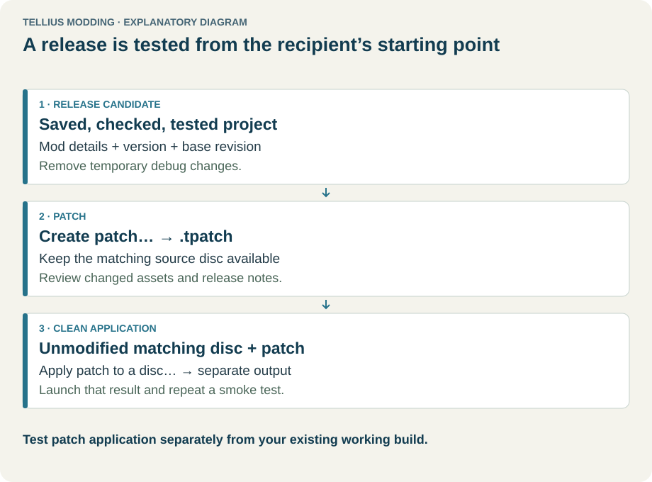
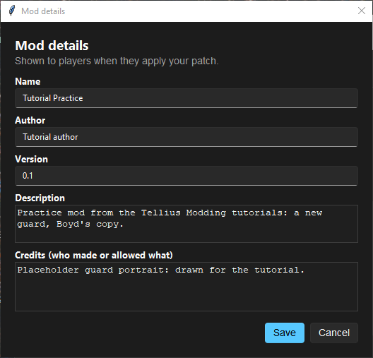
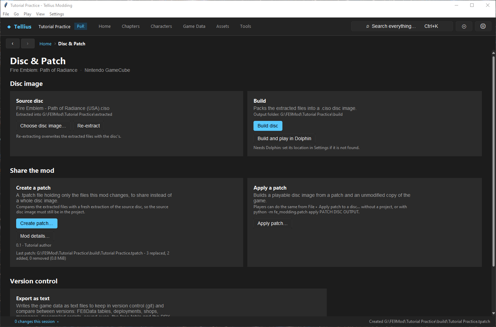
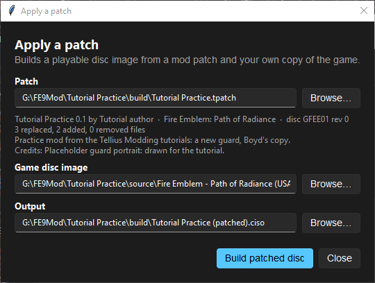
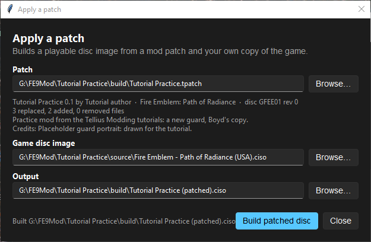

# Package and share a mod

**Route:** Disc & Patch → Share the mod

## What you will make

You will give the practice project a name, author, version and credits, turn it into a `.tpatch` file that holds only what the mod changed, and apply that patch to a clean copy of the game the way a player would, ending with a new playable disc image. At the end you know what the patch contains, what the player needs, and how to check a release before you share it.

## Before you begin

- Save every editor (the patch takes the extracted files as they are on disk; it asks about unsaved editors).
- Run **Tools → Check** and fix what it reports ([Check a project and fix problems](05-check-project.md)).
- Keep the project's source disc image: **Create patch…** extracts it again to compare. The project made in [lesson 1](01-install-create-project.md) has its copy in its `source` folder.
- Build and play the release candidate in Dolphin once ([Set up Dolphin and build the game](04-dolphin-setup.md)).

## How the editor fits together

<!-- diagram release -->
<figure class="tutorial-figure" markdown="1">

<figcaption>Concept diagram, not an app screenshot. A release is tested from the recipient's starting point: clean disc, patch, patched disc. Select the image to open it at full size.</figcaption>
</figure>

A **patch** (`.tpatch`) is a zip file with a `manifest.json` and a `files/` folder. **Create patch…** extracts the source disc again, compares every file of your `extracted` folder with it, and stores each changed or added file whole, plus the list of removed ones. The manifest records the game, the base disc's ID and revision, the SHA-1 of every stored file and of every retail file it replaces, and your mod details.

**Applying** a patch extracts the player's own disc, refuses it unless it is the same disc (same ID, and every file the patch replaces or removes matches the retail hash), writes the patch's files over the tree and packs a new disc image, exactly like a project build. The player never needs your project.

A patch stores whole files rather than byte differences because a build lays out the disc again: one resized file moves every file after it, so a byte diff of two images would be mostly noise.

## Guided walkthrough

### 1. Fill the mod details

<!-- screenshot 61-a-setup.png -->
<figure class="tutorial-figure" markdown="1">

<figcaption markdown="span">**Disc & Patch › Mod details…**: **Name**, **Author**, **Version**, **Description** and **Credits (who made or allowed what)** are saved in the project and shown to whoever applies the patch.</figcaption>
</figure>

1. Open **Disc & Patch** and press **Mod details…** in **Create a patch**.
2. Keep **Name** `Tutorial Practice`, set **Author** `Tutorial author`, **Version** `0.1`, a one-line **Description**, and in **Credits (who made or allowed what)** name every person whose work is in the mod (here: the placeholder portrait).
3. Press **Save**. The card now reads *0.1 · Tutorial author*.

### 2. Create the patch

<!-- screenshot 61-c-created.png -->
<figure class="tutorial-figure" markdown="1">

<figcaption markdown="span">After **Create patch…**: the **Create a patch** card shows the version and author, and *Last patch:* with the counts of replaced, added and removed files and the patch size.</figcaption>
</figure>

1. Press **Create patch…** and save `Tutorial Practice.tpatch` in the project's `build` folder (the default).
2. Wait for the status bar: the source disc is extracted to a temporary folder and compared. This takes a minute or two.

The message, repeated on the card as *Last patch:*, gives the content: here *3 replaced, 2 added, 0 removed (0.8 MiB)*. The three replaced files are `FE8Data.bin` (the new character), `Face/facedata.bin` (its face record) and `system.cmp`, the archive the game really reads those files from: the build copies the loose files into it, so it changes with them. The two added files are the new portrait, `Face/TGUARD.cms` and `Face/L_TGUARD.cms`.

If the message says *Empty patch*, the extracted files are identical to the disc's: nothing was saved.

### 3. Apply it like a player

<!-- screenshot 61-apply.png -->
<figure class="tutorial-figure" markdown="1">

<figcaption markdown="span">**Apply patch…** (or **File › Apply patch to a disc…**, or the standalone Tellius Patcher): the patch shows its name, game and credits; **Game disc image** must be the clean disc it was made from; **Output** is the new image.</figcaption>
</figure>

1. Press **Apply patch…** (the player uses **File → Apply patch to a disc…**, the standalone **Tellius Patcher**, or the command line).
2. **Patch**: the `.tpatch`. The dialog shows its name, version, author, game, base disc (*disc GFEE01 rev 0*), the file counts, the description and the credits.
3. **Game disc image**: a clean copy of the game. Here the project's own source disc.
4. **Output**: where to write the new image, for example `Tutorial Practice (patched).ciso`.

<!-- screenshot 61-b-result.png -->
<figure class="tutorial-figure" markdown="1">

<figcaption markdown="span">**Build patched disc** extracted the clean disc, checked every file the patch replaces against the retail hash, wrote the patch's files and packed a new image: the status reads *Built …*.</figcaption>
</figure>

Press **Build patched disc**. The dialog extracts the disc, checks it, writes the patch's files and packs the image; the status line ends with *Built …*. If the tools that extract discs are not installed yet, it asks to download them first.

### 4. Test the result

Boot the patched image in Dolphin (**File → Open** in Dolphin). Check what the mod changed (here: `PID_TUTORIAL_GUARD` exists, with its portrait), and play past the first chapter transition. This is the test the player will run; your project build is not.

## Understand every control

| Control | Where | What it does |
| --- | --- | --- |
| **Mod details…** | Create a patch | Opens **Name**, **Author**, **Version**, **Description**, **Credits (who made or allowed what)**. Saved in `project.json`; shown when the patch is applied. |
| **Create patch…** | Create a patch | Compares the extracted files with a fresh extraction of the source disc and writes the `.tpatch`. Disabled without a source disc or while a task runs. |
| *Last patch:* | Create a patch | Path and content of the last patch made this session. |
| **Apply patch…** | Apply a patch | Opens the patcher dialog over the project. |
| **Patch** / **Browse…** | Apply a patch dialog | The `.tpatch`; its details appear under it. An unreadable patch shows the reason there. |
| **Game disc image** / **Browse…** | Apply a patch dialog | The player's clean disc (`.iso`, `.ciso`, or the formats the game's tools read). |
| **Output** / **Browse…** | Apply a patch dialog | The new image. Asks before replacing an existing file. |
| **Build patched disc** | Apply a patch dialog | Extracts, verifies, writes and packs. Warns when the image is larger than a disc. |
| **Close** | Apply a patch dialog | Closes the dialog (waits for a running build). |
| **Export as text…** | Version control | Writes decoded game data into a folder, to keep in git and compare between versions. Path of Radiance exports FE8Data, deployments, shops, messages, scripts, sound, faces and DBX; Radiant Dawn exports FE10Data, FE10Growth, messages and scripts. Export only: it is not part of the patch and replaces the folder's previous export. |

The player can also apply a patch with `python -m fe_modding.patch apply PATCH DISC OUTPUT`, or with `TelliusPatcher.exe`, a single program a mod author can ship next to the `.tpatch`.

## Things to try next

1. **Version control.** Press **Export as text…** into a folder of a git repository and commit it; export again after an edit and read the diff.
2. **A wrong disc.** Apply the patch to another region's disc: the dialog refuses it before writing anything.
3. **A second release.** Change one value, set **Version** `0.2`, create the patch again, and compare the two *Last patch:* lines.

## Interactions and precedence

- The patch reflects the files on disk. Unsaved editor changes are not in it.
- Every file you touched is stored whole, even for a one-byte change, and any file the build rewrites (`system.cmp`) goes with it.
- The base disc must match exactly: a US patch does not apply to a PAL disc, and a disc already patched by something else fails the hash check.
- **Game Code** changes are in `sys/main.dol`, so they travel in the patch like any other file.
- Credits are part of the patch. Name the authors of every asset, code port or patch you include, and include only what you are allowed to share.

## Test matrix

| Case | Setup | Expected result |
| --- | --- | --- |
| Baseline | **Create patch…** on an unmodified project | *Empty patch* |
| Intended change | The practice project | *3 replaced, 2 added, 0 removed*; applying to the clean disc builds an image |
| Boundary | Apply the patch to its own output image | Refused: the files no longer match the retail hashes |
| Likely failure | **Create patch…** without the project's source disc | The button is disabled, or creation fails: the source disc is needed to compare |

## Troubleshooting

| Symptom | Likely cause | What to do |
| --- | --- | --- |
| *Empty patch* | Nothing saved, or edits made outside `extracted` | Save the editors and try again |
| The patch is much bigger than expected | Large media replaced (music, video), or a file rewritten by a tool | Look at the replaced list; restore originals you did not mean to change |
| The player's disc is refused | Another region or revision, or an already modified disc | Ask for the clean disc the patch was made from (the dialog shows its ID) |
| The patched image is oversized | Added media exceed a disc | Reduce the media; see [Replace a video and manage disc size](49-videos.md) |
| The patched game behaves differently from your build | Unsaved editors when you made the patch | Create the patch again after saving, and test the patched image |

## Save, build, and revert

**Mod details** are saved in the project when you press **Save**. **Create patch…** only writes the `.tpatch`; it changes nothing in the project. The patched image is a new file; delete it when the test is done. To release a fix, edit, save, create the patch again with a new **Version**.

## Limits and confidence

- Creating, reading and applying patches are source-reviewed, and the full path in this lesson ran in the app: patch created from the practice project and applied to its clean disc (app-tested).
- Booting the patched image in Dolphin is the remaining check of this walkthrough.
- A patch is tied to one disc ID and revision. There is no cross-region patch.

## Related tutorials and references

- Before: [Check a project and fix problems](05-check-project.md), [Set up Dolphin and build the game](04-dolphin-setup.md), [Know the current limits](63-known-limits.md)
- Next: [Build a three-chapter mini-campaign](62-mini-campaign.md)
- Reference: [GameCube Disc & FST](../formats/iso-fst.md)

---

[← Previous: Use the game's debug menus](60-debug-menus.md) · [All tutorials](index.md) · [Next: Build a three-chapter mini-campaign →](62-mini-campaign.md)
