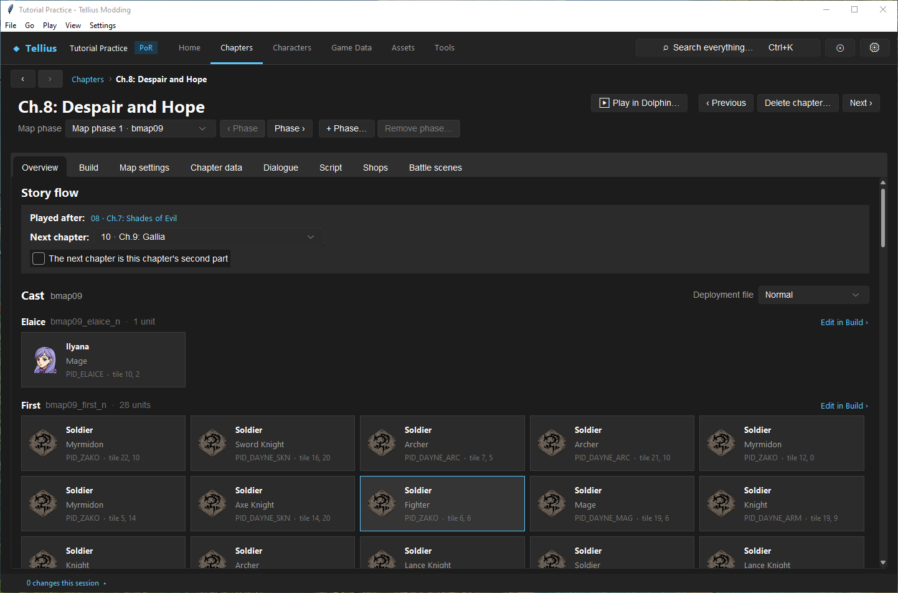
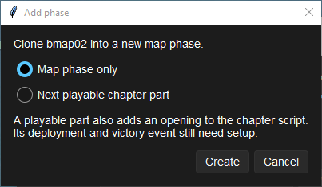
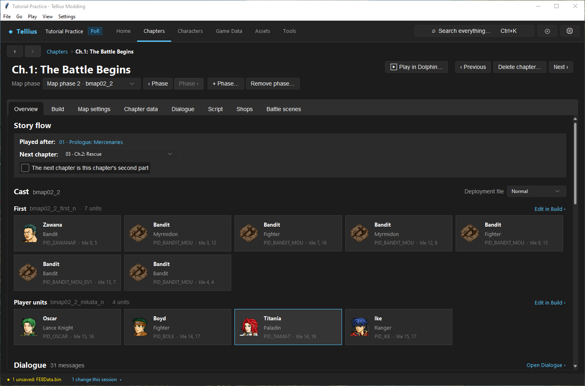
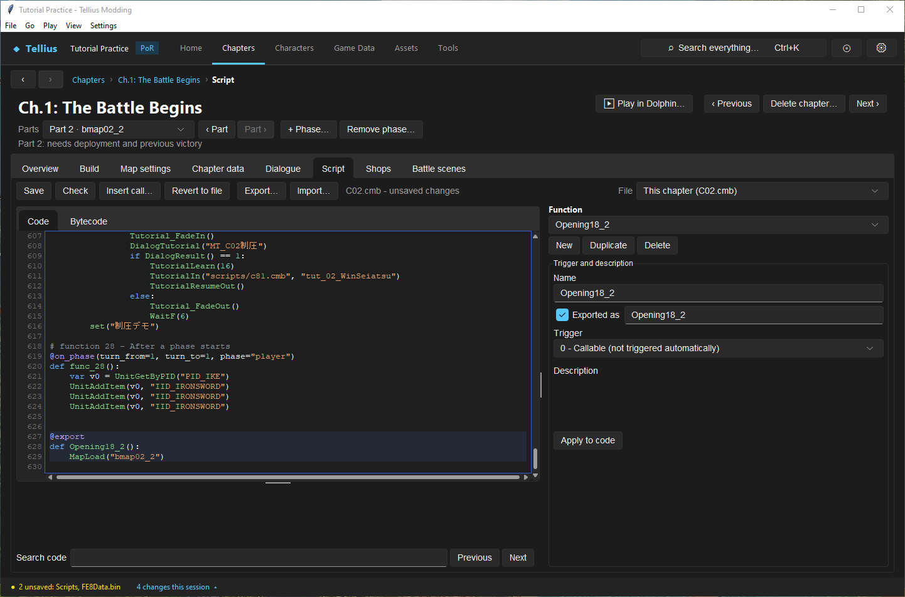
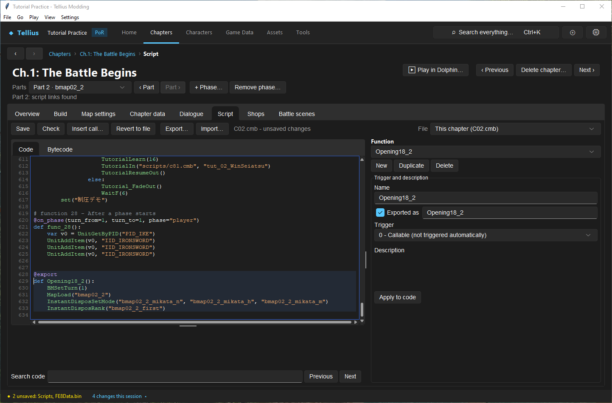

# Manage chapter parts and phases

**Route:** a chapter's header → **Map phase** / **Parts**, **+ Phase…**, **Remove phase…**; **Overview** → **The next chapter is this chapter's second part**

## What you will make

You will give Ch.1 a second map folder, remove it, then add it again as a **playable part**: a second battle after the first one's victory, in the same chapter. You will link the part in the script until the app reports *script links found*. At the end you can choose between the three ways to put more than one map in a chapter, and you know what each one changes in the game.

## Before you begin

- [Understand a chapter's parts](06-chapter-anatomy.md) and [Work with chapter IDs and story order](07-chapter-ids-and-story-flow.md).
- A copy of the project folder: a playable part also changes `main.dol` (a Game Code entry) and the chapter script.
- [Edit, compile, and test event scripts](33-script-editor.md) for step 4.

## How the editor fits together

A chapter can use several map folders, `bmapNN`, `bmapNN_2`, `bmapNN_3`… Each holds its own `map.cmp` and `dispos.cmp`. The game loads one when the chapter script calls `MapLoad("…")`. There are three ways to use more than one:

| Way | How the game plays it | Retail example | Made with |
| --- | --- | --- | --- |
| **Map phase** | The script switches maps inside one battle or cutscene, e.g. an opening scene on another map | Ch.5 opens on `bmap06_2`, then fights on `bmap06`; Ch.8 has five folders | **+ Phase…** › **Map phase only**, then your own `MapLoad` calls |
| **Playable part** | One chapter number, several battles. Each battle but the last ends with `Complete18(part)`: no new chapter, the save menu opens, then `Opening18_2`, `_3` or `_4` sets up the next battle | Ch.17: Day Breaks (slot 18), four battles | **+ Phase…** › **Next playable chapter part** |
| **Two-part chapter** | Two chapter numbers played as one: no save menu between them, the army is not sorted out, support points are not counted again, the war record shows two rows | Ch.27 is slots 28 and 29 | **Overview** › **The next chapter is this chapter's second part** ([Work with chapter IDs and story order](07-chapter-ids-and-story-flow.md)) |

A chapter has at most four playable parts. When the script loads a folder from a numbered part opening, the header calls the list **Parts** instead of **Map phase**.

Support points: retail counts them at the start of every battle map, except in Ch.17's later parts. When you add a playable part to any other chapter, the app turns on the Game Code entry **Count supports once in split chapters**, so the points are counted once for the whole chapter.

## Guided walkthrough

### 1. Look at a chapter with several phases

<!-- screenshot 65-c-phases.png -->
<figure class="tutorial-figure" markdown="1">

[](../assets/images/tutorials/screenshots/65-c-phases.png)

<figcaption markdown="span">Ch.8: Despair and Hope (slot 09) has five map phases, `bmap09` to `bmap09_5`: **Map phase** lists them in play order and **‹ Phase** / **Phase ›** step through them. Only the script's `MapLoad` calls decide when the game loads each one.</figcaption>
</figure>

Open Ch.8: Despair and Hope (slot 09). **Map phase** lists *Map phase 1 · bmap09* to *Map phase 5 · bmap09_5*. Press **Phase ›** four times: the Overview's cast changes with each folder. On the **Script** tab, **Search code** `MapLoad` finds where each folder is loaded.

### 2. Add a map phase

<!-- screenshot 65-a-setup.png -->
<figure class="tutorial-figure" markdown="1">

[](../assets/images/tutorials/screenshots/65-a-setup.png)

<figcaption markdown="span">**+ Phase…** on Ch.1: *Clone bmap02 into a new map phase.* **Map phase only** copies the folder; **Next playable chapter part** also adds an opening for it to the chapter script.</figcaption>
</figure>

1. Open Ch.1: The Battle Begins (slot 02), **Overview**.
2. Press **+ Phase…**. The dialog reads *Clone bmap02 into a new map phase.*
3. Keep **Map phase only** and press **Create**.

<!-- screenshot 65-d-map.png -->
<figure class="tutorial-figure" markdown="1">

[](../assets/images/tutorials/screenshots/65-d-map.png)

<figcaption markdown="span">After **Create** with **Map phase only**: *Map phase 2 · bmap02_2*, a copy of `bmap02` whose sections are renamed (`bmap02_2_first_n`…). No script loads it yet, so the game never shows it; **Remove phase…** deletes it again.</figcaption>
</figure>

The header shows *Map phase 2 · bmap02_2*. The new folder is a copy of `bmap02` with its sections renamed (`bmap02_2_first_n`, `bmap02_2_mikata_n`…), and `FE8Data.bin` has a new **Battle scenes** row for it (the status bar shows *1 unsaved: FE8Data.bin*). No script names it, so the game never loads it.

### 3. Remove it

Press **Remove phase…**. The confirmation asks *Delete zmap/bmap02_2 and its map and deployment files?* and adds that its Battle scenes row goes too. **Yes** deletes the folder; the list is back to one phase. **Remove phase…** is refused while any script still names the folder (*The chapter script still references bmap02_2. Remove those references first.*), and it is disabled on the first folder.

### 4. Add a playable part

<!-- screenshot 65-b-result.png -->
<figure class="tutorial-figure" markdown="1">

[](../assets/images/tutorials/screenshots/65-b-result.png)

<figcaption markdown="span">With **Next playable chapter part**: the header now says **Parts** (*Part 2 · bmap02_2*) and *Part 2: needs deployment and previous victory*; the Script tab shows the new, unsaved `Opening18_2` with its `MapLoad("bmap02_2")`.</figcaption>
</figure>

1. Press **+ Phase…** again, choose **Next playable chapter part**, **Create**.
2. A message explains what is left: *Opening18_2 now loads bmap02_2. In the Script tab, add deployment calls for its copied sections and change the preceding battle's victory path to Complete18(1).* It adds that **Count supports once in split chapters** is now on.
3. The page opens the **Script** tab on the new, unsaved function:

    ```python
    @export
    def Opening18_2():
        MapLoad("bmap02_2")
    ```

4. The header now says **Parts**, *Part 2 · bmap02_2*, and under it *Part 2: needs deployment and previous victory*.

### 5. Link the part

<!-- screenshot 65-e-linked.png -->
<figure class="tutorial-figure" markdown="1">

[](../assets/images/tutorials/screenshots/65-e-linked.png)

<figcaption markdown="span">The part linked: `Complete18(1)` ends part 1's victory function `func_20`, and `Opening18_2` sets turn 1, loads `bmap02_2` and deploys its player and enemy sections. The status reads *Part 2: script links found*; **Save** writes `C02.cmb` once it compiles.</figcaption>
</figure>

1. Pick `func_20` in **Function**: it is Ch.1's victory, triggered by `@on_complete(flag="gf_complete")` when Ike seizes. At its end, after `func_7()`, add `Complete18(1)`. Part 1 now ends the battle without leaving the chapter.
2. Pick `Opening18_2` and make it set up the battle:

    ```python
    @export
    def Opening18_2():
        BMSetTurn(1)
        MapLoad("bmap02_2")
        InstantDisposSetMode("bmap02_2_mikata_n", "bmap02_2_mikata_h", "bmap02_2_mikata_m")
        InstantDisposRank("bmap02_2_first")
    ```

    `BMSetTurn(1)` restarts the turn count; the two calls place the player and enemy sections of the difficulty being played.
3. The status reads *Part 2: script links found*. Press **Check**, then **Save**.
4. On **Build**, with *Part 2 · bmap02_2* selected, edit the second battle's units and map; **Save Chapter** saves that folder. Then **Save FE8Data.bin** for the battle-scene row.

The second battle reuses part 1's script: its turn events (`@on_phase(turn_from=1…)`), boss lines and victory flag are still registered. Give part-specific events their own guards ([Build reliable chapter events](35-event-recipes.md)). To undo this whole step, restore your project copy, or remove the `Opening18_2` function and the `Complete18(1)` call, **Save**, then **Remove phase…**.

## Understand every control

| Control | What it does | How to choose |
| --- | --- | --- |
| **Map phase** / **Parts** list | The chapter's folders in play order. Switching asks first when the map or deployment has unsaved edits. | |
| **‹ Phase** / **Phase ›** (**‹ Part** / **Part ›**) | The previous or next folder | |
| **+ Phase…** | Copies the shown folder into the next free number (`bmap02_2`, `_3`…), renames its sections and copies its Battle scenes row. Asks to save unsaved map and deployment edits first. | Select the folder to copy before pressing it |
| **Map phase only** | Only the copy | A cutscene map or an in-battle map change you script yourself |
| **Next playable chapter part** | The copy, an `Opening18_N` that loads it, and the support Game Code entry | A new battle in the same chapter (up to four) |
| **Create** / **Cancel** | Make the copy / close | |
| **Remove phase…** | Deletes the shown folder and its Battle scenes row. Refused while a script names the folder; disabled on the first. | |
| Part status | *Part N: script links found*, or *needs deployment*, *needs previous victory*, or both | Follow it until it says *script links found* |
| **The next chapter is this chapter's second part** (Overview) | Makes the transition to the next chapter work like Ch.27's 28 → 29 | Two records that should play as one chapter |

Refusals of **Next playable chapter part**: *Chapter part openings have a gap* (an `Opening18_3` without `Opening18_2`), *The game supports at most four playable parts per chapter.*, *This chapter has no script to hold a playable part.*

## Things to try next

1. **A cutscene map.** Add a **Map phase only** copy, put a few units in its Common file on **Build**, and in the opening add `MapLoad("bmap02_2")`, `InstantDispos("bmap02_2_…_c")`, a `TalkEvent`, then `MapLoad("bmap02")` before the battle, as Ch.5 does.
2. **Read retail parts.** In Ch.17 (slot 18), find `Complete18(1)` at the end of `func_82` and the `Opening18_2` that follows.
3. **Compare with two-part chapters.** On Ch.27 (slot 28), read the note under **Story flow** about chapters 28 and 29.

## Interactions and precedence

- The game loads only what the script names. A folder no script names is never played, and the app does not warn about it.
- Playable parts keep one chapter number, so one record, one message file, one script, one set of chapter flags. Two-part chapters use two of each.
- Between parts the save menu opens; a save made there resumes at the next part's opening.
- Events registered in part 1 stay active in part 2.
- The support Game Code entry changes `main.dol` for every split chapter; Ch.17 plays as in retail.

## Test matrix

| Case | Setup | Expected result |
| --- | --- | --- |
| Baseline | Ch.1 unmodified | One map phase |
| Intended change | **Map phase only** | *Map phase 2 · bmap02_2*; game unchanged |
| Boundary | **Remove phase…** on it | Back to one phase |
| Intended change | **Next playable chapter part**, then step 5 | *Part 2: script links found*; script compiles |
| Likely failure | **Remove phase…** with `Opening18_2` saved | Refused: the script still references `bmap02_2` |
| In game | Ch.1 won | The save menu opens, then the second battle starts on turn 1 (Dolphin) |

## Troubleshooting

| Symptom | Likely cause | What to do |
| --- | --- | --- |
| The second battle never starts | Part 1's victory does not call `Complete18(1)` | Add it at the end of the victory function |
| The second battle has no units | `Opening18_2` deploys nothing, or names sections that do not exist | Use the section names shown on **Overview** for that part |
| Part 2 starts at the turn part 1 ended | No `BMSetTurn(1)` | Add it at the start of the opening |
| Part 1's boss talk plays again | Events of part 1 are still registered | Guard them with a flag |
| Supports rise twice as fast | The Game Code entry is off | **Tools › Game Code** › **Count supports once in split chapters** |
| **Remove phase…** refused | A saved script names the folder | Remove the references and save first |

## Save, build, and revert

**+ Phase…** writes the new folder at once; the Battle scenes row needs **Save FE8Data.bin**; the opening needs **Save** on the Script tab. **Remove phase…** deletes the folder at once. Build and test the whole chapter from a save made before it.

## Limits and confidence

- Phase cloning, removal, the part check and the support entry are source-reviewed; steps 1–5 were done in the app on a US disc and then reverted (app-tested). The step 5 script compiles and passes the part check.
- The game behaviour of `Complete18` parts comes from the engine study in [Chapters](../systems/chapters.md), whose recorded test added a second battle to the Prologue. This lesson's Ch.1 part was not played in Dolphin (unknown).

## Related tutorials and references

- Before: [Work with chapter IDs and story order](07-chapter-ids-and-story-flow.md)
- Next: [Create a campaign skeleton](08-new-campaign-wizard.md)
- Also: [Edit, compile, and test event scripts](33-script-editor.md), [Apply engine tweaks](57-game-code.md)
- Reference: [Chapters](../systems/chapters.md), [New Game & Campaign Flow](../systems/campaign-flow.md)

---

[← Previous: Work with chapter IDs and story order](07-chapter-ids-and-story-flow.md) · [All tutorials](index.md) · [Next: Create a campaign skeleton →](08-new-campaign-wizard.md)
