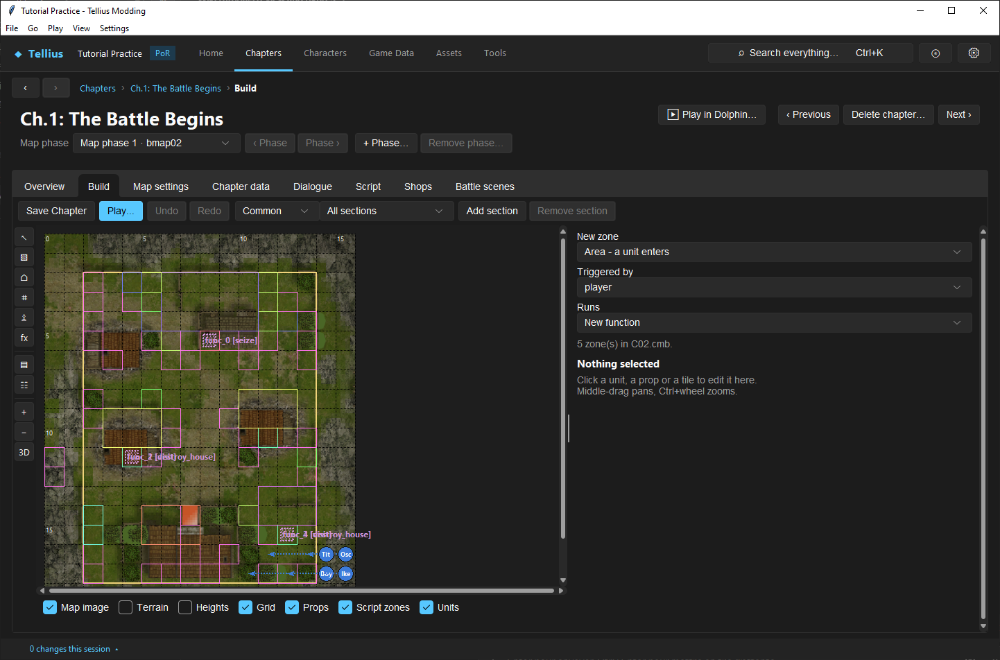
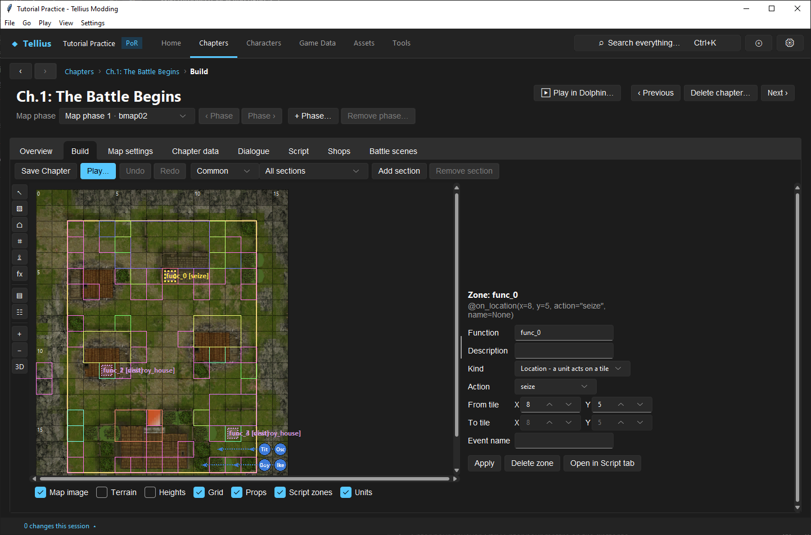
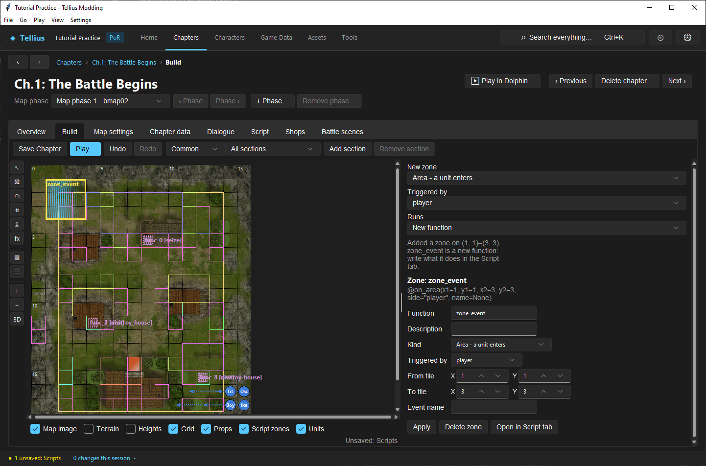
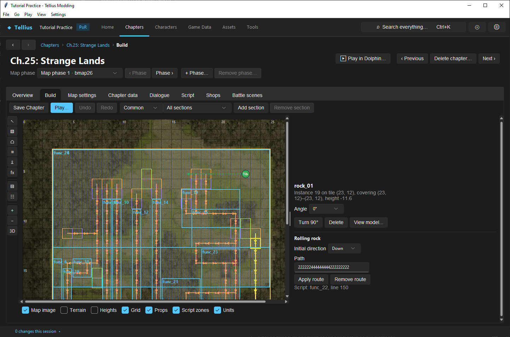

# Place script zones and rolling rocks on the map

**Route:** a chapter's **Build** → the **Script function / zone** tool; a rock prop → **Rolling rock**

## What you will make

You will read Ch.1's seize zone, draw a new area zone that runs a function when a player unit enters it, and read a rolling rock's route on Ch.25. At the end you know which trigger each zone writes into the chapter script, which tile a rock's `SetRock` call uses, and which edits the Build tab makes for you and which belong on the Script tab.

## Before you begin

- [Use the map Build tab](21-map-build-basics.md) and [Edit, compile, and test event scripts](33-script-editor.md).
- The chapter's script open in the Script tab (the Build tab edits the open chapter script; it says *Open this chapter's script* when another file is shown).

## How the editor fits together

A zone is a script function with a map trigger. The Build tab draws them and writes them; the Script tab holds them:

| Zone kind | Trigger it writes | Fires when | Retail example |
| --- | --- | --- | --- |
| *Area - a unit enters* | `@on_area(x1, y1, x2, y2, side, name)` | a unit of the chosen army (**Triggered by** *player*, *enemy*, *ally*, *partner*, *any*) acts inside the rectangle | Ch.25's rock triggers, `@on_area(x1=3, y1=14, x2=3, y2=27, side="player", name="F03140327")` |
| *Location - a unit acts on a tile* | `@on_location(x, y, action, name)` | a unit takes the **Action** on that tile: *visit*, *door*, *chest*, *seize*, *escape*, *destroy_house*, *arrive*, *other* | Ch.1's seize, `@on_location(x=8, y=5, action="seize")` |

For an area, `name` is the event's label; retail functions set a flag of the same name (`set("F03140327")`) so the event runs once. For a talk or a fight, `name` is the one-time flag itself ([Recruit by talk and make a boss](14-recruitment-and-bosses.md)).

A rolling rock is two things: a rock prop in the map (`rock_01` in `map.bin`) and a `SetRock(x, y, direction, path)` call in the script that makes it a terrain entry with a route. The route is a string registered with `TTPMEntry("…")`, one digit per step: 4 left, 6 right, 2 down, 8 up. Retail Ch.25 registers all eleven routes in `Startup` (`TTPMInit()` then eleven `TTPMEntry`) and calls each `SetRock` with the route's number; every rock prop sits one tile from its call's tile, in the call's initial direction (`SetRock(4, 11, 2, 0)`, prop on 5, 11). The Build tab follows the same layout. A script holds at most 32 routes; the longest retail route has 40 steps.

## Guided walkthrough

### 1. See the zones

<!-- screenshot 66-a-setup.png -->
<figure class="tutorial-figure" markdown="1">

[](../assets/images/tutorials/screenshots/66-a-setup.png)

<figcaption markdown="span">The **Script function / zone** tool on Ch.1: the pink rectangles are the script's zones (the seize tile, the village visits). The panel makes a **New zone**: its kind, what it is **Triggered by** and the function it **Runs**.</figcaption>
</figure>

1. Open Ch.1: The Battle Begins › **Build**. Tick **Script zones** under the map.
2. Choose the **Script function / zone** tool (fx in the tool column). The pink rectangles are the script's zones, each labelled with its function: `func_0 [seize]`, `func_2 [visit/destroy_house]`… The panel says *5 zone(s) in C02.cmb.*

### 2. Read a zone

<!-- screenshot 66-c-zone.png -->
<figure class="tutorial-figure" markdown="1">

[](../assets/images/tutorials/screenshots/66-c-zone.png)

<figcaption markdown="span">Ch.1's seize zone selected: `func_0`, *Location - a unit acts on a tile*, **Action** *seize* at (8, 5). **Apply** writes a change into the script, **Delete zone** removes the trigger, **Open in Script tab** shows the function (`set("gf_complete")`).</figcaption>
</figure>

With the select tool, click the seize tile (8, 5). The panel shows **Zone: func_0** with its trigger, `@on_location(x=8, y=5, action="seize", name=None)`, then **Function**, **Description**, **Kind** *Location - a unit acts on a tile*, **Action** *seize*, **From tile** 8, 5, **Event name**. **Open in Script tab** shows the function: `set("gf_complete")`, the flag that wins the chapter.

### 3. Draw a new zone

<!-- screenshot 66-b-result.png -->
<figure class="tutorial-figure" markdown="1">

[](../assets/images/tutorials/screenshots/66-b-result.png)

<figcaption markdown="span">A new **Area** zone drawn on tiles (1, 1)–(3, 3), **Triggered by** the player's units: the chapter script gets a new, empty function with an `@on_area` trigger (unsaved until **Save** on the Script tab). Write what it does there.</figcaption>
</figure>

1. Back on the zone tool: **New zone** *Area - a unit enters*, **Triggered by** *player*, **Runs** *New function*.
2. Drag over tiles (1, 1)–(3, 3).
3. The note reads *Added a zone on (1, 1)–(3, 3). zone_event is a new function: write what it does in the Script tab.* The chapter script now ends with an empty `zone_event` under `@on_area(x1=1, y1=1, x2=3, y2=3, side="player", name=None)`; the status bar shows *1 unsaved: Scripts*.
4. Open it in the Script tab and give it a body, for example a line of dialogue and a one-time flag:

    ```python
    @on_area(x1=1, y1=1, x2=3, y2=3, side="player", name="TUTORIAL_CORNER")
    def zone_event():
        set("TUTORIAL_CORNER")
        TalkEvent("MS_02_TUTORIAL_CORNER")
    ```

    Register `TUTORIAL_CORNER` in `Startup` with `regist(...)`, **Check**, **Save**. (This lesson's capture reverted the script instead.)

Drag a selected zone to move it, or edit its tiles in the panel; **Undo** and **Redo** cover zone edits. **Delete zone** removes the trigger; an empty function goes with it, a function with code stays, marked UNUSED.

### 4. Read a rolling rock

<!-- screenshot 66-d-rock.png -->
<figure class="tutorial-figure" markdown="1">

[](../assets/images/tutorials/screenshots/66-d-rock.png)

<figcaption markdown="span">Ch.25 (slot 26): a rolling-rock prop selected. Under **Rolling rock**: the **Initial direction** and the **Path** (one digit per step: 4 left, 6 right, 2 down, 8 up) of its `SetRock` call, **Apply route** and **Remove route**, and the script line that holds it.</figcaption>
</figure>

1. Open Ch.25: Strange Lands (slot 26) › **Build**. Each rock's route is drawn as arrows from the rock.
2. Click the rock on (23, 12). Under **Rolling rock**: **Initial direction** *Down*, **Path** `222222444444444222222222`, **Apply route**, **Remove route**, and *Script: func_22, line 150* (`SetRock(23, 11, 4, 10)`, route 10 of `Startup`'s list).
3. Change the path and press **Apply route**: the app edits that route's `TTPMEntry` (or gives the rock its own when the route is shared). Moving the prop moves its `SetRock` call with it; deleting the prop removes the call and keeps the route's slot, so the other rocks' numbers stay.

For a new rock, place a `rock_01` prop ([Place, copy, import, and configure props](24-map-props.md)), select it, and **Add route**: the call goes into `RegistLocationTT`.

## Understand every control

### Zone tool (New zone)

| Control | What it does |
| --- | --- |
| **New zone** | *Area - a unit enters* or *Location - a unit acts on a tile* |
| **Triggered by** / **Action** | The army (area) or the action (location) that fires it |
| **Runs** | *New function*, or an existing function without a trigger (UNUSED ones first) that takes the zone's trigger |
| Drag on the map | Draws the zone (one tile for a location) |
| Note line | What the last edit did; *Open this chapter's script* when the shown script is another file |

### Selected zone

| Control | What it does |
| --- | --- |
| **Function**, **Description** | The function's name and comment |
| **Kind**, **Triggered by** / **Action** | The trigger kind and its army or action |
| **From tile** / **To tile** (**X**, **Y**) | The rectangle (a location uses only **From tile**) |
| **Event name** | The trigger's name label |
| **Apply** | Writes the fields into the script |
| **Delete zone** | Removes the trigger (and an empty function) |
| **Open in Script tab** | Shows the function |

### Rolling rock (a rock prop selected)

| Control | What it does |
| --- | --- |
| **Initial direction** | *Left*, *Right*, *Down*, *Up*: the first step from the call's tile to the rock |
| **Path** | The route: 4 left, 6 right, 2 down, 8 up, up to 40 steps |
| **Apply route** / **Add route** | Edits or creates the call and its route |
| **Remove route** | Removes the call, keeping the route's slot |
| *Script: func_N, line L* | Where the call is |
| *Several SetRock calls use this tile. Edit them in the Script tab.*, *This call needs editing in the Script tab.* | Calls the Build tab will not rewrite |

A player unit that should move by itself (an escort, a unit to rescue) is set on its unit panel: **AI-controlled unit** under **AI** ([Create common AI orders](44-common-ai-orders.md)).

## Things to try next

1. **A village.** Draw a *Location* zone with **Action** *visit* on a house tile and give its function a `TalkEvent` and an item.
2. **An enemy trigger.** Draw an area **Triggered by** *enemy* in front of a gate and make it set a flag the boss reacts to.
3. **Copy a rock.** On Ch.25, read `Startup`'s eleven `TTPMEntry` lines and match each to a rock on the map.

## Interactions and precedence

- Zone edits are script edits: unsaved until **Save** on the Script tab, and part of its **Revert to file**.
- Set a flag named after the area in its function, as retail does, so it runs once; without one, test whether it repeats.
- The `side` and `action` values are the game's; *any* is 65535.
- A rock route changes only the script. The prop's position, its model and the tiles' terrain are the map's ([Paint terrain and control movement](22-paint-terrain-and-blocking.md)).

## Test matrix

| Case | Setup | Expected result |
| --- | --- | --- |
| Baseline | Ch.1, zone tool | *5 zone(s) in C02.cmb.* |
| Intended change | Area zone (1, 1)–(3, 3), player | New `zone_event` with `@on_area(x1=1, y1=1, x2=3, y2=3, side="player", …)` |
| Boundary | **Delete zone** on the empty new zone | Trigger and function gone |
| Rock | Ch.25, rock on (23, 12) | *Down*, 24-step path, `func_22` line 150 |
| In game | A player unit enters the area | The function runs once (Dolphin) |

## Troubleshooting

| Symptom | Likely cause | What to do |
| --- | --- | --- |
| No zones drawn | **Script zones** unticked, or another script shown | Tick it; open this chapter's script |
| The zone never fires | Wrong army in **Triggered by**, or its flag already set | Check the trigger; a new save |
| It fires again and again | No flag set in its function | `set("<name>")` with the name registered in `Startup` |
| A rock shows **Add route** instead of its route | Its call is not on the tile one step behind it, or not a plain `SetRock` line | Read the call in the Script tab |
| *All 32 rolling-rock route slots may be used.* | 32 `TTPMEntry` lines | Reuse a route for rocks that roll the same way |

## Save, build, and revert

Zone and rock edits wait in the Script tab: **Save** there writes `Scripts/CNN.cmb`, **Revert to file** drops them. Prop moves and deletions are map edits: **Save Chapter**.

## Limits and confidence

- The triggers, the route format and the controls are source-reviewed. Reading Ch.1's zones, drawing an area zone and reading Ch.25's rocks were done in the app on a US disc, then reverted (app-tested).
- That a prop sits one step from its `SetRock` tile is read from all eleven retail rocks, not from the game code; how the game uses each tile in play is unknown here.

## Related tutorials and references

- Before: [Use the map Build tab](21-map-build-basics.md), [Edit, compile, and test event scripts](33-script-editor.md)
- Also: [Build reliable chapter events](35-event-recipes.md), [Place, copy, import, and configure props](24-map-props.md)
- Reference: [Script Functions](../systems/script-functions.md)

---

[← Previous: Edit, compile, and test event scripts](33-script-editor.md) · [All tutorials](index.md) · [Next: Use chapter and campaign flags →](34-event-flags.md)
