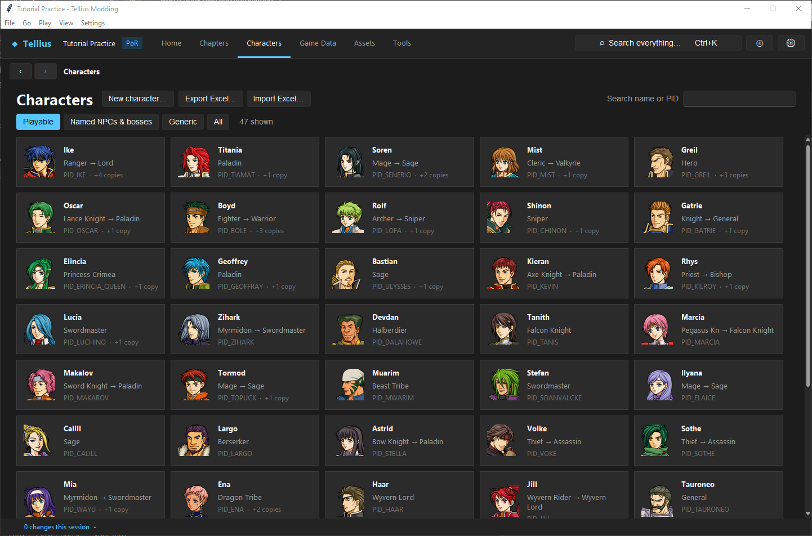
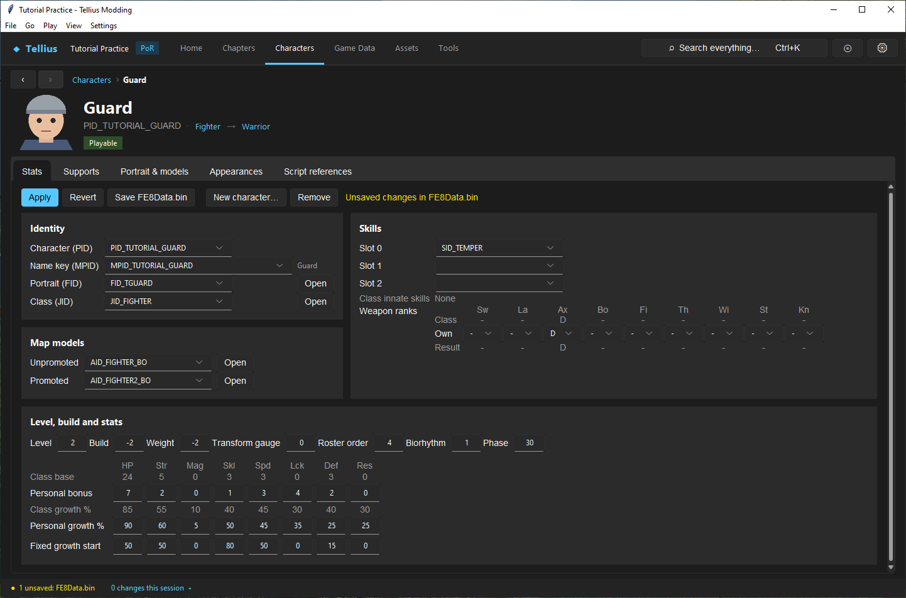
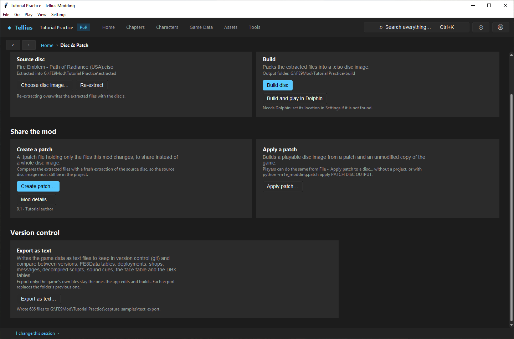

# Edit data in bulk outside the app

**Route:** Characters → **Export Excel…** / **Import Excel…**; Game Data → Items, Terrain; a chapter's Build → **Units list**; Dialogue → **Export chapter…**; Script → **Export…**; Game Data → Flags; Disc & Patch → **Export as text…**

## What you will make

You will export every character to a workbook, change one growth rate in a spreadsheet program, import it back, and save. You will see what the import refuses. Then you will export the whole project as text files for version control. At the end you know which tables can make the round trip, which exports are one-way, and where each file goes back in.

## Before you begin

- A spreadsheet program that reads and writes `.xlsx` (LibreOffice Calc, Excel, Google Sheets with a download).
- `PID_TUTORIAL_GUARD` from [Create a character](10-create-character.md), or any record you can change and change back.
- A copy of the project folder.

## How the editor fits together

Every round trip has the same shape: the app writes a file, you edit it elsewhere, the app reads it back, checks every row, and applies it to the editor's copy in memory. Nothing is written to the game files until you save that editor, and a file with one bad row changes nothing.

| Data | Export / import | File | Back in with |
| --- | --- | --- | --- |
| Characters | **Characters › Export Excel…** / **Import Excel…** | `.xlsx`, sheet *Characters*: one row per record, columns `pid`, `mpid`, `fid`, `jid`, `sid0`–`sid2`, `aid_unpromoted`, `aid_promoted`, `level`, `build`, `weight`, `weapon_ranks`, `roster_order`, biorhythm, `stat_bonus_*`, `growth_*`, `fixed_growth_start_*` | **Save FE8Data.bin** |
| Items, terrain | **Game Data › Items** / **Terrain**, **Export Excel…** / **Import Excel…** (only on those two tabs) | `.xlsx`, sheet *Items* or *Terrain* | **Save FE8Data.bin** |
| A chapter's deployment | **Build** › **Units list** (☷ in the tool column) › **Export Excel…** / **Import Excel…** | `.xlsx`, one sheet per difficulty file, one row per unit, flags as yes/no columns | **Save Chapter** |
| Script flags | **Game Data › Flags** › **Export Excel…** / **Import Excel…** | `.xlsx`, *Campaign Flags* and *Chapter Flags*; import only appends new names | the scripts it rewrites |
| A chapter's dialogue | **Dialogue** › **Export chapter…** / **Import chapter…** | UTF-8 `.txt`: `=== MESSAGE_ID ===` then the text as the editor shows it | **Save Chapter** on Dialogue |
| A script | **Script** › **Export…** / **Import…** | `.fe9s` source in the app's script language | **Save** on Script |
| Everything, read-only | **Disc & Patch › Export as text…** | a folder of JSON, TSV and text files | nothing: export only |

## Guided walkthrough

### 1. Export the characters

<!-- screenshot 67-a-setup.png -->
<figure class="tutorial-figure" markdown="1">

<figcaption markdown="span">**Characters**: search by name or PID, **New character…**, and **Export Excel… / Import Excel…** for editing every character in a spreadsheet.</figcaption>
</figure>

1. Open **Characters** and press **Export Excel…**.
2. Save as `characters.xlsx` (*Export characters*). The workbook has one sheet, *Characters*, with a header row and 341 rows on a US disc: the first column is `index`, the record's number, then `pid` and the fields.

### 2. Edit it elsewhere

Open the workbook in your spreadsheet program. Find the row whose `pid` is `PID_TUTORIAL_GUARD` and change `growth_hp` from 75 to 90. Save it, keeping the `.xlsx` format. Each row is matched to its record by the `index` column and each column by its header, so sorting rows is safe; do not change `index` or the headers. An empty cell keeps the record's value.

### 3. Import it

<!-- screenshot 67-b-result.png -->
<figure class="tutorial-figure" markdown="1">

<figcaption markdown="span">After **Import Excel…** of a workbook whose `PID_TUTORIAL_GUARD` row has `growth_hp` 90: the Guard's **Personal growth %** HP reads 90 and the status bar names FE8Data.bin as unsaved. Nothing is written until **Save FE8Data.bin**.</figcaption>
</figure>

1. Press **Import Excel…** and pick the workbook (*Import characters*).
2. Open the Guard: **Personal growth %** HP reads 90; the bar reads *Unsaved changes in FE8Data.bin*.
3. Press **Save FE8Data.bin**, or **Revert** / **Discard unsaved edits** to drop the import.

### 4. See what an import refuses

Set the Guard's `jid` to `JID_NOPE`, save the workbook and import again. The app shows *Excel import has errors*: *Characters row 342: Label 'JID_NOPE' not found anywhere in this file.* Put `abc` in `growth_hp`: *Characters row 342: growth_hp must be a whole number*. In both cases nothing changed. The row number counts the header row.

### 5. Export the project as text

<!-- screenshot 67-c-text.png -->
<figure class="tutorial-figure" markdown="1">

<figcaption markdown="span">**Disc & Patch › Export as text…** into a chosen folder: *Wrote 686 files to …	ext_export.* FE8Data tables, deployments, shops, messages, decompiled scripts, sound cues, the face table and the DBX tables, as text for git and diffs.</figcaption>
</figure>

1. Open **Disc & Patch**, scroll to **Version control**, press **Export as text…** and choose a folder, for example `text_export` inside a git repository.
2. The line under the button reads *Wrote 686 files to …\text_export.* The folder holds `FE8Data/` (characters, classes, items, skills, chapters, terrain, battle scenes and skies, army groups, difficulty, as JSON), `deployments/<map folder>/dispos_<n|h|m|c>.json`, `shops/`, `messages/` (`## ID` then the text), `scripts/` (decompiled `.fe9s`), `sound/`, `faces.tsv` and `zdbx/`.
3. Commit it. After your next edits, export again into the same folder (it is replaced) and read the diff: only what you changed differs.

## Understand every control

| Control | What it does |
| --- | --- |
| **Export Excel…** | Writes the table to a new workbook; the file chooser names what is exported (*Export characters*, *Export items*, *Export deployment*, *Export flags*) |
| **Import Excel…** | Reads a workbook, checks every row, then applies it in memory; *Excel import has errors* lists up to 30 problems and applies nothing |
| **Units list** › **Export Excel…** / **Import Excel…** | The open chapter phase's deployment files |
| **Export chapter…** / **Import chapter…** | The chapter's messages as one text file; import changes the texts of the IDs it contains and adds the IDs that are new (*Imported: N changed, M added*, or *Import: no change*) |
| **Export…** / **Import…** (Script) | The open script as a `.fe9s` source file; import compiles it before replacing |
| **Export as text…** | The whole project as text, into the chosen folder, replacing the previous export |

## Things to try next

1. **Many growths at once.** Sort the workbook by `jid`, give every `JID_FIGHTER` row +10 `growth_str` with a formula, paste the values over the formulas, and import.
2. **Translate a chapter.** **Export chapter…** on Ch.1, translate the text under each `===` line, **Import chapter…**, read a few messages in the preview, **Save Chapter**.
3. **Review a mod in git.** Export as text before and after [Create a campaign skeleton](08-new-campaign-wizard.md) and read which files changed.

## Interactions and precedence

- An import only fills the editor's copy; the build uses saved files. Save after importing.
- A workbook made from an older version of the project can carry old values back: export again before a new edit session.
- Character and item rows are matched by their `index` column. A new row does not add a record and a deleted row does not remove one: use **New character…** and **Remove** in the app.
- Labels (`PID_`, `JID_`, `IID_`, `SID_`) must already exist in `FE8Data.bin`.
- **Export as text…** never writes game files: you cannot build from it.

## Test matrix

| Case | Setup | Expected result |
| --- | --- | --- |
| Baseline | Export, import unchanged | No change; nothing unsaved |
| Intended change | `growth_hp` 90 for the Guard | HP growth 90; *Unsaved changes in FE8Data.bin* |
| Boundary | Import, then **Revert** | Back to 75 |
| Likely failure | `jid` `JID_NOPE` | *Label 'JID_NOPE' not found anywhere in this file.*; nothing applied |
| Text export | **Export as text…** | *Wrote N files to …*; same files on a second export without edits |

## Troubleshooting

| Symptom | Likely cause | What to do |
| --- | --- | --- |
| *Excel import has errors* with many rows | The spreadsheet program changed numbers to text or dates | Format the columns as numbers; re-export and redo the edit |
| An import changed other records | An `index` cell was edited or filled down | Revert, export again, leave `index` alone |
| The game still shows old values | Imported but not saved, or not rebuilt | Save, then build |
| Flag import refused | It renames or reorders existing flags | Only append new names ([Design, register, and test event flags](34-event-flags.md)) |
| Dialogue import says *The file does not start with a === MESSAGE_ID === line.* | Text before the first marker | Keep only `#` comments before it |

## Save, build, and revert

Each import is undone by its editor's revert before saving (**Revert**, **Discard unsaved edits**, closing the chapter without saving). After saving, restore from your project copy, or import the workbook you exported before editing.

## Limits and confidence

- The formats, the checks and the save owners are source-reviewed. The character round trip, both refusals and the text export were run in the app on a US disc (app-tested), with the workbook edited by the app's own reader and writer rather than a spreadsheet program.
- Spreadsheet programs differ in how they store numbers and empty cells; check one small edit with yours before a big one.

## Related tutorials and references

- Before: [Create a character](10-create-character.md)
- Also: [Place and tune units by difficulty](30-deployment-by-difficulty.md), [Design, register, and test event flags](34-event-flags.md), [Package and share a mod](61-share-a-patch.md)
- Reference: [Fe8Data](../formats/fe8data.md)

---

[← Previous: Remove records without corrupting saves](15-remove-records.md) · [All tutorials](index.md) · [Next: Edit classes →](16-classes.md)
