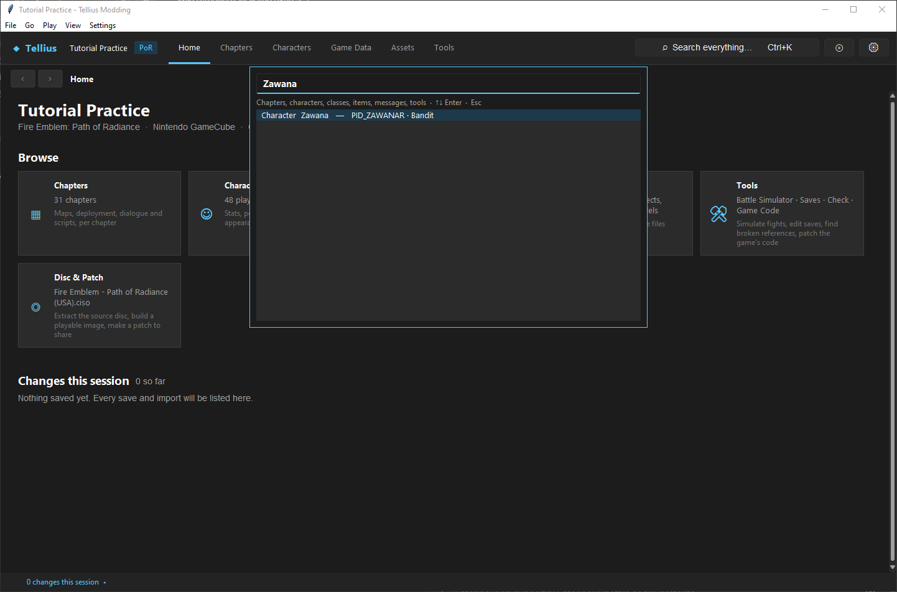
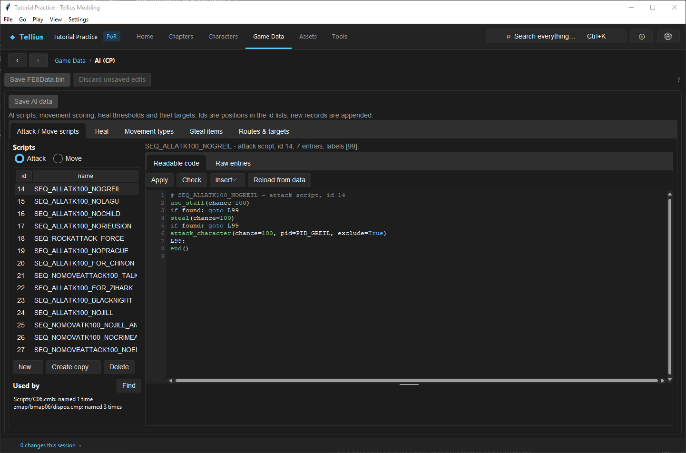

# Find where a record is used

**Route:** Ctrl+K; a character's **Appearances** and **Script references**; Game Data → AI (CP) → **Used by**; **Remove** on any record

## What you will make

You will answer "who uses this?" for a character, an AI script and an item before changing them: Zawana, Ch.1's boss; `SEQ_ALLATK100_NOGREIL`, an attack script; `IID_IRONAXE`, the Iron Axe. At the end you know which tool answers the question for each kind of record, and what each one does not see.

## Before you begin

- The practice project, extracted and indexed ([Tour the workspace](02-workspace-tour.md)).
- Change nothing in this lesson.

## How the editor fits together

Records are found by their ID (`PID_ZAWANAR`, `IID_IRONAXE`, `SEQ_…`, `RID_…`). Each tool searches for that ID where that kind of record can be named:

| You want the users of… | Tool | It searches |
| --- | --- | --- |
| A character | **Appearances** and **Script references** on its page | Every deployment row and every message (portrait or speaker); every script function whose code or trigger names its PID or name key |
| Any `FE8Data.bin` record (character, class, item, skill…) | **Remove** on its page: the refusal lists the users | Pointer fields of `FE8Data.bin` (support lists, bonds, skill lists, other records) and the strings of every script, deployment, shop file, `zdbx.cmp`, `FE8Anim.bin` and `main.dol` ([Remove records without corrupting saves](15-remove-records.md)) |
| An AI script | **Game Data › AI (CP)** › **Used by** › **Find** | Other AI scripts of `cp_data.bin`, then the same game files |
| A resource (`RID_`) | **Game Data › Rect RIDs** › **Referenced in** | Scripts and data that name it ([Lay out screens with Rect RIDs](72-rect-rids.md)) |
| An icon | **Assets › Icons**: *used by* under the selected icon | Items and skills with that icon number |
| A flag | **Game Data › Flags** | Every script that registers, sets, clears or tests it ([Design, register, and test event flags](34-event-flags.md)) |
| A message or a line of dialogue | Ctrl+K, the words of the text; the chapter's Dialogue | Every chapter message |
| A model | **3D Models › Model tables…** › **Which models does a character get?** | The battle job list and the animation IDs ([Give a character unique models](12-character-model-slot.md)) |
| A chapter | Its **Overview**: **Played after:** | The story table ([Work with chapter IDs and story order](07-chapter-ids-and-story-flow.md)) |
| Anything else | **Disc & Patch › Export as text…**, then a text search in the folder | Every table, deployment, message and decompiled script as text ([Edit data in bulk outside the app](67-bulk-edit.md)) |

## Guided walkthrough

### 1. Find a character

<!-- screenshot 68-a-setup.png -->
<figure class="tutorial-figure" markdown="1">

<figcaption markdown="span">**Ctrl+K** *Zawana*: one row, *Character Zawana — PID_ZAWANAR · Bandit*. The search matches record names and IDs, and the words of every chapter message; his name is in no message text, so no *Message* row appears.</figcaption>
</figure>

Press **Ctrl+K** and type `Zawana`: one row, *Character Zawana — PID_ZAWANAR · Bandit*. The search matches names, IDs and the words of every chapter message; no message text says "Zawana", so no *Message* row appears. Press Enter.

### 2. Read its users

1. Open **Appearances**. **Deployed in** lists every deployment row of `PID_ZAWANAR`: Ch.1's `bmap02_first_n`, `_h` and `_m`. **Dialogue** lists the messages that show his portrait or name him as speaker (his boss lines `MS_02_BT…`, his death line `MS_02_DIE`). Double-click a row to open it.
2. Open **Script references**: five functions of `C02.cmb`. `func_11` and `func_14` name `PID_ZAWANAR` in their code (the opening and turn 1); `func_17` and `func_18` name him in their `@on_battle` trigger (his quotes) and `func_19` in its `@on_death` trigger ([Recruit by talk and make a boss](14-recruitment-and-bosses.md)).

### 3. Find an AI script's users

<!-- screenshot 68-b-result.png -->
<figure class="tutorial-figure" markdown="1">

<figcaption markdown="span">**Game Data › AI (CP)**, `SEQ_ALLATK100_NOGREIL` selected, **Used by** › **Find**: *Scripts/C06.cmb: named 1 time* (Ch.5's script switches Dakova to it) and *zmap/bmap06/dispos.cmp: named 3 times* (units that start with it). The same file search runs before every **Remove**.</figcaption>
</figure>

Open **Game Data › AI (CP)**, select `SEQ_ALLATK100_NOGREIL` (attack, id 14) and press **Find** next to **Used by**: *Scripts/C06.cmb: named 1 time* (Ch.5 switches Dakova to it on turn 4) and *zmap/bmap06/dispos.cmp: named 3 times* (three units start with it). *nothing names it* means the script is free to change or remove.

### 4. Find an item's users

On **Game Data › Items**, select `IID_IRONAXE` and press **Remove**. The app refuses: *IID_IRONAXE is still used*, then the first 14 of 39 places, starting with *zmap/bmap02/dispos.cmp: named 4 times*, and *Point them at another record first.* Nothing changed. The refusal is the complete reference check; use it as a search whenever you want to know whether a record is free.

## Understand every control

| Control | Where | What it shows |
| --- | --- | --- |
| Ctrl+K | Everywhere | Sections, tools, chapters, characters, classes, items, skills, every message; ↑/↓, Enter, Esc |
| **Appearances** › **Deployed in** | Character page | *N unit records*: **Chapter**, **Map**, **File**, **Section**, **Record**, **Class**, **Tile**; double-click opens the unit on **Build** |
| **Appearances** › **Dialogue** | Character page | **Chapter**, **Message**, **As** (*portrait* or *speaker*), **Text**; double-click opens the message |
| **Script references** | Character page | **Chapter**, **Function**, **Uses** (the PID or name key), from the functions' code and from their triggers; functions are named as the Script tab names them |
| **Used by** › **Find** | Game Data › AI (CP) | *cp_data.bin: &lt;script&gt;* rows, then *&lt;file&gt;: named N times* rows |
| **Remove** refusal | Any record's page | Up to 14 places, then *… and N more* |
| **Referenced in (N)** | Game Data › Rect RIDs | The files that name the selected RID |
| *used by* | Assets › Icons | The items and skills of the selected icon |

## Things to try next

1. **A class.** Press **Remove** on `JID_FIGHTER` in Game Data › Classes and read who uses it.
2. **A free AI script.** Find an AI script whose **Used by** says *nothing names it*.
3. **A whole-project search.** Export as text and search the folder for `PID_ZAWANAR`: compare with the character's two tabs.

## Interactions and precedence

- The character tabs read the project index, which is rebuilt after saves; right after an unsaved edit they show the saved state.
- The searches look for IDs as whole strings in the files they know. An ID built at run time from pieces, or a raw number (a table position), is not found.
- **Check** finds the opposite case: names that point to nothing ([Check a project and fix problems](05-check-project.md)).

## Test matrix

| Question | Tool | Expected result (US disc) |
| --- | --- | --- |
| Who deploys Zawana? | **Appearances** | Ch.1's three first sections |
| Who names `SEQ_ALLATK100_NOGREIL`? | **Used by** › **Find** | `C06.cmb` once, `bmap06/dispos.cmp` three times |
| Who uses `IID_IRONAXE`? | **Remove** | Refused, 39 places |
| A new character nothing uses | **Appearances** | *Not found in any deployment file or chapter message.* |

## Troubleshooting

| Symptom | Likely cause | What to do |
| --- | --- | --- |
| A new record is not found | The index has not been rebuilt | Save, or reopen the project |
| **Script references** shows `func_N` | The script was saved outside the app, so no kept source names its functions | Open the Script tab; names come from your saved source |
| *Searching the game files...* stays | A large project | Wait; the search runs in the background |
| The game uses something the search missed | A name built at run time, or a table position | Search the text export; read the script |

## Save, build, and revert

Nothing in this lesson writes a file. A refused **Remove** changes nothing.

## Limits and confidence

- What each tool searches is source-reviewed; the four questions of the walkthrough were asked in the app on a US disc (app-tested).
- No tool follows a reference made by number or computed at run time.

## Related tutorials and references

- Before: [Tour the workspace](02-workspace-tour.md)
- Also: [Remove records without corrupting saves](15-remove-records.md), [Check a project and fix problems](05-check-project.md)

---

[← Previous: Check a project and fix problems](05-check-project.md) · [All tutorials](index.md) · [Next: Understand a chapter's parts →](06-chapter-anatomy.md)
