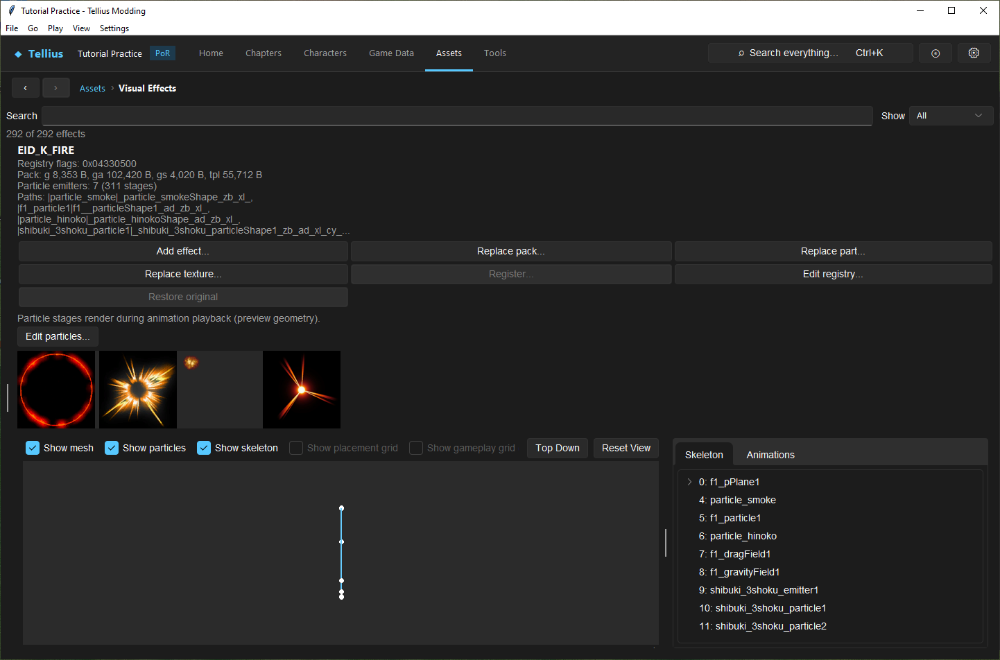
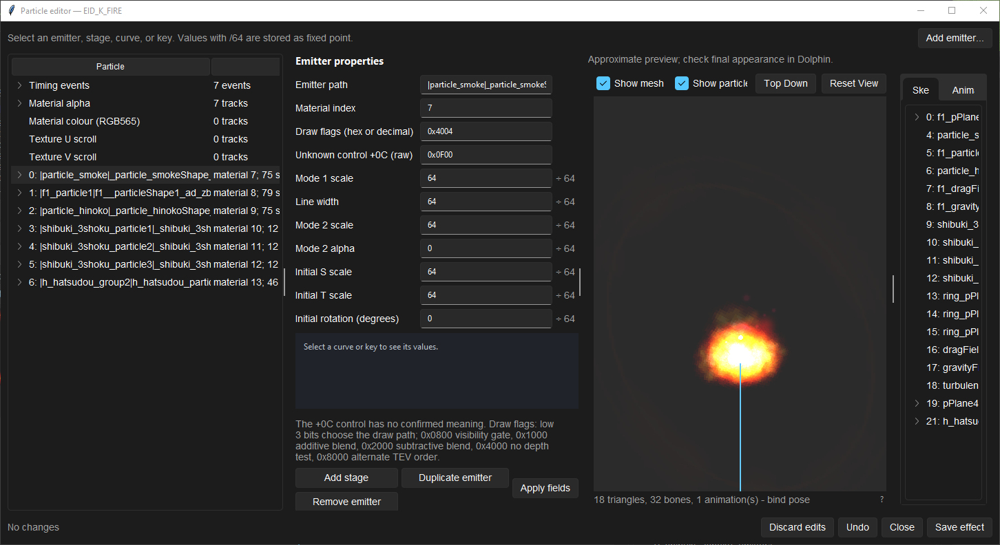
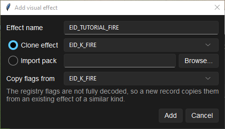

# Edit visual effects and particles

**Route:** Assets → Visual Effects

## What you will make

You will open the Fire tome's spell effect, read how it is built (a registry record, a pack of model, animation and textures, and particle emitters), inspect one emitter in the particle editor, and prepare a copy of the effect under a new name that a weapon could use instead of the original. At the end you can tell which part of an effect to change for a new colour, a new texture or a new timing, and what only Dolphin can confirm.

!!! warning "Untested in game"
    Edited particles, replaced packs and new effects have not been checked in a recorded Dolphin session. The preview draws the raw animation only: the game's own timing and sequencing of effects are not decoded.

## Before you begin

- Know which effect you want: a weapon names its effects in **Battle Weapons** (the Fire tome: **Effect** `EID_K_FIRE`), see [Edit battle presentation](55-battle-presentation.md).
- Keep a copy of any image or `.cmp` file you will import.

## How the editor fits together

An effect has two parts:

- a **registry record** in `FE8Effect.bin`: its `EID_` name, a flags word (only partly decoded: byte 0 looks like a category, byte 2 is always 5) and, for 53 effects, the next effect in a **chain** that plays after it;
- a **pack** in `yme/<EID_NAME>.cmp`: an ordinary model set, with a skeleton (`.g`), an animation (`.ga`) that also holds the particle table and timing events, a mesh (`.gs`) and textures (`.tpl`).

The page lists every registered effect plus any pack without a record (*unregistered*). The **Status** column says which, and *no pack* marks a record with no file. Changes are written at once and the first write of a file keeps its original for **Restore original**.

## Guided walkthrough

### 1. Read an effect

<!-- screenshot 69-a-setup.png -->
<figure class="tutorial-figure" markdown="1">

<figcaption markdown="span">**Assets › Visual Effects** with `EID_K_FIRE`, the Fire tome's spell: its registry flags, the parts of its `yme/` pack, its particle emitters, its textures and the animated preview.</figcaption>
</figure>

Open **Assets → Visual Effects**, type `K_FIRE` in **Search** and select `EID_K_FIRE`. The details read its **Registry flags** (`0x04330500`), the size of each part of its pack (g, ga, gs, tpl), and *Particle emitters: 7 (311 stages)* with the paths of the first emitters. Under the buttons are its textures and the animated preview; the **Skeleton** tab lists its nodes (`f1_pPlane1`, `particle_smoke`…).

### 2. Inspect its particles

<!-- screenshot 69-b-result.png -->
<figure class="tutorial-figure" markdown="1">

<figcaption markdown="span">**Edit particles…** on `EID_K_FIRE`: the **Timing events**, the material tracks (alpha, colour, texture scroll) and each emitter with its stages, curves and keys. Select one to edit its fields, **Apply fields**, then **Save effect**; the preview is approximate.</figcaption>
</figure>

Press **Edit particles…**. The tree lists the **Timing events** (7), the material tracks (**Material alpha**, **Material colour (RGB565)**, **Texture U scroll**, **Texture V scroll**) and the seven emitters. Select emitter `0: |particle_smoke|…`: **Emitter properties** shows its path, **Material index** 7, draw flags, scales and initial rotation. Values marked `÷ 64` are stored as fixed point. Open an emitter to reach its stages (frames and curves) and their keys; a selected curve is drawn in the chart.

Change a field, press **Apply fields**, and the preview plays the edit at once. **Save effect** writes the pack; **Undo**, **Discard edits** and **Close** leave without writing. Close it now without saving.

### 3. Prepare a copy

<!-- screenshot 69-c-add.png -->
<figure class="tutorial-figure" markdown="1">

<figcaption markdown="span">**Add effect…**: a new `EID_` name, then **Clone effect** (copy an existing pack) or **Import pack** (a `.cmp` file), and **Copy flags from** an effect whose registry flags fit.</figcaption>
</figure>

Press **Add effect…**. Set **Effect name** `EID_TUTORIAL_FIRE`, keep **Clone effect** on `EID_K_FIRE`, and **Copy flags from** `EID_K_FIRE` (the flags are not fully decoded, so a new record copies them from an effect of the same kind). **Add** writes the new pack and the registry record. To use it, select `FIRE` in **Battle Weapons** and set its **Effect** to `EID_TUTORIAL_FIRE`; edit the copy's particles or texture without touching the retail effect.

## Understand every control

| Control | What it does |
| --- | --- |
| **Search** / **Show** | Filter by name; **Show** All, Registered, Unregistered or Chained effects. |
| Table | **Effect**, **Cat.** (byte 0 of the flags), **Next in chain**, **Status**. |
| **Add effect…** | A new effect: name, then **Clone effect** (copy a registered effect's pack) or **Import pack** (a `.cmp` file, checked first), and **Copy flags from**. |
| **Replace pack…** | Replaces the whole pack with another `.cmp` (also gives a pack to a record that has none). |
| **Replace part…** | Replaces one part of the pack (`.g`, `.ga`, `.gs`, `.tpl`) with a file. |
| **Replace texture…** | Replaces one image of the pack's texture with a picture (it asks which when there are several), re-encoded in the stored format; a format the app cannot encode is refused. |
| **Register…** | Adds a registry record for an unregistered pack, keeping the pack. |
| **Edit registry…** | Edits the raw flags and the next effect in the chain (a chain that loops back is refused). |
| **Restore original** | Puts back the retail pack of the selected effect. |
| **Edit particles…** | Opens the particle editor (only when the animation has a particle table). |
| Textures | The pack's textures as thumbnails. |
| Preview | The pack played with its animation; particle stages render as preview geometry. |

### Particle editor

| Element | What it edits |
| --- | --- |
| **Timing events** | Frame and codes of each event; codes can move the effect, mark hits, play sounds and other game actions. Keep codes you do not know. |
| **Material alpha**, **Material colour (RGB565)**, **Texture U scroll**, **Texture V scroll** | One track per `.gs` material: keys as `frame:value` pairs, mode 0 interpolates, mode 1 holds. |
| Emitter | **Emitter path**, **Material index**, **Draw flags**, the unknown control at +0C (raw), mode scales, line width, mode 2 alpha, initial S/T scale and rotation. **Add stage**, **Duplicate emitter**, **Remove emitter**; **Add emitter…** at the top. |
| Stage | Start and end frame and its curves. |
| Curve / key | The channel, the value divisor shift, and frame/value keys, drawn in the chart. |
| **Apply fields** | Applies the shown fields to the effect in the editor. |
| **Save effect** / **Undo** / **Discard edits** / **Close** | Write the pack, undo the last change, drop all edits, close (asks when edits are unsaved). |

## Things to try next

1. **A new colour.** In the copy, change a key of **Material colour (RGB565)** and watch the preview.
2. **A new texture.** Draw an image of the same size as the copy's texture (its thumbnail shows the look), then **Replace texture…** on the copy.
3. **A chain.** Read `EID_BREATHRED` with **Show** Chained: its **Next in chain** plays after it.
4. **A slower spell.** Move a stage's end frame later and check where the hit lands in **Render fight**.

## Interactions and precedence

- A weapon, a skill or a script names an effect by its `EID_` name; the registry finds the pack by the same name. Renaming breaks every user.
- A tome's spell timing comes from its effect's events, not from the caster ([Battle Staging & Camera](../systems/battle-staging.md)).
- Editing a retail effect changes every user of it. Clone first when only one weapon should change.
- An emitter's material index must exist in the pack's mesh; the editor refuses a save that points past the last material.

## Test matrix

| Case | Setup | Expected result |
| --- | --- | --- |
| Baseline | `EID_K_FIRE` selected | 7 emitters, 311 stages, the fire preview |
| Intended change | Clone as `EID_TUTORIAL_FIRE`, Fire's **Effect** set to it | Fire plays the copy; the retail effect is unchanged |
| Boundary | **Add effect…** with a name that is not `EID_…` | Refused: names look like `EID_SOMETHING` |
| Likely failure | An emitter material index past the mesh's materials | **Save effect** refused with the material count |

## Troubleshooting

| Symptom | Likely cause | What to do |
| --- | --- | --- |
| **Edit particles…** is disabled | The effect's animation has no particle table, or it has no pack | Pick another effect, or **Replace pack…** |
| The preview shows nothing | The effect is made of particles only, or its nodes use flags the viewer does not pose | Read the details and the particle editor; check in the app's **Render fight** or Dolphin |
| *This effect changed since the particle editor opened* | The pack was replaced while the editor was open | Reopen the editor |
| The weapon plays no effect in game | The name in **Battle Weapons** is not registered | Check **Status**; **Register…** an unregistered pack |

## Save, build, and revert

Every action is written to the extracted files at once (the particle editor only on **Save effect**) and logged in **Changes this session**. **Restore original** reverts the selected effect's pack. A new effect is removed by restoring `FE8Effect.bin` and deleting its pack. Build the disc to test.

## Limits and confidence

- The registry and pack formats, the page and the particle editor are source-reviewed; the inspection and the clone dialog in this lesson were done in the app (app-tested).
- The registry flags are only partly decoded, and the meaning of the emitter control at +0C is not confirmed.
- The preview approximates particles and does not play the game's effect sequencing. Every visual result needs Dolphin.

## Related tutorials and references

- Before: [Edit battle presentation](55-battle-presentation.md)
- Next: [Edit battle cameras](70-battle-cameras.md), [Simulate and render a fight](56-battle-simulator.md)
- Reference: [FE8Effect.bin](../formats/fe8effect.md), [Battle Staging & Camera](../systems/battle-staging.md)

---

[← Previous: Troubleshoot crashes, missing data, and bad builds](64-troubleshooting.md) · [All tutorials](index.md) · [Next: Edit battle cameras →](70-battle-cameras.md)
