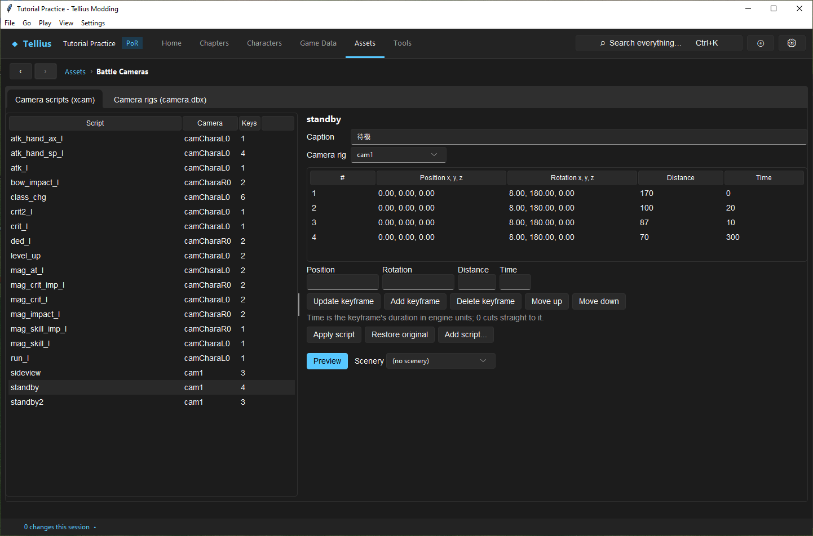
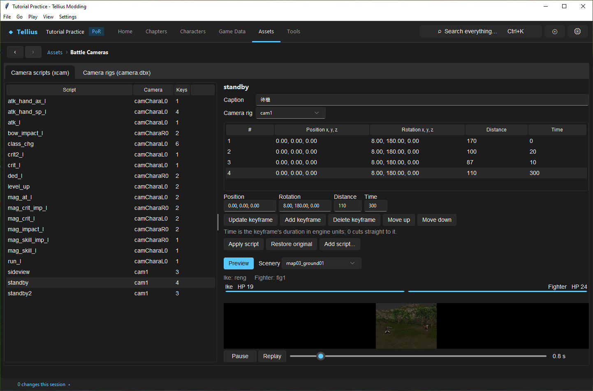
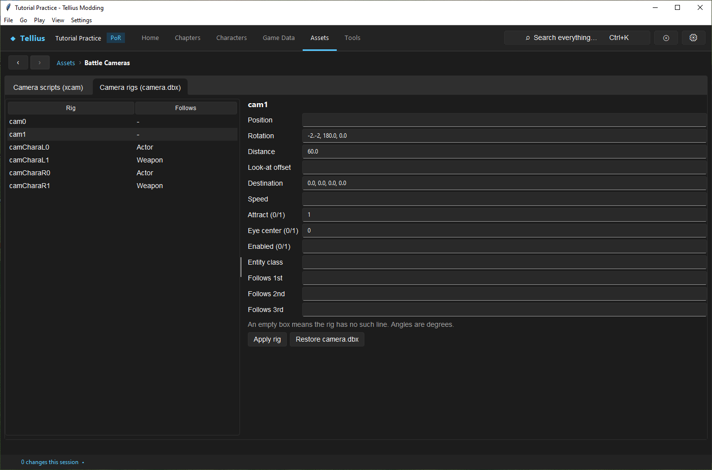

# Edit battle cameras

**Route:** Assets → Battle Cameras

## What you will make

You will change the camera that opens every melee fight so that it stops further away, watch the result in the page's preview before writing anything, then write it and restore it. On the way you will learn which camera script films which moment of a fight and what a camera rig is.

## Before you begin

- Read how a fight is filmed in [Battle Staging & Camera](../systems/battle-staging.md): which script plays when, and how per-model cameras take over most strikes.
- Have the fixture of [Simulate and render a fight](56-battle-simulator.md) ready for a second check.

## How the editor fits together

A battle is filmed by **camera scripts** played on **camera rigs**:

- A **script** (`xcam/<name>.dbx`) is a list of keyframes. Each keyframe has an offset (**Position**), a pitch/yaw/roll (**Rotation**), a **Distance** from what the rig looks at, and a **Time** in ticks to glide there (0 cuts straight to it). The script names the **Camera rig** it drives and a **Caption**.
- A **rig** (`zdbx/camera.dbx`) says what the camera looks at and follows: `cam1` the free camera of the opening, `camCharaL0` the striker, `camCharaR0` the one being struck, `camCharaL1`/`R1` their weapons.

The page lists the kind-of-strike scripts: `standby` (the opening zoom), `standby2` (the opening at range), `sideview` (the fixed side camera of the Combat Camera option), `atk_l`, `crit_l`, `crit2_l`, `ded_l` (death), `mag_*`, `atk_hand_ax_l`/`atk_hand_sp_l` (thrown axes and spears), `bow_impact_l`, `class_chg`, `level_up`, `run_l`. Only left-side scripts exist; the defender's strikes play them mirrored. Most class models also carry their own per-clip cameras (`xcam/<model>/cam.cmp`), which film most strikes instead of `atk_l`; those are not on this page.

**Apply script** and **Apply rig** write `zdbx.cmp` at once; the first edit of an entry keeps the original.

## Guided walkthrough

### 1. Read the opening camera

<!-- screenshot 70-a-setup.png -->
<figure class="tutorial-figure" markdown="1">

<figcaption markdown="span">**Assets › Battle Cameras**, **Camera scripts (xcam)** with `standby`, the zoom that opens a melee fight: rig `cam1`, four keyframes from distance 170 to 70 over 330 ticks.</figcaption>
</figure>

Open **Assets → Battle Cameras**, keep **Camera scripts (xcam)**, and select `standby`. It drives rig `cam1` with four keyframes, all at **Rotation** 8, 180, 0 (slightly above, side-on from the front): **Distance** 170 at time 0, then 100 over 20 ticks, 87 over 10, and 70 over 300. The fight opens wide and closes in.

### 2. Edit a keyframe and preview it

<!-- screenshot 70-b-result.png -->
<figure class="tutorial-figure" markdown="1">

<figcaption markdown="span">The last keyframe's **Distance** changed from 70 to 110 with **Update keyframe**, then **Preview**: the built-in fight (Ike against a Fighter) plays with the edited script, ending wider. **Apply script** would write it; nothing is written yet.</figcaption>
</figure>

1. Select keyframe 4. Its values fill **Position**, **Rotation**, **Distance** and **Time** under the table.
2. Set **Distance** to `110` and press **Update keyframe**. The table shows 110; nothing is written yet.
3. Press **Preview**. A short fight (Ike with an Iron Sword against a Fighter with an Iron Axe) plays below on the **Scenery** `map03_ground01`, with the script as edited driving the camera from the first frame. It ends wider than before.

### 3. Write it, then restore it

1. Press **Apply script**. The row is marked as edited and the change is listed in **Changes this session**.
2. Close the **Battle Simulator - fight** window if it is open, and **Render fight** the fixture: the opening stops at 110.
3. Back on `standby`, press **Restore original**.

### 4. Read a rig

<!-- screenshot 70-c-rigs.png -->
<figure class="tutorial-figure" markdown="1">

<figcaption markdown="span">**Camera rigs (camera.dbx)** with `cam1`, the free camera of the opening: position, rotation, distance, look-at offset, speed and the units it follows. **Apply rig** writes one rig; **Restore camera.dbx** restores them all.</figcaption>
</figure>

Open **Camera rigs (camera.dbx)** and select `cam1`: **Rotation** `-2,-2, 180.0, 0.0` (the retail file's own malformed value, kept as is), **Distance** 60, **Destination**, **Attract (0/1)** 1, **Eye center (0/1)** 0, no unit followed. Select `camCharaL0`: it follows the actor. A rig edit changes every script that uses it.

## Understand every control

### Camera scripts (xcam)

| Control | What it does |
| --- | --- |
| Script list | **Script**, **Camera** (its rig), **Keys** (keyframe count), edited mark. |
| **Caption** | The script's label (Japanese in the retail files). |
| **Camera rig** | The rig the script drives. |
| Keyframe table | **#**, **Position x, y, z**, **Rotation x, y, z**, **Distance**, **Time**. |
| **Position**, **Rotation**, **Distance**, **Time** | The selected keyframe's values. Position and rotation need three numbers (`0, 7, 0`); distance a number; time a whole number of ticks. |
| **Update keyframe** / **Add keyframe** / **Delete keyframe** / **Move up** / **Move down** | Edit the list in the page (a script needs at least one keyframe). |
| **Apply script** | Writes the script as edited. *No change.* when nothing differs. |
| **Restore original** | Puts back the retail script. |
| **Add script…** | A new script with one keyframe on the shown rig (name like `atk_custom_l`). It plays only where the game asks for that name. |
| **Preview** / **Scenery** | Plays the built-in short fight with the script as edited, on the chosen scenery. |

### Camera rigs (camera.dbx)

| Field | Meaning |
| --- | --- |
| **Position**, **Rotation**, **Distance** | The rig's starting placement (angles in degrees). |
| **Look-at offset** | Offset from the followed unit's camera bone (7 units up for the strike rigs). |
| **Destination**, **Speed**, **Attract (0/1)**, **Eye center (0/1)**, **Enabled (0/1)** | Movement and behaviour switches of the rig. |
| **Entity class**, **Follows 1st**, **Follows 2nd**, **Follows 3rd** | What the rig follows (the *Follows* column: Actor or Weapon). |
| **Apply rig** / **Restore camera.dbx** | Write one rig; restore the whole file. |

An empty box means the rig has no such line; a line cannot be emptied from the page.

## Things to try next

1. **A closer death.** Lower the last **Distance** of `ded_l` and fix a killing blow in the simulator.
2. **The fixed camera.** Edit `sideview` and set **Combat Camera** to Fixed in the game's options to see it in Dolphin.
3. **A cut.** Set a keyframe's **Time** to 0 in `standby` and preview: the camera jumps instead of gliding.

## Interactions and precedence

- A per-clip model camera (`xcam/<model>/cam.cmp`) replaces the kind-of-strike script for that strike; editing `atk_l` changes only strikes of models without one.
- `standby`, `bow_impact_l`, `ded_l` and the spell cameras always play.
- The defender's strikes play the left script mirrored: turns become 360° minus themselves and sideways offsets change sign.
- Unit parameters change where the actors are, and so what the camera frames ([Edit battle presentation](55-battle-presentation.md)).

## Test matrix

| Case | Setup | Expected result |
| --- | --- | --- |
| Baseline | `standby` unchanged, **Preview** | Zoom from 170 to 70 |
| Intended change | Keyframe 4 at 110, **Preview** | The opening ends wider; nothing written until **Apply script** |
| Boundary | **Time** 0 on a keyframe | A straight cut |
| Likely failure | **Rotation** with two numbers | Refused: three numbers are needed |

## Troubleshooting

| Symptom | Likely cause | What to do |
| --- | --- | --- |
| An `atk_l` edit never shows | The model has its own per-clip camera | Check the model's `xcam/<model>/cam.cmp` in [Battle Staging & Camera](../systems/battle-staging.md) |
| **Render fight** shows the old camera | The render window read the archive before the edit | Close it and render again |
| A rig field cannot be emptied | Lines are removed in the file only | Use **DBX Files** › **Text** on `zdbx/camera.dbx` |

## Save, build, and revert

**Apply script** and **Apply rig** write `zdbx.cmp` immediately; keyframe edits before that live in the page only. **Restore original** and **Restore camera.dbx** revert. Build the disc to test.

## Limits and confidence

- The script and rig formats and the camera model in the preview are source-reviewed against the engine description; the edit, preview and restore in this lesson were done in the app (app-tested).
- The preview uses a fixed fight; the in-game result needs Dolphin.

## Related tutorials and references

- Before: [Edit battle presentation](55-battle-presentation.md)
- Next: [Edit DBX files and the battle HUD](71-dbx-files-and-hud.md)
- Reference: [Battle Staging & Camera](../systems/battle-staging.md), [ZDBX & DBX](../formats/zdbx.md)

---

[← Previous: Edit visual effects and particles](69-visual-effects.md) · [All tutorials](index.md) · [Next: Edit DBX files and the battle HUD →](71-dbx-files-and-hud.md)
